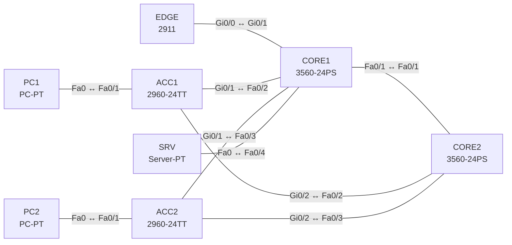

# Lab 01 – Netzwerkkomponenten, Topologien und Verkabelung

**Dauer:** 60 min · **Niveau:** leicht

Du baust ein SOHO-Netz und ein Campus-Netz in 2-Tier-Architektur, wählst jedes Kabel selbst (ohne die Auto-Verbindung von Packet Tracer) und ordnest jedem Gerät seine Rolle zu. Das Lab braucht fast keine Konfiguration; der Lerneffekt liegt in Entwurf, Kabelwahl und den Fragen.

**Lernziele:** Nach diesem Lab kannst du …

- Für jede Geräteverbindung das richtige Kabel wählen und begründen.
- Router, Switches, Firewall, AP, WLC und Server ihrer Rolle und ihrem Layer zuordnen.
- 2-Tier, 3-Tier und Spine-Leaf unterscheiden und einem Einsatz zuordnen.

| CCNA-Ziel | Thema |
|---|---|
| 1.1 | Rollen von Netzwerkkomponenten (Router, Switches, Firewall/IPS, AP, WLC, Endgeräte, Server, PoE) |
| 1.2 | Topologie-Architekturen (2-/3-Tier, Spine-Leaf, WAN, SOHO, On-Prem/Cloud) |
| 1.3 | Schnittstellen und Verkabelung (Kupfer, Glasfaser, shared media vs. P2P) |

**So arbeitest du:** Teil A = Bauen, Teil C = Üben (kein Reparatur-Teil: Das Lab besteht aus Aufbau und Fragen). Die Konfigurationsdateien liegen in `build/` (Ausgangszustand zum Einfügen in die CLI), `repair/` (fertig gebaut, mit Fehlern) und `solutions/` (Musterlösung und Fehlerliste, erst nach eigenem Versuch öffnen). Anleitung zum Einfügen: siehe [Arbeiten mit den Dateien](../README.md#arbeiten-mit-den-dateien).

## Topologie

Oben das Campus-Netz (2-Tier, Collapsed Core), das SOHO-Netz mit WRT300N baust du daneben als zweites, unabhängiges Netz.

### Geräte

| Gerät | Modell in Packet Tracer | Rolle |
|---|---|---|
| EDGE | 2911 | Edge-Router zum Provider |
| CORE1 | 3560-24PS | Collapsed Core / Distribution (L3) |
| CORE2 | 3560-24PS | Collapsed Core / Distribution (L3), Redundanz |
| ACC1 | 2960-24TT | Access-Switch Gebäude A (L2) |
| ACC2 | 2960-24TT | Access-Switch Gebäude B (L2) |
| PC1 | PC-PT | Endgerät |
| PC2 | PC-PT | Endgerät |
| SRV | Server-PT | Server |

### Verkabelung

| Von | Port | Nach | Port | Kabel |
|---|---|---|---|---|
| EDGE | Gi0/0 | CORE1 | Gi0/1 | Copper Straight-Through |
| CORE1 | Fa0/1 | CORE2 | Fa0/1 | Copper Cross-Over |
| ACC1 | Gi0/1 | CORE1 | Fa0/2 | Copper Cross-Over |
| ACC1 | Gi0/2 | CORE2 | Fa0/2 | Copper Cross-Over |
| ACC2 | Gi0/1 | CORE1 | Fa0/3 | Copper Cross-Over |
| ACC2 | Gi0/2 | CORE2 | Fa0/3 | Copper Cross-Over |
| PC1 | Fa0 | ACC1 | Fa0/1 | Copper Straight-Through |
| PC2 | Fa0 | ACC2 | Fa0/1 | Copper Straight-Through |
| SRV | Fa0 | CORE1 | Fa0/4 | Copper Straight-Through |

### Adressplan (Ausgangszustand)

| Gerät | Interface | Adresse | Maske | Gateway | DNS |
|---|---|---|---|---|---|
| PC1 | Fa0 (GUI) | 10.1.1.11 | 255.255.255.0 | 10.1.1.1 |  |
| PC2 | Fa0 (GUI) | 10.1.1.12 | 255.255.255.0 | 10.1.1.1 |  |
| SRV | Fa0 (GUI) | 10.1.1.100 | 255.255.255.0 | 10.1.1.1 |  |

> **Packet-Tracer-Hinweis:** PoE wird in Packet Tracer nur begrenzt simuliert. Die Konzepte (802.3af/at/bt) übst du in Teil C. Kabel im Menü „Connections“ manuell wählen, nicht den Blitz (Auto) verwenden.

## Teil A – Bauen

Arbeite die Schritte der Reihe nach ab. Jeder Schritt sagt dir, was du tust, woran du den Erfolg erkennst (**Prüfen**) und worüber du nachdenken sollst (**Denkfrage**). Die Antworten auf die Denkfragen stehen am Ende von Teil A.

1. **Campus bauen.** Platziere die Geräte aus der Tabelle. Verbinde sie von Hand nach der Verkabelungstabelle, ohne die Auto-Verbindung (Blitz). Regel: Straight-Through zwischen verschiedenen Geräteklassen, Cross-Over zwischen gleichen.
   - **Prüfen:** Alle Link-LEDs werden grün.
   - **Denkfrage:** Bei welchen Verbindungen wäre der Kabeltyp dank Auto-MDIX egal? Und warum fragt Cisco trotzdem nach der klassischen Regel?
2. **Rollen zuordnen.** Beschrifte jedes Gerät mit einer Notiz: Access-Layer, Distribution/Core, Edge-Router, Endgerät oder Server.
   - **Denkfrage:** Welche Geräte arbeiten auf Layer 2, welche auf Layer 3?
3. **SOHO bauen.** Baue ein zweites Netz: ein WRT300N, zwei PCs per Kabel an Eth1 und Eth2, ein Laptop per WLAN. Der Port „Internet“ führt nach außen.
   - **Prüfen:** Die PCs bekommen per DHCP eine Adresse aus 192.168.0.0/24, der Laptop verbindet sich mit der SSID „SOHO“.
   - **Denkfrage:** Welche Funktionen stecken in diesem einen Gerät?
4. **Topologie bewerten.** Zeichne dasselbe Campus-Netz auf Papier einmal als 3-Tier und einmal als Spine-Leaf.
   - **Denkfrage:** Wann lohnt sich die dritte Ebene, wann Spine-Leaf?
5. **Glasfaser wählen.** Stell dir vor, der Uplink ACC1–CORE1 wird auf Glasfaser umgestellt.
   - **Denkfrage:** Welche Faser nimmst du bei 300 m, welche bei 10 km?
6. **Collapsed Core prüfen.** Sieh dir den Link zwischen CORE1 und CORE2 an.
   - **Denkfrage:** Wozu dient er, und was fehlt ohne ihn?

Antworten zu den Denkfragen

- **Zu 1:** Auto-MDIX erkennt die Belegung und tauscht Senden und Empfangen selbst. Dann funktionieren auch Switch–Switch oder PC–Router mit Straight-Through. Die Prüfung fragt die Regel trotzdem ab, weil sie zeigt, ob du verstehst, welche Geräte auf welchen Adern senden.
- **Zu 2:** Layer 2: Access-Switches. Layer 3: Router, Firewall und Multilayer-Switches im Core. Endgeräte und Server arbeiten auf allen Schichten, leiten aber nichts für andere weiter.
- **Zu 3:** Router mit NAT, Switch für die LAN-Ports, Access Point für das WLAN, DHCP-Server und oft eine einfache Firewall.
- **Zu 4:** Die dritte Ebene (Core) lohnt sich, sobald viele Distribution-Blöcke verbunden werden müssen, z. B. mehrere Gebäude. Spine-Leaf passt ins Rechenzentrum: Jeder Leaf hängt an jedem Spine, jeder Weg ist gleich lang. Das passt zu viel Ost-West-Verkehr zwischen Servern.
- **Zu 5:** 300 m schafft Multimode-Faser (OM3/OM4). Für 10 km brauchst du Singlemode-Faser mit passenden Optiken (z. B. LR).
- **Zu 6:** Er verbindet die beiden Core-Switches. Ohne ihn müsste Verkehr zwischen den Cores über einen Access-Switch laufen, und fällt ein Uplink aus, kann ein Teil des Netzes abgeschnitten werden.

## Verifikation

| Prüfung | Das solltest du sehen |
|---|---|
| Link-LEDs | alle grün, jeder Port wie in der Tabelle belegt (Mauszeiger zeigt den Portnamen) |
| Ping zwischen zwei Campus-PCs (10.1.1.0/24, IP von Hand) | Antwort über CORE1/CORE2, ohne VLAN-Konfiguration |
| SOHO | Laptop im WLAN „SOHO“, PCs mit einer Adresse aus 192.168.0.0/24 per DHCP |

## Teil C – Üben

Beantworte zuerst selbst, dann klappe die Antwort auf.

1. Welches Kabel verbindet (a) PC↔Switch, (b) Switch↔Switch, (c) Router↔Router, (d) PC↔Router, (e) PC↔Konsolenport des Routers?

Antwort

**(a) Straight-Through, (b) Cross-Over, (c) Cross-Over, (d) Cross-Over, (e) Konsolenkabel (Rollover).** Regel: gleiche Geräteklasse → Cross-Over, verschiedene → Straight-Through. PC und Router zählen dabei zur selben Klasse. Mit Auto-MDIX gehen (b) bis (d) auch mit Straight-Through.

2. Nenne drei Unterschiede zwischen Singlemode- und Multimode-Faser.

Antwort

**Kern, Lichtquelle und Reichweite.** Singlemode hat einen dünnen Kern (etwa 9 µm), nutzt einen Laser und schafft viele Kilometer, die Optiken sind teurer. Multimode hat einen dicken Kern (50 oder 62,5 µm), nutzt LED oder VCSEL und reicht nur einige hundert Meter, ist dafür günstiger.

3. Was ist Shared Media, was Point-to-Point bei Ethernet?

Antwort

**Shared Media: viele Stationen teilen ein Medium. Point-to-Point: genau zwei Geräte an einem Link.** Shared Media (Hub, Koax) läuft halbduplex mit CSMA/CD, Kollisionen sind normal. Point-to-Point (Switch-Port zu Gerät) läuft vollduplex, Kollisionen gibt es nicht.

4. Wofür steht PoE, und welche Standards kennst du?

Antwort

**Power over Ethernet: Strom über das Datenkabel.** 802.3af (PoE, bis 15,4 W am Switch-Port), 802.3at (PoE+, 30 W), 802.3bt (PoE++, 60 bzw. 90 W). Typisch für IP-Telefone, Access Points und Kameras.

5. Was unterscheidet eine NGFW von einer klassischen Firewall, und wo steht ein IPS?

Antwort

**Die NGFW erkennt zusätzlich Anwendungen, Benutzer und Inhalte.** Eine klassische Firewall sieht nur Adressen, Ports und Verbindungszustand. Ein IPS sucht im Datenstrom nach Angriffsmustern und blockiert sie, wenn es inline steht. Man setzt es an den Übergang ins Internet oder vor schützenswerte Zonen.

6. Wann nimmst du 2-Tier, 3-Tier oder Spine-Leaf?

Antwort

**2-Tier für kleine und mittlere Standorte, 3-Tier für große Campus, Spine-Leaf im Rechenzentrum.** 2-Tier fasst Distribution und Core zusammen (Collapsed Core). 3-Tier trennt sie, damit viele Gebäude sauber skalieren. Spine-Leaf bietet gleich lange Wege für viel Verkehr zwischen Servern.

7. Was unterscheidet On-Premises- von Cloud-Betrieb, und was heißt das für die WAN-Anbindung?

Antwort

**On-Premises läuft im eigenen Haus, Cloud beim Anbieter. Mit der Cloud wird der Internetzugang zum kritischen Pfad.** Dann zählen Bandbreite und Redundanz am Übergang nach außen deutlich mehr, z. B. zwei Provider oder eine Direktanbindung.

## Prüfungsbezug

- Router trennen Broadcast-Domänen und routen zwischen Netzen. L2-Switches leiten nach der MAC-Tabelle weiter, L3-Switches routen zusätzlich über SVIs.
- Firewall und IPS filtern und prüfen Verkehr. Ein WLC steuert Lightweight-APs zentral. PoE versorgt Endgeräte über das Datenkabel.
- 2-Tier (Collapsed Core) für kleine und mittlere Campus, 3-Tier für große, Spine-Leaf im Rechenzentrum.
- Straight-Through zwischen verschiedenen Klassen (PC–Switch, Router–Switch), Cross-Over zwischen gleichen (Switch–Switch, Router–Router, PC–Router).
- Multimode für Hunderte Meter, Singlemode für Kilometer.

## Lösungen

- `solutions/<Gerät>.cfg`: Konfiguration zu Teil A (ohne Basis-Adressen)
