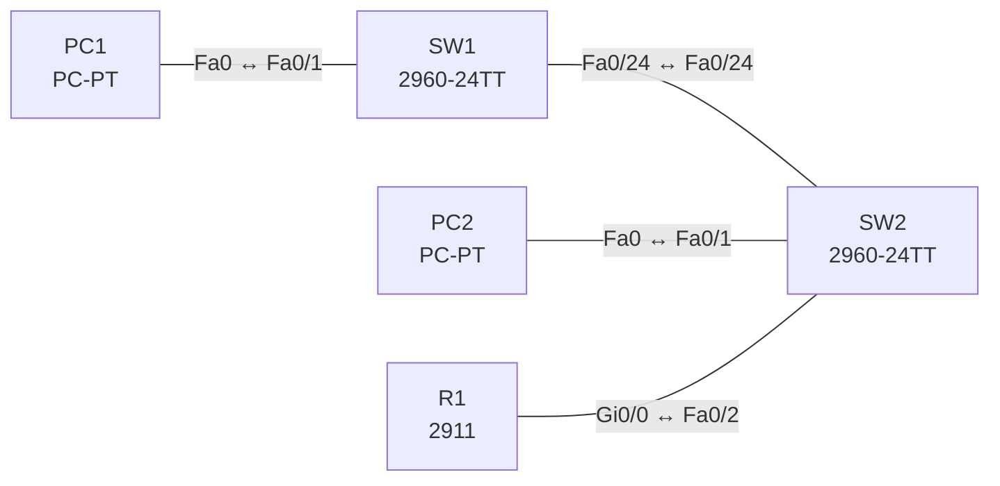

# Lab 02 – Schnittstellen- und Kabelprobleme (Duplex, Speed, Fehler)

**Dauer:** 60 min · **Niveau:** leicht

Typische Layer-1/2-Störungen finden: administrativ down, Speed- und Duplex-Mismatch, falsche Maske am Endgerät. Du liest `show interfaces`, `show interfaces status` und die Zähler (Kollisionen, CRC, Runts, Giants).

**Lernziele:** Nach diesem Lab kannst du …

- Die Statuszeile von `show interfaces` lesen und Layer 1 von Layer 2 trennen.
- Speed- und Duplex-Mismatch erzeugen, erkennen und beheben.
- Fehlerzähler (CRC, Runts, Giants, Late Collisions) einer Ursache zuordnen.

| CCNA-Ziel | Thema |
|---|---|
| 1.4 | Schnittstellen- und Kabelprobleme (Kollisionen, Fehler, Duplex, Speed) |
| 1.3 | Schnittstellen und Verkabelung (Kupfer, Glasfaser, shared media vs. P2P) |

**So arbeitest du:** Teil A = Bauen, Teil B = Reparieren, Teil C = Üben. Die Konfigurationsdateien liegen in `build/` (Ausgangszustand zum Einfügen in die CLI), `repair/` (fertig gebaut, mit Fehlern) und `solutions/` (Musterlösung und Fehlerliste, erst nach eigenem Versuch öffnen). Anleitung zum Einfügen: siehe [Arbeiten mit den Dateien](../README.md#arbeiten-mit-den-dateien).

## Topologie




### Geräte

| Gerät | Modell in Packet Tracer | Rolle |
|---|---|---|
| R1 | 2911 | Gateway |
| SW2 | 2960-24TT | Access-Switch |
| SW1 | 2960-24TT | Access-Switch |
| PC1 | PC-PT | Endgerät |
| PC2 | PC-PT | Endgerät |

### Verkabelung

| Von | Port | Nach | Port | Kabel |
|---|---|---|---|---|
| PC1 | Fa0 | SW1 | Fa0/1 | Copper Straight-Through |
| SW1 | Fa0/24 | SW2 | Fa0/24 | Copper Cross-Over |
| PC2 | Fa0 | SW2 | Fa0/1 | Copper Straight-Through |
| R1 | Gi0/0 | SW2 | Fa0/2 | Copper Straight-Through |

### Adressplan (Ausgangszustand)

| Gerät | Interface | Adresse | Maske | Gateway | DNS |
|---|---|---|---|---|---|
| R1 | Gi0/0 | 192.168.2.1 | 255.255.255.0 | | |
| PC1 | Fa0 (GUI) | 192.168.2.11 | 255.255.255.0 | 192.168.2.1 |  |
| PC2 | Fa0 (GUI) | 192.168.2.12 | 255.255.255.0 | 192.168.2.1 |  |


> **Packet-Tracer-Hinweis:** Packet Tracer simuliert Fehlerzähler (CRC, Runts, Kollisionen) nur eingeschränkt. Speed-Mismatch führt zu „down“, Duplex-Mismatch zeigt sich vor allem in `show interfaces` (Duplex-Zeile). Die Zählerbedeutung übst du in Teil C.

## Teil A – Bauen

Arbeite die Schritte der Reihe nach ab. Jeder Schritt sagt dir, was du tust, woran du den Erfolg erkennst (**Prüfen**) und worüber du nachdenken sollst (**Denkfrage**). Die Antworten auf die Denkfragen stehen am Ende von Teil A.

1. **Basis aufbauen.** Verkabeln, die Konfiguration aus `build/` einfügen und die Hosts nach der Tabelle einstellen. Alle Interfaces mit `no shutdown` und Auto-Negotiation.
   - **Prüfen:** PC1 pingt PC2 und R1.
2. **Statuszeile lesen.** Führe auf SW1 `show interfaces fa0/24` aus und sieh dir die erste Zeile an.
   - **Denkfrage:** Was bedeuten `up/up`, `up/down`, `down/down` und `administratively down`?
3. **Mismatch erzeugen.** Setze auf SW1 an Fa0/24 `speed 10` und `duplex half`. SW2 bleibt auf Auto.
   - **Prüfen:** `show interfaces fa0/24` und `show interfaces status` zeigen auf beiden Seiten unterschiedliche Werte für Speed und Duplex.
   - **Denkfrage:** Woran erkennst du einen Duplex-Mismatch, wenn der Link trotzdem oben ist?
4. **Mismatch beheben.** Stelle beide Seiten auf `speed auto` und `duplex auto`.
   - **Prüfen:** `show interfaces status` zeigt `a-full` und `a-100`.
   - **Denkfrage:** Warum ist Auto auf beiden Seiten besser, als nur eine Seite fest einzustellen?
5. **Zähler kennenlernen.** Sieh dir `show interfaces counters errors` an.
   - **Denkfrage:** Was zeigen input errors, CRC, Runts, Giants, Collisions und Late Collisions jeweils an?
6. **Checkliste schreiben.** Schreib deine eigene Layer-1-Checkliste: Kabeltyp und -länge, LED, Port-Status, Speed/Duplex, Fehlerzähler, err-disabled.

<details><summary>Antworten zu den Denkfragen</summary>

- **Zu 2:** Der erste Wert ist Layer 1 (Signal da?), der zweite Layer 2 (Protokoll läuft?). `up/up`: alles gut. `up/down`: Kabel ok, aber Layer 2 klappt nicht, z. B. Encapsulation oder Keepalives. `down/down`: kein Signal, z. B. Kabel, Gegenseite aus, Speed-Mismatch. `administratively down`: Jemand hat `shutdown` gesetzt.
- **Zu 3:** An den Zählern. Auf der Halbduplex-Seite steigen Late Collisions, auf der Vollduplex-Seite CRC-Fehler und Runts. Dazu kommt schlechte Leistung unter Last.
- **Zu 4:** Ist nur eine Seite fest eingestellt, erkennt die Auto-Seite zwar die Geschwindigkeit, aber nicht das Duplex. Sie fällt dann bei 10 und 100 Mbit/s auf Halbduplex zurück, und es entsteht genau der Mismatch.
- **Zu 5:** Input errors: Summe aller Empfangsfehler. CRC: Prüfsumme falsch (Kabel, Störungen, Duplex). Runts: Frames unter 64 Byte. Giants: Frames über 1518 Byte. Collisions: normal bei Halbduplex. Late Collisions: Kollision nach den ersten 64 Byte, typisch für Duplex-Mismatch oder zu lange Kabel.

</details>

## Teil B – Reparieren

Baue die Topologie wie oben (oder behalte deine aus Teil A), setze alle Geräte zurück (`erase startup-config`, `reload` bzw. neues Gerät) und füge dann die Dateien aus `repair/` ein und stelle die Endgeräte laut Tabelle unten ein. Es stecken **4 Fehler** drin. Behandle jede Meldung als Ticket: erst Symptom nachstellen, dann Layer für Layer eingrenzen, beheben und beweisen. Ändere nur, was kaputt ist.

**Endgeräte im Repair-Zustand:**

| Gerät | IP | Maske | Gateway | DNS |
|---|---|---|---|---|
| PC1 | 192.168.2.11 | 255.255.255.0 | 192.168.2.1 |  |
| PC2 | 192.168.20.12 | 255.255.255.0 | 192.168.2.1 |  |

**Ticket 1:** Alles ist erreichbar, aber Übertragungen zwischen PC1 und PC2 sind auffällig langsam. `show interfaces status` auf SW1 zeigt Fa0/24 mit `10` und `half`.

**Ticket 2:** Das Gateway R1 ist von PC2 aus nicht erreichbar, der Switch-Port zu R1 meldet `administratively down`.

**Ticket 3:** Zwischen den PCs und R1 stockt es bei Last, Pings verlieren einzelne Pakete. CDP meldet einen Duplex-Mismatch an Gi0/0.

**Ticket 4:** PC2 erreicht PC1 nicht (ping `Destination host unreachable`), obwohl alles verbunden ist.

## Verifikation

```
show interfaces status
show interfaces fa0/24
show interfaces counters errors
show ip interface brief
```

| Befehl | Das solltest du im Sollzustand sehen |
|---|---|
| `show interfaces status` | alle genutzten Ports `connected` mit `a-full` und `a-100` |
| `show interfaces counters errors` | keine steigenden Fehlerzähler |
| `show ip interface brief` | alle genutzten Interfaces `up/up` |

## Teil C – Üben

Beantworte zuerst selbst, dann klappe die Antwort auf.

1. Auf einem Port steigen Late Collisions. Was vermutest du?
<details><summary>Antwort</summary>

**Einen Duplex-Mismatch.** Dieser Port läuft halbduplex, die Gegenseite vollduplex. Seltener ist ein zu langes oder falsches Kabel. Bei korrektem Vollduplex gibt es keine Late Collisions.

</details>

2. Wofür stehen CRC-Fehler, Runts und Giants?
<details><summary>Antwort</summary>

**CRC: Prüfsumme falsch. Runts: zu kleine Frames. Giants: zu große Frames.** CRC-Fehler kommen von Kabeln, Störungen oder Duplex-Problemen. Runts sind kleiner als 64 Byte, meist Reste von Kollisionen. Giants sind größer als 1518 Byte bzw. die MTU.

</details>

3. `show interfaces` zeigt `GigabitEthernet0/1 is up, line protocol is down`. Wo suchst du?
<details><summary>Antwort</summary>

**Auf Layer 2.** Das Signal ist da, aber das Protokoll läuft nicht. Prüfe Encapsulation und Keepalives und ob die Gegenseite passend eingestellt ist.

</details>

4. Warum ist ein Port `err-disabled`, und wie bringst du ihn zurück?
<details><summary>Antwort</summary>

**Eine Schutzfunktion hat ihn abgeschaltet, z. B. Port Security oder BPDU Guard.** Erst die Ursache beheben, dann `shutdown` und `no shutdown`. Alternativ holt `errdisable recovery` ihn automatisch nach einer Wartezeit zurück.

</details>

## Prüfungsbezug

- Duplex-Mismatch: Der Link steht, aber die Leistung ist schlecht. Late Collisions auf der Halbduplex-Seite, CRC und Runts auf der Vollduplex-Seite.
- Speed-Mismatch: Der Link bleibt down.
- `up/down` = Layer 1 ok, Layer 2 nicht. `administratively down` = `shutdown`.
- Ist nur eine Seite fest eingestellt, fällt die Auto-Seite bei 10/100 Mbit/s auf Halbduplex zurück.

## Lösungen

- `solutions/<Gerät>.cfg`: Konfiguration zu Teil A (ohne Basis-Adressen)
- `solutions/FAULTS.md`: Fehlerliste zu Teil B (Spoiler!)
