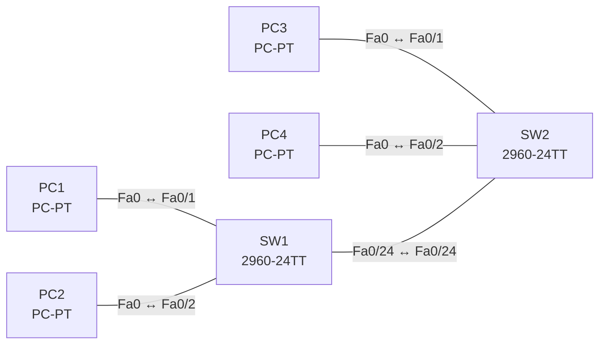

# Lab 03 – Switching-Konzepte: MAC-Lernen, Aging, Flooding

**Dauer:** 60 min · **Niveau:** leicht

Du beobachtest im Simulationsmodus, wie Switches Quell-MAC-Adressen lernen, unbekannte Ziele fluten, Einträge altern lassen und wie sich statische MAC-Einträge auswirken.

**Lernziele:** Nach diesem Lab kannst du …

- Erklären, wie ein Switch MAC-Adressen lernt, weiterleitet und flutet.
- Aging und statische Einträge in der MAC-Tabelle einsetzen.
- Kollisions- und Broadcast-Domänen in einer Topologie zählen.

| CCNA-Ziel | Thema |
|---|---|
| 1.13 | Switching-Konzepte (MAC-Lernen, Aging, Flooding, MAC-Tabelle) |
| 1.1 | Rollen von Netzwerkkomponenten (Router, Switches, Firewall/IPS, AP, WLC, Endgeräte, Server, PoE) |

**So arbeitest du:** Teil A = Bauen, Teil B = Reparieren, Teil C = Üben. Die Konfigurationsdateien liegen in `build/` (Ausgangszustand zum Einfügen in die CLI), `repair/` (fertig gebaut, mit Fehlern) und `solutions/` (Musterlösung und Fehlerliste, erst nach eigenem Versuch öffnen). Anleitung zum Einfügen: siehe [Arbeiten mit den Dateien](../README.md#arbeiten-mit-den-dateien).

## Topologie




### Geräte

| Gerät | Modell in Packet Tracer | Rolle |
|---|---|---|
| SW1 | 2960-24TT | Access-Switch links |
| SW2 | 2960-24TT | Access-Switch rechts |
| PC1 | PC-PT | Endgerät |
| PC2 | PC-PT | Endgerät |
| PC3 | PC-PT | Endgerät |
| PC4 | PC-PT | Endgerät |

### Verkabelung

| Von | Port | Nach | Port | Kabel |
|---|---|---|---|---|
| PC1 | Fa0 | SW1 | Fa0/1 | Copper Straight-Through |
| PC2 | Fa0 | SW1 | Fa0/2 | Copper Straight-Through |
| PC3 | Fa0 | SW2 | Fa0/1 | Copper Straight-Through |
| PC4 | Fa0 | SW2 | Fa0/2 | Copper Straight-Through |
| SW1 | Fa0/24 | SW2 | Fa0/24 | Copper Cross-Over |

### Adressplan (Ausgangszustand)

| Gerät | Interface | Adresse | Maske | Gateway | DNS |
|---|---|---|---|---|---|
| PC1 | Fa0 (GUI) | 192.168.3.11 | 255.255.255.0 |  |  |
| PC2 | Fa0 (GUI) | 192.168.3.12 | 255.255.255.0 |  |  |
| PC3 | Fa0 (GUI) | 192.168.3.13 | 255.255.255.0 |  |  |
| PC4 | Fa0 (GUI) | 192.168.3.14 | 255.255.255.0 |  |  |


> **Packet-Tracer-Hinweis:** Simulationsmodus (Simulation-Schalter rechts unten), Filter auf ARP und ICMP setzen. Mit `show mac address-table` auf jedem Switch vergleichen.

## Teil A – Bauen

Arbeite die Schritte der Reihe nach ab. Jeder Schritt sagt dir, was du tust, woran du den Erfolg erkennst (**Prüfen**) und worüber du nachdenken sollst (**Denkfrage**). Die Antworten auf die Denkfragen stehen am Ende von Teil A.

1. **Basis.** Verkabeln, die Konfigurationen aus `build/` einfügen und die PCs nach der Tabelle einstellen.
   - **Prüfen:** `show mac address-table` ist auf allen Switches noch leer oder fast leer.
2. **Lernen beobachten.** Lass PC1 im Simulationsmodus PC3 anpingen. Verfolge den ARP-Broadcast Schritt für Schritt.
   - **Prüfen:** Nach dem Ping steht die MAC von PC1 auf jedem Switch am Port, der in Richtung PC1 zeigt.
   - **Denkfrage:** Warum lernt der Switch aus der Quell-MAC und nie aus der Ziel-MAC?
3. **Flooding und Filtern.** Beobachte im Simulationsmodus, an welche Ports ein Frame geht.
   - **Denkfrage:** Welche Frames werden geflutet, und wann leitet der Switch gezielt an einen Port weiter?
4. **Aging.** Setze auf SW2 `mac address-table aging-time 60` und warte, bis ein Eintrag verschwindet.
   - **Prüfen:** `show mac address-table aging-time` zeigt 60. Nach einer Minute ohne Verkehr ist der Eintrag weg. Setze danach den Standard 300 s zurück.
5. **Statischer Eintrag.** Trage die MAC von PC3 fest ein: `mac address-table static <MAC> vlan 1 interface fa0/3`.
   - **Prüfen:** `show mac address-table` zeigt den Eintrag als `STATIC`.
   - **Denkfrage:** Was spricht für statische Einträge, was dagegen?
6. **Domänen zählen.** Zähle in der Topologie die Kollisions- und die Broadcast-Domänen.
   - **Denkfrage:** Wie ändert sich die Zahl, wenn du einen Switch durch einen Hub ersetzt?

<details><summary>Antworten zu den Denkfragen</summary>

- **Zu 2:** Nur die Quelladresse verrät, über welchen Port ein Gerät erreichbar ist: Der Frame kommt ja von dort. Die Zieladresse sagt nur, wohin er will.
- **Zu 3:** Geflutet werden Broadcasts, unbekannte Unicasts und ohne IGMP Snooping auch Multicasts, und zwar an alle Ports im VLAN außer dem Eingangsport. Kennt der Switch die Ziel-MAC, schickt er den Frame nur an diesen Port. Liegt das Ziel am Eingangsport, verwirft er ihn (Filtern).
- **Zu 5:** Dafür: Niemand kann die MAC an einem anderen Port vortäuschen, und der Eintrag altert nicht. Dagegen: Jede Änderung musst du von Hand nachziehen. Steckt das Gerät um, ist es nicht mehr erreichbar.
- **Zu 6:** Jeder Switch-Port ist eine eigene Kollisionsdomäne, alle Ports in VLAN 1 bilden eine Broadcast-Domäne. Ein Hub fasst alle seine Ports zu einer einzigen Kollisionsdomäne zusammen. An der Broadcast-Domäne ändert sich nichts.

</details>

## Teil B – Reparieren

Baue die Topologie wie oben (oder behalte deine aus Teil A), setze alle Geräte zurück (`erase startup-config`, `reload` bzw. neues Gerät) und füge dann die Dateien aus `repair/` ein und stelle die Endgeräte laut Tabelle unten ein. Es stecken **3 Fehler** drin. Behandle jede Meldung als Ticket: erst Symptom nachstellen, dann Layer für Layer eingrenzen, beheben und beweisen. Ändere nur, was kaputt ist.

**Endgeräte im Repair-Zustand:**

| Gerät | IP | Maske | Gateway | DNS |
|---|---|---|---|---|
| PC1 | 192.168.3.11 | 255.255.255.0 |  |  |
| PC2 | 192.168.3.12 | 255.255.255.0 |  |  |
| PC3 | 192.168.3.13 | 255.255.255.252 |  |  |
| PC4 | 192.168.3.14 | 255.255.255.0 |  |  |

**Ticket 1:** Zwischen den Switches wird auffällig viel geflutet: `show mac address-table` auf SW2 ist nach kurzer Zeit fast leer, Pakete erscheinen im Simulationsmodus wiederholt an allen Ports.

**Ticket 2:** Die Hosts an SW1 und SW2 sehen einander nicht, jede Seite erreicht nur die eigenen Nachbarn.

**Ticket 3:** PC3 erreicht nur PC4, aber weder PC1 noch PC2.

## Verifikation

```
show mac address-table
show mac address-table dynamic
show mac address-table address <MAC>
show mac address-table aging-time
clear mac address-table dynamic
```

| Befehl | Das solltest du sehen |
|---|---|
| `show mac address-table` nach dem Ping | die MACs jeweils am Port in Richtung Quelle |
| `show mac address-table` auf SW1 | die MACs der Hosts hinter SW2 am Uplink Fa0/24 |
| `show mac address-table aging-time` | 300 (Standard) |

## Teil C – Üben

Beantworte zuerst selbst, dann klappe die Antwort auf.

1. Was passiert, wenn der Switch die Ziel-MAC nicht kennt?
<details><summary>Antwort</summary>

**Er flutet den Frame an alle Ports im VLAN außer dem Eingangsport.** Das heißt Unknown Unicast Flooding. Antwortet das Ziel, lernt der Switch dessen Port, und ab dann geht es gezielt.

</details>

2. Wann lernt ein Switch eine MAC-Adresse, und warum nie aus der Zieladresse?
<details><summary>Antwort</summary>

**Bei jedem eingehenden Frame, und zwar aus der Quelladresse.** Nur die Quelle zeigt, über welchen Port das Gerät erreichbar ist.

</details>

3. Ein PC wird an einen anderen Port umgesteckt. Was geschieht mit dem alten Eintrag?
<details><summary>Antwort</summary>

**Er wird überschrieben, sobald der PC am neuen Port sendet.** Sendet der PC nicht, läuft der alte Eintrag nach der Aging-Time ab.

</details>

4. Wie viele Kollisions- und Broadcast-Domänen hat ein Switch mit 10 Hosts in einem VLAN?
<details><summary>Antwort</summary>

**10 Kollisionsdomänen, 1 Broadcast-Domäne.** Jeder Port ist eine eigene Kollisionsdomäne, ein VLAN ist eine Broadcast-Domäne.

</details>

5. Wie unterscheiden sich Store-and-Forward und Cut-Through?
<details><summary>Antwort</summary>

**Store-and-Forward prüft den ganzen Frame, Cut-Through leitet sofort weiter.** Store-and-Forward liest den Frame komplett, prüft die FCS und verwirft fehlerhafte Frames, das kostet etwas Zeit. Cut-Through beginnt nach der Ziel-MAC: schneller, aber fehlerhafte Frames gehen mit durch.

</details>

## Prüfungsbezug

- Lernen aus der Quell-MAC, weiterleiten nach der Ziel-MAC.
- Geflutet werden Broadcast, Unknown Unicast und ohne Snooping auch Multicast, an alle Ports außer dem Eingangsport.
- Einträge altern nach 300 s.
- Jeder Switch-Port ist eine Kollisionsdomäne, ein VLAN eine Broadcast-Domäne.

## Lösungen

- `solutions/<Gerät>.cfg`: Konfiguration zu Teil A (ohne Basis-Adressen)
- `solutions/FAULTS.md`: Fehlerliste zu Teil B (Spoiler!)
