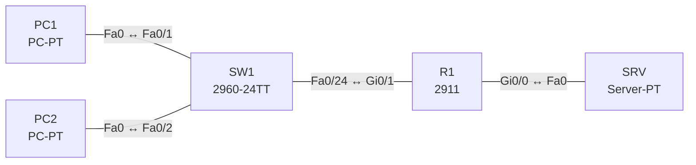

# Lab 04 – TCP und UDP: Verbindungsaufbau, Ports, Dienste

**Dauer:** 75 min · **Niveau:** leicht

Mit einem Server-PT (HTTP, DNS, TFTP) und einem Router beobachtest du im Simulationsmodus TCP-Handshake, UDP-Anfragen und Portnummern. Ein kaputter ACL-Eintrag zeigt, dass die Namensauflösung (UDP/53) ausfallen kann, während Web (TCP/80) per IP weiter funktioniert.

**Lernziele:** Nach diesem Lab kannst du …

- TCP und UDP an ihrem Verhalten im Simulationsmodus unterscheiden.
- Die wichtigsten Well-known Ports und ihr Transportprotokoll aufzählen.
- Erklären, warum Web per IP gehen kann, während die Namensauflösung ausfällt.

| CCNA-Ziel | Thema |
|---|---|
| 1.5 | TCP und UDP im Vergleich |
| 5.6 | Access Control Lists |

**So arbeitest du:** Teil A = Bauen, Teil B = Reparieren, Teil C = Üben. Die Konfigurationsdateien liegen in `build/` (Ausgangszustand zum Einfügen in die CLI), `repair/` (fertig gebaut, mit Fehlern) und `solutions/` (Musterlösung und Fehlerliste, erst nach eigenem Versuch öffnen). Anleitung zum Einfügen: siehe [Arbeiten mit den Dateien](../README.md#arbeiten-mit-den-dateien).

## Topologie




### Geräte

| Gerät | Modell in Packet Tracer | Rolle |
|---|---|---|
| R1 | 2911 | Router zwischen Client- und Server-LAN |
| SW1 | 2960-24TT | Client-Switch |
| PC1 | PC-PT | Client |
| PC2 | PC-PT | Client |
| SRV | Server-PT | HTTP, DNS, TFTP |

### Verkabelung

| Von | Port | Nach | Port | Kabel |
|---|---|---|---|---|
| PC1 | Fa0 | SW1 | Fa0/1 | Copper Straight-Through |
| PC2 | Fa0 | SW1 | Fa0/2 | Copper Straight-Through |
| SW1 | Fa0/24 | R1 | Gi0/1 | Copper Straight-Through |
| R1 | Gi0/0 | SRV | Fa0 | Copper Cross-Over |

### Adressplan (Ausgangszustand)

| Gerät | Interface | Adresse | Maske | Gateway | DNS |
|---|---|---|---|---|---|
| R1 | Gi0/0 | 10.4.2.1 | 255.255.255.0 | | |
| R1 | Gi0/1 | 10.4.1.1 | 255.255.255.0 | | |
| PC1 | Fa0 (GUI) | 10.4.1.11 | 255.255.255.0 | 10.4.1.1 | 10.4.2.10 |
| PC2 | Fa0 (GUI) | 10.4.1.12 | 255.255.255.0 | 10.4.1.1 | 10.4.2.10 |
| SRV | Fa0 (GUI) | 10.4.2.10 | 255.255.255.0 | 10.4.2.1 | 10.4.2.10 |


> **Packet-Tracer-Hinweis:** Im Simulationsmodus unter „Edit Filters“ nur HTTP, DNS, TCP, UDP, TFTP anhaken. Auf dem Server unter Services die Dienste HTTP, DNS (A-Record `www.lab.local` → 10.4.2.10) und TFTP einschalten.

## Teil A – Bauen

Arbeite die Schritte der Reihe nach ab. Jeder Schritt sagt dir, was du tust, woran du den Erfolg erkennst (**Prüfen**) und worüber du nachdenken sollst (**Denkfrage**). Die Antworten auf die Denkfragen stehen am Ende von Teil A.

1. **Basis.** Verkabeln, die Konfigurationen aus `build/` einfügen und die Hosts nach der Tabelle einstellen.
   - **Prüfen:** PC1 pingt SRV (10.4.2.10).
2. **DNS beobachten (UDP).** Schalte auf SRV den DNS-Dienst ein und lege `www.lab.local` → 10.4.2.10 an. Öffne auf PC1 im Browser `www.lab.local` und verfolge die DNS-Anfrage im Simulationsmodus.
   - **Prüfen:** Die Anfrage nutzt UDP mit einem zufälligen Quellport und Zielport 53.
   - **Denkfrage:** Gibt es vor der DNS-Anfrage einen Verbindungsaufbau?
3. **HTTP beobachten (TCP).** Verfolge danach den Aufruf der Webseite.
   - **Prüfen:** Vor dem HTTP-GET kommen SYN, SYN/ACK und ACK zu Port 80.
   - **Denkfrage:** Wozu dient dieser Handshake?
4. **TFTP beobachten (UDP).** Kopiere auf R1 die Konfiguration mit `copy running-config tftp:` auf den Server.
   - **Prüfen:** Die Übertragung geht an UDP 69. Jeder Datenblock wird einzeln bestätigt.
   - **Denkfrage:** TFTP hat keinen Handshake. Wie stellt es trotzdem sicher, dass nichts verloren geht?
5. **Vergleichstabelle.** Fülle für TCP und UDP aus: Verbindung, Zuverlässigkeit, Reihenfolge, Flusskontrolle, Header-Größe, typische Dienste.
6. **Ports zuordnen.** Ordne zu und markiere TCP oder UDP: 20/21 FTP, 22 SSH, 23 Telnet, 25 SMTP, 53 DNS, 67/68 DHCP, 69 TFTP, 80 HTTP, 110 POP3, 123 NTP, 143 IMAP, 161/162 SNMP, 443 HTTPS, 514 Syslog.

<details><summary>Antworten zu den Denkfragen</summary>

- **Zu 2:** Nein. UDP schickt die Anfrage sofort. Kommt keine Antwort, fragt der Client nach einer Wartezeit erneut.
- **Zu 3:** Beide Seiten vereinbaren ihre Startnummern für die Sequenznummern. Erst danach kann TCP Verluste erkennen und Daten in der richtigen Reihenfolge zusammensetzen.
- **Zu 4:** Im Lock-Step: Der Server schickt einen Block und wartet auf das ACK dafür, bevor der nächste kommt. Fehlt das ACK, schickt er den Block erneut. Die Zuverlässigkeit steckt also in der Anwendung, nicht in UDP.
- **Zu 5:**

| | TCP | UDP |
|---|---|---|
| Verbindung | ja, 3-Wege-Handshake | nein |
| Zuverlässigkeit | Bestätigung, Wiederholung | keine |
| Reihenfolge | ja, per Sequenznummer | nein |
| Flusskontrolle | ja, per Window | nein |
| Header | 20 Byte (mindestens) | 8 Byte |
| Dienste | HTTP(S), SSH, FTP, SMTP | DNS, DHCP, TFTP, SNMP, Syslog, NTP, VoIP |

- **Zu 6:** TCP: FTP 20/21, SSH 22, Telnet 23, SMTP 25, HTTP 80, POP3 110, IMAP 143, HTTPS 443. UDP: DHCP 67/68, TFTP 69, NTP 123, SNMP 161/162, Syslog 514. DNS nutzt beides: UDP für normale Anfragen, TCP für große Antworten und Zonentransfers.

</details>

## Teil B – Reparieren

Baue die Topologie wie oben (oder behalte deine aus Teil A), setze alle Geräte zurück (`erase startup-config`, `reload` bzw. neues Gerät) und füge dann die Dateien aus `repair/` ein und stelle die Endgeräte laut Tabelle unten ein. Es stecken **3 Fehler** drin. Behandle jede Meldung als Ticket: erst Symptom nachstellen, dann Layer für Layer eingrenzen, beheben und beweisen. Ändere nur, was kaputt ist.

**Endgeräte im Repair-Zustand:**

| Gerät | IP | Maske | Gateway | DNS |
|---|---|---|---|---|
| PC1 | 10.4.1.11 | 255.255.255.0 | 10.4.1.1 | 10.4.2.10 |
| PC2 | 10.4.1.12 | 255.255.255.0 | 10.4.1.1 | 10.4.2.11 |
| SRV | 10.4.2.10 | 255.255.255.0 | 10.4.2.1 | 10.4.2.10 |

**Ticket 1:** Webseite per IP (`http://10.4.2.10`) lädt, per Name (`www.lab.local`) nicht; `nslookup` läuft in ein Timeout.

**Ticket 2:** Ping und DNS gehen, die Webseite lädt nicht (Browser: Timeout).

**Ticket 3:** Auf PC2 funktioniert `www.lab.local` nicht, auf PC1 schon.

## Verifikation

```
show access-lists
show ip interface gi0/0 | include access list
ping 10.4.2.10
```

| Prüfung | Das solltest du sehen |
|---|---|
| `nslookup www.lab.local` auf PC1 und PC2 | Antwort mit 10.4.2.10 |
| Browser `www.lab.local` | die Webseite lädt |
| `show access-lists` auf R1 | Treffer auf den Zeilen für UDP 53 und TCP 80 |

## Teil C – Üben

Beantworte zuerst selbst, dann klappe die Antwort auf.

1. Warum nutzt DNS normalerweise UDP, schaltet aber bei großen Antworten auf TCP?
<details><summary>Antwort</summary>

**Weil eine kleine Frage und eine kleine Antwort keinen Verbindungsaufbau brauchen.** Passt die Antwort nicht in ein UDP-Paket (Truncation) oder geht es um einen Zonentransfer, wiederholt der Client die Anfrage über TCP 53.

</details>

2. Wozu dienen Sequenz- und Bestätigungsnummern?
<details><summary>Antwort</summary>

**Damit TCP die Reihenfolge herstellen und Verluste erkennen kann.** Fehlt eine Bestätigung, sendet der Absender die Daten erneut.

</details>

3. Wofür braucht man Quell- und Zielport?
<details><summary>Antwort</summary>

**Der Zielport adressiert die Anwendung, der Quellport trennt parallele Sitzungen.** Öffnest du zwei Browser-Tabs zum selben Server, haben beide Zielport 443, aber verschiedene Quellports.

</details>

4. Ein Webserver ist per IP erreichbar, per Name nicht. Welcher Dienst ist verdächtig?
<details><summary>Antwort</summary>

**DNS auf UDP 53.** Prüfe den DNS-Server am Client, den Weg dorthin und ACLs, die UDP 53 blockieren könnten.

</details>

5. Was bedeutet das TCP-Fenster (Window)?
<details><summary>Antwort</summary>

**Wie viele Daten der Sender schicken darf, ohne auf eine Bestätigung zu warten.** So bremst der Empfänger den Sender, wenn er nicht mehr nachkommt (Flusskontrolle).

</details>

## Prüfungsbezug

- TCP: verbindungsorientiert (SYN, SYN/ACK, ACK), zuverlässig, geordnet, Flusskontrolle per Window, 20 Byte Header.
- UDP: verbindungslos, keine Zustellgarantie, 8 Byte Header, wenig Verzögerung. Typisch: DNS, DHCP, TFTP, VoIP, SNMP, Syslog, NTP.
- Die Anwendung entscheidet, ob sie Zuverlässigkeit braucht. TFTP baut sie selbst ein.

## Lösungen

- `solutions/<Gerät>.cfg`: Konfiguration zu Teil A (ohne Basis-Adressen)
- `solutions/FAULTS.md`: Fehlerliste zu Teil B (Spoiler!)
