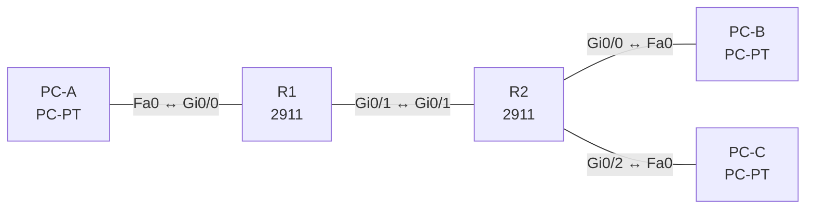

# Lab 05 – IPv4-Adressierung, VLSM und private Bereiche

**Dauer:** 90 min · **Niveau:** mittel

Aus dem Block 192.168.50.0/24 planst du Subnetze nach Hostbedarf (VLSM), konfigurierst Router und Hosts und findest typische Adressierungsfehler. Dazu gehört das Prüfen der IP-Parameter auf Windows, macOS und Linux.

**Lernziele:** Nach diesem Lab kannst du …

- Einen Adressblock per VLSM nach Hostbedarf aufteilen.
- Netz-ID, Broadcast und Hostbereich zu jeder Adresse mit Maske schnell berechnen.
- Typische Adressierungsfehler (Maske, Gateway, Broadcast als Hostadresse) erkennen.

| CCNA-Ziel | Thema |
|---|---|
| 1.6 | IPv4-Adressierung und Subnetting |
| 1.7 | Private IPv4-Adressen |
| 1.10 | IP-Parameter auf Windows, macOS und Linux prüfen |
| 3.3 | Statisches Routing IPv4/IPv6 (Default, Netz, Host, Floating) |

**So arbeitest du:** Teil A = Bauen, Teil B = Reparieren, Teil C = Üben. Die Konfigurationsdateien liegen in `build/` (Ausgangszustand zum Einfügen in die CLI), `repair/` (fertig gebaut, mit Fehlern) und `solutions/` (Musterlösung und Fehlerliste, erst nach eigenem Versuch öffnen). Anleitung zum Einfügen: siehe [Arbeiten mit den Dateien](../README.md#arbeiten-mit-den-dateien).

## Topologie




### Geräte

| Gerät | Modell in Packet Tracer | Rolle |
|---|---|---|
| R1 | 2911 | Router Standort A |
| R2 | 2911 | Router Standort B |
| PC-A | PC-PT | LAN-A |
| PC-B | PC-PT | LAN-B |
| PC-C | PC-PT | LAN-C |

### Verkabelung

| Von | Port | Nach | Port | Kabel |
|---|---|---|---|---|
| PC-A | Fa0 | R1 | Gi0/0 | Copper Cross-Over |
| R1 | Gi0/1 | R2 | Gi0/1 | Copper Cross-Over |
| R2 | Gi0/0 | PC-B | Fa0 | Copper Cross-Over |
| R2 | Gi0/2 | PC-C | Fa0 | Copper Cross-Over |

### Adressplan (Ausgangszustand)

| Gerät | Interface | Adresse | Maske | Gateway | DNS |
|---|---|---|---|---|---|
| R1 | Gi0/0 | 192.168.50.1 | 255.255.255.192 | | |
| R1 | Gi0/1 | 192.168.50.253 | 255.255.255.252 | | |
| R2 | Gi0/1 | 192.168.50.254 | 255.255.255.252 | | |
| R2 | Gi0/0 | 192.168.50.65 | 255.255.255.224 | | |
| R2 | Gi0/2 | 192.168.50.97 | 255.255.255.240 | | |
| PC-A | Fa0 (GUI) | 192.168.50.10 | 255.255.255.192 | 192.168.50.1 |  |
| PC-B | Fa0 (GUI) | 192.168.50.70 | 255.255.255.224 | 192.168.50.65 |  |
| PC-C | Fa0 (GUI) | 192.168.50.100 | 255.255.255.240 | 192.168.50.97 |  |


> **Packet-Tracer-Hinweis:** PCs haben unter Desktop → Command Prompt `ipconfig /all`. Für macOS/Linux gibt es in Packet Tracer keine eigenen Hosts; die Befehle lernst du in Teil C.

## Teil A – Bauen

Arbeite die Schritte der Reihe nach ab. Jeder Schritt sagt dir, was du tust, woran du den Erfolg erkennst (**Prüfen**) und worüber du nachdenken sollst (**Denkfrage**). Die Antworten auf die Denkfragen stehen am Ende von Teil A.

1. **VLSM-Plan auf Papier.** Teile 192.168.50.0/24 auf: LAN-A 60 Hosts, LAN-B 28 Hosts, LAN-C 12 Hosts, dazu ein Router-Router-Link. Vergib die Subnetze von groß nach klein, ohne Überlappung. Notiere je Subnetz Netz-ID, Maske, ersten und letzten Host und Broadcast.
   - **Prüfen:** Vergleiche deinen Plan mit dem Adressplan oben.
   - **Denkfrage:** Warum vergibt man von groß nach klein?
2. **Konfigurieren.** Füge die Konfigurationen aus `build/` ein und stelle die PCs ein. Ergänze statische Routen: R1 zu LAN-B und LAN-C über R2, R2 zu LAN-A über R1.
   - **Prüfen:** PC-A pingt PC-B und PC-C.
3. **Routing-Tabelle lesen.** Sieh dir `show ip route` auf R1 an.
   - **Denkfrage:** Was bedeuten die Codes C, L und S?
4. **Besondere Bereiche.** Ordne zu: RFC 1918, APIPA, Loopback, Multicast.
   - **Denkfrage:** Welche Bereiche sind das jeweils?
5. **Subnetting-Drill.** Berechne Netz-ID, Broadcast, Hostbereich und Anzahl Hosts für 172.16.37.200/21, 10.1.77.9/19 und 192.168.5.77/27.
6. **IP-Parameter am Endgerät.** Lass dir auf einem PC mit `ipconfig /all` alle Werte anzeigen.
   - **Denkfrage:** Welche Befehle zeigen dasselbe unter macOS und Linux? Was zeigt `arp -a`?

<details><summary>Antworten zu den Denkfragen</summary>

- **Zu 1:** Große Blöcke müssen an ihrer eigenen Grenze beginnen. Vergibst du sie zuerst, liegen sie sauber am Anfang, und die kleinen passen in die Lücken dahinter. Andersherum zerstückelst du den Raum. Ergebnis hier: LAN-A .0/26, LAN-B .64/27, LAN-C .96/28, Link .252/30.
- **Zu 3:** C = direkt verbundenes Netz, L = die eigene Adresse am Interface als /32, S = statische Route.
- **Zu 4:** RFC 1918 (privat): 10.0.0.0/8, 172.16.0.0/12, 192.168.0.0/16. APIPA: 169.254.0.0/16. Loopback: 127.0.0.0/8. Multicast: 224.0.0.0/4.
- **Zu 5:** 172.16.37.200/21: Block 8 im 3. Oktett, Netz 172.16.32.0, Broadcast 172.16.39.255, Hosts .32.1 bis .39.254, 2046 Hosts. 10.1.77.9/19: Block 32 im 3. Oktett, Netz 10.1.64.0, Broadcast 10.1.95.255, Hosts .64.1 bis .95.254, 8190 Hosts. 192.168.5.77/27: Block 32 im 4. Oktett, Netz .64, Broadcast .95, Hosts .65 bis .94, 30 Hosts.
- **Zu 6:** macOS: `ifconfig` oder `networksetup -getinfo Wi-Fi`. Linux: `ip a`, Routen mit `ip route`, DNS mit `resolvectl status`. `arp -a` (Linux: `ip neigh`) zeigt, welche IP zu welcher MAC gehört, z. B. die MAC des Gateways.

</details>

## Teil B – Reparieren

Baue die Topologie wie oben (oder behalte deine aus Teil A), setze alle Geräte zurück (`erase startup-config`, `reload` bzw. neues Gerät) und füge dann die Dateien aus `repair/` ein und stelle die Endgeräte laut Tabelle unten ein. Es stecken **4 Fehler** drin. Behandle jede Meldung als Ticket: erst Symptom nachstellen, dann Layer für Layer eingrenzen, beheben und beweisen. Ändere nur, was kaputt ist.

**Endgeräte im Repair-Zustand:**

| Gerät | IP | Maske | Gateway | DNS |
|---|---|---|---|---|
| PC-A | 192.168.50.10 | 255.255.255.192 | 192.168.50.1 |  |
| PC-B | 192.168.50.95 | 255.255.255.224 | 192.168.50.65 |  |
| PC-C | 192.168.50.100 | 255.255.255.240 | 192.168.50.98 |  |

**Ticket 1:** R1 und R2 sehen sich nicht, kein Ping über den Router-Link; die LANs erreichen sich nicht.

**Ticket 2:** PC-A erreicht LAN-B, aber nicht LAN-C. In `show ip route` auf R1 fehlt 192.168.50.96/28, obwohl die Route konfiguriert ist.

**Ticket 3:** PC-B hat keine Verbindung außer lokal; `ipconfig` zeigt eine Adresse, die auf .95 endet.

**Ticket 4:** PC-C erreicht nur das eigene Subnetz, aber keine anderen LANs.

## Verifikation

```
show ip interface brief
show ip route
ping 192.168.50.65
```

| Prüfung | Das solltest du sehen |
|---|---|
| `show ip route` auf R1 | C und L für LAN-A und den Link, S für LAN-B (.64/27) und LAN-C (.96/28) |
| `ipconfig /all` auf jedem PC | Adresse, Maske und Gateway aus dem eigenen Subnetz |
| Ping zwischen allen drei LANs | Antworten |

## Teil C – Üben

Beantworte zuerst selbst, dann klappe die Antwort auf.

1. Wie viele Hosts passen in ein /26, /27, /28, /29 und /30?
<details><summary>Antwort</summary>

**62, 30, 14, 6 und 2.** Formel: 2^(32 − Präfix) − 2. Netz-ID und Broadcast fallen weg.

</details>

2. 172.16.37.200/21: Netz-ID, Broadcast, Hostbereich?
<details><summary>Antwort</summary>

**Netz 172.16.32.0, Broadcast 172.16.39.255, Hosts 172.16.32.1 bis 172.16.39.254.** /21 lässt im 3. Oktett 3 Hostbit, die Blockgröße ist 8. 37 liegt im Block 32 bis 39. Das ergibt 2046 Hosts.

</details>

3. Mit welchen Befehlen zeigst du die IP-Einstellungen unter Windows, macOS und Linux an?
<details><summary>Antwort</summary>

**Windows `ipconfig /all`, macOS `ifconfig`, Linux `ip a`.** Unter Linux zusätzlich `ip route` für Routen und `resolvectl status` für DNS. Die ARP-Tabelle zeigt `arp -a`, unter Linux `ip neigh`.

</details>

4. Ein PC hat 169.254.12.7. Was bedeutet das?
<details><summary>Antwort</summary>

**Er hat keinen DHCP-Server gefunden und sich selbst eine APIPA-Adresse gegeben.** Damit kann er nur im lokalen Segment mit anderen APIPA-Geräten sprechen.

</details>

5. Welche Adressen darf ein Host im Netz 192.168.50.64/27 nicht verwenden?
<details><summary>Antwort</summary>

**192.168.50.64 (Netz-ID) und 192.168.50.95 (Broadcast).**

</details>

## Prüfungsbezug

- Blockgröße = 256 − Wert der Maske im interessanten Oktett. Die Netz-ID ist ein Vielfaches davon, der Broadcast liegt eins vor dem nächsten Netz.
- Hosts = 2^n − 2.
- VLSM: große Subnetze zuerst.
- Privat: 10.0.0.0/8, 172.16.0.0/12, 192.168.0.0/16.
- Das Gateway muss im selben Subnetz liegen wie der Host.

## Lösungen

- `solutions/<Gerät>.cfg`: Konfiguration zu Teil A (ohne Basis-Adressen)
- `solutions/FAULTS.md`: Fehlerliste zu Teil B (Spoiler!)
