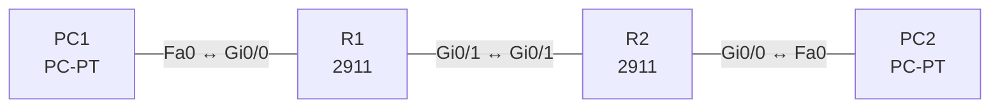

# Lab 06 – IPv6: Adressen, Adresstypen und EUI-64

**Dauer:** 90 min · **Niveau:** mittel

Zwei Router verbinden zwei IPv6-LANs. Du vergibst globale Unicast-, Link-Local- und EUI-64-Adressen, lässt PCs per SLAAC eine Adresse bilden und routest statisch (IPv6-Default und -Netzroute).

**Lernziele:** Nach diesem Lab kannst du …

- IPv6-Adressen verkürzen und ihren Typ am Präfix erkennen.
- Eine EUI-64-Interface-ID aus einer MAC-Adresse berechnen.
- SLAAC und statisches IPv6-Routing einrichten und prüfen.

| CCNA-Ziel | Thema |
|---|---|
| 1.8 | IPv6-Adressierung und Präfix |
| 1.9 | IPv6-Adresstypen (GUA, ULA, Link-Local, Anycast, Multicast, EUI-64) |
| 3.3 | Statisches Routing IPv4/IPv6 (Default, Netz, Host, Floating) |

**So arbeitest du:** Teil A = Bauen, Teil B = Reparieren, Teil C = Üben. Die Konfigurationsdateien liegen in `build/` (Ausgangszustand zum Einfügen in die CLI), `repair/` (fertig gebaut, mit Fehlern) und `solutions/` (Musterlösung und Fehlerliste, erst nach eigenem Versuch öffnen). Anleitung zum Einfügen: siehe [Arbeiten mit den Dateien](../README.md#arbeiten-mit-den-dateien).

## Topologie



Adressen stammen aus dem Dokumentationsbereich 2001:db8::/32 und aus fd00::/8 (Unique Local).

### Geräte

| Gerät | Modell in Packet Tracer | Rolle |
|---|---|---|
| R1 | 2911 | Router 1 |
| R2 | 2911 | Router 2 |
| PC1 | PC-PT | LAN1 |
| PC2 | PC-PT | LAN2 |

### Verkabelung

| Von | Port | Nach | Port | Kabel |
|---|---|---|---|---|
| PC1 | Fa0 | R1 | Gi0/0 | Copper Cross-Over |
| R1 | Gi0/1 | R2 | Gi0/1 | Copper Cross-Over |
| R2 | Gi0/0 | PC2 | Fa0 | Copper Cross-Over |

### Adressplan (Ausgangszustand)

| Gerät | Interface | Adresse | Maske | Gateway | DNS |
|---|---|---|---|---|---|
| PC1 | Fa0 (GUI) | Auto Config (SLAAC) |  |  |  |
| PC2 | Fa0 (GUI) | Auto Config (SLAAC) |  |  |  |

| Gerät | Interface | IPv6 |
|---|---|---|
| R1 | Gi0/0 (LAN1) | 2001:db8:acad:10::1/64, Link-Local FE80::1 |
| R1 | Gi0/1 (Link) | 2001:db8:acad:12::1/64, Link-Local FE80::1 |
| R2 | Gi0/1 (Link) | 2001:db8:acad:12::2/64, Link-Local FE80::2 |
| R2 | Gi0/0 (LAN2) | 2001:db8:acad:20::/64 EUI-64, Link-Local FE80::2 |

> **Packet-Tracer-Hinweis:** Die PCs stellst du in der IP-Konfiguration auf „Auto Config“ (IPv6 SLAAC). Ob Packet Tracer den EUI-64-Teil der PC-Adresse aus der MAC bildet, siehst du unter Desktop → Command Prompt → `ipconfig /all`.

## Teil A – Bauen

Arbeite die Schritte der Reihe nach ab. Jeder Schritt sagt dir, was du tust, woran du den Erfolg erkennst (**Prüfen**) und worüber du nachdenken sollst (**Denkfrage**). Die Antworten auf die Denkfragen stehen am Ende von Teil A.

1. **Routing einschalten.** Verkabeln, die Konfigurationen aus `build/` einfügen (hier gibt es kein IPv4) und `ipv6 unicast-routing` aktivieren.
   - **Denkfrage:** Was macht der Router ohne diesen Befehl nicht?
2. **Adressen setzen.** Vergib die Adressen aus der Tabelle. Setze die Link-Local-Adressen von Hand, z. B. `ipv6 address FE80::1 link-local`.
   - **Prüfen:** `show ipv6 interface brief` zeigt pro Interface eine Link-Local- und eine globale Adresse.
3. **EUI-64 rechnen.** R2 bildet an Gi0/0 die Interface-ID aus der MAC. Berechne sie für 0060.5C2B.7A01 zuerst selbst: in der Mitte FFFE einfügen, im ersten Byte das 7. Bit umdrehen.
   - **Prüfen:** Vergleiche dein Ergebnis mit `show ipv6 interface gi0/0`.
4. **SLAAC.** Stelle die PCs auf „Auto Config“.
   - **Prüfen:** `ipconfig /all` zeigt eine Adresse aus dem Präfix des LANs und eine Link-Local-Adresse des Routers als Gateway.
   - **Denkfrage:** Woher kennt der PC das Präfix und sein Gateway?
5. **Statisch routen.** R1: `ipv6 route 2001:db8:acad:20::/64 2001:db8:acad:12::2`. R2: `ipv6 route ::/0 2001:db8:acad:12::1`.
   - **Prüfen:** PC1 pingt PC2.
   - **Denkfrage:** Warum braucht eine Route mit Link-Local-Next-Hop zusätzlich das Ausgangsinterface?
6. **Adresstypen zuordnen.** 2001:db8::1, fd00::1, FE80::1, ::1, FF02::1, FF02::2, FF02::5, 2001:db8::/32.
   - **Denkfrage:** Was ist Anycast?

<details><summary>Antworten zu den Denkfragen</summary>

- **Zu 1:** Er leitet keine IPv6-Pakete weiter und sendet keine Router Advertisements. Ohne RA bekommen die PCs per SLAAC weder Präfix noch Gateway.
- **Zu 3:** 0060.5C2B.7A01 → 0060:5CFF:FE2B:7A01. Das erste Byte 0x00 wird durch das umgedrehte U/L-Bit zu 0x02. Ergebnis: 0260:5CFF:FE2B:7A01.
- **Zu 4:** Aus dem Router Advertisement. Der Router schickt es regelmäßig an FF02::1 oder auf Anfrage (Router Solicitation). Es enthält das Präfix, und die Link-Local-Adresse des Absenders wird zum Gateway.
- **Zu 5:** Link-Local-Adressen gelten nur auf einem Link, und jedes Interface hat eine. FE80::1 kann es an mehreren Interfaces geben. Erst das Ausgangsinterface sagt, welche gemeint ist.
- **Zu 6:** Global Unicast 2001:db8::1, Unique Local fd00::1, Link-Local FE80::1, Loopback ::1, alle Knoten FF02::1, alle Router FF02::2, OSPF-Router FF02::5, Dokumentationsbereich 2001:db8::/32. Anycast: Dieselbe Adresse liegt auf mehreren Geräten, das Paket geht an das nächste davon.

</details>

## Teil B – Reparieren

Baue die Topologie wie oben (oder behalte deine aus Teil A), setze alle Geräte zurück (`erase startup-config`, `reload` bzw. neues Gerät) und füge dann die Dateien aus `repair/` ein. Es stecken **4 Fehler** drin. Behandle jede Meldung als Ticket: erst Symptom nachstellen, dann Layer für Layer eingrenzen, beheben und beweisen. Ändere nur, was kaputt ist.

**Ticket 1:** PC1 erhält keine Adresse per SLAAC und erreicht nichts; `show ipv6 interface gi0/0` zeigt keine Router Advertisements.

**Ticket 2:** PC1 erreicht R2 (Link), aber nicht LAN2; `show ipv6 route` zeigt die Route mit einem nicht erreichbaren Next Hop.

**Ticket 3:** PC2 bekommt eine Adresse aus einem unerwarteten Präfix (…:21::), Antworten an PC1 laufen ins Leere, da R1 …:20::/64 routet.

**Ticket 4:** LAN2 erreicht nichts jenseits von R2 (auch nicht LAN1).

## Verifikation

```
show ipv6 interface brief
show ipv6 route
show ipv6 neighbors
```

| Prüfung | Das solltest du sehen |
|---|---|
| `show ipv6 route` auf R1 | eine S-Route für 2001:db8:acad:20::/64 über ::2 |
| `ipconfig /all` auf den PCs | eine Adresse aus :10::/64 bzw. :20::/64 und ein FE80-Gateway |
| Ping PC1 → PC2 (Adresse aus `ipconfig`) | Antworten |

## Teil C – Üben

Beantworte zuerst selbst, dann klappe die Antwort auf.

1. Verkürze 2001:0db8:0000:0000:00ab:0000:0000:0001.
<details><summary>Antwort</summary>

**2001:db8::ab:0:0:1.** Führende Nullen fallen weg, `::` ersetzt einmal eine Folge von Nullgruppen. Hier gibt es zwei gleich lange Folgen. Gültig ist auch 2001:db8:0:0:ab::1, empfohlen (RFC 5952) wird bei Gleichstand die erste.

</details>

2. MAC 0060.5C2B.7A01: Wie lautet die EUI-64-Interface-ID?
<details><summary>Antwort</summary>

**0260:5CFF:FE2B:7A01.** In der Mitte kommt FFFE hinein, und das 7. Bit des ersten Bytes wird umgedreht: 0x00 wird 0x02.

</details>

3. Wozu dienen NDP, NS/NA und RS/RA?
<details><summary>Antwort</summary>

**NDP ersetzt ARP und liefert die Daten für SLAAC.** Neighbor Solicitation und Advertisement lösen IPv6 zu MAC auf und prüfen auf doppelte Adressen (DAD). Router Solicitation und Advertisement liefern Präfix und Gateway.

</details>

4. Was ist der Unterschied zwischen SLAAC und DHCPv6?
<details><summary>Antwort</summary>

**SLAAC bildet die Adresse selbst, DHCPv6 vergibt sie zentral.** Bei SLAAC setzt der Host Präfix und eigene Interface-ID zusammen. Stateful DHCPv6 vergibt die Adresse vom Server, stateless DHCPv6 liefert nur Zusätze wie DNS.

</details>

5. Warum braucht IPv6 kein NAT mehr?
<details><summary>Antwort</summary>

**Weil genug Adressen da sind, damit jedes Gerät eine globale bekommt.** Geschützt wird mit Firewall und ACL statt durch versteckte Adressen. NAT66 oder NPTv6 gibt es nur für Sonderfälle.

</details>

## Prüfungsbezug

- 128 Bit in Hex. Führende Nullen weglassen, `::` nur einmal.
- Global Unicast 2000::/3, Unique Local FC00::/7 (praktisch FD00::/8), Link-Local FE80::/10, Multicast FF00::/8. Broadcast gibt es nicht.
- EUI-64: MAC teilen, FFFE einfügen, 7. Bit umdrehen.
- `ipv6 unicast-routing` schaltet Weiterleitung und Router Advertisements ein.
- Anycast: eine Adresse auf mehreren Geräten, Zustellung an das nächste.

## Lösungen

- `solutions/<Gerät>.cfg`: Konfiguration zu Teil A (ohne Basis-Adressen)
- `solutions/FAULTS.md`: Fehlerliste zu Teil B (Spoiler!)
