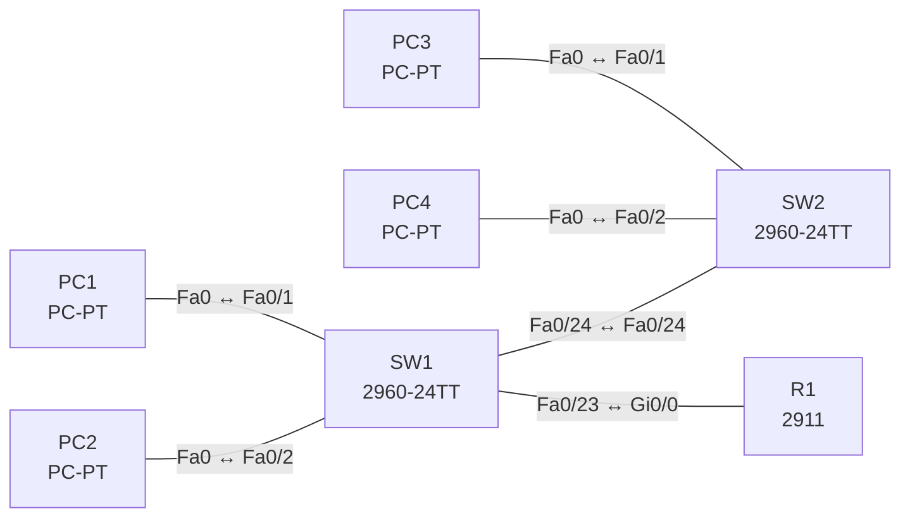

# Lab 07 – VLANs, Trunks und Inter-VLAN-Routing

**Dauer:** 90 min · **Niveau:** mittel

Zwei Access-Switches, zwei VLANs und ein Router-on-a-Stick: Du legst VLANs an, ordnest Ports zu, trunkst zwischen den Switches und routest zwischen den VLANs über Subinterfaces.

**Lernziele:** Nach diesem Lab kannst du …

- VLANs anlegen, Access-Ports zuordnen und Trunks zwischen Switches aufbauen.
- Inter-VLAN-Routing mit Router-on-a-Stick einrichten.
- Router-on-a-Stick und SVI auf einem Layer-3-Switch vergleichen.

| CCNA-Ziel | Thema |
|---|---|
| 2.1 | VLANs über mehrere Switches inkl. Inter-VLAN-Routing |
| 2.2 | Interswitch-Verbindungen (Trunk, 802.1Q, Native VLAN) |

**So arbeitest du:** Teil A = Bauen, Teil B = Reparieren, Teil C = Üben. Die Konfigurationsdateien liegen in `build/` (Ausgangszustand zum Einfügen in die CLI), `repair/` (fertig gebaut, mit Fehlern) und `solutions/` (Musterlösung und Fehlerliste, erst nach eigenem Versuch öffnen). Anleitung zum Einfügen: siehe [Arbeiten mit den Dateien](../README.md#arbeiten-mit-den-dateien).

## Topologie



Zusatz (Teil A, Schritt 6): Ersetze den Router durch einen 3560 mit SVIs (`ip routing`, `interface vlan 10/20`).

### Geräte

| Gerät | Modell in Packet Tracer | Rolle |
|---|---|---|
| R1 | 2911 | Router-on-a-Stick |
| SW1 | 2960-24TT | Access-Switch 1 |
| SW2 | 2960-24TT | Access-Switch 2 |
| PC1 | PC-PT | VLAN 10 |
| PC2 | PC-PT | VLAN 20 |
| PC3 | PC-PT | VLAN 10 |
| PC4 | PC-PT | VLAN 20 |

### Verkabelung

| Von | Port | Nach | Port | Kabel |
|---|---|---|---|---|
| PC1 | Fa0 | SW1 | Fa0/1 | Copper Straight-Through |
| PC2 | Fa0 | SW1 | Fa0/2 | Copper Straight-Through |
| PC3 | Fa0 | SW2 | Fa0/1 | Copper Straight-Through |
| PC4 | Fa0 | SW2 | Fa0/2 | Copper Straight-Through |
| SW1 | Fa0/24 | SW2 | Fa0/24 | Copper Cross-Over |
| SW1 | Fa0/23 | R1 | Gi0/0 | Copper Straight-Through |

### Adressplan (Ausgangszustand)

| Gerät | Interface | Adresse | Maske | Gateway | DNS |
|---|---|---|---|---|---|
| R1 | Gi0/0.10 | 192.168.10.1 | 255.255.255.0 | | |
| R1 | Gi0/0.20 | 192.168.20.1 | 255.255.255.0 | | |
| PC1 | Fa0 (GUI) | 192.168.10.11 | 255.255.255.0 | 192.168.10.1 |  |
| PC2 | Fa0 (GUI) | 192.168.20.11 | 255.255.255.0 | 192.168.20.1 |  |
| PC3 | Fa0 (GUI) | 192.168.10.12 | 255.255.255.0 | 192.168.10.1 |  |
| PC4 | Fa0 (GUI) | 192.168.20.12 | 255.255.255.0 | 192.168.20.1 |  |


## Teil A – Bauen

Arbeite die Schritte der Reihe nach ab. Jeder Schritt sagt dir, was du tust, woran du den Erfolg erkennst (**Prüfen**) und worüber du nachdenken sollst (**Denkfrage**). Die Antworten auf die Denkfragen stehen am Ende von Teil A.

1. **Basis.** Verkabeln, die Konfigurationen aus `build/` einfügen und die Hosts nach der Tabelle einstellen.
   - **Prüfen:** Ping von PC1 zu PC2.
   - **Denkfrage:** Warum scheitert der Ping, obwohl beide noch im selben VLAN 1 hängen?
2. **VLANs anlegen.** Lege auf beiden Switches `vlan 10` (USERS) und `vlan 20` (SERVER) an.
   - **Prüfen:** `show vlan brief` zeigt beide VLANs als `active`.
3. **Access-Ports.** Fa0/1 kommt in VLAN 10, Fa0/2 in VLAN 20, jeweils mit `switchport mode access` und `switchport access vlan`.
   - **Prüfen:** `show vlan brief` listet die Ports beim richtigen VLAN.
   - **Denkfrage:** Warum setzt man `mode access` ausdrücklich?
4. **Trunks.** Mach SW1–SW2 (Fa0/24) und SW1–R1 (Fa0/23) zu Trunks mit `switchport mode trunk` und erlaube nur VLAN 10 und 20.
   - **Prüfen:** `show interfaces trunk` zeigt beide Trunks mit den VLANs 10 und 20 in allen drei Blöcken.
5. **Router-on-a-Stick.** Lege auf R1 Gi0/0.10 und Gi0/0.20 an, jeweils mit `encapsulation dot1Q <VLAN>` und der Gateway-Adresse.
   - **Prüfen:** PC1 pingt PC4 (anderes VLAN, anderer Switch).
   - **Denkfrage:** Wie viele physische Router-Interfaces brauchst du dafür?
6. **Alternative mit SVI.** Baue dasselbe mit einem 3560: `ip routing`, `interface vlan 10` mit der Gateway-Adresse, ebenso für VLAN 20.
   - **Denkfrage:** Was spricht für SVIs, was für Router-on-a-Stick?

<details><summary>Antworten zu den Denkfragen</summary>

- **Zu 1:** Layer 2 würde passen, aber die PCs haben Adressen aus verschiedenen Netzen. Ein PC schickt Pakete in ein fremdes Netz an sein Gateway, und das gibt es noch nicht.
- **Zu 3:** Sonst steht der Port auf `dynamic auto` und könnte mit einem Gerät auf `desirable` einen Trunk aushandeln. `mode access` legt ihn fest und schaltet das Aushandeln praktisch ab.
- **Zu 5:** Eines. Der Trunk trägt beide VLANs, und jedes Subinterface ist das Gateway für ein VLAN.
- **Zu 6:** SVIs routen im Switch in Hardware, ohne den einen Link zum Router als Engpass, und skalieren gut. Router-on-a-Stick braucht keinen Layer-3-Switch und reicht für kleine Netze, aber aller Verkehr zwischen VLANs läuft zweimal über denselben Link.

</details>

## Teil B – Reparieren

Baue die Topologie wie oben (oder behalte deine aus Teil A), setze alle Geräte zurück (`erase startup-config`, `reload` bzw. neues Gerät) und füge dann die Dateien aus `repair/` ein und stelle die Endgeräte laut Tabelle unten ein. Es stecken **5 Fehler** drin. Behandle jede Meldung als Ticket: erst Symptom nachstellen, dann Layer für Layer eingrenzen, beheben und beweisen. Ändere nur, was kaputt ist.

**Endgeräte im Repair-Zustand:**

| Gerät | IP | Maske | Gateway | DNS |
|---|---|---|---|---|
| PC1 | 192.168.10.11 | 255.255.255.0 | 192.168.10.1 |  |
| PC2 | 192.168.20.11 | 255.255.255.0 | 192.168.20.254 |  |
| PC3 | 192.168.10.12 | 255.255.255.0 | 192.168.10.1 |  |
| PC4 | 192.168.20.12 | 255.255.255.0 | 192.168.20.1 |  |

**Ticket 1:** PC3 (192.168.10.12) erreicht weder PC1 noch sein Gateway.

**Ticket 2:** VLAN 10 läuft über beide Switches, VLAN 20 nicht: PC4 erreicht weder PC2 noch sein Gateway.

**Ticket 3:** Hosts in VLAN 20 erreichen ihr Gateway 192.168.20.1 nicht, VLAN 10 funktioniert.

**Ticket 4:** Kein VLAN läuft zwischen SW1 und SW2; `show interfaces trunk` auf SW2 bleibt leer.

**Ticket 5:** PC2 erreicht PC4 (gleiches VLAN), aber nichts in anderen Netzen.

## Verifikation

```
show vlan brief
show interfaces trunk
show interfaces fa0/24 switchport
show ip interface brief   ! R1
show ip route             ! R1
```

| Prüfung | Das solltest du sehen |
|---|---|
| Ping PC1 ↔ PC3 und PC2 ↔ PC4 | Antworten direkt über die Switches (gleiches VLAN) |
| Ping PC1 → PC4 | Antworten über R1 |
| `show ip route` auf R1 | zwei C-Netze, 192.168.10.0/24 und 192.168.20.0/24 |

## Teil C – Üben

Beantworte zuerst selbst, dann klappe die Antwort auf.

1. Warum braucht jedes VLAN ein eigenes IP-Subnetz?
<details><summary>Antwort</summary>

**Weil jedes VLAN eine eigene Broadcast-Domäne ist.** Zwischen Broadcast-Domänen geht es nur per Routing. Dafür braucht jedes VLAN ein eigenes Subnetz mit eigenem Gateway.

</details>

2. Wie fügt 802.1Q das VLAN in den Frame ein?
<details><summary>Antwort</summary>

**Mit einem 4-Byte-Tag zwischen Quell-MAC und EtherType.** Er enthält TPID 0x8100, die Priorität (PCP), das DEI-Bit und die 12-Bit-VLAN-ID. Frames im Native VLAN bleiben ohne Tag.

</details>

3. Der PC in VLAN 20 erreicht sein Gateway nicht. Welche vier Dinge prüfst du?
<details><summary>Antwort</summary>

**Access-VLAN am Port, VLAN vorhanden, VLAN auf dem Trunk erlaubt, Subinterface am Router.** Am Router prüfst du Encapsulation (richtige VLAN-ID) und Adresse.

</details>

4. Router-on-a-Stick oder SVI?
<details><summary>Antwort</summary>

**SVI, wenn ein Layer-3-Switch da ist.** Er routet in Hardware und skaliert besser. Router-on-a-Stick braucht nur einen Router, aber der eine Trunk und die Router-CPU werden zum Engpass.

</details>

5. Welche VLAN-Nummern gehören zum Normal- und welche zum erweiterten Bereich?
<details><summary>Antwort</summary>

**Normal 1 bis 1005, erweitert 1006 bis 4094.** 1002 bis 1005 sind für FDDI und Token Ring reserviert.

</details>

## Prüfungsbezug

- Ein VLAN ist eine Broadcast-Domäne. Ein Access-Port gehört zu genau einem Daten-VLAN, ein Trunk trägt viele per 802.1Q-Tag (4 Byte, Native VLAN ohne Tag).
- Inter-VLAN-Routing: Router-on-a-Stick (Subinterfaces) oder Layer-3-Switch (SVI und `ip routing`).
- Normalbereich 1 bis 1005 (gespeichert in `vlan.dat`), erweitert 1006 bis 4094. VLAN 1 ist Standard und lässt sich nicht löschen.

## Lösungen

- `solutions/<Gerät>.cfg`: Konfiguration zu Teil A (ohne Basis-Adressen)
- `solutions/FAULTS.md`: Fehlerliste zu Teil B (Spoiler!)
