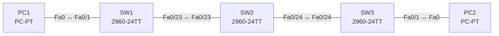

# Lab 08 – Trunks, Native VLAN, DTP und CDP/LLDP

**Dauer:** 75 min · **Niveau:** mittel

Drei Switches in einer Kette mit 802.1Q-Trunks, Native VLAN 99, ausgeschaltetem DTP und aktivem CDP/LLDP. Du findest Native-VLAN-Mismatch, DTP-Fehlaushandlung, fehlende erlaubte VLANs und verschwundene Nachbarn.

**Lernziele:** Nach diesem Lab kannst du …

- Trunks mit eigenem Native VLAN, erlaubten VLANs und ohne DTP konfigurieren.
- DTP-Kombinationen vorhersagen und Native-VLAN-Mismatches erkennen.
- Nachbarn mit CDP und LLDP finden und wissen, wo man beide besser abschaltet.

| CCNA-Ziel | Thema |
|---|---|
| 2.2 | Interswitch-Verbindungen (Trunk, 802.1Q, Native VLAN) |
| 2.3 | Layer-2-Discovery (CDP, LLDP) |
| 2.1 | VLANs über mehrere Switches inkl. Inter-VLAN-Routing |

**So arbeitest du:** Teil A = Bauen, Teil B = Reparieren, Teil C = Üben. Die Konfigurationsdateien liegen in `build/` (Ausgangszustand zum Einfügen in die CLI), `repair/` (fertig gebaut, mit Fehlern) und `solutions/` (Musterlösung und Fehlerliste, erst nach eigenem Versuch öffnen). Anleitung zum Einfügen: siehe [Arbeiten mit den Dateien](../README.md#arbeiten-mit-den-dateien).

## Topologie




### Geräte

| Gerät | Modell in Packet Tracer | Rolle |
|---|---|---|
| SW1 | 2960-24TT | Switch links |
| SW2 | 2960-24TT | Switch Mitte |
| SW3 | 2960-24TT | Switch rechts |
| PC1 | PC-PT | VLAN 10 |
| PC2 | PC-PT | VLAN 10 |

### Verkabelung

| Von | Port | Nach | Port | Kabel |
|---|---|---|---|---|
| PC1 | Fa0 | SW1 | Fa0/1 | Copper Straight-Through |
| SW1 | Fa0/23 | SW2 | Fa0/23 | Copper Cross-Over |
| SW2 | Fa0/24 | SW3 | Fa0/24 | Copper Cross-Over |
| SW3 | Fa0/1 | PC2 | Fa0 | Copper Straight-Through |

### Adressplan (Ausgangszustand)

| Gerät | Interface | Adresse | Maske | Gateway | DNS |
|---|---|---|---|---|---|
| PC1 | Fa0 (GUI) | 192.168.8.11 | 255.255.255.0 |  |  |
| PC2 | Fa0 (GUI) | 192.168.8.12 | 255.255.255.0 |  |  |


> **Packet-Tracer-Hinweis:** Falls `lldp run` in deiner Packet-Tracer-Version nicht akzeptiert wird, beschränke dich auf CDP und beantworte die LLDP-Fragen in Teil C theoretisch.

## Teil A – Bauen

Arbeite die Schritte der Reihe nach ab. Jeder Schritt sagt dir, was du tust, woran du den Erfolg erkennst (**Prüfen**) und worüber du nachdenken sollst (**Denkfrage**). Die Antworten auf die Denkfragen stehen am Ende von Teil A.

1. **Basis.** Verkabeln, `build/` einfügen und die PCs einstellen.
   - **Prüfen:** `show cdp neighbors` auf SW2 zeigt SW1 und SW3 mit ihren Port-IDs.
2. **VLANs.** Lege VLAN 10 (USERS) und 99 (NATIVE) auf allen drei Switches an und setze die PCs in VLAN 10.
3. **Trunks.** Konfiguriere beide Links zwischen den Switches mit `switchport mode trunk`, `switchport trunk native vlan 99`, `switchport trunk allowed vlan 10,99` und `switchport nonegotiate`.
   - **Prüfen:** `show interfaces trunk` zeigt Native VLAN 99 und die VLANs 10 und 99.
   - **Denkfrage:** Warum lässt man das Native VLAN nicht auf VLAN 1?
4. **DTP ausprobieren.** Stelle testweise beide Seiten eines Links auf verschiedene Kombinationen aus `dynamic auto` und `dynamic desirable`.
   - **Prüfen:** `show interfaces fa0/23 switchport` zeigt bei „Operational Mode“, ob ein Trunk entstanden ist.
   - **Denkfrage:** Welche Kombinationen ergeben einen Trunk? Welcher Befehl schaltet DTP ab?
5. **CDP lesen.** Sieh dir `show cdp neighbors detail` an und schalte CDP danach an den Access-Ports mit `no cdp enable` ab.
   - **Denkfrage:** Was verrät CDP, und warum schaltet man es an Access-Ports ab?
6. **LLDP.** Aktiviere `lldp run` und sieh dir `show lldp neighbors` an.
   - **Denkfrage:** Was unterscheidet LLDP von CDP?

<details><summary>Antworten zu den Denkfragen</summary>

- **Zu 3:** VLAN 1 ist überall Standard, und Steuerprotokolle laufen darüber. Ein ungenutztes Native VLAN erschwert VLAN Hopping per Double Tagging, weil ein Angreifer am Access-Port nicht im Native VLAN sitzt.
- **Zu 4:** Trunk entsteht bei desirable–desirable, desirable–auto und wenn eine Seite fest `trunk` ist und die andere DTP spricht. auto–auto bleibt Access, weil keiner fragt. `switchport nonegotiate` schaltet DTP ab.
- **Zu 5:** Hostname, Plattform, Software-Version, Management-IP, Port, Capabilities, Native VLAN und Duplex. Das hilft beim Dokumentieren, aber an einem Access-Port verrät es einem Angreifer zu viel. Ausnahme: IP-Telefone, die CDP für das Voice-VLAN brauchen.
- **Zu 6:** LLDP ist ein offener Standard (IEEE 802.1AB) und funktioniert mit allen Herstellern. CDP ist Cisco-proprietär. Auf Cisco-Geräten ist CDP standardmäßig an, LLDP aus.

</details>

## Teil B – Reparieren

Baue die Topologie wie oben (oder behalte deine aus Teil A), setze alle Geräte zurück (`erase startup-config`, `reload` bzw. neues Gerät) und füge dann die Dateien aus `repair/` ein. Es stecken **4 Fehler** drin. Behandle jede Meldung als Ticket: erst Symptom nachstellen, dann Layer für Layer eingrenzen, beheben und beweisen. Ändere nur, was kaputt ist.

**Ticket 1:** Auf SW2/SW3 erscheinen Meldungen zu `native vlan mismatch`; `show cdp neighbors detail` zeigt unterschiedliche Native VLANs, Verkehr im VLAN 99 stimmt nicht.

**Ticket 2:** PC1 erreicht PC2 nicht; auf SW2 zeigt `show interfaces trunk` für Fa0/23 nur VLAN 99 als erlaubt.

**Ticket 3:** `show cdp neighbors` auf SW1 und SW3 zeigt SW2 nicht mehr, obwohl der Link up ist.

**Ticket 4:** Der Link SW1–SW2 wird nicht zum Trunk (Access-Betrieb); PC1 erreicht PC2 nicht.

## Verifikation

```
show interfaces trunk
show interfaces fa0/23 switchport
show cdp neighbors [detail]
show lldp neighbors
show vlan brief
```

| Prüfung | Das solltest du sehen |
|---|---|
| Ping PC1 ↔ PC2 | Antworten über beide Trunks (VLAN 10) |
| `show interfaces trunk` auf allen Switches | Native VLAN 99 an beiden Enden, erlaubt 10 und 99 |
| `show cdp neighbors` auf SW2 | SW1 und SW3 |

## Teil C – Üben

Beantworte zuerst selbst, dann klappe die Antwort auf.

1. Welche DTP-Kombinationen bilden einen Trunk?
<details><summary>Antwort</summary>

**Alle, bei denen mindestens eine Seite aktiv fragt oder fest Trunk ist.** trunk–trunk, trunk–desirable, trunk–auto, desirable–desirable, desirable–auto. Nicht: auto–auto (beide warten) und alles mit access.

</details>

2. Wozu dient das Native VLAN, und was geht bei einem Mismatch schief?
<details><summary>Antwort</summary>

**Es trägt die Frames ohne Tag. Bei einem Mismatch landen sie auf der anderen Seite im falschen VLAN.** Damit sind zwei VLANs ungewollt verbunden. CDP und STP melden den Fehler im Log.

</details>

3. Wie findest du ohne Dokumentation heraus, welches Gerät an Gi0/1 hängt?
<details><summary>Antwort</summary>

**Mit `show cdp neighbors` oder `show lldp neighbors`.** Du siehst Gerätename, Port, Modell und mit `detail` auch die Management-IP.

</details>

4. Warum schaltet man CDP und LLDP an Access-Ports ab?
<details><summary>Antwort</summary>

**Weil sie Plattform, Version und Adressen an jeden verraten, der dort einsteckt.** Ausnahme sind Ports mit IP-Telefonen oder APs, die CDP oder LLDP-MED nutzen.

</details>

5. Wie oft sendet CDP, und wie lange gilt ein Eintrag?
<details><summary>Antwort</summary>

**Alle 60 s, ein Eintrag gilt 180 s (Hold-Time).**

</details>

## Prüfungsbezug

- 802.1Q-Tag 4 Byte, Native VLAN ohne Tag. Ein Mismatch erzeugt Meldungen, Fehlverhalten und das Risiko VLAN Hopping.
- DTP-Modi: trunk, dynamic desirable, dynamic auto, access. `nonegotiate` unterdrückt DTP.
- CDP ist Cisco-proprietär und standardmäßig an. LLDP ist IEEE 802.1AB und auf Cisco standardmäßig aus (`lldp run`, pro Port `lldp transmit`/`receive`).

## Lösungen

- `solutions/<Gerät>.cfg`: Konfiguration zu Teil A (ohne Basis-Adressen)
- `solutions/FAULTS.md`: Fehlerliste zu Teil B (Spoiler!)
