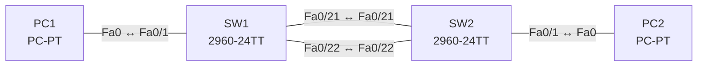

# Lab 09 – EtherChannel mit LACP

**Dauer:** 75 min · **Niveau:** mittel

Zwei Switches verbinden sich mit zwei parallelen Links, die du zu einem logischen Port-Channel bündelst (LACP). Du erkennst, welche Parameter auf beiden Seiten und an allen Mitgliedern übereinstimmen müssen.

**Lernziele:** Nach diesem Lab kannst du …

- Zwei Links mit LACP zu einem Port-Channel bündeln.
- Erklären, welche Parameter auf allen Mitgliedern gleich sein müssen.
- Die Flags in `show etherchannel summary` lesen.

| CCNA-Ziel | Thema |
|---|---|
| 2.4 | EtherChannel (LACP) |
| 2.2 | Interswitch-Verbindungen (Trunk, 802.1Q, Native VLAN) |

**So arbeitest du:** Teil A = Bauen, Teil B = Reparieren, Teil C = Üben. Die Konfigurationsdateien liegen in `build/` (Ausgangszustand zum Einfügen in die CLI), `repair/` (fertig gebaut, mit Fehlern) und `solutions/` (Musterlösung und Fehlerliste, erst nach eigenem Versuch öffnen). Anleitung zum Einfügen: siehe [Arbeiten mit den Dateien](../README.md#arbeiten-mit-den-dateien).

## Topologie




### Geräte

| Gerät | Modell in Packet Tracer | Rolle |
|---|---|---|
| SW1 | 2960-24TT | Switch 1 |
| SW2 | 2960-24TT | Switch 2 |
| PC1 | PC-PT | VLAN 10 |
| PC2 | PC-PT | VLAN 10 |

### Verkabelung

| Von | Port | Nach | Port | Kabel |
|---|---|---|---|---|
| PC1 | Fa0 | SW1 | Fa0/1 | Copper Straight-Through |
| SW1 | Fa0/21 | SW2 | Fa0/21 | Copper Cross-Over |
| SW1 | Fa0/22 | SW2 | Fa0/22 | Copper Cross-Over |
| SW2 | Fa0/1 | PC2 | Fa0 | Copper Straight-Through |

### Adressplan (Ausgangszustand)

| Gerät | Interface | Adresse | Maske | Gateway | DNS |
|---|---|---|---|---|---|
| PC1 | Fa0 (GUI) | 192.168.9.11 | 255.255.255.0 |  |  |
| PC2 | Fa0 (GUI) | 192.168.9.12 | 255.255.255.0 |  |  |


> **Packet-Tracer-Hinweis:** Packet Tracer unterstützt LACP (`channel-group 1 mode active|passive`) und PAgP (`desirable|auto`) auf den 2960; teilweise fehlen Details in `show etherchannel`.

## Teil A – Bauen

Arbeite die Schritte der Reihe nach ab. Jeder Schritt sagt dir, was du tust, woran du den Erfolg erkennst (**Prüfen**) und worüber du nachdenken sollst (**Denkfrage**). Die Antworten auf die Denkfragen stehen am Ende von Teil A.

1. **Basis.** Verkabeln (zwei Links Fa0/21 und Fa0/22), `build/` einfügen und die PCs einstellen.
   - **Prüfen:** `show spanning-tree` zeigt einen der beiden Links als blockiert.
   - **Denkfrage:** Warum blockiert STP den zweiten Link?
2. **VLAN und Access-Ports.** Lege VLAN 10 auf beiden Switches an und setze die PCs hinein.
3. **Bündeln.** `interface range Fa0/21 - 22` und `channel-group 1 mode active` auf beiden Switches. Konfiguriere danach `interface Port-channel1` als Trunk mit erlaubtem VLAN 10.
   - **Prüfen:** `show etherchannel summary` zeigt `Po1(SU)` mit `Fa0/21(P)` und `Fa0/22(P)`.
   - **Denkfrage:** Warum konfigurierst du den Trunk am Port-Channel und nicht an den Mitgliedern?
4. **Ausfall testen.** Starte einen Dauerping von PC1 zu PC2 und ziehe Fa0/21 (Cable-Tool).
   - **Prüfen:** Es gehen höchstens ein, zwei Pings verloren, `show etherchannel summary` zeigt nur noch Fa0/22 als `P`.
5. **Modi testen.** Probiere active/active, active/passive, passive/passive, on/on und on/active.
   - **Denkfrage:** Welche Kombinationen bilden einen Channel?
6. **Lastverteilung.** Sieh dir `show etherchannel load-balance` an.
   - **Denkfrage:** Warum nutzt eine einzelne Verbindung immer nur einen Link?

<details><summary>Antworten zu den Denkfragen</summary>

- **Zu 1:** Zwei parallele Links zwischen denselben Switches bilden eine Schleife. STP lässt nur einen davon weiterleiten.
- **Zu 3:** Die Einstellungen am Port-Channel werden an alle Mitglieder weitergegeben. Konfigurierst du die Mitglieder einzeln, weichen sie leicht voneinander ab, und ein Port fliegt aus dem Bündel.
- **Zu 5:** active/active, active/passive und on/on. passive/passive bildet nichts, weil keine Seite LACP startet. on/active bildet auch nichts: `on` spricht kein LACP.
- **Zu 6:** Der Switch berechnet aus Adressen (z. B. Quell- und Ziel-MAC oder -IP) einen Hash und wählt damit den Link. Für denselben Flow kommt immer dasselbe Ergebnis heraus. So bleibt die Reihenfolge der Pakete erhalten.

</details>

## Teil B – Reparieren

Baue die Topologie wie oben (oder behalte deine aus Teil A), setze alle Geräte zurück (`erase startup-config`, `reload` bzw. neues Gerät) und füge dann die Dateien aus `repair/` ein. Es stecken **4 Fehler** drin. Behandle jede Meldung als Ticket: erst Symptom nachstellen, dann Layer für Layer eingrenzen, beheben und beweisen. Ändere nur, was kaputt ist.

**Ticket 1:** `show etherchannel summary` zeigt kein `Po1(SU)`, die Links bleiben stand-alone (`I`) oder suspendiert; STP blockiert einen Link, ggf. Err-Disable.

**Ticket 2:** Der Channel steht (`Po1(SU)`), aber PC1 und PC2 erreichen sich nicht.

**Ticket 3:** Nur ein Member (Fa0/21) ist gebündelt, Fa0/22 meldet `s` oder `I`; die Bandbreite des Channels ist nur 100 Mbit/s.

**Ticket 4:** PC1 erreicht PC2 nicht, obwohl der Channel steht.

## Verifikation

```
show etherchannel summary
show etherchannel port-channel
show interfaces trunk
show spanning-tree summary
```

| Prüfung | Das solltest du sehen |
|---|---|
| `show etherchannel summary` | `Po1(SU)` mit `Fa0/21(P) Fa0/22(P)`, Protokoll LACP |
| `show interfaces trunk` | Po1 als Trunk mit VLAN 10 |
| `show spanning-tree` | Po1 als ein einziger Port, nichts blockiert |

## Teil C – Üben

Beantworte zuerst selbst, dann klappe die Antwort auf.

1. Welche Modus-Kombinationen bilden einen LACP-Channel?
<details><summary>Antwort</summary>

**active/active und active/passive.** passive/passive bildet nichts, weil niemand anfängt. `on` funktioniert nur zusammen mit `on`.

</details>

2. Ein Mitglied zeigt `(s)` für suspended. Was prüfst du?
<details><summary>Antwort</summary>

**Ob seine Parameter zum Channel und zur Gegenseite passen.** Speed, Duplex, Switchport-Modus, erlaubte VLANs, Native VLAN und das Protokoll der Gegenseite (LACP gegen PAgP oder `on`).

</details>

3. Warum wird eine einzelne TCP-Verbindung durch einen EtherChannel nicht schneller?
<details><summary>Antwort</summary>

**Weil der Hash einen Flow immer demselben Link zuweist.** Nur viele verschiedene Flows verteilen sich auf alle Links.

</details>

4. Wie sieht STP einen Port-Channel?
<details><summary>Antwort</summary>

**Als ein einziges logisches Interface.** STP blockiert deshalb keine einzelnen Mitglieder, alle Links tragen Verkehr.

</details>

5. Was ist ein Layer-3-EtherChannel?
<details><summary>Antwort</summary>

**Ein gerouteter Port-Channel.** Auf Port-Channel und Mitgliedern steht `no switchport`, die IP-Adresse liegt am Port-Channel.

</details>

## Prüfungsbezug

- LACP (IEEE 802.3ad): `active` fragt, `passive` antwortet nur. PAgP (Cisco): `desirable`/`auto`. `on` = statisch ohne Protokoll.
- Alle Mitglieder brauchen gleiche Speed, Duplex, Switchport-Modus, VLANs und Native VLAN. Bis zu 8 aktive Links.
- Lastverteilung per Hash pro Flow, nicht pro Paket.
- Flags: S = Layer 2, U = in Benutzung, P = gebündelt, I = einzeln, D = down, s = suspended.

## Lösungen

- `solutions/<Gerät>.cfg`: Konfiguration zu Teil A (ohne Basis-Adressen)
- `solutions/FAULTS.md`: Fehlerliste zu Teil B (Spoiler!)
