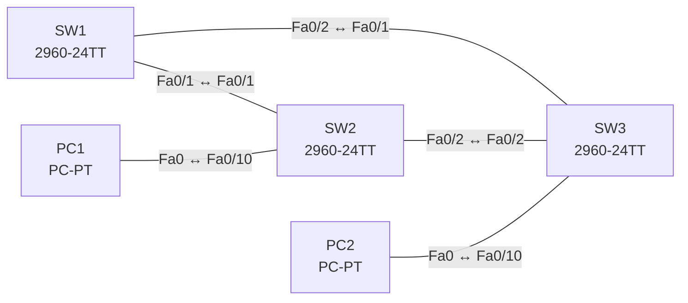

# Lab 10 – Rapid PVST+: Root Bridge, Port-Rollen und Schutzfunktionen

**Dauer:** 90 min · **Niveau:** mittel

Drei Switches im Dreieck. Du steuerst die Root Bridge per Priorität, liest Port-Rollen und -Zustände, aktivierst PortFast, BPDU Guard und Root Guard und reparierst typische STP-Fehler.

**Lernziele:** Nach diesem Lab kannst du …

- Die Root Bridge und alle Port-Rollen vorhersagen, bevor du sie prüfst.
- Rapid PVST+ einschalten und die Root per Priorität festlegen.
- PortFast, BPDU Guard, Root Guard und Loop Guard richtig einsetzen.

| CCNA-Ziel | Thema |
|---|---|
| 2.5 | Rapid PVST+ (Root Bridge, Port-Rollen und -Zustände, PortFast, Guards) |

**So arbeitest du:** Teil A = Bauen, Teil B = Reparieren, Teil C = Üben. Die Konfigurationsdateien liegen in `build/` (Ausgangszustand zum Einfügen in die CLI), `repair/` (fertig gebaut, mit Fehlern) und `solutions/` (Musterlösung und Fehlerliste, erst nach eigenem Versuch öffnen). Anleitung zum Einfügen: siehe [Arbeiten mit den Dateien](../README.md#arbeiten-mit-den-dateien).

## Topologie




### Geräte

| Gerät | Modell in Packet Tracer | Rolle |
|---|---|---|
| SW1 | 2960-24TT | Root Bridge |
| SW2 | 2960-24TT | Backup-Root |
| SW3 | 2960-24TT | Access-Switch |
| PC1 | PC-PT | VLAN 10 |
| PC2 | PC-PT | VLAN 10 |

### Verkabelung

| Von | Port | Nach | Port | Kabel |
|---|---|---|---|---|
| SW1 | Fa0/1 | SW2 | Fa0/1 | Copper Cross-Over |
| SW1 | Fa0/2 | SW3 | Fa0/1 | Copper Cross-Over |
| SW2 | Fa0/2 | SW3 | Fa0/2 | Copper Cross-Over |
| PC1 | Fa0 | SW2 | Fa0/10 | Copper Straight-Through |
| PC2 | Fa0 | SW3 | Fa0/10 | Copper Straight-Through |

### Adressplan (Ausgangszustand)

| Gerät | Interface | Adresse | Maske | Gateway | DNS |
|---|---|---|---|---|---|
| PC1 | Fa0 (GUI) | 192.168.10.11 | 255.255.255.0 |  |  |
| PC2 | Fa0 (GUI) | 192.168.10.12 | 255.255.255.0 |  |  |


## Teil A – Bauen

Arbeite die Schritte der Reihe nach ab. Jeder Schritt sagt dir, was du tust, woran du den Erfolg erkennst (**Prüfen**) und worüber du nachdenken sollst (**Denkfrage**). Die Antworten auf die Denkfragen stehen am Ende von Teil A.

1. **Ausgangslage.** Verkabeln (Dreieck), `build/` einfügen und die PCs einstellen. Sieh dir auf allen Switches `show spanning-tree` an.
   - **Prüfen:** Ein Switch nennt sich „This bridge is the root“.
   - **Denkfrage:** Warum wird ausgerechnet dieser Switch Root, obwohl du nichts eingestellt hast?
2. **Rapid PVST+.** Setze auf allen drei Switches `spanning-tree mode rapid-pvst`.
   - **Prüfen:** `show spanning-tree` meldet „protocol rstp“.
   - **Denkfrage:** Was macht RSTP schneller als das klassische STP?
3. **Root festlegen.** SW1 bekommt `spanning-tree vlan 1,10 priority 4096`, SW2 als Backup `8192`. Bestimme vorher auf Papier, welche Ports Root, Designated und Alternate werden (Kosten: Fa 19, Gi 4).
   - **Prüfen:** `show spanning-tree vlan 10` bestätigt deine Vorhersage: SW1 ist Root, auf SW3 ist ein Port Alternate.
4. **Edge-Ports.** Setze an den PC-Ports `spanning-tree portfast` und `spanning-tree bpduguard enable`. Stecke testweise einen Switch an einen solchen Port.
   - **Prüfen:** Der Port geht in den Zustand err-disabled.
5. **Root Guard.** Setze auf SW2 an Fa0/2 (Richtung SW3) `spanning-tree guard root`. Gib SW3 testweise Priorität 0.
   - **Prüfen:** SW2 meldet Fa0/2 als `root-inconsistent`. Nimm die Priorität auf SW3 danach zurück.
6. **Weitere Schutzfunktionen.** Lies nach, was Loop Guard, BPDU Filter und `spanning-tree portfast default` tun.
   - **Denkfrage:** Wo passt welche Funktion, und welche ist gefährlich?

<details><summary>Antworten zu den Denkfragen</summary>

- **Zu 1:** Alle haben dieselbe Standardpriorität 32768 plus VLAN-ID. Dann entscheidet die kleinste MAC-Adresse. Das ist oft ein altes Gerät, also nicht unbedingt der beste Switch für die Rolle.
- **Zu 2:** RSTP wartet nicht auf Timer. Zwei Switches einigen sich per Proposal und Agreement in Bruchteilen von Sekunden. Für jeden Root Port steht außerdem ein Alternate Port bereit, der sofort übernimmt.
- **Zu 6:** Loop Guard an Ports, die BPDUs empfangen sollen (Root- und Alternate-Ports zwischen Switches): Bleiben BPDUs aus, wird der Port nicht zum Forwarding. BPDU Filter ist gefährlich: Der Port sendet und verarbeitet keine BPDUs mehr, Schleifen bleiben unbemerkt. `portfast default` setzt PortFast an allen Access-Ports, sinnvoll zusammen mit `bpduguard default`.

</details>

## Teil B – Reparieren

Baue die Topologie wie oben (oder behalte deine aus Teil A), setze alle Geräte zurück (`erase startup-config`, `reload` bzw. neues Gerät) und füge dann die Dateien aus `repair/` ein. Es stecken **4 Fehler** drin. Behandle jede Meldung als Ticket: erst Symptom nachstellen, dann Layer für Layer eingrenzen, beheben und beweisen. Ändere nur, was kaputt ist.

**Ticket 1:** Die Root Bridge ist nicht mehr SW1; SW2 meldet `ROOTGUARD_BLOCK` auf Fa0/2 und `show spanning-tree` zeigt Fa0/2 als `*ROOT_INCONS`.

**Ticket 2:** Nach einem Linkausfall dauert die Umschaltung 30–50 Sekunden; `show spanning-tree` auf SW2 zeigt `Spanning tree enabled protocol ieee`.

**Ticket 3:** PC2 hat nach dem Einstecken eine längere Wartezeit bis zum Link-Status Forwarding als PC1; `show spanning-tree interface fa0/10 detail` zeigt Edge `no`.

**Ticket 4:** Der Verkehr von PC2 in VLAN 10 nimmt den Umweg über SW2 statt des direkten Links zu SW1; der Root Port von SW3 für VLAN 10 ist Fa0/2.

## Verifikation

```
show spanning-tree
show spanning-tree vlan 10
show spanning-tree summary
show spanning-tree interface fa0/10 detail
show errdisable recovery
```

| Prüfung | Das solltest du sehen |
|---|---|
| `show spanning-tree vlan 10` auf SW1 | „This bridge is the root“, alle Ports Designated |
| auf SW2 | Root Port Fa0/1 |
| auf SW3 | Root Port Fa0/1, Fa0/2 als Alternate (Discarding) |

## Teil C – Üben

Beantworte zuerst selbst, dann klappe die Antwort auf.

1. Wie wird der Root Port bestimmt?
<details><summary>Antwort</summary>

**Über die niedrigsten Gesamtkosten zur Root Bridge.** Bei Gleichstand gewinnt die kleinere Bridge-ID des Nachbarn, danach dessen kleinere Port-ID.

</details>

2. Welche Port-Rollen und Zustände kennt RSTP?
<details><summary>Antwort</summary>

**Rollen: Root, Designated, Alternate, Backup, Disabled. Zustände: Discarding, Learning, Forwarding.**

</details>

3. Was unterscheidet BPDU Guard von Root Guard?
<details><summary>Antwort</summary>

**BPDU Guard sperrt bei jeder BPDU, Root Guard nur bei einer besseren.** BPDU Guard schaltet einen Edge-Port ab, sobald überhaupt eine BPDU kommt. Root Guard lässt normale BPDUs zu, blockiert den Port aber (root-inconsistent), wenn darüber eine neue Root erscheinen würde.

</details>

4. Warum ist `spanning-tree bpdufilter enable` gefährlich?
<details><summary>Antwort</summary>

**Weil STP an diesem Port blind wird.** Der Port sendet und verarbeitet keine BPDUs mehr. Steckt jemand einen Switch an, entsteht eine Schleife, die STP nicht erkennt.

</details>

5. Was passiert mit PortFast an einem Trunk zu einem Switch?
<details><summary>Antwort</summary>

**Der Port geht sofort auf Forwarding und kann kurzzeitig eine Schleife bilden.** PortFast gehört an Ports zu Endgeräten.

</details>

## Prüfungsbezug

- Root Bridge = kleinste Bridge-ID: Priorität (Schritte 4096) + VLAN-ID + MAC.
- Root Port: kleinste Pfadkosten, dann kleinste Bridge-ID des Senders, dann kleinste Port-ID des Senders.
- RSTP-Rollen: Root, Designated, Alternate, Backup, Disabled. Zustände: Discarding, Learning, Forwarding.
- PortFast für Edge-Ports. BPDU Guard → err-disabled. Root Guard → root-inconsistent. Loop Guard gegen einseitige Links. BPDU Filter schaltet STP am Port praktisch ab.

## Lösungen

- `solutions/<Gerät>.cfg`: Konfiguration zu Teil A (ohne Basis-Adressen)
- `solutions/FAULTS.md`: Fehlerliste zu Teil B (Spoiler!)
