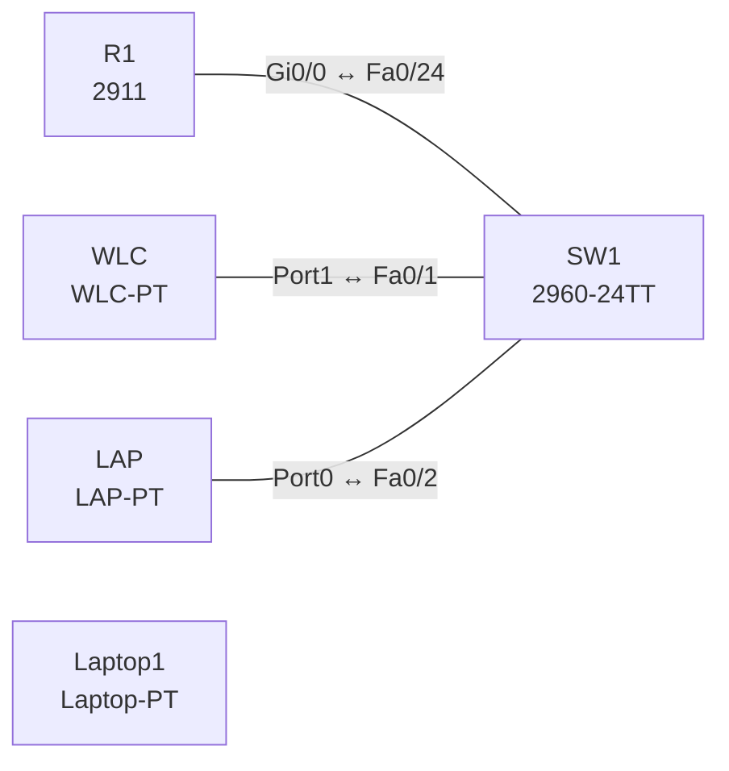

# Lab 11 – Wireless-Architekturen: WLC, Lightweight-AP und DHCP

**Dauer:** 75 min · **Niveau:** mittel

Ein Lightweight-AP bekommt per DHCP eine Adresse samt Option 43 und findet so den WLC. Du lernst Architekturen (Autonomous, Lightweight/Split-MAC, Cloud-managed), AP-Modi und die Switch-Anbindung von AP und Controller.

**Lernziele:** Nach diesem Lab kannst du …

- Erklären, wie ein Lightweight-AP per DHCP Option 43 seinen WLC findet.
- Autonomous, Lightweight, Cloud-managed und Embedded Wireless unterscheiden.
- Jedem AP-Modus einen Einsatz und jedem Gerät den passenden Switch-Port zuordnen.

| CCNA-Ziel | Thema |
|---|---|
| 2.6 | Wireless-Architekturen und AP-Modi |
| 2.7 | WLAN-Komponenten: Verbindungen von AP und WLC |
| 1.11 | Wireless-Grundlagen (Kanäle, SSID, RF, Verschlüsselung) |

**So arbeitest du:** Teil A = Bauen, Teil B = Reparieren, Teil C = Üben. Die Konfigurationsdateien liegen in `build/` (Ausgangszustand zum Einfügen in die CLI), `repair/` (fertig gebaut, mit Fehlern) und `solutions/` (Musterlösung und Fehlerliste, erst nach eigenem Versuch öffnen). Anleitung zum Einfügen: siehe [Arbeiten mit den Dateien](../README.md#arbeiten-mit-den-dateien).

## Topologie




### Geräte

| Gerät | Modell in Packet Tracer | Rolle |
|---|---|---|
| R1 | 2911 | Gateway und DHCP-Server |
| SW1 | 2960-24TT | Access-Switch |
| WLC | WLC-PT | Controller (Management-IP) |
| LAP | LAP-PT | Lightweight-AP |
| Laptop1 | Laptop-PT | Funk-Client (WLAN-Modul WPC300N) |

### Verkabelung

| Von | Port | Nach | Port | Kabel |
|---|---|---|---|---|
| R1 | Gi0/0 | SW1 | Fa0/24 | Copper Straight-Through |
| WLC | Port1 | SW1 | Fa0/1 | Copper Straight-Through |
| LAP | Port0 | SW1 | Fa0/2 | Copper Straight-Through |

### Adressplan (Ausgangszustand)

| Gerät | Interface | Adresse | Maske | Gateway | DNS |
|---|---|---|---|---|---|
| R1 | Gi0/0 | 10.11.1.1 | 255.255.255.0 | | |
| WLC | Fa0 (GUI) | 10.11.1.5 | 255.255.255.0 | 10.11.1.1 |  |
| LAP | Fa0 (GUI) | DHCP |  |  |  |
| Laptop1 | Fa0 (GUI) | DHCP |  |  |  |


> **Packet-Tracer-Hinweis:** Portnamen und Dialoge von WLC und LAP unterscheiden sich je nach Packet-Tracer-Version. Wenn der LAP sich nicht anmeldet: auf dem LAP unter Config die WLC-Adresse prüfen und `option 43` im DHCP-Pool vergleichen. WLC über den Browser (Server-PC) aufrufen: `https://10.11.1.5`.

## Teil A – Bauen

Arbeite die Schritte der Reihe nach ab. Jeder Schritt sagt dir, was du tust, woran du den Erfolg erkennst (**Prüfen**) und worüber du nachdenken sollst (**Denkfrage**). Die Antworten auf die Denkfragen stehen am Ende von Teil A.

1. **Basis.** Verkabeln, `build/` einfügen und am WLC die Management-Adresse 10.11.1.5/24 mit Gateway 10.11.1.1 setzen.
   - **Denkfrage:** Was braucht der Lightweight-AP, bevor er sich anmelden kann?
2. **DHCP mit Option 43.** Lege auf R1 `ip dhcp pool WLAN` an, mit `option 43 hex f104.0a0b.0105`.
   - **Prüfen:** `show ip dhcp binding` zeigt eine Adresse für den AP.
   - **Denkfrage:** Wie liest du den Hexwert?
3. **Anmeldung am WLC.** Öffne die WLC-Oberfläche vom Server-PC aus (`https://10.11.1.5`).
   - **Prüfen:** Unter *Wireless* bzw. *Monitor → Access Points* steht der AP.
   - **Denkfrage:** Welches Protokoll verbindet AP und WLC, und was heißt Split-MAC?
4. **Architekturen vergleichen.** Autonomous, Lightweight mit WLC, Cloud-managed (Meraki), Embedded Wireless (Controller im AP oder Switch).
   - **Denkfrage:** Wofür eignet sich welche Variante?
5. **AP-Modi.** Local, FlexConnect, Monitor, Sniffer, Rogue Detector, Bridge/Mesh, SE-Connect.
   - **Denkfrage:** Wann setzt du welchen Modus ein?
6. **Anbindung.** Überlege, welcher Switch-Port-Modus an diese Geräte gehört: (a) Lightweight-AP im Local Mode, (b) FlexConnect-AP mit lokalem Switching mehrerer VLANs, (c) WLC mit mehreren Ports.

<details><summary>Antworten zu den Denkfragen</summary>

- **Zu 1:** Eine IP-Adresse und die Adresse des WLC. Ohne Controller-Adresse weiß der AP nicht, wo er sich melden soll. DHCP liefert beides.
- **Zu 2:** f1 ist der Typ (Liste von Controller-Adressen), 04 die Länge in Byte, 0a0b0105 die Adresse: 0a = 10, 0b = 11, 01 = 1, 05 = 5, also 10.11.1.5.
- **Zu 3:** CAPWAP, Control auf UDP 5246, Daten auf UDP 5247. Split-MAC teilt die Arbeit: Zeitkritisches wie Beacons und Verschlüsselung macht der AP, Verwaltung, Anmeldung und Roaming der WLC.
- **Zu 4:** Autonomous: wenige APs, jeder einzeln verwaltet. Lightweight mit WLC: viele APs, zentrale Steuerung, Roaming, Funkoptimierung. Cloud-managed: verteilte Standorte ohne eigene Controller, Verwaltung aus der Cloud, die Daten bleiben lokal. Embedded: kleine Standorte, Controller-Funktion ohne eigenes Gerät.
- **Zu 5:** Local: Standard, bedient Clients, Daten über den WLC. FlexConnect: Außenstelle, lokales Switching, läuft weiter, wenn die WAN-Verbindung zum WLC fällt. Monitor: scannt Kanäle, findet Rogues und Angriffe. Sniffer: schickt Funkpakete an einen Analyzer. Rogue Detector: sucht fremde Geräte im LAN. Bridge/Mesh: verbindet Gebäude per Funk. SE-Connect: Spektrumanalyse.
- **Zu 6:** (a) Access-Port, weil der Verkehr im CAPWAP-Tunnel steckt. (b) Trunk, weil der AP mehrere VLANs selbst ausleitet. (c) Trunk, mehrere Ports gebündelt als LAG.

</details>

## Teil B – Reparieren

Baue die Topologie wie oben (oder behalte deine aus Teil A), setze alle Geräte zurück (`erase startup-config`, `reload` bzw. neues Gerät) und füge dann die Dateien aus `repair/` ein. Es stecken **3 Fehler** drin. Behandle jede Meldung als Ticket: erst Symptom nachstellen, dann Layer für Layer eingrenzen, beheben und beweisen. Ändere nur, was kaputt ist.

**Ticket 1:** Der LAP bekommt eine Adresse, erscheint aber nicht im WLC.

**Ticket 2:** Der LAP ist offline (keine Link-LED), `show interfaces status` auf SW1 zeigt Fa0/2 als disabled.

**Ticket 3:** LAP und Laptop erhalten keine Adresse (APIPA oder keine Anmeldung); `show ip dhcp pool` zeigt 0 freie Adressen.

## Verifikation

```
show ip dhcp binding        ! R1
show ip dhcp pool
show interfaces status      ! SW1
```

| Prüfung | Das solltest du sehen |
|---|---|
| `show ip dhcp binding` | Adressen für AP und Laptop aus 10.11.1.0/24 |
| WLC *Monitor → Access Points* | der AP ist angemeldet |
| Laptop | findet die SSID und holt eine Adresse aus 10.11.1.0/24 |

## Teil C – Üben

Beantworte zuerst selbst, dann klappe die Antwort auf.

1. Wozu dient Option 43 im DHCP?
<details><summary>Antwort</summary>

**Sie sagt dem Lightweight-AP, wo sein WLC ist.** Mit der Adresse aus der Option baut der AP den CAPWAP-Tunnel zum Controller auf.

</details>

2. Was bedeutet Split-MAC?
<details><summary>Antwort</summary>

**Die Arbeit ist zwischen AP und WLC geteilt.** Der AP macht das Zeitkritische: Beacons, Verschlüsselung, Bestätigungen. Der WLC macht Verwaltung, Authentisierung und Roaming.

</details>

3. Wofür ist FlexConnect, und welcher Port-Typ gehört dazu?
<details><summary>Antwort</summary>

**Für Außenstellen, die auch ohne WLC weiterlaufen sollen. Am Switch hängt der AP an einem Trunk.** Der AP schaltet den Verkehr lokal in die VLANs, statt alles zum WLC zu tunneln.

</details>

4. Was bringt ein Controller gegenüber Autonomous APs?
<details><summary>Antwort</summary>

**Zentrale Verwaltung.** Konfiguration und Updates an einer Stelle, Roaming zwischen APs, automatische Wahl von Kanal und Sendeleistung (RRM), einheitliche Sicherheit und Überwachung.

</details>

5. Was macht ein AP im Monitor- oder Sniffer-Modus?
<details><summary>Antwort</summary>

**Er bedient keine Clients, sondern hört nur zu.** Monitor scannt alle Kanäle nach fremden APs und Angriffen. Sniffer schickt die mitgeschnittenen Pakete an einen Analyzer wie Wireshark.

</details>

## Prüfungsbezug

- Lightweight-AP und WLC sprechen CAPWAP: Control UDP 5246, Daten UDP 5247. Split-MAC teilt die Aufgaben.
- AP im Local Mode an einen Access-Port, FlexConnect an einen Trunk. WLC per Trunk, mehrere Ports als LAG.
- Management-Zugang zum WLC: Console, SSH, HTTPS, SNMP. HTTP und Telnet sind unsicher.
- Cloud-managed (Meraki): Verwaltung aus der Cloud, Nutzdaten bleiben lokal.

## Lösungen

- `solutions/<Gerät>.cfg`: Konfiguration zu Teil A (ohne Basis-Adressen)
- `solutions/FAULTS.md`: Fehlerliste zu Teil B (Spoiler!)
