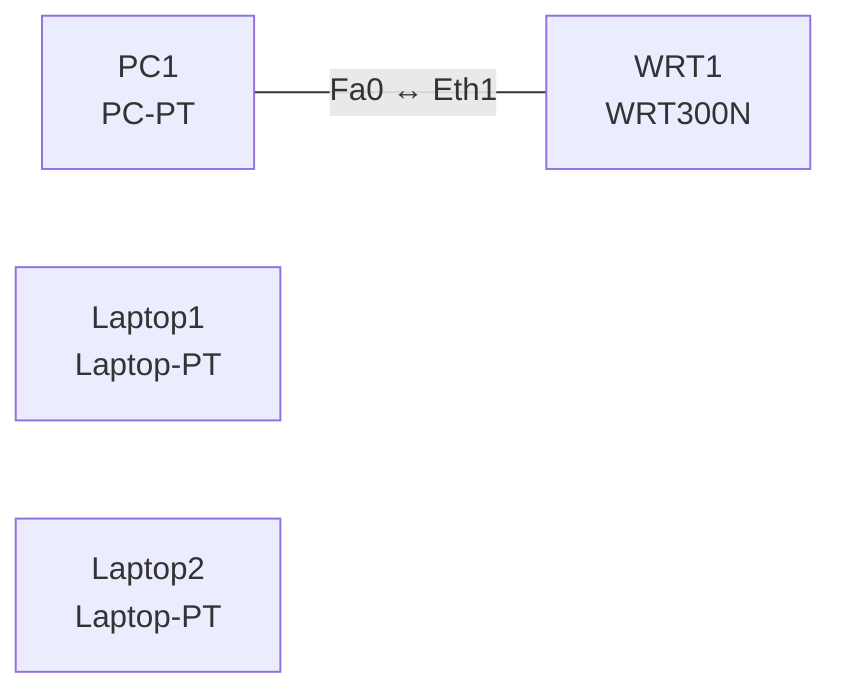

# Lab 12 – WLAN per GUI: SSID, Kanäle, WPA2-PSK und Fehleranalyse

**Dauer:** 75 min · **Niveau:** leicht

Am Wireless-Router (WRT300N) und im WLC-Webinterface konfigurierst du SSID, Kanal, Sicherheitsmodus und Passphrase. In den Analyseaufgaben liest du Einstellungen und findest, warum Clients sich nicht verbinden.

**Lernziele:** Nach diesem Lab kannst du …

- Ein WLAN mit SSID, Kanal und WPA2-PSK am Wireless-Router und im WLC einrichten.
- Nicht überlappende Kanäle wählen und Störungen durch Überlappung erkennen.
- Personal und Enterprise, WPA2 und WPA3 unterscheiden.

| CCNA-Ziel | Thema |
|---|---|
| 1.11 | Wireless-Grundlagen (Kanäle, SSID, RF, Verschlüsselung) |
| 2.9 | WLAN-GUI-Konfiguration interpretieren |
| 5.9 | Wireless-Sicherheit (WPA, WPA2, WPA3) |
| 5.10 | WLAN mit WPA2-PSK per GUI konfigurieren |

**So arbeitest du:** Teil A = Bauen, Teil B2 = Konfiguration interpretieren, Teil C = Üben. Die Konfigurationsdateien liegen in `build/` (Ausgangszustand zum Einfügen in die CLI), `repair/` (fertig gebaut, mit Fehlern) und `solutions/` (Musterlösung und Fehlerliste, erst nach eigenem Versuch öffnen). Anleitung zum Einfügen: siehe [Arbeiten mit den Dateien](../README.md#arbeiten-mit-den-dateien).

## Topologie

### Geräte

| Gerät | Modell in Packet Tracer | Rolle |
|---|---|---|
| WRT1 | WRT300N | Wireless Router (Kanal 1) |
| PC1 | PC-PT | kabelgebunden |
| Laptop1 | Laptop-PT | WLAN-Client |
| Laptop2 | Laptop-PT | WLAN-Client |

### Verkabelung

| Von | Port | Nach | Port | Kabel |
|---|---|---|---|---|
| PC1 | Fa0 | WRT1 | Eth1 | Copper Straight-Through |

### Adressplan (Ausgangszustand)

| Gerät | Interface | Adresse | Maske | Gateway | DNS |
|---|---|---|---|---|---|
| PC1 | Fa0 (GUI) | DHCP |  |  |  |
| Laptop1 | Fa0 (GUI) | DHCP |  |  |  |
| Laptop2 | Fa0 (GUI) | DHCP |  |  |  |

> **Packet-Tracer-Hinweis:** Laptops brauchen das WLAN-Modul (WPC300N): Gerät ausschalten, Ethernet-Modul ziehen, WPC300N einsetzen, einschalten. WRT300N öffnest du per Klick → GUI → Wireless.

## Teil A – Bauen

Arbeite die Schritte der Reihe nach ab. Jeder Schritt sagt dir, was du tust, woran du den Erfolg erkennst (**Prüfen**) und worüber du nachdenken sollst (**Denkfrage**). Die Antworten auf die Denkfragen stehen am Ende von Teil A.

1. **Basis.** Verkabeln (PC1 an Eth1) und die Laptops platzieren. Prüfe am WRT300N unter Setup → Basic: IP 192.168.0.1, DHCP an.
2. **WLAN anlegen.** GUI → Wireless → Basic: SSID `LAB-WLAN`, Standard `Mixed`, Kanal 1. Verbinde Laptop1.
   - **Prüfen:** Laptop1 bekommt eine Adresse aus 192.168.0.0/24.
   - **Denkfrage:** Welche Kanäle im 2,4-GHz-Band überlappen sich nicht?
3. **WPA2-PSK.** Wireless Security: `WPA2 Personal`, Verschlüsselung `AES`, Passphrase `Lab#2026wlan`. Verbinde Laptop1 neu.
   - **Prüfen:** Mit der richtigen Passphrase klappt es, mit einer falschen nicht.
   - **Denkfrage:** Warum AES statt TKIP, und warum WPA2 oder WPA3 statt WEP?
4. **SSID verstecken.** Schalte den SSID-Broadcast aus.
   - **Prüfen:** Laptop1 findet das Netz nicht mehr in der Liste.
   - **Denkfrage:** Macht das das WLAN sicherer?
5. **Zweites WLAN.** Stell einen zweiten Router mit Kanal 3 daneben.
   - **Denkfrage:** Welches Problem entsteht, und wie behebst du es?
6. **WLAN im WLC.** Lege im WLC aus Lab 11 unter *WLANs → Create New* an: Profil `Staff`, SSID `LAB-WLAN`, Layer-2-Security `WPA2 + AES`, Auth Key Mgmt `PSK`, passendes Interface, Status Enabled.
   - **Denkfrage:** Wo stellst du das QoS-Profil ein, und welches nimmst du für Sprache?

Antworten zu den Denkfragen

- **Zu 2:** 1, 6 und 11. Die Kanäle liegen 5 MHz auseinander, ein WLAN ist 20 MHz breit. Erst fünf Kanäle Abstand reichen.
- **Zu 3:** AES-CCMP ist ein starkes, aktuelles Verfahren. TKIP war nur eine Übergangslösung für alte WEP-Hardware und gilt als gebrochen, WEP lässt sich in Minuten knacken. WPA3 ersetzt PSK durch SAE und schützt gegen Wörterbuchangriffe.
- **Zu 4:** Nein. Die SSID steht weiter in den Frames der Clients und ist mit jedem Sniffer sichtbar. Das Netz ist nur aus der Liste verschwunden.
- **Zu 5:** Kanal 3 überlappt mit Kanal 1 und mit 6. Beide Netze stören sich und werden langsamer. Lösung: den zweiten Router auf 6 oder 11 stellen.
- **Zu 6:** Im WLAN-Profil unter *QoS*. Platinum ist für Sprache gedacht, Gold für Video, Silver ist Standard (Best Effort), Bronze für Hintergrundverkehr.

## Teil B2 – Konfiguration interpretieren

Diese Aufgaben brauchen keine Geräte: Lies die Einstellungen, beantworte die Frage und klappe dann die Antwort auf.

**1. Laptop findet das WLAN nicht**

| Einstellung | Wert |
|---|---|
| Router | WRT300N |
| SSID | LAB-WLAN |
| SSID-Broadcast | Disabled |
| Standard | Mixed |
| Kanal | 6 |
| Security | WPA2 Personal, AES |

Der Laptop zeigt `LAB-WLAN` in der Netzliste nicht an. Was ist die wahrscheinlichste Ursache, und wie verbindest du dich trotzdem?

Antwort

**Der SSID-Broadcast ist aus.** Das Netz ist da, steht aber nicht in der Liste. Trag die SSID von Hand als verstecktes Netz ein oder schalte den Broadcast wieder an. Sicherer wird das Netz durch das Verstecken nicht.

**2. Verbindung scheitert nach Eingabe der Passphrase**

| Einstellung | Router | Laptop-Profil |
|---|---|---|
| SSID | LAB-WLAN | LAB-WLAN |
| Security | WPA2-Personal, AES | WPA2-Personal, AES |
| Passphrase | `Lab#2026wlan` | `lab#2026wlan` |

Warum schlägt die Anmeldung fehl?

Antwort

**Die Passphrase unterscheidet sich in der Groß- und Kleinschreibung (`L` gegen `l`).** Aus der Passphrase wird der Schlüssel berechnet. Ist sie anders, passen die Schlüssel nicht, und der Vier-Wege-Handshake scheitert.

**3. Schlechte Leistung im Büro**

| AP | Kanal | Band | Breite |
|---|---|---|---|
| AP-Eingang | 1 | 2,4 GHz | 20 MHz |
| AP-Mitte | 3 | 2,4 GHz | 20 MHz |
| AP-Hinten | 6 | 2,4 GHz | 20 MHz |

Wo liegt das Problem, und wie lautet die Lösung?

Antwort

**Kanal 3 überlappt mit 1 und mit 6.** Die APs stören sich gegenseitig. Lösung: nur 1, 6 und 11 verwenden, z. B. 1, 11, 6, oder auf 5 GHz mit mehr freien Kanälen ausweichen.

**4. WLC: Clients landen im falschen Subnetz**

| WLAN-Einstellung | Wert |
|---|---|
| Profil / SSID | Staff / LAB-STAFF |
| Status | Enabled |
| Layer-2-Security | WPA2 + AES |
| Auth Key Mgmt | PSK |
| QoS | Silver |
| Interface/Interface Group | management |

Die Clients bekommen Adressen aus dem Management-Subnetz. Was ist falsch?

Antwort

**Das WLAN hängt am Interface `management` statt am Interface für das Mitarbeiter-VLAN.** Lege ein dynamisches Interface für dieses VLAN an und ordne das WLAN zu. Der Trunk zum WLC muss das VLAN ebenfalls erlauben.

**5. WLC: Enterprise gewünscht, aber nur eine Passphrase**

| WLAN-Einstellung | Wert |
|---|---|
| Layer-2-Security | WPA2 + AES |
| Auth Key Mgmt | PSK |
| RADIUS-Server | – |

Die Firma will einen eigenen Zugang pro Benutzer. Was änderst du?

Antwort

**Auth Key Mgmt von `PSK` auf `802.1X` umstellen und einen RADIUS-Server eintragen, z. B. ISE.** Dann meldet sich jeder Benutzer mit eigenem Namen und Passwort oder Zertifikat an (WPA2- bzw. WPA3-Enterprise).

## Verifikation

| Prüfung | Das solltest du sehen |
|---|---|
| Netzliste auf Laptop1 | `LAB-WLAN` (solange der Broadcast an ist) |
| Verbindung mit WPA2-PSK | Adresse aus 192.168.0.0/24 |
| falsche Passphrase | Verbindung scheitert |
| Ping Laptop1 → PC1 | Antworten |

## Teil C – Üben

Beantworte zuerst selbst, dann klappe die Antwort auf.

1. Warum 1, 6 und 11 im 2,4-GHz-Band?

Antwort

**Weil sich nur diese drei nicht überlappen.** Die Kanäle liegen 5 MHz auseinander, ein WLAN belegt aber 20 MHz, also etwa vier bis fünf Kanäle.

2. Was unterscheidet WPA2-Personal von Enterprise?

Antwort

**Personal nutzt einen gemeinsamen Schlüssel, Enterprise eine eigene Anmeldung pro Benutzer.** Enterprise läuft über 802.1X gegen einen RADIUS-Server.

3. Wofür steht SAE bei WPA3?

Antwort

**Simultaneous Authentication of Equals.** SAE ersetzt den PSK-Handshake, schützt gegen Offline-Wörterbuchangriffe und bietet Forward Secrecy: Ein später geknacktes Passwort entschlüsselt keinen alten Verkehr.

4. Was ist ein Rogue AP?

Antwort

**Ein nicht genehmigter Access Point im eigenen Netz oder in der Nähe.** Der WLC oder APs im Monitor-Modus können ihn erkennen.

5. Was bewirkt das QoS-Profil Platinum?

Antwort

**Die höchste Priorität auf der Funkstrecke, gedacht für Sprache.**

## Prüfungsbezug

- 2,4 GHz: nur 1, 6 und 11 überlappen sich nicht (je 20 MHz). 5 GHz hat viel mehr freie Kanäle.
- SSID = Name des Netzes, BSSID = MAC-Adresse des AP-Funkmoduls.
- WPA2: AES-CCMP. WPA3: SAE statt PSK, PMF Pflicht, 192-Bit-Modus bei Enterprise.
- Personal = PSK, Enterprise = 802.1X mit RADIUS.
- WLAN im WLC: Layer-2-Security, Auth Key Mgmt (PSK oder 802.1X), Interface, QoS-Profil, Status.

## Lösungen

- `solutions/<Gerät>.cfg`: Konfiguration zu Teil A (ohne Basis-Adressen)
