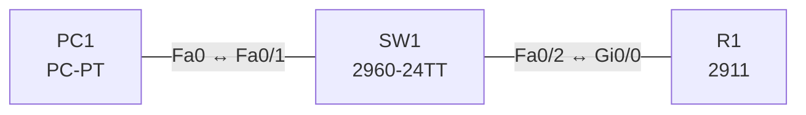

# Lab 13 – Gerätezugriff: lokale Passwörter, Passwortrichtlinie und SSH

**Dauer:** 75 min · **Niveau:** leicht

Router und Switch werden für sicheren Fernzugriff gehärtet: verschlüsselte Passwörter, lokale Benutzer mit `secret`, SSH Version 2 statt Telnet, Mindestlänge, Login-Block und Timeouts. Dazu gehört die Einordnung der Management-Zugänge (Console, Telnet, SSH, HTTP/HTTPS, RADIUS/TACACS+).

**Lernziele:** Nach diesem Lab kannst du …

- Passwörter sicher speichern und eine Passwortrichtlinie auf dem Gerät umsetzen.
- SSH Version 2 mit lokalem Benutzer einrichten und Telnet abschalten.
- Die Management-Zugänge nach ihrer Sicherheit einordnen.

| CCNA-Ziel | Thema |
|---|---|
| 5.3 | Gerätezugriff mit lokalen Passwörtern |
| 5.4 | Passwort-Richtlinien (Komplexität, MFA, Zertifikate, Biometrie) |
| 4.8 | SSH für Fernzugriff |
| 2.8 | Verwaltungszugriff (Console, Telnet, SSH, HTTP/HTTPS, TACACS+/RADIUS, Cloud) |

**So arbeitest du:** Teil A = Bauen, Teil B = Reparieren, Teil C = Üben. Die Konfigurationsdateien liegen in `build/` (Ausgangszustand zum Einfügen in die CLI), `repair/` (fertig gebaut, mit Fehlern) und `solutions/` (Musterlösung und Fehlerliste, erst nach eigenem Versuch öffnen). Anleitung zum Einfügen: siehe [Arbeiten mit den Dateien](../README.md#arbeiten-mit-den-dateien).

## Topologie




### Geräte

| Gerät | Modell in Packet Tracer | Rolle |
|---|---|---|
| R1 | 2911 | Router (Zugriff über SSH) |
| SW1 | 2960-24TT | Access-Switch (Management 10.13.1.2) |
| PC1 | PC-PT | Admin-PC |

### Verkabelung

| Von | Port | Nach | Port | Kabel |
|---|---|---|---|---|
| PC1 | Fa0 | SW1 | Fa0/1 | Copper Straight-Through |
| SW1 | Fa0/2 | R1 | Gi0/0 | Copper Straight-Through |

### Adressplan (Ausgangszustand)

| Gerät | Interface | Adresse | Maske | Gateway | DNS |
|---|---|---|---|---|---|
| R1 | Gi0/0 | 10.13.1.1 | 255.255.255.0 | | |
| SW1 | Vlan1 | 10.13.1.2 | 255.255.255.0 | | |
| PC1 | Fa0 (GUI) | 10.13.1.11 | 255.255.255.0 | 10.13.1.1 |  |


> **Packet-Tracer-Hinweis:** Schlüsselerzeugung: `crypto key generate rsa modulus 2048` (Packet Tracer verlangt zuvor `ip domain-name`). SSH-Client am PC: Desktop → Command Prompt → `ssh -l admin 10.13.1.1`.

## Teil A – Bauen

Arbeite die Schritte der Reihe nach ab. Jeder Schritt sagt dir, was du tust, woran du den Erfolg erkennst (**Prüfen**) und worüber du nachdenken sollst (**Denkfrage**). Die Antworten auf die Denkfragen stehen am Ende von Teil A.

1. **Basis.** Verkabeln, `build/` einfügen und PC1 auf 10.13.1.11/24 setzen.
   - **Prüfen:** PC1 pingt R1 und SW1. `telnet 10.13.1.1` scheitert, weil auf den vty-Lines noch nichts eingerichtet ist.
2. **Lokale Passwörter.** Setze `enable secret`, ein Console-Passwort und `service password-encryption`.
   - **Prüfen:** `show running-config` zeigt das Enable-Secret als Hash (Typ 5, 8 oder 9) und das Console-Passwort als Typ 7.
   - **Denkfrage:** Warum ist `secret` besser als `password`?
3. **Passwortrichtlinie.** Setze `security passwords min-length 10`, `login block-for 60 attempts 3 within 30` und auf vty und Console `exec-timeout 5 0`.
   - **Prüfen:** Ein kürzeres Passwort wird abgelehnt. Nach drei Fehlversuchen meldet `show login` die Sperre.
   - **Denkfrage:** Welche Teile einer Passwortrichtlinie kann der Router selbst nicht durchsetzen?
4. **SSH einrichten.** `username admin privilege 15 secret …`, `ip domain-name lab.local`, `crypto key generate rsa modulus 2048`, `ip ssh version 2`, auf den vty-Lines `login local` und `transport input ssh`.
   - **Prüfen:** Auf PC1 klappt `ssh -l admin 10.13.1.1`, `show ssh` zeigt die Sitzung.
5. **Telnet und SSH vergleichen.** Öffne testweise eine Telnet-Sitzung und beobachte sie im Simulationsmodus, danach eine SSH-Sitzung.
   - **Denkfrage:** Was siehst du bei Telnet, was bei SSH?
6. **Härten.** Setze ein `banner motd`, schalte ungenutzte Ports mit `shutdown` ab und erlaube Management nur aus einem Subnetz (Vorschau auf Lab 23).
   - **Denkfrage:** Wo kommen MFA, Zertifikate und Biometrie ins Spiel?

<details><summary>Antworten zu den Denkfragen</summary>

- **Zu 2:** `secret` speichert einen Hash, aus dem sich das Passwort nicht zurückrechnen lässt. `password` steht im Klartext da oder, mit `service password-encryption`, als Typ 7. Typ 7 lässt sich in Sekunden umkehren.
- **Zu 3:** Komplexität (Groß/klein, Ziffern, Sonderzeichen), Ablauf, Wiederverwendungsverbot und MFA. Das setzt man zentral durch, z. B. über RADIUS oder TACACS+ mit einem Verzeichnisdienst.
- **Zu 5:** Bei Telnet stehen Benutzername, Passwort und jeder Befehl im Klartext im Paket. Bei SSH ist alles nach dem Schlüsselaustausch verschlüsselt.
- **Zu 6:** Bei der zentralen Anmeldung (Lab 26): Ein AAA-Server prüft zusätzlich einen zweiten Faktor oder ein Zertifikat. Biometrie ist ein Faktor auf Seite des Benutzers, z. B. der Fingerabdruck am Laptop.

</details>

## Teil B – Reparieren

Baue die Topologie wie oben (oder behalte deine aus Teil A), setze alle Geräte zurück (`erase startup-config`, `reload` bzw. neues Gerät) und füge dann die Dateien aus `repair/` ein. Es stecken **4 Fehler** drin. Behandle jede Meldung als Ticket: erst Symptom nachstellen, dann Layer für Layer eingrenzen, beheben und beweisen. Ändere nur, was kaputt ist.

**Ticket 1:** `ssh -l admin 10.13.1.1` wird abgelehnt (`Connection refused`), Telnet geht stattdessen.

**Ticket 2:** Die Schlüsselerzeugung scheitert (`Please define a domain-name first`), `show ip ssh` meldet SSH disabled; SSH ist nicht möglich.

**Ticket 3:** SSH baut die Verbindung auf, aber die Anmeldung wird immer abgelehnt (`Access denied`).

**Ticket 4:** Telnet/SSH zeigen `Password required, but none set` und trennen die Verbindung.

## Verifikation

```
show running-config | section line
show ip ssh
show ssh
show users
show login
```

| Prüfung | Das solltest du sehen |
|---|---|
| `ssh -l admin 10.13.1.1` auf PC1 | Anmeldung klappt, Prompt `R1#` |
| `telnet 10.13.1.1` | `Connection refused` |
| `show ip ssh` | „SSH Enabled - version 2.0“ |

## Teil C – Üben

Beantworte zuerst selbst, dann klappe die Antwort auf.

1. Welche Schritte brauchst du für SSH auf einem frischen Router?
<details><summary>Antwort</summary>

**Hostname, Domänenname, RSA-Schlüssel, SSH Version 2, Benutzer und vty-Lines.** Konkret: `hostname`, `ip domain-name`, `crypto key generate rsa modulus 2048`, `ip ssh version 2`, `username … secret …`, unter `line vty 0 4` dann `login local` und `transport input ssh`.

</details>

2. Was unterscheidet `enable password` von `enable secret`?
<details><summary>Antwort</summary>

**`secret` speichert einen Hash, `password` Klartext oder schwachen Typ 7.** Sind beide gesetzt, gilt `secret`.

</details>

3. Wozu dient `login block-for 60 attempts 3 within 30`?
<details><summary>Antwort</summary>

**Gegen Passwort-Raten.** Nach drei Fehlversuchen innerhalb von 30 s sperrt der Router jede Anmeldung für 60 s.

</details>

4. Wie gut schützt Typ 7 (`service password-encryption`)?
<details><summary>Antwort</summary>

**Praktisch gar nicht.** Typ 7 ist umkehrbar. Es verhindert nur, dass jemand das Passwort beim Blick auf den Bildschirm mitliest.

</details>

5. Was bringen MFA, Zertifikate und Biometrie?
<details><summary>Antwort</summary>

**Sie machen ein gestohlenes Passwort allein wertlos.** MFA verlangt mehrere Faktoren (Wissen, Besitz, Merkmal). Zertifikate beweisen die Identität kryptografisch, ohne Passwort im Netz. Biometrie nutzt Körpermerkmale, die sich aber nicht ändern lassen, wenn sie einmal kopiert sind.

</details>

## Prüfungsbezug

- `enable secret` (Hash Typ 5, 8 oder 9) ist stärker als `enable password`. `service password-encryption` erzeugt nur umkehrbaren Typ 7.
- SSH braucht Hostname, Domänenname, RSA-Schlüssel, Benutzer (lokal oder AAA) und `transport input ssh`.
- `login local` nutzt die lokale Benutzerdatenbank.
- Passwortrichtlinie: Länge, Komplexität, Ablauf, keine Wiederverwendung, MFA, Zertifikate, Biometrie.
- Zugänge: Console (lokal), Telnet (Klartext, vermeiden), SSH (verschlüsselt), HTTP/HTTPS, SNMP. Zentral: RADIUS oder TACACS+.

## Lösungen

- `solutions/<Gerät>.cfg`: Konfiguration zu Teil A (ohne Basis-Adressen)
- `solutions/FAULTS.md`: Fehlerliste zu Teil B (Spoiler!)
