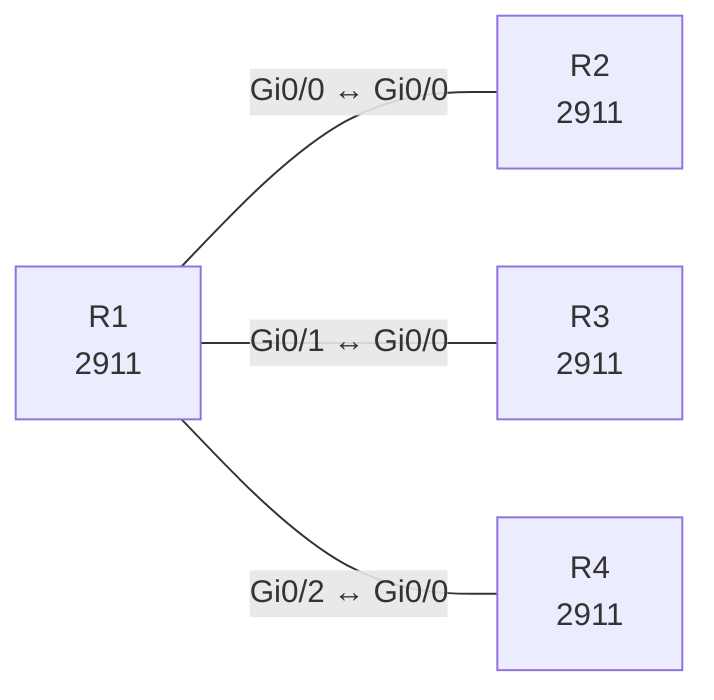

# Lab 14 – Routing-Tabelle lesen und die Weiterleitungsentscheidung vorhersagen

**Dauer:** 75 min · **Niveau:** mittel

R1 hat überlappende Routen (/8, /16, /24, Default) zu drei Nachbarn. Du sagst voraus, welchen Next Hop ein Paket nimmt, prüfst mit `show ip route <Ziel>` und liest Codes, Administrative Distance, Metrik und das Gateway of Last Resort.

**Lernziele:** Nach diesem Lab kannst du …

- Codes, Administrative Distanz und Metrik in der Routing-Tabelle lesen.
- Für jede Zieladresse den Next Hop per Longest Match vorhersagen.
- Erklären, wann das Gateway of Last Resort greift.

| CCNA-Ziel | Thema |
|---|---|
| 3.1 | Routing-Tabelle lesen |
| 3.2 | Weiterleitungsentscheidung (Longest Match, AD, Metrik) |
| 3.3 | Statisches Routing IPv4/IPv6 (Default, Netz, Host, Floating) |

**So arbeitest du:** Teil A = Bauen, Teil B = Reparieren, Teil C = Üben. Die Konfigurationsdateien liegen in `build/` (Ausgangszustand zum Einfügen in die CLI), `repair/` (fertig gebaut, mit Fehlern) und `solutions/` (Musterlösung und Fehlerliste, erst nach eigenem Versuch öffnen). Anleitung zum Einfügen: siehe [Arbeiten mit den Dateien](../README.md#arbeiten-mit-den-dateien).

## Topologie




### Geräte

| Gerät | Modell in Packet Tracer | Rolle |
|---|---|---|
| R1 | 2911 | Zentraler Router |
| R2 | 2911 | Ziel für 10/8 und Default |
| R3 | 2911 | Ziel für 10.1/16 |
| R4 | 2911 | Ziel für 10.1.1/24 |

### Verkabelung

| Von | Port | Nach | Port | Kabel |
|---|---|---|---|---|
| R1 | Gi0/0 | R2 | Gi0/0 | Copper Cross-Over |
| R1 | Gi0/1 | R3 | Gi0/0 | Copper Cross-Over |
| R1 | Gi0/2 | R4 | Gi0/0 | Copper Cross-Over |

### Adressplan (Ausgangszustand)

| Gerät | Interface | Adresse | Maske | Gateway | DNS |
|---|---|---|---|---|---|
| R1 | Gi0/0 | 192.168.14.1 | 255.255.255.252 | | |
| R1 | Gi0/1 | 192.168.14.5 | 255.255.255.252 | | |
| R1 | Gi0/2 | 192.168.14.9 | 255.255.255.252 | | |
| R2 | Gi0/0 | 192.168.14.2 | 255.255.255.252 | | |
| R2 | Loopback0 | 10.9.9.9 | 255.255.255.255 | | |
| R2 | Loopback1 | 8.8.8.8 | 255.255.255.255 | | |
| R3 | Gi0/0 | 192.168.14.6 | 255.255.255.252 | | |
| R3 | Loopback0 | 10.1.5.5 | 255.255.255.255 | | |
| R4 | Gi0/0 | 192.168.14.10 | 255.255.255.252 | | |
| R4 | Loopback0 | 10.1.1.1 | 255.255.255.255 | | |


## Teil A – Bauen

Arbeite die Schritte der Reihe nach ab. Jeder Schritt sagt dir, was du tust, woran du den Erfolg erkennst (**Prüfen**) und worüber du nachdenken sollst (**Denkfrage**). Die Antworten auf die Denkfragen stehen am Ende von Teil A.

1. **Basis.** Verkabeln und `build/` einfügen. R2 bis R4 haben je eine Loopback und eine Default-Route zurück zu R1.
   - **Prüfen:** `show ip route` auf R1 zeigt nur C- und L-Einträge.
   - **Denkfrage:** Was bedeuten C und L?
2. **Statische Routen auf R1.** Lege an: `ip route 10.0.0.0 255.0.0.0 192.168.14.2`, `ip route 10.1.0.0 255.255.0.0 192.168.14.6`, `ip route 10.1.1.0 255.255.255.0 192.168.14.10` und `ip route 0.0.0.0 0.0.0.0 192.168.14.2`.
   - **Prüfen:** `show ip route static` zeigt vier Einträge der Form `S … [1/0] via …`.
   - **Denkfrage:** Was bedeuten die beiden Zahlen in `[1/0]`?
3. **Vorhersagen.** Schreib für jedes Ziel den Next Hop auf, bevor du testest: 10.1.1.1, 10.1.5.5, 10.9.9.9, 8.8.8.8, 172.16.0.1.
   - **Prüfen:** `show ip route <Ziel>` und `traceroute` bestätigen deine Vorhersage.
4. **Regel formulieren.** Schreib die Reihenfolge auf, nach der R1 entscheidet.
   - **Denkfrage:** Was passiert, wenn zwei Routen in allem gleich sind?
5. **AD-Werte.** Ordne zu: Connected, Static, eBGP, EIGRP, OSPF, RIP, externes EIGRP, iBGP.
6. **Gateway of Last Resort.** Entferne die Default-Route und pinge 172.16.0.1.
   - **Prüfen:** Die Zeile „Gateway of last resort“ meldet „not set“, der Ping endet mit `Destination net unreachable`.
   - **Denkfrage:** Wann steht dort eine Adresse?

<details><summary>Antworten zu den Denkfragen</summary>

- **Zu 1:** C = das Netz, das direkt an einem Interface hängt. L = die eigene Adresse an diesem Interface als /32.
- **Zu 2:** Die erste Zahl ist die Administrative Distanz (statisch = 1), die zweite die Metrik (bei statischen Routen 0).
- **Zu 3:** 10.1.1.1 → R4 über das /24. 10.1.5.5 → R3 über das /16. 10.9.9.9 → R2 über das /8. 8.8.8.8 und 172.16.0.1 → R2 über die Default-Route.
- **Zu 4:** Erst das längste passende Präfix, dann die kleinste AD, dann die kleinste Metrik. Sind zwei Routen in allem gleich, nutzt der Router beide (ECMP) und verteilt die Last.
- **Zu 5:** Connected 0, Static 1, eBGP 20, EIGRP 90, OSPF 110, RIP 120, externes EIGRP 170, iBGP 200.
- **Zu 6:** Sobald es eine Default-Route 0.0.0.0/0 gibt. Ihr Next Hop wird zum Gateway of Last Resort.

</details>

## Teil B – Reparieren

Baue die Topologie wie oben (oder behalte deine aus Teil A), setze alle Geräte zurück (`erase startup-config`, `reload` bzw. neues Gerät) und füge dann die Dateien aus `repair/` ein. Es stecken **4 Fehler** drin. Behandle jede Meldung als Ticket: erst Symptom nachstellen, dann Layer für Layer eingrenzen, beheben und beweisen. Ändere nur, was kaputt ist.

**Ticket 1:** Ping 10.1.1.1 scheitert; `traceroute` endet an R3, das die Adresse nicht kennt (oder zurückgibt).

**Ticket 2:** 10.1.5.5 landet nicht bei R3 sondern über /8 bei R2; `show ip route 10.1.5.5` zeigt 10.0.0.0/8.

**Ticket 3:** R1 kann 10.1.5.5 anpingen, bekommt aber keine Antwort (R3 kennt den Rückweg nicht).

**Ticket 4:** 8.8.8.8 und 172.16.0.1 erreichen R2 nicht; `show ip route` zeigt den Default via R4.

## Verifikation

```
show ip route
show ip route 10.1.1.1
show ip route static
traceroute 10.1.5.5
```

| Ziel | Das solltest du sehen |
|---|---|
| 10.1.1.1 | über R4 (192.168.14.10), Route /24 |
| 10.1.5.5 | über R3 (192.168.14.6), Route /16 |
| 10.9.9.9 | über R2 (192.168.14.2), Route /8 |
| 8.8.8.8 | über R2, Default-Route |

## Teil C – Üben

Beantworte zuerst selbst, dann klappe die Antwort auf.

1. Routen: 10.0.0.0/8 (statisch), 10.1.0.0/16 (OSPF), 10.1.1.0/24 (RIP). Wohin geht ein Paket an 10.1.1.9?
<details><summary>Antwort</summary>

**Über die RIP-Route 10.1.1.0/24.** Das längste Präfix gewinnt. Die AD zählt nur zwischen Routen mit gleich langem Präfix.

</details>

2. Was unterscheidet AD und Metrik?
<details><summary>Antwort</summary>

**Die AD vergleicht Quellen, die Metrik vergleicht Wege.** Mit der AD entscheidet der Router, welchem Protokoll er mehr glaubt. Die Metrik bewertet mehrere Wege innerhalb eines Protokolls.

</details>

3. Was bedeuten `S*` und `0.0.0.0/0`?
<details><summary>Antwort</summary>

**Eine statische Default-Route.** Das Sternchen markiert sie als Kandidat für das Gateway of Last Resort.

</details>

4. Was passiert mit einem Paket, für das es keine Route gibt?
<details><summary>Antwort</summary>

**Der Router verwirft es und schickt ICMP `Destination Unreachable` an den Absender.**

</details>

5. Wie liest du `O 10.2.0.0/16 [110/20] via 10.0.0.2, 00:03:10, Gi0/1`?
<details><summary>Antwort</summary>

**OSPF-Route zu 10.2.0.0/16 mit AD 110 und Kosten 20 über 10.0.0.2.** Die Route ist seit 3 min 10 s bekannt, der Ausgang ist Gi0/1.

</details>

## Prüfungsbezug

- Ein Eintrag besteht aus Code (C, L, S, O, D, B), Präfix, `[AD/Metrik]`, Next Hop, Alter und Ausgangsinterface.
- Entscheidung: 1. längstes Präfix, 2. kleinste AD, 3. kleinste Metrik.
- AD: Connected 0, Static 1, eBGP 20, EIGRP 90, OSPF 110, RIP 120, iBGP 200.
- Default-Route 0.0.0.0/0 = Gateway of Last Resort, markiert mit `*`.

## Lösungen

- `solutions/<Gerät>.cfg`: Konfiguration zu Teil A (ohne Basis-Adressen)
- `solutions/FAULTS.md`: Fehlerliste zu Teil B (Spoiler!)
