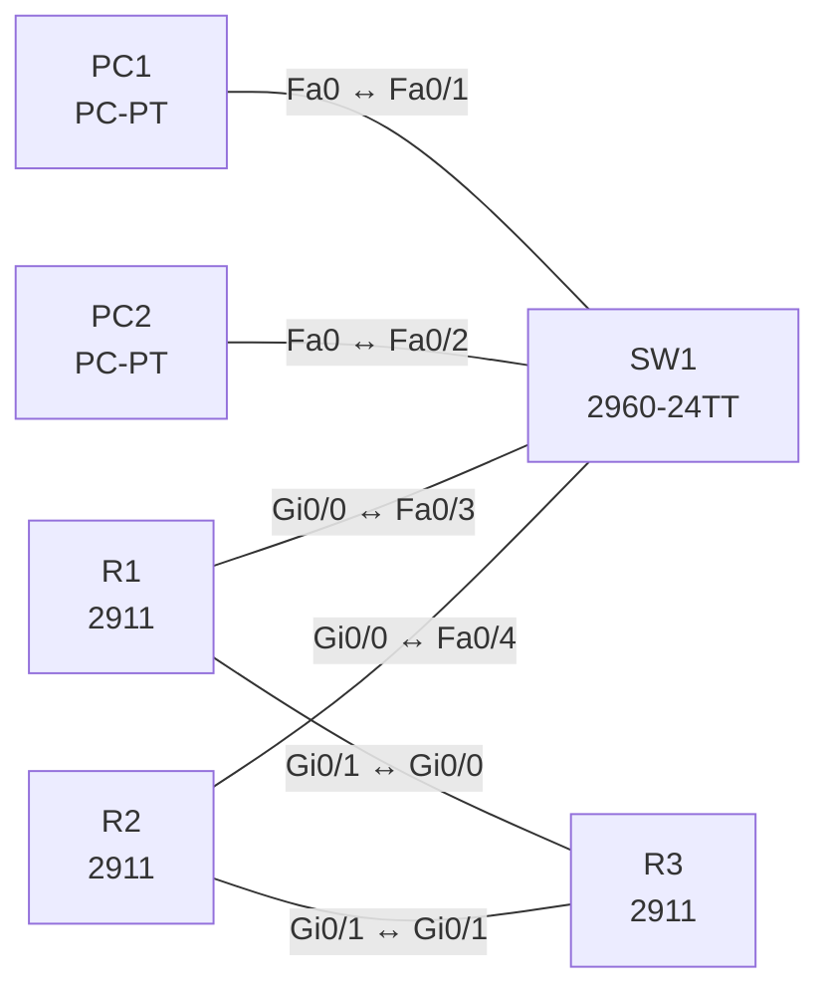

# Lab 17 – First Hop Redundancy: HSRP mit Preempt und Tracking

**Dauer:** 75 min · **Niveau:** mittel

Zwei Router teilen sich als virtuelles Gateway 10.17.1.1 (HSRP). Du konfigurierst Priorität, Preempt und Interface-Tracking und testest den Failover. VRRP und GLBP vergleichst du konzeptionell.

**Lernziele:** Nach diesem Lab kannst du …

- HSRP mit Priorität, Preempt und Tracking konfigurieren.
- Den Failover testen und die Rolle der virtuellen MAC erklären.
- HSRP, VRRP und GLBP unterscheiden.

| CCNA-Ziel | Thema |
|---|---|
| 3.5 | First Hop Redundancy Protocols |

**So arbeitest du:** Teil A = Bauen, Teil B = Reparieren, Teil C = Üben. Die Konfigurationsdateien liegen in `build/` (Ausgangszustand zum Einfügen in die CLI), `repair/` (fertig gebaut, mit Fehlern) und `solutions/` (Musterlösung und Fehlerliste, erst nach eigenem Versuch öffnen). Anleitung zum Einfügen: siehe [Arbeiten mit den Dateien](../README.md#arbeiten-mit-den-dateien).

## Topologie



R1 ist bevorzugter Active-Router (Priorität 110), R2 Standby (100). R3 simuliert das Internet (Loopback 8.8.8.8).

### Geräte

| Gerät | Modell in Packet Tracer | Rolle |
|---|---|---|
| R1 | 2911 | Active-Router |
| R2 | 2911 | Standby-Router |
| R3 | 2911 | Internet-Simulation |
| SW1 | 2960-24TT | LAN-Switch |
| PC1 | PC-PT | Client |
| PC2 | PC-PT | Client |

### Verkabelung

| Von | Port | Nach | Port | Kabel |
|---|---|---|---|---|
| PC1 | Fa0 | SW1 | Fa0/1 | Copper Straight-Through |
| PC2 | Fa0 | SW1 | Fa0/2 | Copper Straight-Through |
| R1 | Gi0/0 | SW1 | Fa0/3 | Copper Straight-Through |
| R2 | Gi0/0 | SW1 | Fa0/4 | Copper Straight-Through |
| R1 | Gi0/1 | R3 | Gi0/0 | Copper Cross-Over |
| R2 | Gi0/1 | R3 | Gi0/1 | Copper Cross-Over |

### Adressplan (Ausgangszustand)

| Gerät | Interface | Adresse | Maske | Gateway | DNS |
|---|---|---|---|---|---|
| R1 | Gi0/0 | 10.17.1.2 | 255.255.255.0 | | |
| R1 | Gi0/1 | 10.17.13.1 | 255.255.255.252 | | |
| R2 | Gi0/0 | 10.17.1.3 | 255.255.255.0 | | |
| R2 | Gi0/1 | 10.17.23.1 | 255.255.255.252 | | |
| R3 | Gi0/0 | 10.17.13.2 | 255.255.255.252 | | |
| R3 | Gi0/1 | 10.17.23.2 | 255.255.255.252 | | |
| R3 | Loopback0 | 8.8.8.8 | 255.255.255.255 | | |
| PC1 | Fa0 (GUI) | 10.17.1.11 | 255.255.255.0 | 10.17.1.1 |  |
| PC2 | Fa0 (GUI) | 10.17.1.12 | 255.255.255.0 | 10.17.1.1 |  |


> **Packet-Tracer-Hinweis:** HSRP gibt es in Packet Tracer auf den Routern (`standby`). VRRP/GLBP sind nicht verfügbar; die Konzepte stehen in Teil C. Wird `standby version 2` abgelehnt, lass die Zeile weg (HSRP Version 1, virtuelle MAC 0000.0c07.ac01). Das Tracking mit `standby 1 track <Interface> <Abzug>` ist die klassische Form; falls es fehlt, nutze `track 1 interface … line-protocol` und `standby 1 track 1 decrement 20`.

## Teil A – Bauen

Arbeite die Schritte der Reihe nach ab. Jeder Schritt sagt dir, was du tust, woran du den Erfolg erkennst (**Prüfen**) und worüber du nachdenken sollst (**Denkfrage**). Die Antworten auf die Denkfragen stehen am Ende von Teil A.

1. **Basis.** Verkabeln, `build/` einfügen und den PCs als Gateway die virtuelle Adresse 10.17.1.1 geben.
   - **Denkfrage:** Warum darf das Gateway nicht die echte Adresse eines Routers sein?
2. **HSRP.** Auf Gi0/0 beider Router: `standby version 2`, `standby 1 ip 10.17.1.1`. R1 bekommt `standby 1 priority 110` und `standby 1 preempt`, R2 bleibt bei 100.
   - **Prüfen:** `show standby brief` zeigt R1 als Active, R2 als Standby.
3. **Virtuelle MAC.** Sieh dir `show standby` an.
   - **Prüfen:** Die virtuelle MAC ist `0000.0c9f.f001` (Version 2) bzw. `0000.0c07.ac01` (Version 1).
   - **Denkfrage:** Wozu braucht HSRP eine virtuelle MAC?
4. **Failover testen.** Starte auf PC1 `ping -t 8.8.8.8` und schalte auf R1 Gi0/0 ab. Schalte es danach wieder an.
   - **Prüfen:** R2 wird Active, es gehen nur wenige Pings verloren. Nach dem Einschalten holt sich R1 die Rolle zurück.
   - **Denkfrage:** Warum holt sich R1 die Rolle zurück?
5. **Tracking.** Setze auf R1 `standby 1 track GigabitEthernet0/1 20` und schalte den Uplink Gi0/1 ab.
   - **Prüfen:** Die Priorität von R1 sinkt auf 90, R2 wird Active.
   - **Denkfrage:** Was würde ohne Tracking passieren?
6. **Vergleich.** Stell HSRP, VRRP und GLBP in einer Tabelle gegenüber: Hersteller, Rollen, Multicast-Adresse, Preempt, Lastverteilung.

<details><summary>Antworten zu den Denkfragen</summary>

- **Zu 1:** Fällt dieser Router aus, ist das Gateway weg. Die virtuelle Adresse zieht mit, egal welcher Router gerade aktiv ist.
- **Zu 3:** Die Hosts haben die MAC ihres Gateways im ARP-Cache. Ist sie virtuell, übernimmt der neue Active-Router sie einfach, und die Hosts müssen nichts neu lernen.
- **Zu 4:** Wegen `preempt`. Ohne Preempt bliebe R2 Active, bis er selbst ausfällt.
- **Zu 5:** R1 bliebe Active, weil sein LAN-Port ja läuft. Er würde den Verkehr annehmen und ins Leere schicken.
- **Zu 6:**

| | HSRP | VRRP | GLBP |
|---|---|---|---|
| Hersteller | Cisco | offener Standard (RFC 5798) | Cisco |
| Rollen | Active/Standby | Master/Backup | AVG/AVF |
| Multicast | 224.0.0.2 (v1), 224.0.0.102 (v2) | 224.0.0.18 | 224.0.0.102 |
| Preempt | standardmäßig aus | standardmäßig an | standardmäßig aus |
| Lastverteilung | nur über mehrere Gruppen | nur über mehrere Gruppen | ja, pro Host |

</details>

## Teil B – Reparieren

Baue die Topologie wie oben (oder behalte deine aus Teil A), setze alle Geräte zurück (`erase startup-config`, `reload` bzw. neues Gerät) und füge dann die Dateien aus `repair/` ein und stelle die Endgeräte laut Tabelle unten ein. Es stecken **4 Fehler** drin. Behandle jede Meldung als Ticket: erst Symptom nachstellen, dann Layer für Layer eingrenzen, beheben und beweisen. Ändere nur, was kaputt ist.

**Endgeräte im Repair-Zustand:**

| Gerät | IP | Maske | Gateway | DNS |
|---|---|---|---|---|
| PC1 | 10.17.1.11 | 255.255.255.0 | 10.17.1.1 |  |
| PC2 | 10.17.1.12 | 255.255.255.0 | 10.17.1.2 |  |

**Ticket 1:** Im Log steht `%HSRP-4-DIFFVIP1`. Solange R1 Active ist, läuft alles. Fällt R1 aus, wird R2 Active, aber die PCs verlieren trotzdem ihr Gateway.

**Ticket 2:** Nach der Rückkehr von R1 bleibt R2 Active; R1 bleibt Standby, obwohl er höhere Priorität hat.

**Ticket 3:** Beim Ausfall von R1 Gi0/1 bleibt R1 Active und der Internet-Verkehr der PCs läuft ins Leere.

**Ticket 4:** PC2 verliert die Verbindung ins Internet, sobald R1 ausfällt, PC1 nicht.

## Verifikation

```
show standby brief
show standby
show ip route         ! R3
```

| Prüfung | Das solltest du sehen |
|---|---|
| `show standby brief` auf R1 | Active, Priorität 110, virtuelle IP 10.17.1.1 |
| `show standby brief` auf R2 | Standby |
| nach Ausfall des Uplinks von R1 | R1 Priorität 90, R2 Active |

## Teil C – Üben

Beantworte zuerst selbst, dann klappe die Antwort auf.

1. Was ist der Unterschied zwischen HSRP und VRRP?
<details><summary>Antwort</summary>

**HSRP ist Cisco-proprietär, VRRP ein offener Standard.** HSRP heißt Active/Standby, VRRP Master/Backup. Dazu kommen andere Multicast-Adressen, und bei VRRP ist Preempt standardmäßig an.

</details>

2. Wozu dient Preempt?
<details><summary>Antwort</summary>

**Damit der Router mit der höheren Priorität die Rolle zurückholt, wenn er wieder da ist.**

</details>

3. Was passiert, wenn der Uplink ausfällt, der LAN-Port aber up bleibt?
<details><summary>Antwort</summary>

**Ohne Tracking bleibt der Router Active und verwirft den Verkehr.** Mit Tracking sinkt seine Priorität unter die des Standby, und dieser übernimmt.

</details>

4. Was ist bei GLBP anders?
<details><summary>Antwort</summary>

**GLBP verteilt die Last auf mehrere Router.** Der AVG beantwortet ARP-Anfragen reihum mit verschiedenen virtuellen MACs, die zu verschiedenen AVFs gehören.

</details>

5. Warum zeigt ein HSRP-Paar manchmal zweimal `Active`?
<details><summary>Antwort</summary>

**Weil die Router ihre Hellos nicht sehen.** Ursachen: ein Layer-2-Problem dazwischen, unterschiedliche Gruppe, Version oder virtuelle IP. Jeder hält sich dann für allein.

</details>

## Prüfungsbezug

- FHRP stellt eine virtuelle IP und MAC als Gateway bereit. Fällt ein Router aus, ändert sich für die Hosts nichts.
- HSRP: Active/Standby, Priorität 100, Hello 3 s/Hold 10 s, Preempt aus.
- VRRP: offener Standard, Master/Backup, Preempt an.
- GLBP: Der AVG verteilt per ARP verschiedene virtuelle MACs, so teilen sich mehrere Router die Last.
- Tracking senkt die Priorität, wenn der Uplink ausfällt. Der Abzug muss größer sein als der Abstand zum anderen Router.

## Lösungen

- `solutions/<Gerät>.cfg`: Konfiguration zu Teil A (ohne Basis-Adressen)
- `solutions/FAULTS.md`: Fehlerliste zu Teil B (Spoiler!)
