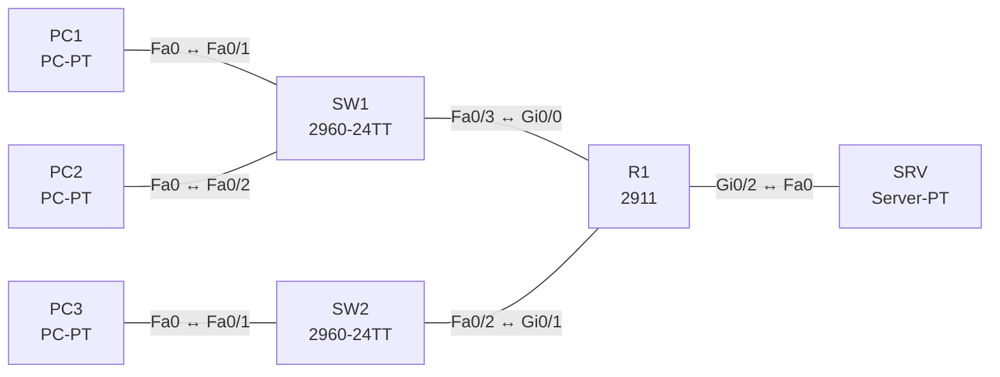

# Lab 18 – DHCP (Router, Server, Relay) und DNS

**Dauer:** 90 min · **Niveau:** mittel

Ein Router vergibt Adressen selbst (LAN A), leitet DHCP-Anfragen von LAN B per Relay (`ip helper-address`) an einen Server weiter und verweist Clients auf einen DNS-Server. Du beobachtest DORA und findest typische DHCP-Fehler.

**Lernziele:** Nach diesem Lab kannst du …

- DHCP auf dem Router mit Pool und ausgeschlossenen Adressen einrichten.
- DHCP-Anfragen per `ip helper-address` an einen Server in einem anderen Subnetz weiterleiten.
- Den Ablauf von DORA und der DNS-Auflösung erklären.

| CCNA-Ziel | Thema |
|---|---|
| 4.3 | DHCP und DNS: Rollen im Netz |
| 4.6 | DHCP-Client und Relay |
| 1.10 | IP-Parameter auf Windows, macOS und Linux prüfen |

**So arbeitest du:** Teil A = Bauen, Teil B = Reparieren, Teil C = Üben. Die Konfigurationsdateien liegen in `build/` (Ausgangszustand zum Einfügen in die CLI), `repair/` (fertig gebaut, mit Fehlern) und `solutions/` (Musterlösung und Fehlerliste, erst nach eigenem Versuch öffnen). Anleitung zum Einfügen: siehe [Arbeiten mit den Dateien](../README.md#arbeiten-mit-den-dateien).

## Topologie




### Geräte

| Gerät | Modell in Packet Tracer | Rolle |
|---|---|---|
| R1 | 2911 | Gateway, DHCP-Server (LAN A), Relay (LAN B) |
| SW1 | 2960-24TT | Switch LAN A |
| SW2 | 2960-24TT | Switch LAN B |
| PC1 | PC-PT | LAN A |
| PC2 | PC-PT | LAN A |
| PC3 | PC-PT | LAN B |
| SRV | Server-PT | DHCP für LAN B und DNS |

### Verkabelung

| Von | Port | Nach | Port | Kabel |
|---|---|---|---|---|
| PC1 | Fa0 | SW1 | Fa0/1 | Copper Straight-Through |
| PC2 | Fa0 | SW1 | Fa0/2 | Copper Straight-Through |
| SW1 | Fa0/3 | R1 | Gi0/0 | Copper Straight-Through |
| PC3 | Fa0 | SW2 | Fa0/1 | Copper Straight-Through |
| SW2 | Fa0/2 | R1 | Gi0/1 | Copper Straight-Through |
| R1 | Gi0/2 | SRV | Fa0 | Copper Cross-Over |

### Adressplan (Ausgangszustand)

| Gerät | Interface | Adresse | Maske | Gateway | DNS |
|---|---|---|---|---|---|
| R1 | Gi0/0 | 10.18.1.1 | 255.255.255.0 | | |
| R1 | Gi0/1 | 10.18.2.1 | 255.255.255.0 | | |
| R1 | Gi0/2 | 10.18.3.1 | 255.255.255.0 | | |
| PC1 | Fa0 (GUI) | DHCP |  |  |  |
| PC2 | Fa0 (GUI) | DHCP |  |  |  |
| PC3 | Fa0 (GUI) | DHCP |  |  |  |
| SRV | Fa0 (GUI) | 10.18.3.10 | 255.255.255.0 | 10.18.3.1 | 10.18.3.10 |


> **Packet-Tracer-Hinweis:** Server-PT: Services → DHCP, Pool für LAN B anlegen (Default Gateway 10.18.2.1, DNS 10.18.3.10, Start-IP 10.18.2.11, Maske 255.255.255.0, Max. 50). Services → DNS: A-Record `www.lab.local` → 10.18.3.10.

## Teil A – Bauen

Arbeite die Schritte der Reihe nach ab. Jeder Schritt sagt dir, was du tust, woran du den Erfolg erkennst (**Prüfen**) und worüber du nachdenken sollst (**Denkfrage**). Die Antworten auf die Denkfragen stehen am Ende von Teil A.

1. **Basis.** Verkabeln, `build/` einfügen, PC1 bis PC3 auf DHCP stellen, SRV statisch.
2. **DHCP auf dem Router (LAN A).** `ip dhcp excluded-address 10.18.1.1 10.18.1.10` und ein Pool `LAN-A` mit Netz, Gateway und DNS.
   - **Prüfen:** `show ip dhcp binding` zeigt Adressen für PC1 und PC2 ab .11.
   - **Denkfrage:** Welche vier Nachrichten siehst du im Simulationsmodus, und mit welchen Adressen und Ports gehen sie?
3. **DHCP-Relay (LAN B).** Setze auf Gi0/1 des Routers `ip helper-address 10.18.3.10`.
   - **Denkfrage:** Warum braucht es das, und woher weiß der Server, aus welchem Pool er vergeben soll?
4. **Server-Pool.** Lege auf dem Server den Pool für LAN B an (siehe Hinweis oben).
   - **Prüfen:** PC3 bekommt eine Adresse aus 10.18.2.0/24.
5. **DNS.** Pinge auf einem PC `www.lab.local`.
   - **Prüfen:** Der Name wird zu 10.18.3.10 aufgelöst.
   - **Denkfrage:** In welcher Reihenfolge sucht der PC nach dem Namen? Welche Record-Typen kennst du?
6. **Lease.** Sieh dir `show ip dhcp pool` an und probiere auf einem PC `ipconfig /release` und `ipconfig /renew`.
   - **Denkfrage:** Wie erkennt DHCP einen Adresskonflikt?

<details><summary>Antworten zu den Denkfragen</summary>

- **Zu 2:** Discover, Offer, Request, Ack (DORA). Der Client sendet von 0.0.0.0 an 255.255.255.255, von UDP 68 an UDP 67. Offer und Ack kommen vom Server auf UDP 67 an Port 68 zurück.
- **Zu 3:** Das Discover ist ein Broadcast, und Router leiten Broadcasts nicht weiter. Der Relay macht daraus ein Unicast an den Server und trägt seine eigene Adresse im LAN B als giaddr ein. Daran erkennt der Server das Subnetz und wählt den passenden Pool.
- **Zu 5:** Erst der lokale Cache, dann die hosts-Datei, dann der eingetragene DNS-Server. Der fragt sich bei Bedarf über Root- und TLD-Server bis zum zuständigen Server durch. Record-Typen: A (IPv4), AAAA (IPv6), CNAME (Alias), MX (Mailserver), NS (Nameserver), PTR (Rückwärtsauflösung).
- **Zu 6:** Der Router pingt eine Adresse vor der Vergabe an. Antwortet jemand, trägt er sie in `show ip dhcp conflict` ein und vergibt die nächste.

</details>

## Teil B – Reparieren

Baue die Topologie wie oben (oder behalte deine aus Teil A), setze alle Geräte zurück (`erase startup-config`, `reload` bzw. neues Gerät) und füge dann die Dateien aus `repair/` ein. Es stecken **4 Fehler** drin. Behandle jede Meldung als Ticket: erst Symptom nachstellen, dann Layer für Layer eingrenzen, beheben und beweisen. Ändere nur, was kaputt ist.

**Ticket 1:** PC3 (LAN B) erhält keine Adresse (169.254.x.x), PC1/PC2 funktionieren.

**Ticket 2:** PC1/PC2 haben eine Adresse, erreichen aber nichts außerhalb von LAN A; `ipconfig` zeigt Gateway 10.18.1.254.

**Ticket 3:** PC1 erreicht `www.lab.local` nicht per Namen, per IP schon.

**Ticket 4:** Kein PC in LAN A erhält eine Adresse (169.254.x.x), `show ip dhcp pool` zeigt keine freien Adressen.

## Verifikation

```
show ip dhcp binding
show ip dhcp pool
show ip dhcp conflict
show ip interface gi0/1 | include Helper
```

| Prüfung | Das solltest du sehen |
|---|---|
| `ipconfig /all` auf PC1/PC2 | Adresse aus 10.18.1.11 aufwärts, Gateway 10.18.1.1, DNS 10.18.3.10 |
| `ipconfig /all` auf PC3 | Adresse aus 10.18.2.0/24, Gateway 10.18.2.1 |
| `nslookup www.lab.local` | 10.18.3.10 |

## Teil C – Üben

Beantworte zuerst selbst, dann klappe die Antwort auf.

1. Warum braucht ein Client in einem anderen Subnetz einen Relay?
<details><summary>Antwort</summary>

**Weil Router Broadcasts nicht weiterleiten.** Das Discover ist ein Broadcast. Der Relay schickt es als Unicast an den Server und setzt giaddr auf das Subnetz des Clients.

</details>

2. Wofür dient `ip dhcp excluded-address`?
<details><summary>Antwort</summary>

**Es nimmt Adressen aus dem Pool, die fest vergeben sind.** Zum Beispiel Gateway, Server und Drucker. So bekommt kein Client eine davon.

</details>

3. Welche Parameter liefert DHCP außer der IP-Adresse?
<details><summary>Antwort</summary>

**Maske, Gateway, DNS-Server, Domänenname und Lease-Zeit.** Bei Bedarf weitere Optionen, z. B. 43 (WLC), 66 oder 150 (TFTP-Server für Telefone).

</details>

4. Ein Client bekommt 169.254.x.x. Was bedeutet das?
<details><summary>Antwort</summary>

**Er hat keinen DHCP-Server erreicht.** Mögliche Ursachen: Pool leer, Relay fehlt, falsches VLAN oder ein Layer-2-Problem.

</details>

5. Wie läuft eine DNS-Auflösung ab?
<details><summary>Antwort</summary>

**Cache, hosts-Datei, dann der eingetragene DNS-Server.** Der fragt rekursiv über Root, TLD und den zuständigen Server. Die Antwort wird für die Dauer der TTL gespeichert.

</details>

## Prüfungsbezug

- DHCP: DORA (Discover, Offer, Request, Ack), Server UDP 67, Client UDP 68, beim Start per Broadcast.
- Relay: `ip helper-address <Server>` an dem Interface, an dem die Clients hängen.
- `ip dhcp excluded-address` schützt fest vergebene Adressen.
- DNS: UDP 53, TCP 53 für große Antworten. Records A, AAAA, CNAME, MX, NS, PTR.

## Lösungen

- `solutions/<Gerät>.cfg`: Konfiguration zu Teil A (ohne Basis-Adressen)
- `solutions/FAULTS.md`: Fehlerliste zu Teil B (Spoiler!)
