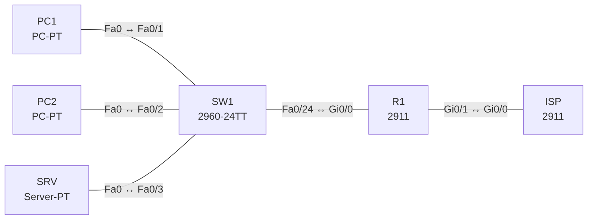

# Lab 19 – Inside Source NAT: statisch, Pool und PAT

**Dauer:** 75 min · **Niveau:** mittel

Ein Edge-Router übersetzt private LAN-Adressen. Du baust PAT (Overload), dynamisches NAT mit Pool und statisches NAT für einen Server und liest die vier NAT-Adressbegriffe aus `show ip nat translations`.

**Lernziele:** Nach diesem Lab kannst du …

- PAT, dynamisches NAT mit Pool und statisches NAT konfigurieren.
- Die vier NAT-Adressbegriffe in einer Übersetzung zuordnen.
- NAT-Fehler mit `show ip nat translations` und `statistics` eingrenzen.

| CCNA-Ziel | Thema |
|---|---|
| 4.1 | Inside Source NAT |

**So arbeitest du:** Teil A = Bauen, Teil B = Reparieren, Teil C = Üben. Die Konfigurationsdateien liegen in `build/` (Ausgangszustand zum Einfügen in die CLI), `repair/` (fertig gebaut, mit Fehlern) und `solutions/` (Musterlösung und Fehlerliste, erst nach eigenem Versuch öffnen). Anleitung zum Einfügen: siehe [Arbeiten mit den Dateien](../README.md#arbeiten-mit-den-dateien).

## Topologie



Öffentliche Adressen aus dem Dokumentationsbereich: Link 198.51.100.0/30, NAT-Pool und Server-Adresse aus 203.0.113.0/24 (der ISP routet das /24 zu R1).

### Geräte

| Gerät | Modell in Packet Tracer | Rolle |
|---|---|---|
| R1 | 2911 | Edge-Router mit NAT |
| ISP | 2911 | Internet-Simulation |
| SW1 | 2960-24TT | LAN-Switch |
| PC1 | PC-PT | Client |
| PC2 | PC-PT | Client |
| SRV | Server-PT | Webserver (HTTP an) |

### Verkabelung

| Von | Port | Nach | Port | Kabel |
|---|---|---|---|---|
| PC1 | Fa0 | SW1 | Fa0/1 | Copper Straight-Through |
| PC2 | Fa0 | SW1 | Fa0/2 | Copper Straight-Through |
| SRV | Fa0 | SW1 | Fa0/3 | Copper Straight-Through |
| SW1 | Fa0/24 | R1 | Gi0/0 | Copper Straight-Through |
| R1 | Gi0/1 | ISP | Gi0/0 | Copper Cross-Over |

### Adressplan (Ausgangszustand)

| Gerät | Interface | Adresse | Maske | Gateway | DNS |
|---|---|---|---|---|---|
| R1 | Gi0/0 | 192.168.19.1 | 255.255.255.0 | | |
| R1 | Gi0/1 | 198.51.100.1 | 255.255.255.252 | | |
| ISP | Gi0/0 | 198.51.100.2 | 255.255.255.252 | | |
| ISP | Loopback0 | 8.8.8.8 | 255.255.255.255 | | |
| PC1 | Fa0 (GUI) | 192.168.19.11 | 255.255.255.0 | 192.168.19.1 |  |
| PC2 | Fa0 (GUI) | 192.168.19.12 | 255.255.255.0 | 192.168.19.1 |  |
| SRV | Fa0 (GUI) | 192.168.19.100 | 255.255.255.0 | 192.168.19.1 |  |


## Teil A – Bauen

Arbeite die Schritte der Reihe nach ab. Jeder Schritt sagt dir, was du tust, woran du den Erfolg erkennst (**Prüfen**) und worüber du nachdenken sollst (**Denkfrage**). Die Antworten auf die Denkfragen stehen am Ende von Teil A.

1. **Problem sehen.** PC1 pingt 8.8.8.8.
   - **Prüfen:** Der Ping scheitert. `debug ip icmp` auf dem ISP zeigt Anfragen mit privater Quelladresse.
   - **Denkfrage:** Warum kommt keine Antwort zurück?
2. **PAT.** Setze `ip nat inside` und `ip nat outside` an den Interfaces, eine ACL 1 für 192.168.19.0/24 und `ip nat inside source list 1 interface Gi0/1 overload`.
   - **Prüfen:** PC1 und PC2 pingen 8.8.8.8. `show ip nat translations` zeigt beide unter 198.51.100.1 mit verschiedenen Ports.
3. **Vier Adressbegriffe.** Nimm eine Zeile aus `show ip nat translations` und benenne Inside Local, Inside Global, Outside Local und Outside Global.
   - **Denkfrage:** Welche davon ändert Inside-Source-NAT?
4. **Statisches NAT.** `ip nat inside source static 192.168.19.100 203.0.113.10`.
   - **Prüfen:** Vom ISP aus antwortet `ping 203.0.113.10`.
   - **Denkfrage:** Warum klappt hier der Aufbau von außen, bei PAT aber nicht?
5. **Dynamisches NAT mit Pool.** Ersetze PAT testweise durch `ip nat pool POOL 203.0.113.20 203.0.113.22 netmask 255.255.255.0` und `ip nat inside source list 1 pool POOL`. Lass vier Hosts nacheinander ins Internet.
   - **Prüfen:** Der vierte Host kommt nicht hinaus, `show ip nat statistics` zählt Misses.
   - **Denkfrage:** Warum, und wie löst `overload` das?
6. **Aufräumen.** Probiere `clear ip nat translation *`, `show ip nat statistics` und kurz `debug ip nat`.
   - **Denkfrage:** Was passiert mit laufenden Verbindungen bei `clear`?

<details><summary>Antworten zu den Denkfragen</summary>

- **Zu 1:** Private Adressen werden im Internet nicht geroutet. Der ISP kennt keinen Weg zurück zu 192.168.19.0/24.
- **Zu 3:** Inside Local: private Adresse des PCs. Inside Global: öffentliche Adresse, unter der er draußen erscheint. Outside Global: Adresse des Ziels im Internet. Outside Local: das Ziel aus Sicht des LANs, meist gleich Outside Global. Inside-Source-NAT ändert nur Inside Local zu Inside Global.
- **Zu 4:** Statisches NAT hat eine feste Zuordnung, die immer existiert. Bei PAT entsteht die Zuordnung erst, wenn ein innerer Host eine Verbindung startet.
- **Zu 5:** Dynamisches NAT ohne Overload braucht pro Host eine eigene öffentliche Adresse, der Pool hat nur drei. `overload` unterscheidet die Verbindungen über Ports, so teilen sich alle Hosts eine Adresse.
- **Zu 6:** Dynamische Einträge werden gelöscht. Laufende Verbindungen brechen ab und müssen neu aufgebaut werden. Statische Einträge bleiben.

</details>

## Teil B – Reparieren

Baue die Topologie wie oben (oder behalte deine aus Teil A), setze alle Geräte zurück (`erase startup-config`, `reload` bzw. neues Gerät) und füge dann die Dateien aus `repair/` ein. Es stecken **4 Fehler** drin. Behandle jede Meldung als Ticket: erst Symptom nachstellen, dann Layer für Layer eingrenzen, beheben und beweisen. Ändere nur, was kaputt ist.

**Ticket 1:** Weder PC1 noch PC2 erreichen 8.8.8.8, `show ip nat translations` ist leer.

**Ticket 2:** NAT scheint konfiguriert, aber keine Übersetzung; der ISP sieht private Quellen.

**Ticket 3:** PC1 kommt hinaus, PC2 danach nicht mehr; `show ip nat statistics` zählt Misses.

**Ticket 4:** Der ISP erreicht 203.0.113.10 (Webserver) nicht.

## Verifikation

```
show ip nat translations
show ip nat statistics
show access-lists
show running-config | include nat
```

| Prüfung | Das solltest du sehen |
|---|---|
| `show ip nat translations` | PC1 und PC2 als `198.51.100.1:<Port>`, der Server fest auf 203.0.113.10 |
| `show ip nat statistics` | Gi0/0 als inside, Gi0/1 als outside, steigende Hits |
| Ping PC1 → 8.8.8.8 | Antworten |

## Teil C – Üben

Beantworte zuerst selbst, dann klappe die Antwort auf.

1. Wie viele Verbindungen schafft PAT mit nur einer öffentlichen Adresse?
<details><summary>Antwort</summary>

**Bis zu etwa 65 000 gleichzeitig, begrenzt durch die Portnummern.** Wie viele Hosts dahinter stehen, ist egal.

</details>

2. Was unterscheidet statisches von dynamischem NAT?
<details><summary>Antwort</summary>

**Statisch ist eine feste 1:1-Zuordnung, die auch von außen erreichbar ist.** Dynamisch nimmt bei Bedarf eine Adresse aus einem Pool, und nur ein innerer Host kann die Verbindung starten.

</details>

3. Welche Adresse ist die Inside Global eines Clients?
<details><summary>Antwort</summary>

**Die öffentliche Adresse, unter der er draußen erscheint.** Hier 198.51.100.1 bzw. eine Adresse aus dem Pool.

</details>

4. Ein PC erreicht das Internet nicht. Welche vier NAT-Punkte prüfst du?
<details><summary>Antwort</summary>

**Inside/Outside an den Interfaces, die ACL, Pool oder Overload und das Routing.** Beim Routing auch die Default-Route und ob der ISP den Rückweg zur öffentlichen Adresse kennt.

</details>

5. Was bedeutet `ip nat inside source list 1 interface Gi0/1 overload`?
<details><summary>Antwort</summary>

**Was ACL 1 erlaubt, wird auf die Adresse von Gi0/1 übersetzt.** `overload` unterscheidet die Verbindungen über Ports, das ist PAT.

</details>

## Prüfungsbezug

- Inside Local = interne Adresse, Inside Global = öffentliche Adresse des Hosts, Outside Global = Ziel im Internet, Outside Local = Ziel aus Sicht des LANs (meist gleich).
- Statisch 1:1, dynamisch mit Pool, PAT/Overload viele auf eine über Ports.
- `ip nat inside`/`outside` an jedem Interface, die ACL legt fest, wer übersetzt wird.
- Ohne Overload ist der Pool schnell leer.

## Lösungen

- `solutions/<Gerät>.cfg`: Konfiguration zu Teil A (ohne Basis-Adressen)
- `solutions/FAULTS.md`: Fehlerliste zu Teil B (Spoiler!)
