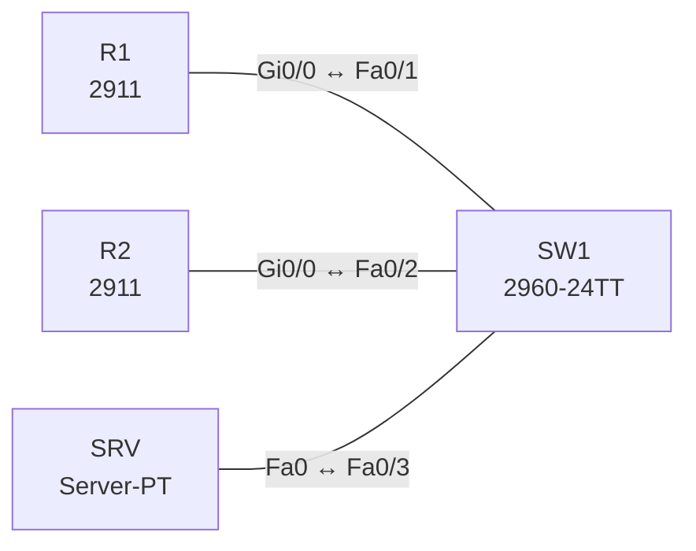

# Lab 21 – TFTP und FTP: Konfigurations- und Image-Sicherung

**Dauer:** 60 min · **Niveau:** leicht

Router sichern ihre Konfiguration und Dateien auf einem Server per TFTP und FTP und spielen sie wieder ein. Du vergleichst die beiden Protokolle (UDP/69 ohne Anmeldung vs. TCP/20/21 mit Benutzer und Passwort).

**Lernziele:** Nach diesem Lab kannst du …

- Konfigurationen und Images per TFTP und FTP sichern und zurückspielen.
- Den Unterschied zwischen Merge in die running-config und Ersetzen der startup-config erklären.
- TFTP, FTP und die sicheren Alternativen SCP und SFTP vergleichen.

| CCNA-Ziel | Thema |
|---|---|
| 4.9 | TFTP und FTP |
| 1.5 | TCP und UDP im Vergleich |

**So arbeitest du:** Teil A = Bauen, Teil B = Reparieren, Teil C = Üben. Die Konfigurationsdateien liegen in `build/` (Ausgangszustand zum Einfügen in die CLI), `repair/` (fertig gebaut, mit Fehlern) und `solutions/` (Musterlösung und Fehlerliste, erst nach eigenem Versuch öffnen). Anleitung zum Einfügen: siehe [Arbeiten mit den Dateien](../README.md#arbeiten-mit-den-dateien).

## Topologie




### Geräte

| Gerät | Modell in Packet Tracer | Rolle |
|---|---|---|
| R1 | 2911 | Router mit FTP-Zugangsdaten |
| R2 | 2911 | Zweiter Router (Wiederherstellung) |
| SW1 | 2960-24TT | Switch |
| SRV | Server-PT | TFTP- und FTP-Server |

### Verkabelung

| Von | Port | Nach | Port | Kabel |
|---|---|---|---|---|
| R1 | Gi0/0 | SW1 | Fa0/1 | Copper Straight-Through |
| R2 | Gi0/0 | SW1 | Fa0/2 | Copper Straight-Through |
| SRV | Fa0 | SW1 | Fa0/3 | Copper Straight-Through |

### Adressplan (Ausgangszustand)

| Gerät | Interface | Adresse | Maske | Gateway | DNS |
|---|---|---|---|---|---|
| R1 | Gi0/0 | 10.21.1.1 | 255.255.255.0 | | |
| R2 | Gi0/0 | 10.21.1.2 | 255.255.255.0 | | |
| SRV | Fa0 (GUI) | 10.21.1.100 | 255.255.255.0 | 10.21.1.1 |  |


> **Packet-Tracer-Hinweis:** Server-PT: Services → TFTP und FTP einschalten; FTP-Benutzer `cisco`/`cisco` mit allen Rechten (Services → FTP → User Setup).

## Teil A – Bauen

Arbeite die Schritte der Reihe nach ab. Jeder Schritt sagt dir, was du tust, woran du den Erfolg erkennst (**Prüfen**) und worüber du nachdenken sollst (**Denkfrage**). Die Antworten auf die Denkfragen stehen am Ende von Teil A.

1. **Basis.** Verkabeln und `build/` einfügen.
   - **Prüfen:** R1 pingt SRV (10.21.1.100).
2. **TFTP-Sicherung.** `copy running-config tftp:` mit Ziel 10.21.1.100 und Dateiname `R1-confg`.
   - **Prüfen:** Die Datei erscheint auf dem Server unter Services → TFTP.
   - **Denkfrage:** Was fehlt bei TFTP im Vergleich zu FTP?
3. **Wiederherstellen.** Ändere den Hostnamen und spiele dann mit `copy tftp: running-config` die Sicherung ein.
   - **Prüfen:** Der alte Hostname ist zurück.
   - **Denkfrage:** Was ist der Unterschied zwischen `copy tftp: running-config` und `copy tftp: startup-config`?
4. **FTP.** `ip ftp username cisco`, `ip ftp password cisco`, dann `copy running-config ftp:`.
   - **Prüfen:** Im Simulationsmodus siehst du die Anmeldung über TCP 21 und die Datenverbindung.
5. **IOS-Image sichern.** `copy flash: tftp:` mit dem Image aus `show flash:`.
   - **Denkfrage:** Warum sichert man das Image vor einem Upgrade, und wozu dient `verify /md5`?
6. **Vergleich.** Stell TFTP und FTP gegenüber: Port, Transport, Anmeldung, Zuverlässigkeit, Verzeichnisse, typische Nutzung.
   - **Denkfrage:** Was nimmst du, wenn die Übertragung sicher sein soll?

<details><summary>Antworten zu den Denkfragen</summary>

- **Zu 2:** Anmeldung, Verzeichnisse und Verschlüsselung. Jeder, der den Server erreicht, kann je nach Einstellung Dateien lesen oder schreiben.
- **Zu 3:** In die running-config wird die Datei eingemischt (Merge) und wirkt sofort. Was in der Datei fehlt, bleibt in der laufenden Konfiguration stehen. In die startup-config wird ersetzt, das wirkt erst nach dem nächsten Neustart.
- **Zu 5:** Geht beim Upgrade etwas schief, brauchst du das alte Image, um zurückzugehen. `verify /md5` berechnet den Hash der Datei. Stimmt er mit dem Wert vom Hersteller überein, ist das Image vollständig und unverändert.
- **Zu 6:**

| | TFTP | FTP |
|---|---|---|
| Port | UDP 69 | TCP 21 (Steuerung), 20 (Daten im Active Mode) |
| Anmeldung | keine | Benutzer und Passwort im Klartext |
| Zuverlässigkeit | eigenes ACK pro Block | TCP |
| Verzeichnisse | nein | ja |
| Nutzung | Boot, Konfiguration, Telefone | Images, Archive |

Sicher sind SCP oder SFTP über SSH, alternativ HTTPS.

</details>

## Teil B – Reparieren

Baue die Topologie wie oben (oder behalte deine aus Teil A), setze alle Geräte zurück (`erase startup-config`, `reload` bzw. neues Gerät) und füge dann die Dateien aus `repair/` ein. Es stecken **3 Fehler** drin. Behandle jede Meldung als Ticket: erst Symptom nachstellen, dann Layer für Layer eingrenzen, beheben und beweisen. Ändere nur, was kaputt ist.

**Ticket 1:** `copy running-config ftp:` auf R2 scheitert mit Login-Fehler, auf R1 geht es.

**Ticket 2:** R1 erreicht den Server (10.21.1.100) nicht, TFTP/FTP-Transfers melden Timeout.

**Ticket 3:** Der Server ist von beiden Routern nicht erreichbar.

## Verifikation

```
show flash:
show running-config | include ftp
copy running-config tftp:
```

| Prüfung | Das solltest du sehen |
|---|---|
| Services → TFTP bzw. FTP auf dem Server | die Dateien `R1-confg` bzw. `R2-confg` |
| `copy tftp: running-config` | Meldung `[OK]` |
| `show running-config | include ftp` | Benutzer und Passwort für FTP |

## Teil C – Üben

Beantworte zuerst selbst, dann klappe die Antwort auf.

1. Warum ist TFTP unsicher?
<details><summary>Antwort</summary>

**Es kennt weder Anmeldung noch Verschlüsselung.** Wer den Server erreicht, kann je nach Einstellung Dateien lesen und schreiben, und alles geht im Klartext übers Netz.

</details>

2. Welche Ports nutzt FTP?
<details><summary>Antwort</summary>

**TCP 21 für Befehle, TCP 20 für Daten im Active Mode.** Im Passive Mode öffnet der Server für die Daten einen hohen Port.

</details>

3. `copy tftp: running-config` oder `copy tftp: startup-config`?
<details><summary>Antwort</summary>

**running-config mischt sofort ein, startup-config ersetzt und wirkt nach dem Neustart.**

</details>

4. Wofür nutzt man TFTP typischerweise?
<details><summary>Antwort</summary>

**Für einfache Übertragungen ohne Anmeldung.** Konfigurationen und Images im Labor, Booten übers Netz (PXE) und die Konfiguration von IP-Telefonen.

</details>

5. Wie überträgst du ein IOS-Image sicher?
<details><summary>Antwort</summary>

**Per SCP, SFTP oder HTTPS, und danach den Hash prüfen.** Mit `verify /md5 flash:<image>` vergleichst du den Hash mit dem Wert des Herstellers.

</details>

## Prüfungsbezug

- TFTP: UDP 69, keine Anmeldung, keine Verzeichnisse. Für Boot und Konfigurationen.
- FTP: TCP 21 (Steuerung) und 20 (Daten), Benutzer und Passwort im Klartext, zuverlässig.
- Beide sind unverschlüsselt. Sicher: SCP oder SFTP über SSH, FTPS, HTTPS.
- `copy <Quelle> <Ziel>`. Das Image liegt im Flash, `boot system` wählt es aus.

## Lösungen

- `solutions/<Gerät>.cfg`: Konfiguration zu Teil A (ohne Basis-Adressen)
- `solutions/FAULTS.md`: Fehlerliste zu Teil B (Spoiler!)
