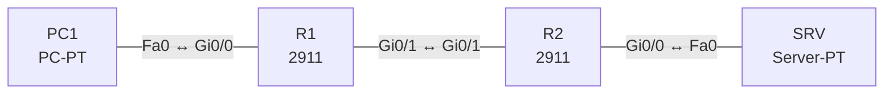

# Lab 22 – QoS: Klassifizierung, Markierung, Queuing, Policing und Shaping

**Dauer:** 90 min · **Niveau:** schwer

Auf einer WAN-Strecke bekommt Sprache Vorrang (LLQ), Geschäftsverkehr eine garantierte Bandbreite, der Rest Best Effort. Du klassifizierst per ACL, markierst DSCP und wendest die Policy am Ausgang an.

**Lernziele:** Nach diesem Lab kannst du …

- Die Schritte von QoS benennen: klassifizieren, markieren, einreihen, begrenzen.
- Eine MQC-Policy mit LLQ und CBWFQ bauen und am richtigen Interface anwenden.
- Policing und Shaping sowie die wichtigsten DSCP-Werte unterscheiden.

| CCNA-Ziel | Thema |
|---|---|
| 4.7 | QoS (Klassifizierung, Markierung, Queuing, Policing, Shaping) |

**So arbeitest du:** Teil A = Bauen, Teil B = Reparieren, Teil C = Üben. Die Konfigurationsdateien liegen in `build/` (Ausgangszustand zum Einfügen in die CLI), `repair/` (fertig gebaut, mit Fehlern) und `solutions/` (Musterlösung und Fehlerliste, erst nach eigenem Versuch öffnen). Anleitung zum Einfügen: siehe [Arbeiten mit den Dateien](../README.md#arbeiten-mit-den-dateien).

## Topologie




### Geräte

| Gerät | Modell in Packet Tracer | Rolle |
|---|---|---|
| R1 | 2911 | WAN-Router mit QoS-Policy |
| R2 | 2911 | Gegenstelle |
| PC1 | PC-PT | Client (Quelle) |
| SRV | Server-PT | Ziel |

### Verkabelung

| Von | Port | Nach | Port | Kabel |
|---|---|---|---|---|
| PC1 | Fa0 | R1 | Gi0/0 | Copper Cross-Over |
| R1 | Gi0/1 | R2 | Gi0/1 | Copper Cross-Over |
| R2 | Gi0/0 | SRV | Fa0 | Copper Cross-Over |

### Adressplan (Ausgangszustand)

| Gerät | Interface | Adresse | Maske | Gateway | DNS |
|---|---|---|---|---|---|
| R1 | Gi0/0 | 10.22.1.1 | 255.255.255.0 | | |
| R1 | Gi0/1 | 10.22.12.1 | 255.255.255.252 | | |
| R2 | Gi0/0 | 10.22.2.1 | 255.255.255.0 | | |
| R2 | Gi0/1 | 10.22.12.2 | 255.255.255.252 | | |
| PC1 | Fa0 (GUI) | 10.22.1.11 | 255.255.255.0 | 10.22.1.1 |  |
| SRV | Fa0 (GUI) | 10.22.2.10 | 255.255.255.0 | 10.22.2.1 |  |


> **Packet-Tracer-Hinweis:** Packet Tracer unterstützt MQC (`class-map`, `policy-map`, `service-policy`) nur teilweise und simuliert kein reales Queuing. Konfiguration und Prüfbefehle (`show policy-map interface`) funktionieren teilweise; für das Verständnis zählen Teil C und die Syntax. Falls ein Befehl abgelehnt wird, notiere dir die Syntax und löse die Teil-C-Fragen.

## Teil A – Bauen

Arbeite die Schritte der Reihe nach ab. Jeder Schritt sagt dir, was du tust, woran du den Erfolg erkennst (**Prüfen**) und worüber du nachdenken sollst (**Denkfrage**). Die Antworten auf die Denkfragen stehen am Ende von Teil A.

1. **Begriffe ordnen.** Fülle eine Tabelle mit den QoS-Werkzeugen: Klassifizieren, Markieren, Queuing, Überlastvermeidung, Policing, Shaping.
   - **Denkfrage:** Welche Verfahren gehören jeweils dazu?
2. **Basis.** Verkabeln und `build/` einfügen. Der Link R1–R2 ist der Engpass, simuliert mit `bandwidth 2000` (2 Mbit/s).
3. **Klassifizieren.** Lege die ACLs `VOICE` (UDP 16384 bis 32767) und `BUSINESS` (TCP 443 und 8080) an und dazu `class-map match-any VOICE` und `class-map match-any BUSINESS`.
   - **Prüfen:** `show class-map` zeigt beide Klassen mit ihrer ACL.
4. **Policy bauen.** `policy-map WAN-OUT`: Klasse VOICE mit `priority percent 20` und `set dscp ef`, Klasse BUSINESS mit `bandwidth percent 40` und `set dscp af31`, `class class-default` mit `fair-queue`.
   - **Denkfrage:** Warum begrenzt `priority` den Sprachverkehr gleichzeitig?
5. **Anwenden.** `interface Gi0/1` und `service-policy output WAN-OUT`.
   - **Prüfen:** `show policy-map interface gi0/1` zeigt die Policy in Richtung output und zählt Pakete pro Klasse.
   - **Denkfrage:** Warum am Ausgang?
6. **Policing und Shaping.** Schreib zwei Varianten auf: `police rate 1000000 bps` am Eingang und `shape average 1000000` am Ausgang.
   - **Denkfrage:** Welche puffert, welche verwirft?

<details><summary>Antworten zu den Denkfragen</summary>

- **Zu 1:** Klassifizieren: ACL, NBAR, vorhandene DSCP- oder CoS-Werte. Markieren: CoS (802.1p, Layer 2), IP Precedence, DSCP (Layer 3). Queuing: FIFO, WFQ, CBWFQ, LLQ. Überlastvermeidung: Tail Drop, WRED. Policing: verwirft oder markiert um. Shaping: puffert und sendet später.
- **Zu 4:** Damit Sprache die anderen Klassen nicht aushungert. Die Priority-Queue wird immer zuerst bedient. Ohne Grenze könnte sie bei Stau die ganze Bandbreite nehmen. Ein eingebauter Policer begrenzt sie deshalb auf die konfigurierte Rate, sobald es eng wird.
- **Zu 5:** Warteschlangen entstehen beim Senden, wenn mehr hinaus will, als der Link schafft. Dort entscheidet das Queuing, was zuerst geht. Am Eingang ist das Paket schon da.
- **Zu 6:** Shaping puffert den Überschuss und schickt ihn später, das glättet, kostet aber Verzögerung. Policing verwirft den Überschuss sofort oder markiert ihn um, ohne Verzögerung.

</details>

## Teil B – Reparieren

Baue die Topologie wie oben (oder behalte deine aus Teil A), setze alle Geräte zurück (`erase startup-config`, `reload` bzw. neues Gerät) und füge dann die Dateien aus `repair/` ein. Es stecken **3 Fehler** drin. Behandle jede Meldung als Ticket: erst Symptom nachstellen, dann Layer für Layer eingrenzen, beheben und beweisen. Ändere nur, was kaputt ist.

**Ticket 1:** Die Priorisierung greift nicht, Sprache leidet bei Last. `show policy-map interface gi0/1` zeigt keine Output-Policy.

**Ticket 2:** Die Klasse VOICE zählt keine Treffer (`0 packets`), Sprache landet in class-default.

**Ticket 3:** Beim Einfügen erscheint eine Meldung über zu hohe Bandbreitenzuteilung (Priority + BUSINESS > 75 % der Schnittstelle), die Policy ist unvollständig.

## Verifikation

```
show class-map
show policy-map
show policy-map interface gi0/1
show access-lists
```

| Prüfung | Das solltest du sehen |
|---|---|
| `show policy-map interface gi0/1` | Policy WAN-OUT in Richtung output |
| dieselbe Ausgabe unter Last | steigende Zähler bei VOICE und BUSINESS |
| `show access-lists` | Treffer in den ACLs VOICE und BUSINESS |

## Teil C – Üben

Beantworte zuerst selbst, dann klappe die Antwort auf.

1. Wie unterscheiden sich Policing und Shaping?
<details><summary>Antwort</summary>

**Policing verwirft den Überschuss sofort, Shaping puffert ihn.** Policing erzeugt keine Verzögerung, lässt aber Lastspitzen sichtbar. Shaping glättet den Fluss und kostet dafür Verzögerung.

</details>

2. Welche DSCP-Werte gehören zu Sprache, Video und Best Effort?
<details><summary>Antwort</summary>

**EF (46) für Sprache, AF41 (34) für interaktives Video, Default (0) für Best Effort.**

</details>

3. Wozu dient die Trust Boundary?
<details><summary>Antwort</summary>

**Sie legt fest, ab wo der Switch Markierungen glaubt.** Markierungen vom IP-Telefon werden übernommen, die vom PC überschrieben. Sonst könnte sich jeder selbst Vorrang geben.

</details>

4. Was bewirkt LLQ?
<details><summary>Antwort</summary>

**Eine strikte Prioritätswarteschlange für Sprache neben den CBWFQ-Klassen.** Sie wird immer zuerst bedient, ist aber begrenzt, damit die anderen Klassen nicht verhungern.

</details>

5. Warum sind Verzögerung, Jitter und Verlust für VoIP kritisch?
<details><summary>Antwort</summary>

**Weil Sprache in Echtzeit läuft und nichts nachholen kann.** Richtwerte: unter 150 ms Verzögerung in eine Richtung, unter 30 ms Jitter, unter 1 % Verlust.

</details>

## Prüfungsbezug

- Ablauf: klassifizieren → markieren → einreihen → bei Überlast verwerfen, policen oder shapen.
- DSCP: EF 46 (Sprache), AF41 34 (Video), AF31 26 und AF21 18 (Geschäft), CS6 (Steuerung), Default 0.
- Trust Boundary: Markierungen nur von vertrauenswürdigen Geräten übernehmen, z. B. IP-Telefonen.
- LLQ = Priority-Queue plus CBWFQ für den Rest.
- Policing verwirft oder markiert um (ein- und ausgehend). Shaping puffert und glättet (nur ausgehend).

## Lösungen

- `solutions/<Gerät>.cfg`: Konfiguration zu Teil A (ohne Basis-Adressen)
- `solutions/FAULTS.md`: Fehlerliste zu Teil B (Spoiler!)
