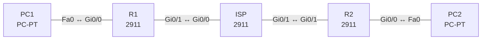

# Lab 25 – IPsec Site-to-Site-VPN

**Dauer:** 90 min · **Niveau:** schwer

Zwei Standorte verbinden ihre privaten LANs über ein simuliertes Internet. Der ISP kennt die privaten Netze nicht; erst der IPsec-Tunnel (IKE Phase 1, Phase 2, Crypto Map) macht sie erreichbar.

**Lernziele:** Nach diesem Lab kannst du …

- Ein Site-to-Site-VPN mit IKE Phase 1, Phase 2 und Crypto Map aufbauen.
- Die Parameter benennen, die auf beiden Seiten gleich sein müssen.
- An `show crypto isakmp sa` und `show crypto ipsec sa` erkennen, welche Phase scheitert.

| CCNA-Ziel | Thema |
|---|---|
| 5.5 | IPsec: Remote Access und Site-to-Site-VPN |

**So arbeitest du:** Teil A = Bauen, Teil B = Reparieren, Teil C = Üben. Die Konfigurationsdateien liegen in `build/` (Ausgangszustand zum Einfügen in die CLI), `repair/` (fertig gebaut, mit Fehlern) und `solutions/` (Musterlösung und Fehlerliste, erst nach eigenem Versuch öffnen). Anleitung zum Einfügen: siehe [Arbeiten mit den Dateien](../README.md#arbeiten-mit-den-dateien).

## Topologie



Interessanter Verkehr (ACL 110) = LAN1 ↔ LAN2. Peers: R1 198.51.100.1 ↔ R2 198.51.101.2.

### Geräte

| Gerät | Modell in Packet Tracer | Rolle |
|---|---|---|
| R1 | 2911 | Standort A (VPN-Peer 1) |
| R2 | 2911 | Standort B (VPN-Peer 2) |
| ISP | 2911 | Internet (kennt keine privaten Netze) |
| PC1 | PC-PT | LAN Standort A |
| PC2 | PC-PT | LAN Standort B |

### Verkabelung

| Von | Port | Nach | Port | Kabel |
|---|---|---|---|---|
| PC1 | Fa0 | R1 | Gi0/0 | Copper Cross-Over |
| R1 | Gi0/1 | ISP | Gi0/0 | Copper Cross-Over |
| ISP | Gi0/1 | R2 | Gi0/1 | Copper Cross-Over |
| R2 | Gi0/0 | PC2 | Fa0 | Copper Cross-Over |

### Adressplan (Ausgangszustand)

| Gerät | Interface | Adresse | Maske | Gateway | DNS |
|---|---|---|---|---|---|
| R1 | Gi0/0 | 192.168.25.1 | 255.255.255.0 | | |
| R1 | Gi0/1 | 198.51.100.1 | 255.255.255.252 | | |
| R2 | Gi0/0 | 172.25.2.1 | 255.255.255.0 | | |
| R2 | Gi0/1 | 198.51.101.2 | 255.255.255.252 | | |
| ISP | Gi0/0 | 198.51.100.2 | 255.255.255.252 | | |
| ISP | Gi0/1 | 198.51.101.1 | 255.255.255.252 | | |
| PC1 | Fa0 (GUI) | 192.168.25.11 | 255.255.255.0 | 192.168.25.1 |  |
| PC2 | Fa0 (GUI) | 172.25.2.11 | 255.255.255.0 | 172.25.2.1 |  |


> **Packet-Tracer-Hinweis:** Packet Tracer 2911: Sicherheits-Lizenz zuerst aktivieren: `license boot module c2900 technology-package securityk9`, EULA mit `yes` bestätigen, `copy running-config startup-config`, `reload`. Danach stehen die `crypto`-Befehle zur Verfügung. Unterstützte Parameter in PT: AES/3DES, SHA/MD5, DH-Gruppe 1/2/5, PSK.

## Teil A – Bauen

Arbeite die Schritte der Reihe nach ab. Jeder Schritt sagt dir, was du tust, woran du den Erfolg erkennst (**Prüfen**) und worüber du nachdenken sollst (**Denkfrage**). Die Antworten auf die Denkfragen stehen am Ende von Teil A.

1. **Basis.** Verkabeln, `build/` einfügen, die Lizenz aktivieren (siehe Hinweis) und die PCs einstellen.
   - **Prüfen:** PC1 pingt PC2 noch nicht.
   - **Denkfrage:** Warum nicht?
2. **Interessanter Verkehr.** Lege auf beiden Routern ACL 110 an, gespiegelt: R1 `permit ip 192.168.25.0 0.0.0.255 172.25.2.0 0.0.0.255`, R2 genau umgekehrt.
   - **Denkfrage:** Warum muss die ACL auf R2 das Spiegelbild sein?
3. **IKE Phase 1.** `crypto isakmp policy 10` mit `encryption aes`, `hash sha`, `authentication pre-share`, `group 2`, `lifetime 86400`. Dazu der Schlüssel: `crypto isakmp key Lab2026vpnKey address <Peer>`.
   - **Denkfrage:** Was baut Phase 1 auf?
4. **IKE Phase 2.** `crypto ipsec transform-set TS esp-aes esp-sha-hmac`. Dann `crypto map CMAP 10 ipsec-isakmp` mit `set peer`, `set transform-set TS` und `match address 110`. Binde die Map mit `crypto map CMAP` an das WAN-Interface.
5. **Auslösen und prüfen.** Pinge von PC1 zu PC2. Die ersten Pings dürfen verloren gehen.
   - **Prüfen:** `show crypto isakmp sa` zeigt `QM_IDLE`, in `show crypto ipsec sa` steigen encaps und decaps.
   - **Denkfrage:** Warum gehen die ersten Pings verloren?
6. **Einordnen.** Vergleiche Site-to-Site mit Remote Access, Tunnel- mit Transportmodus, AH mit ESP.
   - **Denkfrage:** Warum braucht man GRE über IPsec, wenn ein Routing-Protokoll durch den Tunnel soll?

<details><summary>Antworten zu den Denkfragen</summary>

- **Zu 1:** Der ISP kennt die privaten Netze nicht und verwirft die Pakete. Erst der Tunnel verpackt sie in Pakete zwischen den öffentlichen Adressen der Router.
- **Zu 2:** Jede Seite beschreibt den Verkehr aus ihrer Sicht: Quelle ist das eigene LAN, Ziel das fremde. Passen die beiden Beschreibungen nicht genau zueinander, lehnt der Partner die Phase 2 ab.
- **Zu 3:** Einen geschützten Kanal zwischen den beiden Routern (ISAKMP SA). Darüber handeln sie in Phase 2 die eigentlichen IPsec-SAs für die Nutzdaten aus.
- **Zu 5:** Der Tunnel wird erst aufgebaut, wenn interessanter Verkehr kommt. Bis Phase 1 und 2 fertig sind, verwirft der Router die ersten Pakete.
- **Zu 6:** Klassisches IPsec mit Crypto Map transportiert nur Unicast, der zur ACL passt. Routing-Protokolle nutzen Multicast. GRE verpackt das in Unicast, und IPsec verschlüsselt das GRE-Paket. Alternativ ein VTI.

</details>

## Teil B – Reparieren

Baue die Topologie wie oben (oder behalte deine aus Teil A), setze alle Geräte zurück (`erase startup-config`, `reload` bzw. neues Gerät) und füge dann die Dateien aus `repair/` ein. Es stecken **5 Fehler** drin. Behandle jede Meldung als Ticket: erst Symptom nachstellen, dann Layer für Layer eingrenzen, beheben und beweisen. Ändere nur, was kaputt ist.

**Ticket 1:** Phase 1 kommt nicht zustande: `show crypto isakmp sa` hängt in `MM_KEY_EXCH` oder `MM_NO_STATE`, das Log meldet `IKMP_BAD_MESSAGE … failed its sanity check or is malformed`.

**Ticket 2:** Phase 1 steht, aber PC1 und PC2 erreichen sich nicht; Zähler von `show crypto ipsec sa` bleiben 0 oder Phase 2 scheitert.

**Ticket 3:** Phase 1 ist `QM_IDLE`, aber Phase 2 kommt nicht zustande; Meldung `no matching transform set`/`IPSEC rejected`.

**Ticket 4:** PC1 → PC2 pingt nicht und nichts wird verschlüsselt: `show crypto isakmp sa` bleibt leer, `show crypto map` zeigt kein Interface.

**Ticket 5:** ISAKMP-Verhandlung scheitert (`MM_NO_STATE`), Debug zeigt `no offers accepted`.

## Verifikation

```
show crypto isakmp sa
show crypto ipsec sa
show crypto map
show access-lists 110
ping 172.25.2.11 source 192.168.25.1
```

| Prüfung | Das solltest du sehen |
|---|---|
| `show crypto isakmp sa` | Zustand `QM_IDLE` |
| `show crypto ipsec sa` | steigende Zähler bei `encaps` und `decaps` |
| Ping PC1 ↔ PC2 | Antworten, `traceroute` zeigt keine Zwischenstationen beim ISP |

## Teil C – Üben

Beantworte zuerst selbst, dann klappe die Antwort auf.

1. Welche Parameter müssen auf beiden Seiten gleich sein?
<details><summary>Antwort</summary>

**Phase 1: Verschlüsselung, Hash, Authentisierung bzw. PSK und DH-Gruppe. Phase 2: Transform-Set, Modus und die gespiegelte ACL.**

</details>

2. Was unterscheidet ESP von AH?
<details><summary>Antwort</summary>

**ESP verschlüsselt und prüft die Echtheit, AH prüft nur die Echtheit.** AH verträgt sich außerdem nicht mit NAT. In der Praxis nimmt man ESP.

</details>

3. Was unterscheidet Tunnel- und Transportmodus?
<details><summary>Antwort</summary>

**Der Tunnelmodus verpackt das ganze IP-Paket mit neuem Header, der Transportmodus schützt nur die Nutzlast.** Tunnel ist typisch für Site-to-Site, Transport für Verbindungen zwischen zwei Hosts.

</details>

4. Warum läuft ein Routing-Protokoll nicht direkt über reines IPsec?
<details><summary>Antwort</summary>

**Weil klassisches IPsec nur Unicast transportiert.** Routing-Protokolle brauchen Multicast. Dafür nimmt man GRE über IPsec oder ein VTI.

</details>

5. Was unterscheidet Site-to-Site von Remote Access?
<details><summary>Antwort</summary>

**Site-to-Site verbindet zwei Netze dauerhaft über ihre Gateways, Remote Access einzelne Benutzer.** Bei Remote Access baut jeder Client seinen eigenen Tunnel auf, per IPsec oder SSL.

</details>

## Prüfungsbezug

- IPsec bietet Vertraulichkeit (ESP), Integrität (HMAC), Authentisierung (PSK oder Zertifikat) und Schutz gegen Wiederholung.
- IKE Phase 1: ISAKMP SA mit Verschlüsselung, Hash, Authentisierung, DH-Gruppe, Lifetime. Phase 2: IPsec SA mit Transform-Set und Modus.
- Interessanter Verkehr per ACL, Crypto Map am ausgehenden Interface.
- Alle Parameter müssen auf beiden Seiten übereinstimmen.

## Lösungen

- `solutions/<Gerät>.cfg`: Konfiguration zu Teil A (ohne Basis-Adressen)
- `solutions/FAULTS.md`: Fehlerliste zu Teil B (Spoiler!)
