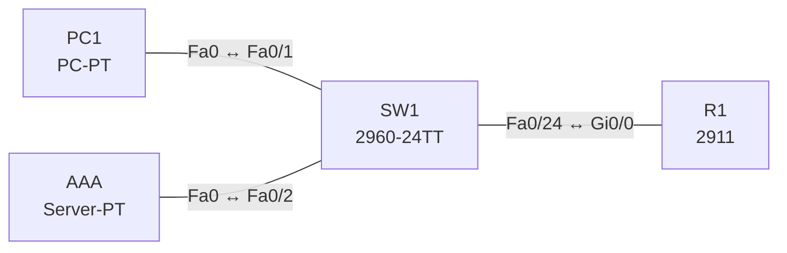

# Lab 26 – AAA: Authentisierung mit RADIUS und lokalem Fallback

**Dauer:** 75 min · **Niveau:** mittel

Ein Router authentisiert Administratoren zentral gegen einen RADIUS-Server und fällt bei Ausfall auf einen lokalen Benutzer zurück. Du ordnest Authentication, Authorization und Accounting zu und vergleichst RADIUS mit TACACS+.

**Lernziele:** Nach diesem Lab kannst du …

- AAA mit RADIUS und lokalem Fallback einrichten, ohne dich auszusperren.
- Erklären, wann der Fallback greift und wann nicht.
- RADIUS und TACACS+ vergleichen und dem passenden Einsatz zuordnen.

| CCNA-Ziel | Thema |
|---|---|
| 5.8 | AAA: Authentication, Authorization, Accounting |
| 2.8 | Verwaltungszugriff (Console, Telnet, SSH, HTTP/HTTPS, TACACS+/RADIUS, Cloud) |
| 5.3 | Gerätezugriff mit lokalen Passwörtern |

**So arbeitest du:** Teil A = Bauen, Teil B = Reparieren, Teil C = Üben. Die Konfigurationsdateien liegen in `build/` (Ausgangszustand zum Einfügen in die CLI), `repair/` (fertig gebaut, mit Fehlern) und `solutions/` (Musterlösung und Fehlerliste, erst nach eigenem Versuch öffnen). Anleitung zum Einfügen: siehe [Arbeiten mit den Dateien](../README.md#arbeiten-mit-den-dateien).

## Topologie




### Geräte

| Gerät | Modell in Packet Tracer | Rolle |
|---|---|---|
| R1 | 2911 | Router mit AAA |
| SW1 | 2960-24TT | Switch |
| PC1 | PC-PT | Admin-PC |
| AAA | Server-PT | RADIUS/TACACS+-Server |

### Verkabelung

| Von | Port | Nach | Port | Kabel |
|---|---|---|---|---|
| PC1 | Fa0 | SW1 | Fa0/1 | Copper Straight-Through |
| AAA | Fa0 | SW1 | Fa0/2 | Copper Straight-Through |
| SW1 | Fa0/24 | R1 | Gi0/0 | Copper Straight-Through |

### Adressplan (Ausgangszustand)

| Gerät | Interface | Adresse | Maske | Gateway | DNS |
|---|---|---|---|---|---|
| R1 | Gi0/0 | 10.26.1.1 | 255.255.255.0 | | |
| PC1 | Fa0 (GUI) | 10.26.1.11 | 255.255.255.0 | 10.26.1.1 |  |
| AAA | Fa0 (GUI) | 10.26.1.100 | 255.255.255.0 | 10.26.1.1 |  |


> **Packet-Tracer-Hinweis:** Server-PT: Services → AAA einschalten. *Network Configuration*: Client `R1`, Adresse 10.26.1.1, Secret `RadKey2026`, Servertyp Radius. *User Setup*: Benutzer `admin`, Passwort `Admin#2026`. TACACS+ kannst du analog als Servertyp einrichten.

## Teil A – Bauen

Arbeite die Schritte der Reihe nach ab. Jeder Schritt sagt dir, was du tust, woran du den Erfolg erkennst (**Prüfen**) und worüber du nachdenken sollst (**Denkfrage**). Die Antworten auf die Denkfragen stehen am Ende von Teil A.

1. **Basis.** Verkabeln und `build/` einfügen.
   - **Prüfen:** PC1 kommt per `telnet 10.26.1.1` auf den Router. Es gilt noch kein AAA.
2. **AAA aktivieren.** Lege zuerst einen lokalen Benutzer `backup` an. Dann `aaa new-model` und `radius-server host 10.26.1.100 key RadKey2026`.
   - **Denkfrage:** Warum zuerst den lokalen Benutzer?
3. **Methodenliste.** `aaa authentication login VTY-AUTH group radius local`, auf den vty-Lines `login authentication VTY-AUTH`.
   - **Prüfen:** `admin` mit dem RADIUS-Passwort kommt hinein. Ein falsches Passwort wird abgelehnt, auch wenn lokal ein Benutzer existiert.
   - **Denkfrage:** Wann greift `local`?
4. **Notfallzugang an der Konsole.** Gib der Konsole eine eigene Liste: `aaa authentication login CON-AUTH local` und `login authentication CON-AUTH`.
   - **Prüfen:** Schalte den RADIUS-Dienst ab. An der Konsole kommst du mit `backup` hinein.
5. **Accounting.** `aaa accounting exec default start-stop group radius`.
   - **Prüfen:** Auf dem Server unter AAA → Accounting steht die Sitzung.
   - **Denkfrage:** Was protokolliert Accounting?
6. **Vergleich.** Stell RADIUS und TACACS+ gegenüber: Transport, Verschlüsselung, Trennung der drei A, Einsatz.

<details><summary>Antworten zu den Denkfragen</summary>

- **Zu 2:** Nach `aaa new-model` gelten die AAA-Methoden sofort. Ist dann weder RADIUS erreichbar noch ein lokaler Benutzer da, sperrst du dich aus.
- **Zu 3:** Nur wenn der RADIUS-Server nicht antwortet. Lehnt er das Passwort ab, ist das eine gültige Antwort, und der Router fragt nicht lokal nach. Merke: Fallback nur bei Schweigen, nicht bei Nein.
- **Zu 5:** Wer sich wann an- und abgemeldet hat, wie lange die Sitzung lief und je nach Einstellung welche Befehle eingegeben wurden.
- **Zu 6:**

| | RADIUS | TACACS+ |
|---|---|---|
| Transport | UDP 1812/1813 (alt 1645/1646) | TCP 49 |
| Verschlüsselung | nur das Passwort | das ganze Paket |
| AAA | Authentisierung und Autorisierung zusammen | alle drei getrennt, Befehle einzeln autorisierbar |
| Einsatz | Netzzugang, 802.1X, VPN, WLAN | Administration von Geräten |

</details>

## Teil B – Reparieren

Baue die Topologie wie oben (oder behalte deine aus Teil A), setze alle Geräte zurück (`erase startup-config`, `reload` bzw. neues Gerät) und füge dann die Dateien aus `repair/` ein. Es stecken **4 Fehler** drin. Behandle jede Meldung als Ticket: erst Symptom nachstellen, dann Layer für Layer eingrenzen, beheben und beweisen. Ändere nur, was kaputt ist.

**Ticket 1:** Anmeldung als `admin` scheitert; RADIUS meldet keine gültige Antwort, der Router fällt auf `local` zurück und lehnt `admin` ab.

**Ticket 2:** Bei ausgeschaltetem RADIUS-Server kommt niemand mehr per Telnet auf den Router, auch `backup` nicht.

**Ticket 3:** Beim Telnet-Login erscheint eine Fehlermeldung zur Method-List bzw. es wird kein Passwort akzeptiert.

**Ticket 4:** RADIUS-Anfragen erreichen den Server nicht (Timeout), Login nur per Fallback; Ping zum Server (10.26.1.100) schlägt fehl.

## Verifikation

```
show aaa servers
show running-config | section aaa
show users
debug aaa authentication     ! nur kurz
```

| Prüfung | Das solltest du sehen |
|---|---|
| Telnet als `admin` | Anmeldung mit dem RADIUS-Passwort klappt |
| RADIUS-Dienst aus | Router meldet einen Timeout, `backup` kommt lokal hinein |
| `show aaa servers` | Server 10.26.1.100 mit Zählern für Anfragen und Antworten |

## Teil C – Üben

Beantworte zuerst selbst, dann klappe die Antwort auf.

1. Wann greift der lokale Fallback?
<details><summary>Antwort</summary>

**Nur wenn kein Server aus der Liste antwortet.** Lehnt der Server das Passwort ab, bleibt der Zugang verweigert.

</details>

2. Wofür ist Accounting da?
<details><summary>Antwort</summary>

**Es protokolliert, wer wann was getan hat.** Benutzer, Zeit, Dauer, je nach Einstellung Befehle und Datenmenge. Das dient der Nachvollziehbarkeit und der Abrechnung.

</details>

3. Nenne drei Unterschiede zwischen RADIUS und TACACS+.
<details><summary>Antwort</summary>

**Transport, Verschlüsselung und Trennung der drei A.** RADIUS nutzt UDP und verschlüsselt nur das Passwort. TACACS+ nutzt TCP, verschlüsselt alles und trennt Authentisierung, Autorisierung und Accounting, so lassen sich Befehle einzeln freigeben.

</details>

4. Wozu dient `aaa new-model`?
<details><summary>Antwort</summary>

**Es schaltet AAA ein.** Danach gelten Methodenlisten statt der einfachen `login`- und `password`-Befehle an den Lines.

</details>

5. Wie vermeidest du, dich selbst auszusperren?
<details><summary>Antwort</summary>

**Mit einem lokalen Notfall-Benutzer, einer eigenen Methodenliste für die Konsole und einer zweiten offenen Sitzung zum Testen.**

</details>

## Prüfungsbezug

- AAA: Authentication (wer bist du), Authorization (was darfst du), Accounting (was hast du getan).
- RADIUS: offener Standard, UDP 1812/1813, verschlüsselt nur das Passwort, typisch für Netzzugang und 802.1X.
- TACACS+: Cisco, TCP 49, verschlüsselt alles, trennt die drei A, ideal für Geräte-Administration mit Befehlsautorisierung.
- Methodenliste = Reihenfolge der Quellen. `local` am Ende greift nur, wenn kein Server antwortet.

## Lösungen

- `solutions/<Gerät>.cfg`: Konfiguration zu Teil A (ohne Basis-Adressen)
- `solutions/FAULTS.md`: Fehlerliste zu Teil B (Spoiler!)
