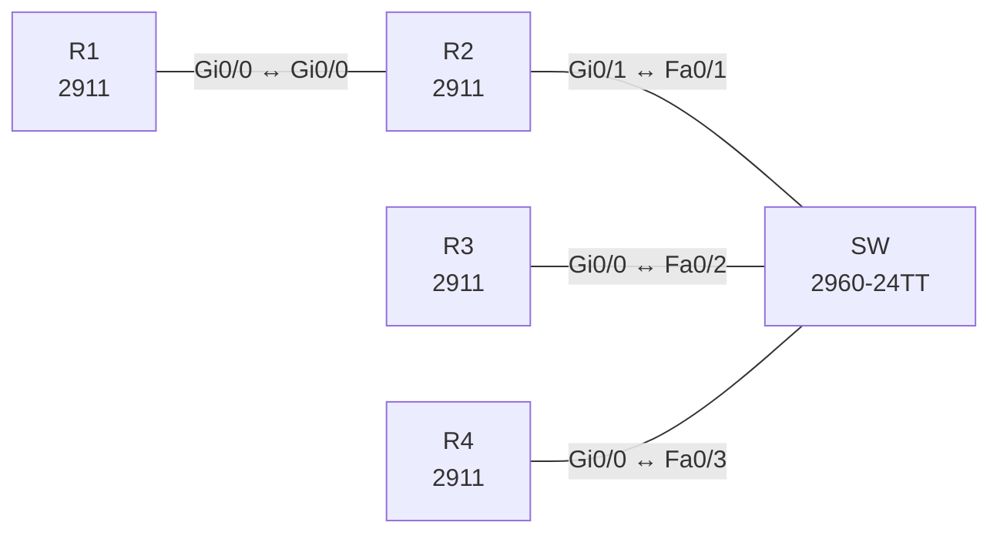

# Lab 01 – OSPFv2 Multi-Area

**Dauer:** 90 min · **Niveau:** mittel

OSPF-Areas, ABR/ASBR, DR/BDR, Summarization, Stub/NSSA, Authentifizierung und typische OSPF-Fehler.

**Lernziele:** Nach diesem Lab kannst du …

- OSPFv2 über mehrere Areas aufbauen und die Rolle von ABR und Backbone erklären.
- Nachbarschaftsprobleme an ihrem Zustand erkennen (INIT, 2WAY, EXSTART) und gezielt beheben.
- Routen am ABR mit `area range` zusammenfassen und das Ergebnis in der LSDB nachweisen.

| ENCOR-Ziel (`Ziel::…`) | Thema |
|---|---|
| 3.2.a | EIGRP und OSPF vergleichen |
| 3.2.b | OSPFv2 und OSPFv3 |

**So arbeitest du:** Teil A = Bauen, Teil B = Reparieren, Teil C = Üben. Die Konfigurationsdateien liegen in `build/` (Ausgangszustand zum Einfügen in die CLI), `repair/` (fertig gebaut, mit Fehlern) und `solutions/` (Musterlösung und Fehlerliste, erst nach eigenem Versuch öffnen). Anleitung zum Einfügen: siehe [Arbeiten mit den Dateien](../README.md#arbeiten-mit-den-dateien).

## Topologie



**Entwurfsskizze (aus dem CML-Lab; Portnamen der Switches siehe Verkabelungstabelle):**

```
 Area 0              Area 1 (10.1.234.0/24)
 R1 ---- R2 (ABR) ---- SW ---- R3 (Lo10-13 = 10.1.16-19.0/24)
 10.0.12.0/30                \--- R4 (extern 198.51.100.0/24 via Null0)
```

### Geräte

| Gerät | Modell in Packet Tracer | Rolle |
|---|---|---|
| R1 | 2911 | Router |
| R2 | 2911 | Router |
| SW | 2960-24TT | Switch (im CML-Lab unmanaged; ohne Konfiguration) |
| R3 | 2911 | Router |
| R4 | 2911 | Router |

### Verkabelung

| Von | Port | Nach | Port | Kabel |
|---|---|---|---|---|
| R1 | Gi0/0 | R2 | Gi0/0 | Copper Cross-Over |
| R2 | Gi0/1 | SW | Fa0/1 | Copper Straight-Through |
| R3 | Gi0/0 | SW | Fa0/2 | Copper Straight-Through |
| R4 | Gi0/0 | SW | Fa0/3 | Copper Straight-Through |

### Adressplan (Ausgangszustand)

| Gerät | Interface | Adresse | Maske | Gateway | DNS |
|---|---|---|---|---|---|
| R1 | Loopback0 | 1.1.1.1 | 255.255.255.255 | | |
| R1 | Gi0/0 | 10.0.12.1 | 255.255.255.252 | | |
| R2 | Loopback0 | 2.2.2.2 | 255.255.255.255 | | |
| R2 | Gi0/0 | 10.0.12.2 | 255.255.255.252 | | |
| R2 | Gi0/1 | 10.1.234.2 | 255.255.255.0 | | |
| R3 | Loopback0 | 3.3.3.3 | 255.255.255.255 | | |
| R3 | Gi0/0 | 10.1.234.3 | 255.255.255.0 | | |
| R3 | Loopback10 | 10.1.16.1 | 255.255.255.0 | | |
| R3 | Loopback11 | 10.1.17.1 | 255.255.255.0 | | |
| R3 | Loopback12 | 10.1.18.1 | 255.255.255.0 | | |
| R3 | Loopback13 | 10.1.19.1 | 255.255.255.0 | | |
| R4 | Loopback0 | 4.4.4.4 | 255.255.255.255 | | |
| R4 | Gi0/0 | 10.1.234.4 | 255.255.255.0 | | |

| Gerät | Interface | Adresse |
|---|---|---|
| R1 | Lo0 / Gi0/0 | 1.1.1.1/32 / 10.0.12.1/30 |
| R2 | Lo0 / Gi0/0 / Gi0/1 | 2.2.2.2/32 / 10.0.12.2/30 / 10.1.234.2/24 |
| R3 | Lo0 / Gi0/0 / Lo10–13 | 3.3.3.3/32 / 10.1.234.3/24 / 10.1.16–19.1/24 |
| R4 | Lo0 / Gi0/0 | 4.4.4.4/32 / 10.1.234.4/24, statisch 198.51.100.0/24 → Null0 |

### Portzuordnung der Switches (CML → Packet Tracer)

Aufgaben, Verkabelung, Konfigurationen und Fehlerlisten verwenden die Packet-Tracer-Ports. Die Tabelle zeigt, welcher Port der CML-Vorlage dazu gehört. Nur die Skizze nennt noch die CML-Ports. Umrechnung: `GiX/Y` → `Fa0/(X·4+Y+1)`.

| Switch | CML-Port | PT-Port |
|---|---|---|
| SW | Gi0/0 | Fa0/1 |
| SW | Gi0/1 | Fa0/2 |
| SW | Gi0/2 | Fa0/3 |

> **Packet-Tracer-Hinweis:** **Eignung: geeignet.** Alle verwendeten Funktionen gibt es in Packet Tracer; Ausgabeformate einzelner `show`-Befehle weichen leicht ab. Die CML-Switches (Gi-Ports) sind hier 3560-24PS bzw. 2960 mit FastEthernet-Ports: Die Portzuordnung steht unter dem Adressplan.

## Teil A – Bauen
Arbeite die Schritte der Reihe nach ab. Jeder Schritt sagt dir, was du tust, woran du den Erfolg erkennst (**Prüfen**) und worüber du nachdenken sollst (**Denkfrage**). Die Antworten auf die Denkfragen stehen am Ende von Teil A.

1. **OSPF aufbauen.** Starte auf allen Routern `router ospf 1` mit der Loopback0 als Router-ID. Aktiviere OSPF direkt am Interface mit `ip ospf 1 area X`, nicht per `network`. Area 0: Link R1–R2 und die Loopbacks von R1 und R2. Area 1: das LAN 10.1.234.0/24, die Loopback0 von R3 und R4 sowie Lo10 bis Lo13 auf R3.
   - **Prüfen:** `show ip ospf neighbor` zeigt auf R2 drei Nachbarn. `show ip route ospf` auf R1 enthält die Netze aus Area 1 als `O IA`.
2. **DR und BDR festlegen.** Im LAN soll R3 DR werden, R4 BDR, R2 nie. Ändere dafür nur die Priorität am LAN-Interface, nicht die Router-IDs: R3 z. B. 100, R4 50, R2 0.
   - **Prüfen:** `show ip ospf neighbor` auf R2 zeigt R3 als DR und R4 als BDR.
   - **Denkfrage:** Warum ändert sich nach dem Setzen der Priorität zunächst nichts, und was musst du tun?
3. **Passive Interfaces.** Setze auf R3 `passive-interface default` und nimm nur Gi0/0 mit `no passive-interface` wieder heraus.
   - **Prüfen:** Die Loopback-Netze von R3 stehen weiter in der Routing-Tabelle von R1. Passiv heißt: keine Hellos, aber das Netz wird angekündigt.
4. **Zusammenfassen am ABR.** R2 soll 10.1.16.0/24 bis 10.1.19.0/24 als eine einzige Route nach Area 0 schicken (`area 1 range`).
   - **Denkfrage:** Welche Maske brauchst du, und was zeigt R1 danach?
5. **Externe Route einspeisen.** R4 verteilt seine statische Route 198.51.100.0/24 mit `redistribute static subnets metric-type 1` in OSPF.
   - **Prüfen:** R1 zeigt `O E1 198.51.100.0/24`. In `show ip ospf database` auf R1 taucht ein Typ-4-LSA für R4 auf.
   - **Denkfrage:** Wer ist hier ABR, wer ASBR, und wozu braucht R1 das Typ-4-LSA? Worin unterscheidet sich E1 von E2?
6. **Stub-Varianten.** Mache Area 1 zur Totally Stubby Area (`area 1 stub no-summary` auf R2, `area 1 stub` auf R3 und R4). R4 muss dafür seine Redistribution entfernen. Schalte danach auf NSSA um (`area 1 nssa`), damit R4 wieder einspeisen darf.
   - **Prüfen:** In der Totally Stubby Area sieht R3 nur noch eine Default-Route `O*IA`. Als NSSA sieht R3 die externe Route als `O N1`, R1 als `O E1`.
   - **Denkfrage:** Warum darf R4 in einer Stub-Area nicht einspeisen, in einer NSSA aber schon? Wer wandelt das Typ-7-LSA um?
7. **Authentisierung.** Schütze den Link R1–R2 mit SHA-256 über eine Key-Chain. Setze danach auf R1 testweise einen falschen Schlüssel.
   - **Prüfen:** Nach spätestens 40 s verschwindet R2 aus `show ip ospf neighbor` auf R1. `debug ip ospf adj` meldet „Mismatched Authentication“. Korrigiere den Schlüssel und schalte das Debugging mit `undebug all` aus.
8. **Timer.** Setze nur auf R1 am Link zu R2 Hello 3 s und Dead 12 s.
   - **Prüfen:** Die Nachbarschaft fällt weg. `debug ip ospf hello` meldet „Mismatched hello parameters“. Setze die Timer danach zurück.
   - **Denkfrage:** Warum genügt es nicht, dass nur der Hello-Wert passt?

<details><summary>Antworten zu den Denkfragen</summary>

- **Zu 2:** Die DR-Wahl ist nicht präemptiv. Ein gewählter DR bleibt, bis er ausfällt oder OSPF neu startet. Nach der Änderung startest du OSPF auf den LAN-Routern neu (`clear ip ospf process`) oder schaltest die LAN-Interfaces kurz aus und an. Priorität 0 heißt: Der Router nimmt an der Wahl nicht teil.
- **Zu 4:** 10.1.16.0 mit Maske 255.255.252.0 (/22). Vier Netze brauchen zwei Bit, also /24 − 2 = /22. R1 sieht danach nur noch `O IA 10.1.16.0/22` statt der vier /24.
- **Zu 5:** R2 ist ABR, weil er in Area 0 und Area 1 hängt. R4 ist ASBR, weil er fremde Routen einspeist. Das Router-LSA von R4 bleibt in Area 1. Damit R1 trotzdem weiß, wie er R4 erreicht, kündigt R2 den ASBR mit einem Typ-4-LSA in Area 0 an. E1 addiert zu den externen Kosten die internen Kosten bis zum ASBR, E2 (Standard) zählt nur die externen Kosten.
- **Zu 6:** Eine Stub-Area verbietet Typ-5-LSAs, also kann darin niemand extern einspeisen. Die NSSA erlaubt externe Routen als Typ 7. Der ABR R2 wandelt sie beim Übergang nach Area 0 in Typ 5 um.
- **Zu 8:** Hello und Dead müssen beide auf beiden Seiten gleich sein. OSPF prüft die Werte in jedem Hello. Weicht einer ab, wird das Hello verworfen.

</details>

## Teil B – Reparieren

Baue die Topologie wie oben (oder behalte deine aus Teil A), setze alle Geräte zurück (`erase startup-config`, `reload` bzw. neues Gerät) und füge dann die Dateien aus `repair/` ein. Es stecken **4 Fehler** drin. Behandle jede Meldung als Ticket: erst Symptom nachstellen, dann Layer für Layer eingrenzen, beheben und beweisen. Ändere nur, was kaputt ist.

**Ticket 1:** R1 und R2 werden nicht Nachbarn, `show ip ospf neighbor` ist auf R1 leer, Area 0 ist isoliert.

**Ticket 2:** R3 erscheint nirgends als Nachbar, R2 und R4 sehen nur sich gegenseitig.

**Ticket 3:** R1 sieht vier einzelne /24 (10.1.16–19) statt der Zusammenfassung.

**Ticket 4:** R4 bleibt in `INIT`/taucht nicht als Nachbar auf, während R3 und R2 sich sehen.

## Verifikation
```
show ip ospf neighbor
show ip ospf interface brief
show ip ospf database [summary|external|nssa-external]
show ip route ospf
show ip protocols
```

| Befehl | Das solltest du nach Schritt 1 bis 5 sehen |
|---|---|
| `show ip route ospf` auf R1 | `O IA 10.1.16.0/22`, `O IA 10.1.234.0/24`, `O E1 198.51.100.0/24` |
| `show ip ospf neighbor` auf R2 | R3 als DR, R4 als BDR, R2 selbst DROTHER |
| `show ip ospf database summary` auf R1 | ein Typ-3-LSA für 10.1.16.0/22 statt vier einzelner |

## Teil C – Üben

Beantworte zuerst selbst, dann klappe die Antwort auf.

1. Welche LSA-Typen sieht ein Router in einer Totally Stubby Area?
<details><summary>Antwort</summary>

**Typ 1 und Typ 2 aus der eigenen Area, dazu eine Default-Route als Typ 3 vom ABR.** Alle anderen Typ-3-LSAs sowie Typ 4 und 5 hält der ABR draußen. Deshalb ist die Tabelle in einer Totally Stubby Area so klein.

</details>

2. Zwei Router hängen im selben Subnetz, bleiben aber in `2WAY`. Ist das ein Fehler?
<details><summary>Antwort</summary>

**Nein, wenn beide DROTHER sind.** Auf Broadcast-Netzen bilden nur DR und BDR mit allen eine volle Adjazenz (FULL). Zwei DROTHERs bleiben untereinander bewusst in 2WAY. Ein Fehler wäre es erst, wenn auch DR oder BDR in 2WAY hängen bleiben.

</details>

3. Warum sieht man auf dem ABR nach `area range` trotzdem die Einzelnetze?
<details><summary>Antwort</summary>

**Weil die Zusammenfassung nur nach außen wirkt.** In der LSDB von Area 1 und in der Routing-Tabelle des ABR bleiben die Einzelnetze stehen. Nur Area 0 bekommt die Summary. Dazu legt der ABR eine Route nach Null0 an, damit Pakete an nicht vorhandene Teilnetze keine Schleife bilden.

</details>

## Prüfungsbezug
- Hello- und Dead-Timer, Area-ID, Authentisierung und Area-Typ (Stub-Flag) müssen auf beiden Seiten gleich sein, sonst gibt es keine Nachbarschaft.
- Die DR-Wahl ist nicht präemptiv. Priorität 0 heißt „nie DR“.
- Zusammenfassen geht nur am ABR (`area range`) oder ASBR (`summary-address`).
- E1 addiert die internen Kosten, E2 nicht. Stub sperrt Typ 5, NSSA transportiert Typ 7.

## Lösungen

- `solutions/<Gerät>.cfg`: Konfiguration zu Teil A (ohne Basis-Adressen)
- `solutions/FAULTS.md`: Fehlerliste zu Teil B (Spoiler!)
