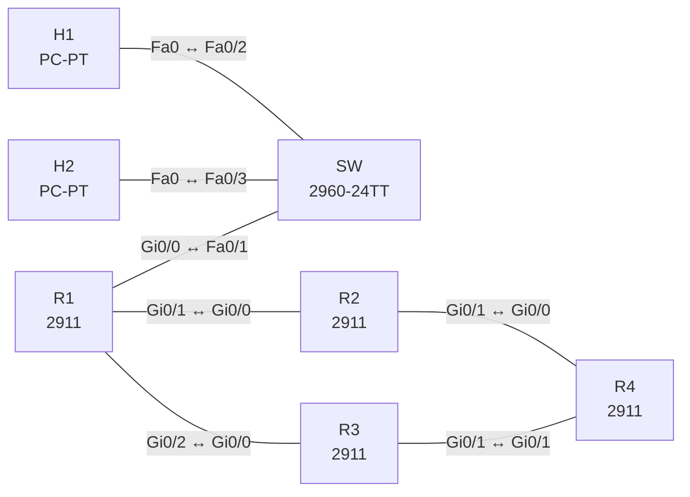

# Lab 04 – Policy-Based Routing mit IP SLA

**Dauer:** 75 min · **Niveau:** mittel

Branch-Router mit zwei Providern: bestimmte Quelle per PBR über ISP2, Rest über ISP1. Der PBR-Next-Hop wird per IP SLA und Track überwacht. Dazu Local-PBR für routereigenen Verkehr.

**Lernziele:** Nach diesem Lab kannst du …

- Policy-Based Routing für eine Quelle einrichten und an das richtige Interface binden.
- Mit IP SLA und Tracking einen Next-Hop überwachen.
- Mit `show route-map` und `show track` nachweisen, welchen Weg ein Paket nimmt.

| ENCOR-Ziel (`Ziel::…`) | Thema |
|---|---|
| 3.2.d | Policy-based Routing |
| 4.4 | IP SLA |

**So arbeitest du:** Teil A = Bauen, Teil B = Reparieren, Teil C = Üben. Die Konfigurationsdateien liegen in `build/` (Ausgangszustand zum Einfügen in die CLI), `repair/` (fertig gebaut, mit Fehlern) und `solutions/` (Musterlösung und Fehlerliste, erst nach eigenem Versuch öffnen). Anleitung zum Einfügen: siehe [Arbeiten mit den Dateien](../README.md#arbeiten-mit-den-dateien).

## Topologie



**Entwurfsskizze (aus dem CML-Lab; Portnamen der Switches siehe Verkabelungstabelle):**

```
 H1 .11 ─┐                 ┌─ R2 (ISP1) ─┐
         SW ── R1 (Branch) ┤             ├─ R4 (Internet: 8.8.8.8, 9.9.9.9)
 H2 .12 ─┘   192.168.1.0/24└─ R3 (ISP2) ─┘
```

### Geräte

| Gerät | Modell in Packet Tracer | Rolle |
|---|---|---|
| SW | 2960-24TT | Switch (im CML-Lab unmanaged; ohne Konfiguration) |
| H1 | PC-PT | Host |
| H2 | PC-PT | Host |
| R1 | 2911 | Router |
| R2 | 2911 | Router |
| R3 | 2911 | Router |
| R4 | 2911 | Router |

### Verkabelung

| Von | Port | Nach | Port | Kabel |
|---|---|---|---|---|
| R1 | Gi0/0 | SW | Fa0/1 | Copper Straight-Through |
| H1 | Fa0 | SW | Fa0/2 | Copper Straight-Through |
| H2 | Fa0 | SW | Fa0/3 | Copper Straight-Through |
| R1 | Gi0/1 | R2 | Gi0/0 | Copper Cross-Over |
| R1 | Gi0/2 | R3 | Gi0/0 | Copper Cross-Over |
| R2 | Gi0/1 | R4 | Gi0/0 | Copper Cross-Over |
| R3 | Gi0/1 | R4 | Gi0/1 | Copper Cross-Over |

### Adressplan (Ausgangszustand)

| Gerät | Interface | Adresse | Maske | Gateway | DNS |
|---|---|---|---|---|---|
| H1 | Fa0 (GUI) | 192.168.1.11 | 255.255.255.0 | 192.168.1.1 |  |
| H2 | Fa0 (GUI) | 192.168.1.12 | 255.255.255.0 | 192.168.1.1 |  |
| R1 | Gi0/0 | 192.168.1.1 | 255.255.255.0 | | |
| R1 | Gi0/1 | 10.0.12.1 | 255.255.255.252 | | |
| R1 | Gi0/2 | 10.0.13.1 | 255.255.255.252 | | |
| R2 | Gi0/0 | 10.0.12.2 | 255.255.255.252 | | |
| R2 | Gi0/1 | 10.0.24.1 | 255.255.255.252 | | |
| R3 | Gi0/0 | 10.0.13.2 | 255.255.255.252 | | |
| R3 | Gi0/1 | 10.0.34.1 | 255.255.255.252 | | |
| R4 | Gi0/0 | 10.0.24.2 | 255.255.255.252 | | |
| R4 | Gi0/1 | 10.0.34.2 | 255.255.255.252 | | |
| R4 | Loopback0 | 8.8.8.8 | 255.255.255.255 | | |
| R4 | Loopback1 | 9.9.9.9 | 255.255.255.255 | | |

| Link | Netz | Seiten |
|---|---|---|
| LAN | 192.168.1.0/24 | R1 .1, H1 .11, H2 .12 |
| R1–R2 (ISP1) | 10.0.12.0/30 | R1 .1 / R2 .2 |
| R1–R3 (ISP2) | 10.0.13.0/30 | R1 .1 / R3 .2 |
| R2–R4 | 10.0.24.0/30 | R2 .1 / R4 .2 |
| R3–R4 | 10.0.34.0/30 | R3 .1 / R4 .2 |

Statisches Routing ist vorgegeben: R1 hat Default via ISP1; R2/R3 haben Default zu R4 und Rückroute ins LAN; R4 kennt 192.168.1.11/32 via R3, den Rest des LANs via R2. R4 hat Lo0 8.8.8.8/32 und Lo1 9.9.9.9/32.

### Portzuordnung der Switches (CML → Packet Tracer)

Aufgaben, Verkabelung, Konfigurationen und Fehlerlisten verwenden die Packet-Tracer-Ports. Die Tabelle zeigt, welcher Port der CML-Vorlage dazu gehört. Nur die Skizze nennt noch die CML-Ports. Umrechnung: `GiX/Y` → `Fa0/(X·4+Y+1)`.

| Switch | CML-Port | PT-Port |
|---|---|---|
| SW | Gi0/0 | Fa0/1 |
| SW | Gi0/1 | Fa0/2 |
| SW | Gi0/2 | Fa0/3 |

> **Packet-Tracer-Hinweis:** **Eignung: teilweise.** Stand Packet Tracer 8.x: IP SLA / Track: nicht vorhanden. IP SLA und Track-Objekte gibt es nicht; die Teile mit Tracking in CML oder EVE-NG machen. Akzeptiert PT einen Befehl nicht, ist das ein PT-Limit und kein Fehler von dir; solche Schritte machst du in CML oder EVE-NG. Die CML-Switches (Gi-Ports) sind hier 3560-24PS bzw. 2960 mit FastEthernet-Ports: Die Portzuordnung steht unter dem Adressplan.

## Teil A – Bauen
Arbeite die Schritte der Reihe nach ab. Jeder Schritt sagt dir, was du tust, woran du den Erfolg erkennst (**Prüfen**) und worüber du nachdenken sollst (**Denkfrage**). Die Antworten auf die Denkfragen stehen am Ende von Teil A.

1. **Ausgangslage prüfen.** Führe auf H1 und H2 `traceroute 8.8.8.8` aus.
   - **Prüfen:** Beide laufen über ISP1, der zweite Hop ist 10.0.12.2 (R2).
2. **PBR für H1.** H1 (192.168.1.11) soll über ISP2 (R3, 10.0.13.2) laufen, H2 weiter über ISP1. Baue dafür auf R1:
   - eine ACL `H1-ONLY`, die nur 192.168.1.11 erlaubt,
   - eine Route-Map `PBR` mit `match ip address H1-ONLY` und `set ip next-hop 10.0.13.2`,
   - die Bindung mit `ip policy route-map PBR` am LAN-Interface, also dort, wo die Pakete von H1 ankommen.
   - **Prüfen:** `traceroute 8.8.8.8` auf H1 geht über 10.0.13.2, auf H2 weiter über 10.0.12.2. `show route-map PBR` zählt Treffer.
3. **Verhalten ohne Treffer.** Überlege, bevor du testest:
   - **Denkfrage:** Was passiert mit einem Paket, das keine Sequenz der Route-Map trifft? Was mit einem, das zwar `match`, aber kein `set` hat? Und worin unterscheidet sich `set ip default next-hop` von `set ip next-hop`?
4. **Next-Hop überwachen.** Baue `ip sla 1` mit `icmp-echo 10.0.13.2 source-interface Gi0/2` und `frequency 5`. Starte die Messung mit `ip sla schedule 1 life forever start-time now`. Lege `track 1 ip sla 1 reachability` an und ändere die Route-Map auf `set ip next-hop verify-availability 10.0.13.2 10 track 1`.
   - **Prüfen:** `show track 1` ist Up. Schalte dann Gi0/2 auf R1 ab: `show track 1` geht nach einigen Sekunden auf Down.
   - **Denkfrage:** Welchen Weg nimmt H1 jetzt, und warum?
5. **Verkehr des Routers selbst.** Pings, die R1 selbst nach 9.9.9.9 schickt, sollen über ISP2 laufen.
   - **Denkfrage:** Warum greift `ip policy` am LAN-Interface hier nicht, und welcher Befehl ist stattdessen nötig?
6. **Fehlersuche.** Schalte kurz `debug ip policy` ein, sende einen Ping von H1 und lies die Meldungen. Danach `undebug all`.
   - **Prüfen:** Die Meldung zeigt „policy match“ und den gewählten Next-Hop.
   - **Denkfrage:** Warum kann PBR die Leistung kosten, wenn eine Plattform es nicht in Hardware erledigt?

<details><summary>Antworten zu den Denkfragen</summary>

- **Zu 3:** Ein Paket ohne Treffer wird ganz normal nach der Routing-Tabelle weitergeleitet, nicht verworfen. Dasselbe gilt für einen Treffer ohne `set`. `set ip next-hop` hat Vorrang vor der Routing-Tabelle. `set ip default next-hop` greift nur, wenn die Tabelle für das Ziel keine spezifischere Route als die Default kennt.
- **Zu 4:** H1 läuft wieder über ISP1. `verify-availability` nutzt den Next-Hop nur, solange Track 1 Up ist. Ist er Down, wird das Paket normal geroutet, und die Default-Route zeigt auf ISP1.
- **Zu 5:** `ip policy` prüft nur Pakete, die an diesem Interface ankommen. Pakete, die R1 selbst erzeugt, kommen an keinem Interface an. Für sie gibt es `ip local policy route-map`.
- **Zu 6:** Ohne Hardware-Unterstützung muss die CPU jedes Paket selbst prüfen statt der schnellen Weiterleitung per CEF oder Hardware. Moderne Router und Switches erledigen PBR meist in CEF bzw. in der TCAM.

</details>

## Teil B – Reparieren

Baue die Topologie wie oben (oder behalte deine aus Teil A), setze alle Geräte zurück (`erase startup-config`, `reload` bzw. neues Gerät) und füge dann die Dateien aus `repair/` ein. Es stecken **4 Fehler** drin. Behandle jede Meldung als Ticket: erst Symptom nachstellen, dann Layer für Layer eingrenzen, beheben und beweisen. Ändere nur, was kaputt ist.

**Ticket 1:** Die Route-Map ist konfiguriert, aber H1 läuft weiter über ISP1 (`show route-map` zeigt 0 Treffer).

**Ticket 2:** PBR-Route-Map ist am LAN aktiv, aber H1 nimmt nicht den Weg über ISP2.

**Ticket 3:** **[in PT nicht prüfbar: IP SLA / Track]** H1 läuft nicht über ISP2, obwohl ACL und Policy stimmen; `show track 1` ist Down.

**Ticket 4:** H1 hat Internet-Ausfall (Pings zu 8.8.8.8 scheitern), H2 funktioniert; der Pfad bis R3 steht.

## Verifikation
```
traceroute 8.8.8.8               ! auf H1 und H2
show route-map PBR
show ip policy
show ip sla statistics 1
show track 1
show ip route 8.8.8.8
```

| Befehl | Das solltest du sehen |
|---|---|
| `traceroute` auf H1 / H2 | H1 über 10.0.13.2, H2 über 10.0.12.2 |
| `show track 1` | State Up |
| `show ip sla statistics 1` | steigende Zahl erfolgreicher Messungen, Rückgabe OK |

## Teil C – Üben

Beantworte zuerst selbst, dann klappe die Antwort auf.

1. Wie beeinflusst `set ip next-hop verify-availability` das Routing?
<details><summary>Antwort</summary>

**Der Next-Hop wird nur benutzt, solange das zugehörige Track-Objekt Up ist.** Fällt es auf Down, prüft der Router die nächste Sequenz der Route-Map oder routet normal nach der Routing-Tabelle.

</details>

2. Ein IP-SLA-Echo gelingt nicht, obwohl Ping manuell geht. Was prüfst du?
<details><summary>Antwort</summary>

**Ob die Operation überhaupt läuft und mit welchen Werten.** `show ip sla configuration` zeigt Quelladresse, Quell-Interface, Frequenz und Timeout, `show ip sla statistics` die Ergebnisse. Fehlt `ip sla schedule`, wird nie gemessen. Danach ACL oder CoPP auf dem Weg prüfen.

</details>

3. Wieso nutzt man PBR statt statischer Route mit Zeit-/AD-Spielereien?
<details><summary>Antwort</summary>

**Weil PBR nach Quelle, Protokoll oder Port entscheiden kann.** Normales Routing schaut nur auf die Zieladresse. Mit statischen Routen und AD-Tricks lässt sich nicht sagen: „Nur H1 über ISP2.“

</details>

## Prüfungsbezug
- PBR wirkt nur auf Pakete, die am Interface ankommen. Für Pakete des Routers selbst gibt es `ip local policy`.
- Ohne `ip sla schedule` misst IP SLA nie, der Track bleibt Down.
- `set ip next-hop` überstimmt die Routing-Tabelle. `set ip default next-hop` greift nur, wenn es keine spezifische Route gibt.

## Lösungen

- `solutions/<Gerät>.cfg`: Konfiguration zu Teil A (ohne Basis-Adressen)
- `solutions/FAULTS.md`: Fehlerliste zu Teil B (Spoiler!)
