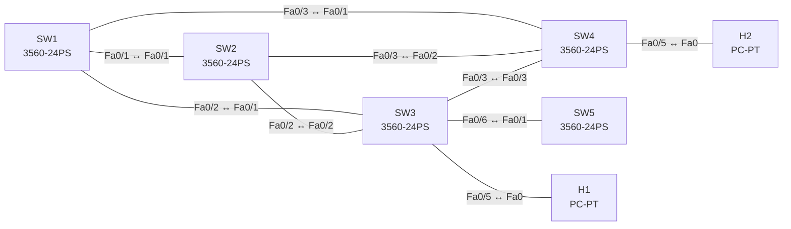

# Lab 06 – Spanning Tree, MST und Schutzfunktionen

**Dauer:** 90 min · **Niveau:** mittel bis schwer

Vier Switches im Dreiecksverbund plus „Rogue“-Switch: Rapid-PVST, Root-Platzierung und Lastverteilung, Umstieg auf MST, PortFast, BPDU Guard, Root Guard, Loop Guard und typische STP-Fehler.

**Lernziele:** Nach diesem Lab kannst du …

- Die STP-Root-Wahl vorhersagen und gezielt steuern.
- MST mit Region, Instanzen und Prioritäten konfigurieren.
- PortFast, BPDU Guard und Root Guard sinnvoll einsetzen.

| ENCOR-Ziel (`Ziel::…`) | Thema |
|---|---|
| 3.1.c | RSTP, MST und Schutzfunktionen |

**So arbeitest du:** Teil A = Bauen, Teil B = Reparieren, Teil C = Üben. Die Konfigurationsdateien liegen in `build/` (Ausgangszustand zum Einfügen in die CLI), `repair/` (fertig gebaut, mit Fehlern) und `solutions/` (Musterlösung und Fehlerliste, erst nach eigenem Versuch öffnen). Anleitung zum Einfügen: siehe [Arbeiten mit den Dateien](../README.md#arbeiten-mit-den-dateien).

## Topologie



**Entwurfsskizze (aus dem CML-Lab; Portnamen der Switches siehe Verkabelungstabelle):**

```
        SW1 ───── SW2          Distribution (Root-Kandidaten)
        │ ╲     ╱ │
        │   ╲ ╱   │
        │   ╱ ╲   │
        SW3 ───── SW4          Access
        │         │
   H1 ──┤         └── H2      (beide VLAN 10)
   SW5 (Rogue, BPDU-Quelle) am Port Gi1/1 von SW3
```

### Geräte

| Gerät | Modell in Packet Tracer | Rolle |
|---|---|---|
| SW1 | 3560-24PS | Switch |
| SW2 | 3560-24PS | Switch |
| SW3 | 3560-24PS | Switch |
| SW4 | 3560-24PS | Switch |
| SW5 | 3560-24PS | Switch |
| H1 | PC-PT | Host |
| H2 | PC-PT | Host |

### Verkabelung

| Von | Port | Nach | Port | Kabel |
|---|---|---|---|---|
| SW1 | Fa0/1 | SW2 | Fa0/1 | Copper Cross-Over |
| SW1 | Fa0/2 | SW3 | Fa0/1 | Copper Cross-Over |
| SW1 | Fa0/3 | SW4 | Fa0/1 | Copper Cross-Over |
| SW2 | Fa0/2 | SW3 | Fa0/2 | Copper Cross-Over |
| SW2 | Fa0/3 | SW4 | Fa0/2 | Copper Cross-Over |
| SW3 | Fa0/3 | SW4 | Fa0/3 | Copper Cross-Over |
| SW3 | Fa0/5 | H1 | Fa0 | Copper Straight-Through |
| SW4 | Fa0/5 | H2 | Fa0 | Copper Straight-Through |
| SW3 | Fa0/6 | SW5 | Fa0/1 | Copper Cross-Over |

### Adressplan (Ausgangszustand)

| Gerät | Interface | Adresse | Maske | Gateway | DNS |
|---|---|---|---|---|---|
| H1 | Fa0 (GUI) | 10.10.10.11 | 255.255.255.0 | 10.10.10.1 |  |
| H2 | Fa0 (GUI) | 10.10.10.12 | 255.255.255.0 | 10.10.10.1 |  |

| Link | Ports |
|---|---|
| SW1–SW2 | Fa0/1 ↔ Fa0/1 |
| SW1–SW3 | Fa0/2 ↔ Fa0/1 |
| SW1–SW4 | Fa0/3 ↔ Fa0/1 |
| SW2–SW3 | Fa0/2 ↔ Fa0/2 |
| SW2–SW4 | Fa0/3 ↔ Fa0/2 |
| SW3–SW4 | Fa0/3 ↔ Fa0/3 |
| H1 / H2 | SW3 Fa0/5 / SW4 Fa0/5 (VLAN 10) |
| SW5 | SW3 Fa0/6 ↔ SW5 Fa0/1 (SW5 ist ab Werk `shutdown`) |

VLANs 10 und 20 sind angelegt, die Inter-Switch-Links sind noch **nicht** als Trunks konfiguriert (Aufgabe 1). Hosts: H1 10.10.10.11, H2 10.10.10.12 (/24).

### Portzuordnung der Switches (CML → Packet Tracer)

Aufgaben, Verkabelung, Konfigurationen und Fehlerlisten verwenden die Packet-Tracer-Ports. Die Tabelle zeigt, welcher Port der CML-Vorlage dazu gehört. Nur die Skizze nennt noch die CML-Ports. Umrechnung: `GiX/Y` → `Fa0/(X·4+Y+1)`.

| Switch | CML-Port | PT-Port |
|---|---|---|
| SW1 | Gi0/0 | Fa0/1 |
| SW1 | Gi0/1 | Fa0/2 |
| SW1 | Gi0/2 | Fa0/3 |
| SW2 | Gi0/0 | Fa0/1 |
| SW2 | Gi0/1 | Fa0/2 |
| SW2 | Gi0/2 | Fa0/3 |
| SW3 | Gi0/0 | Fa0/1 |
| SW3 | Gi0/1 | Fa0/2 |
| SW3 | Gi0/2 | Fa0/3 |
| SW3 | Gi1/0 | Fa0/5 |
| SW3 | Gi1/1 | Fa0/6 |
| SW4 | Gi0/0 | Fa0/1 |
| SW4 | Gi0/1 | Fa0/2 |
| SW4 | Gi0/2 | Fa0/3 |
| SW4 | Gi1/0 | Fa0/5 |
| SW5 | Gi0/0 | Fa0/1 |

> **Packet-Tracer-Hinweis:** **Eignung: teilweise.** Stand Packet Tracer 8.x: MST: eingeschränkt. MST nur in Grundzügen; Region/Instanzen anlegen geht, Feinheiten (z. B. `show spanning-tree mst`-Ausgabe) weichen ab. Akzeptiert PT einen Befehl nicht, ist das ein PT-Limit und kein Fehler von dir; solche Schritte machst du in CML oder EVE-NG. Die CML-Switches (Gi-Ports) sind hier 3560-24PS bzw. 2960 mit FastEthernet-Ports: Die Portzuordnung steht unter dem Adressplan.

## Teil A – Bauen
Arbeite die Schritte der Reihe nach ab. Jeder Schritt sagt dir, was du tust, woran du den Erfolg erkennst (**Prüfen**) und worüber du nachdenken sollst (**Denkfrage**). Die Antworten auf die Denkfragen stehen am Ende von Teil A.

1. **Trunks.** Lege VLAN 99 an. Mache alle sechs Links zwischen den Switches zu festen Trunks (`mode trunk`, `nonegotiate`) mit den erlaubten VLANs 10 und 20 und Native VLAN 99.
   - **Prüfen:** H1 pingt H2.
2. **Rapid-PVST lesen.** Führe auf SW3 `show spanning-tree vlan 10` aus.
   - **Prüfen:** Finde die Root (niedrigste Bridge-ID) und die Rolle jedes Ports: Root, Designated oder Alternate.
   - **Denkfrage:** Warum kann ein Alternate-Port in RSTP sofort übernehmen?
3. **Root festlegen.** Mache SW1 zur Root für VLAN 10 und SW2 zur Root für VLAN 20, jeweils mit dem anderen als Ersatz: `spanning-tree vlan X root primary` bzw. `secondary`.
   - **Prüfen:** `show spanning-tree root` zeigt für VLAN 10 SW1, für VLAN 20 SW2.
   - **Denkfrage:** Welche Priorität setzen `primary` und `secondary`? Wie kannst du mit `spanning-tree cost` die Pfadwahl beeinflussen?
4. **Auf MST umstellen.** Setze auf allen Switches `spanning-tree mode mst` mit Region `ENCOR`, Revision 1, Instanz 1 = VLAN 10, Instanz 2 = VLAN 20. Prioritäten: Instanz 0 und 1 SW1 4096, Instanz 2 SW2 4096, der jeweils andere 8192.
   - **Prüfen:** `show spanning-tree mst configuration` ist auf allen Switches gleich. `show spanning-tree mst` zeigt keine Boundary-Ports.
   - **Denkfrage:** Warum müssen Name, Revision und VLAN-Zuordnung überall gleich sein, und was passiert sonst?
5. **Edge-Ports schützen.** Setze an den Ports von H1, H2 und an Fa0/6 (SW5) `spanning-tree portfast` und `spanning-tree bpduguard enable`. Schalte SW5 mit `no shutdown` ein.
   - **Prüfen:** Der Port zu SW5 geht in den Zustand err-disabled, die Root bleibt SW1. Danach `errdisable recovery cause bpduguard` mit `errdisable recovery interval 60` setzen.
   - **Denkfrage:** Was ist der Unterschied zwischen BPDU Guard und BPDU Filter?
6. **Root Guard.** Setze `spanning-tree guard root` an den Ports der Distribution-Switches Richtung Access (SW1 Fa0/2, Fa0/3, SW2 Fa0/2, Fa0/3).
   - **Prüfen:** `show spanning-tree inconsistentports` ist leer, solange niemand eine bessere BPDU schickt.
   - **Denkfrage:** Was macht Root Guard, wenn doch eine bessere BPDU kommt, und warum blockiert er normale Nachbarn nicht?
7. **Loop Guard und UDLD.** Aktiviere Loop Guard auf den Uplinks der Access-Switches (`spanning-tree guard loop` oder global `spanning-tree loopguard default`) und `udld aggressive`.
   - **Denkfrage:** Welcher Fehler entsteht ohne die beiden, wenn ein Link nur noch in eine Richtung überträgt?
8. **Konvergenz messen.** Starte auf H1 `ping 10.10.10.12 repeat 1000` und schalte den Link zur Root ab.
   - **Prüfen:** Zähle die verlorenen Pings. Bei Rapid-PVST und MST sind es nur wenige.

<details><summary>Antworten zu den Denkfragen</summary>

- **Zu 2:** RSTP hält den Alternate-Port als fertigen Ersatz für den Root-Port bereit. Fällt der Root-Port aus, wechselt der Alternate-Port direkt auf Forwarding, ohne Listening und Learning.
- **Zu 3:** `primary` setzt 24576 oder, falls nötig, einen Wert 4096 unter der aktuellen Root. `secondary` setzt 28672. Mit `spanning-tree cost` machst du einen Port teurer oder günstiger. Der Switch nimmt den Weg mit den geringsten Gesamtkosten zur Root (Standard kurz: 1 Gbit/s = 4, 100 Mbit/s = 19, lang: 1 Gbit/s = 20 000).
- **Zu 4:** Aus Name, Revision und VLAN-Zuordnung berechnet MST einen Digest, an dem sich Switches derselben Region erkennen. Weicht ein Wert ab, bildet der Switch eine eigene Region. Die Ports dazwischen werden Boundary-Ports, und dort laufen alle VLANs über die IST. Die Lastverteilung nach Instanz geht verloren.
- **Zu 5:** BPDU Guard schaltet den Port ab, sobald eine BPDU ankommt. Das ist laut und sicher. BPDU Filter am Interface unterdrückt BPDUs einfach. Hängt dort ein Switch, merkt STP nichts, und es kann eine Schleife entstehen.
- **Zu 6:** Kommt eine bessere BPDU, setzt Root Guard den Port auf root-inconsistent und blockiert ihn. Hören die besseren BPDUs auf, gibt er den Port von selbst wieder frei. Normale Nachbarn senden schlechtere BPDUs, die lässt Root Guard durch.
- **Zu 7:** Kommen auf einem Port keine BPDUs mehr an, hält STP den Weg für frei und schaltet einen blockierten Port auf Forwarding. Die Folge ist eine Schleife. Loop Guard setzt den Port in diesem Fall auf loop-inconsistent. UDLD erkennt die einseitige Verbindung und schaltet den Port ab.

</details>

## Teil B – Reparieren

Baue die Topologie wie oben (oder behalte deine aus Teil A), setze alle Geräte zurück (`erase startup-config`, `reload` bzw. neues Gerät) und füge dann die Dateien aus `repair/` ein. Es stecken **3 Fehler** drin. Behandle jede Meldung als Ticket: erst Symptom nachstellen, dann Layer für Layer eingrenzen, beheben und beweisen. Ändere nur, was kaputt ist.

**Ticket 1:** Alle Hosts erreichen sich, aber `show spanning-tree mst` auf SW4 meldet Boundary-Ports zur eigenen MST-Region; die Lastverteilung nach Instanz funktioniert nicht.

**Ticket 2:** Instanz 2 hat dieselbe Root wie Instanz 1 (SW1), die VLAN-Lastverteilung fehlt.

**Ticket 3:** Nachdem jemand an Fa0/6 einen kleinen Switch angeschlossen hat, wechselt die Root und das Netz flattert. SW3 zeigt eine neue Root über Fa0/6.

## Verifikation
```
show spanning-tree
show spanning-tree mst configuration
show spanning-tree mst 1
show spanning-tree inconsistentports
show spanning-tree summary
show errdisable recovery
show udld neighbors
```

| Befehl | Das solltest du sehen |
|---|---|
| `show spanning-tree mst` | SW1 Root für Instanz 0 und 1, SW2 Root für Instanz 2 |
| `show spanning-tree mst 1` auf SW3 und SW4 | mindestens ein Alternate-Port, keine Boundary-Ports |
| `show interfaces status err-disabled` auf SW3 | der Port zu SW5, ausgelöst durch BPDU Guard |

## Teil C – Üben

Beantworte zuerst selbst, dann klappe die Antwort auf.

1. Welcher Switch wird Root, wenn alle Prioritäten gleich sind?
<details><summary>Antwort</summary>

**Der Switch mit der niedrigsten MAC-Adresse.** Die Bridge-ID besteht aus Priorität und MAC. Bei gleicher Priorität entscheidet die MAC. Bei PVST+ ist die VLAN-ID in der Priorität enthalten (Extended System ID).

</details>

2. Ein Switch hat Port-Zustand `BKN*`. Was bedeutet das?
<details><summary>Antwort</summary>

**Der Port ist durch eine Schutzfunktion blockiert (Broken).** Ursachen sind Root Guard (`ROOT_Inc`), Loop Guard (`LOOP_Inc`) oder eine Type- bzw. PVID-Inkonsistenz. Welche es ist, zeigt `show spanning-tree inconsistentports`.

</details>

3. Warum PortFast **und** BPDU Guard?
<details><summary>Antwort</summary>

**PortFast spart die Wartezeit, BPDU Guard sichert sie ab.** PortFast schaltet einen Edge-Port sofort auf Forwarding. Hängt dort doch ein Switch, könnte eine Schleife entstehen. BPDU Guard schaltet den Port ab, sobald eine BPDU ankommt.

</details>

## Prüfungsbezug
- Rapid-PVST hat eine Instanz pro VLAN, MST fasst VLANs zu Instanzen zusammen.
- Port-Rollen: Root, Designated, Alternate, Backup. Zustände: Discarding, Learning, Forwarding.
- Root Guard an Ports Richtung Access, BPDU Guard an Edge-Ports, Loop Guard an blockierenden Ports.
- Standardkosten 1 Gbit/s: 4 (kurz) bzw. 20 000 (lang). Priorität in Schritten von 4096, bei PVST plus VLAN-ID.

## Lösungen

- `solutions/<Gerät>.cfg`: Konfiguration zu Teil A (ohne Basis-Adressen)
- `solutions/FAULTS.md`: Fehlerliste zu Teil B (Spoiler!)
