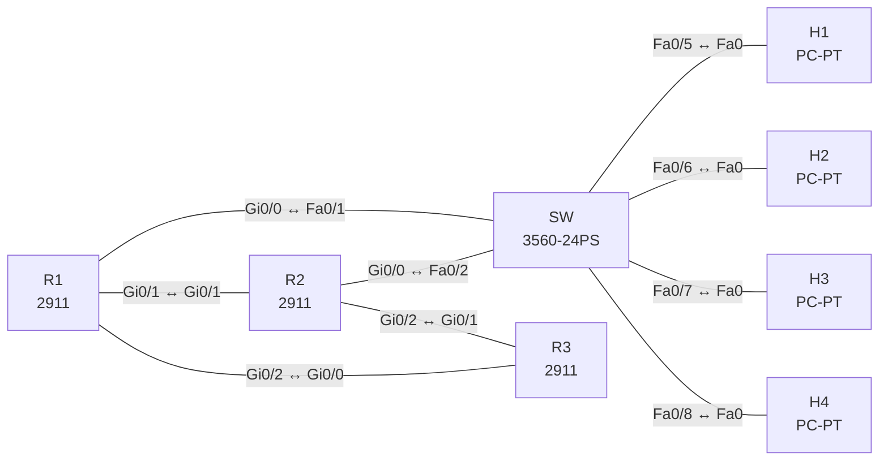

# Lab 07 – First-Hop-Redundanz: HSRP, VRRP und GLBP

**Dauer:** 90 min · **Niveau:** mittel

Zwei Distribution-Router, ein Access-Switch, drei VLANs mit je einem anderen FHRP-Protokoll. Dazu Tracking, Preemption, Timer und die Frage, welche Redundanzstufe (Link, Gerät, Standort) Hochverfügbarkeit wirklich liefert.

**Lernziele:** Nach diesem Lab kannst du …

- HSRP, VRRP und GLBP konfigurieren und ihre Unterschiede erklären.
- Mit Tracking und Preemption steuern, wann die Rolle wechselt.
- Redundanz auf Link-, Geräte- und Chassis-Ebene (SSO/NSF) einordnen.

| ENCOR-Ziel (`Ziel::…`) | Thema |
|---|---|
| 3.3.c | HSRP und VRRP |
| 1.1.b | Redundanz, FHRP und SSO |

**So arbeitest du:** Teil A = Bauen, Teil B = Reparieren, Teil C = Üben. Die Konfigurationsdateien liegen in `build/` (Ausgangszustand zum Einfügen in die CLI), `repair/` (fertig gebaut, mit Fehlern) und `solutions/` (Musterlösung und Fehlerliste, erst nach eigenem Versuch öffnen). Anleitung zum Einfügen: siehe [Arbeiten mit den Dateien](../README.md#arbeiten-mit-den-dateien).

## Topologie



**Entwurfsskizze (aus dem CML-Lab; Portnamen der Switches siehe Verkabelungstabelle):**

```
                     R3 (Core, 8.8.8.8)
                  Gi0/0         Gi0/1
                    │             │
   H1 (V10) ─┐   R1 ─────────── R2       R1/R2 Gi0/1 ↔ Gi0/1  (10.0.12.0/30)
   H2 (V20) ─┼─ SW ── Gi0/0↔R1.Gi0/0    R1 Gi0/2 ↔ R3 Gi0/0, R2 Gi0/2 ↔ R3 Gi0/1
   H3 (V30) ─┤     └─ Gi0/1↔R2.Gi0/0
   H4 (V30) ─┘
```

### Geräte

| Gerät | Modell in Packet Tracer | Rolle |
|---|---|---|
| R1 | 2911 | Router |
| R2 | 2911 | Router |
| R3 | 2911 | Router |
| SW | 3560-24PS | Switch |
| H1 | PC-PT | Host |
| H2 | PC-PT | Host |
| H3 | PC-PT | Host |
| H4 | PC-PT | Host |

### Verkabelung

| Von | Port | Nach | Port | Kabel |
|---|---|---|---|---|
| R1 | Gi0/0 | SW | Fa0/1 | Copper Straight-Through |
| R2 | Gi0/0 | SW | Fa0/2 | Copper Straight-Through |
| R1 | Gi0/1 | R2 | Gi0/1 | Copper Cross-Over |
| R1 | Gi0/2 | R3 | Gi0/0 | Copper Cross-Over |
| R2 | Gi0/2 | R3 | Gi0/1 | Copper Cross-Over |
| SW | Fa0/5 | H1 | Fa0 | Copper Straight-Through |
| SW | Fa0/6 | H2 | Fa0 | Copper Straight-Through |
| SW | Fa0/7 | H3 | Fa0 | Copper Straight-Through |
| SW | Fa0/8 | H4 | Fa0 | Copper Straight-Through |

### Adressplan (Ausgangszustand)

| Gerät | Interface | Adresse | Maske | Gateway | DNS |
|---|---|---|---|---|---|
| R1 | Gi0/1 | 10.0.12.1 | 255.255.255.252 | | |
| R1 | Gi0/2 | 10.0.13.1 | 255.255.255.252 | | |
| R1 | Gi0/0.10 | 10.10.10.2 | 255.255.255.0 | | |
| R1 | Gi0/0.20 | 10.10.20.2 | 255.255.255.0 | | |
| R1 | Gi0/0.30 | 10.10.30.2 | 255.255.255.0 | | |
| R2 | Gi0/1 | 10.0.12.2 | 255.255.255.252 | | |
| R2 | Gi0/2 | 10.0.23.1 | 255.255.255.252 | | |
| R2 | Gi0/0.10 | 10.10.10.3 | 255.255.255.0 | | |
| R2 | Gi0/0.20 | 10.10.20.3 | 255.255.255.0 | | |
| R2 | Gi0/0.30 | 10.10.30.3 | 255.255.255.0 | | |
| R3 | Loopback0 | 8.8.8.8 | 255.255.255.255 | | |
| R3 | Gi0/0 | 10.0.13.2 | 255.255.255.252 | | |
| R3 | Gi0/1 | 10.0.23.2 | 255.255.255.252 | | |
| H1 | Fa0 (GUI) | 10.10.10.11 | 255.255.255.0 | 10.10.10.1 |  |
| H2 | Fa0 (GUI) | 10.10.20.12 | 255.255.255.0 | 10.10.20.1 |  |
| H3 | Fa0 (GUI) | 10.10.30.13 | 255.255.255.0 | 10.10.30.1 |  |
| H4 | Fa0 (GUI) | 10.10.30.14 | 255.255.255.0 | 10.10.30.1 |  |

| VLAN | Protokoll | VIP | R1 | R2 | Rolle (Soll) |
|---|---|---|---|---|---|
| 10 | **HSRP v2** | 10.10.10.1 | .2 | .3 | R1 Active (Prio 110, preempt, Track Uplink) |
| 20 | **VRRP** | 10.10.20.1 | .2 | .3 | R2 Master (Prio 110) |
| 30 | **GLBP** | 10.10.30.1 | .2 | .3 | R1 AVG (Prio 110), Round-Robin |

Hosts: H1 10.10.10.11, H2 10.10.20.12, H3 10.10.30.13, H4 10.10.30.14 (Gateway = VIP). Uplinks: R1 Gi0/2 ↔ R3 Gi0/0 (10.0.13.0/30), R2 Gi0/2 ↔ R3 Gi0/1 (10.0.23.0/30), R3 Lo0 8.8.8.8/32. OSPF 1 (Area 0) läuft bereits auf den Uplinks und zwischen R1/R2.

### Portzuordnung der Switches (CML → Packet Tracer)

Aufgaben, Verkabelung, Konfigurationen und Fehlerlisten verwenden die Packet-Tracer-Ports. Die Tabelle zeigt, welcher Port der CML-Vorlage dazu gehört. Nur die Skizze nennt noch die CML-Ports. Umrechnung: `GiX/Y` → `Fa0/(X·4+Y+1)`.

| Switch | CML-Port | PT-Port |
|---|---|---|
| SW | Gi0/0 | Fa0/1 |
| SW | Gi0/1 | Fa0/2 |
| SW | Gi1/0 | Fa0/5 |
| SW | Gi1/1 | Fa0/6 |
| SW | Gi1/2 | Fa0/7 |
| SW | Gi1/3 | Fa0/8 |

> **Packet-Tracer-Hinweis:** **Eignung: teilweise.** Stand Packet Tracer 8.x: IP SLA / Track: nicht vorhanden. IP SLA und Track-Objekte gibt es nicht; die Teile mit Tracking in CML oder EVE-NG machen. VRRP: nicht vorhanden. Nicht vorhanden. In CML oder EVE-NG üben. GLBP: nicht vorhanden. Nicht vorhanden. In CML oder EVE-NG üben. Akzeptiert PT einen Befehl nicht, ist das ein PT-Limit und kein Fehler von dir; solche Schritte machst du in CML oder EVE-NG. Die CML-Switches (Gi-Ports) sind hier 3560-24PS bzw. 2960 mit FastEthernet-Ports: Die Portzuordnung steht unter dem Adressplan.

## Teil A – Bauen
Arbeite die Schritte der Reihe nach ab. Jeder Schritt sagt dir, was du tust, woran du den Erfolg erkennst (**Prüfen**) und worüber du nachdenken sollst (**Denkfrage**). Die Antworten auf die Denkfragen stehen am Ende von Teil A.

1. **Subinterfaces und Switch.** Lege auf R1 und R2 die Subinterfaces `Gi0/0.10`, `.20` und `.30` an (`encapsulation dot1Q`, R1 jeweils .2, R2 jeweils .3). Lege auf dem Switch die VLANs 10, 20 und 30 an, mache die Ports zu R1 und R2 zu Trunks (erlaubt: 10, 20, 30) und die Host-Ports zu Access-Ports (H1 VLAN 10, H2 VLAN 20, H3 und H4 VLAN 30).
   - **Prüfen:** R1 pingt R2 in allen drei VLANs.
2. **HSRP in VLAN 10.** Konfiguriere `standby version 2` und Gruppe 10 mit der virtuellen IP 10.10.10.1. R1 bekommt Priorität 110 mit `preempt`, R2 behält 100.
   - **Prüfen:** `show standby brief` zeigt R1 als Active, R2 als Standby und die virtuelle MAC `0000.0C9F.F00A`.
   - **Denkfrage:** Warum ist Preempt bei HSRP standardmäßig aus?
3. **Tracking.** Lege auf R1 `track 1 interface Gi0/2 line-protocol` an und koppel es mit `standby 10 track 1 decrement 20` an HSRP. Schalte dann Gi0/2 auf R1 ab.
   - **Prüfen:** `show standby` auf R1 zeigt Priorität 90, R2 wird Active.
   - **Denkfrage:** Welcher Decrement ist mindestens nötig? Und warum reicht der Zustand des Interfaces bei einem Layer-3-Uplink oft nicht aus?
4. **VRRP in VLAN 20.** Konfiguriere `vrrp 20 ip 10.10.20.1` auf beiden Routern, R2 bekommt `vrrp 20 priority 110`.
   - **Prüfen:** `show vrrp brief` zeigt R2 als Master.
   - **Denkfrage:** Was unterscheidet VRRP von HSRP?
5. **GLBP in VLAN 30.** Konfiguriere `glbp 30 ip 10.10.30.1`, auf R1 `glbp 30 priority 110` und `glbp 30 preempt`, auf beiden `glbp 30 load-balancing round-robin`.
   - **Prüfen:** H3 und H4 pingen ihr Gateway. `show arp` auf H3 und H4 zeigt für 10.10.30.1 zwei verschiedene MAC-Adressen.
   - **Denkfrage:** Welche Rollen gibt es bei GLBP, und wer verteilt die MAC-Adressen?
6. **Timer verkürzen.** Setze in HSRP `standby 10 timers msec 200 msec 750`. Starte auf H1 `ping 10.10.10.1 repeat 1000` und schalte Gi0/0 auf R1 ab.
   - **Prüfen:** Es gehen nur wenige Pings verloren. Mit den Standardwerten (3 s Hello, 10 s Hold) wären es deutlich mehr.
   - **Denkfrage:** Was wäre eine Alternative zu sehr kurzen Timern?
7. **Redundanz einordnen.** Ordne zu, was auf welcher Ebene schützt: Link (EtherChannel), Gerät (FHRP, StackWise), Chassis (SSO, NSF), Standort (zweites Rechenzentrum).
   - **Denkfrage:** Was leisten SSO und NSF, was FHRP nicht kann?

<details><summary>Antworten zu den Denkfragen</summary>

- **Zu 2:** Ohne Preempt bleibt ein Router Active, bis er ausfällt. So vermeidet HSRP, dass die Rolle ständig hin und her springt, wenn ein Router neu startet. Wer die Rolle zurückholen soll, braucht `preempt` ausdrücklich.
- **Zu 3:** Die Priorität muss unter die von R2 fallen: 110 − x < 100, also mindestens 11. Ein Interface kann up sein, obwohl dahinter nichts mehr erreichbar ist. Besser ist dann ein Track auf eine Route (`track … ip route … reachability`) oder auf IP SLA.
- **Zu 4:** VRRP ist ein offener Standard (RFC 5798) und nutzt 224.0.0.18. Es heißt Master und Backup statt Active und Standby, Preempt ist standardmäßig an, und die virtuelle MAC lautet `0000.5E00.01xx`. Die virtuelle IP darf sogar die echte Adresse eines Routers sein.
- **Zu 5:** Der Active Virtual Gateway (AVG) beantwortet die ARP-Anfragen und verteilt dabei die virtuellen MAC-Adressen. Bis zu vier Active Virtual Forwarders (AVF) leiten die Pakete weiter. Jeder Host bekommt so ein anderes Gateway, obwohl alle dieselbe IP benutzen.
- **Zu 6:** BFD erkennt Ausfälle in Millisekunden und meldet sie an die Protokolle. So bleibt die CPU-Last durch Hellos klein.
- **Zu 7:** SSO hält den Zustand zwischen zwei Supervisoren in einem Gerät synchron. Fällt einer aus, übernimmt der andere ohne Neustart. NSF leitet in dieser Zeit weiter Pakete weiter, die Nachbarn halten ihre Routen. FHRP schützt dagegen gegen den Ausfall eines ganzen Geräts mit Hilfe eines zweiten.

</details>

## Teil B – Reparieren

Baue die Topologie wie oben (oder behalte deine aus Teil A), setze alle Geräte zurück (`erase startup-config`, `reload` bzw. neues Gerät) und füge dann die Dateien aus `repair/` ein. Es stecken **4 Fehler** drin. Behandle jede Meldung als Ticket: erst Symptom nachstellen, dann Layer für Layer eingrenzen, beheben und beweisen. Ändere nur, was kaputt ist.

**Ticket 1:** Auf VLAN 10 melden beide Router `Active`, im Log steht `%HSRP-4-DIFFVIP1`.

**Ticket 2:** **[in PT nicht prüfbar: IP SLA / Track]** Nach Abschalten von R1 Gi0/2 bleibt R1 HSRP Active, der Verkehr von VLAN 10 geht ins Leere.

**Ticket 3:** **[in PT nicht prüfbar: VRRP]** VLAN 20 zeigt auf beiden Routern `Master`, Hosts erhalten unregelmäßig Pings.

**Ticket 4:** Nach dem Wiederanschalten von R1 Gi0/2 bleibt R2 Active, obwohl R1 höhere Priorität hat.

## Verifikation
```
show standby brief          show vrrp brief          show glbp brief
show track
show ip route ospf
show arp                    ! auf den Hosts
```

| Befehl | Das solltest du sehen |
|---|---|
| `show standby brief` | R1 Active für VLAN 10 |
| `show vrrp brief` | R2 Master für VLAN 20 |
| `show glbp brief` | R1 als AVG, R1 und R2 je ein AVF |

## Teil C – Üben

Beantworte zuerst selbst, dann klappe die Antwort auf.

1. HSRP-Priorität R1 = 110, R2 = 100, R1 verliert den Uplink, Track decrement 5. Wer ist Active?
<details><summary>Antwort</summary>

**Immer noch R1.** 110 − 5 = 105, und 105 ist größer als 100. Der Decrement muss größer sein als der Abstand zu R2, hier also mindestens 11.

</details>

2. Wozu GLBP, wenn HSRP genügt?
<details><summary>Antwort</summary>

**Weil GLBP die Last auf mehrere Router verteilt.** Bei HSRP und VRRP leitet pro Gruppe nur der aktive Router weiter. GLBP gibt verschiedenen Hosts verschiedene virtuelle MAC-Adressen, ohne zusätzliche Gruppen oder Konfiguration pro Host.

</details>

3. Was ist der Unterschied zwischen SSO und FHRP?
<details><summary>Antwort</summary>

**SSO schützt innerhalb eines Geräts, FHRP gegen den Ausfall eines ganzen Geräts.** SSO schaltet auf den zweiten Supervisor um und übernimmt den Zustand. FHRP lässt einen zweiten Router die gemeinsame virtuelle IP übernehmen.

</details>

## Prüfungsbezug
- HSRP: v1 224.0.0.2, v2 224.0.0.102, Priorität 100, Preempt aus.
- VRRP: Master/Backup, Preempt an, 224.0.0.18.
- GLBP: Der AVG verteilt bis zu vier virtuelle MAC-Adressen an die AVFs.
- Tracking senkt die Priorität, wirkt aber nur, wenn die Differenz reicht.
- SSO synchronisiert die Control Plane zwischen Supervisoren, NSF leitet während des Wechsels weiter.

## Lösungen

- `solutions/<Gerät>.cfg`: Konfiguration zu Teil A (ohne Basis-Adressen)
- `solutions/FAULTS.md`: Fehlerliste zu Teil B (Spoiler!)
