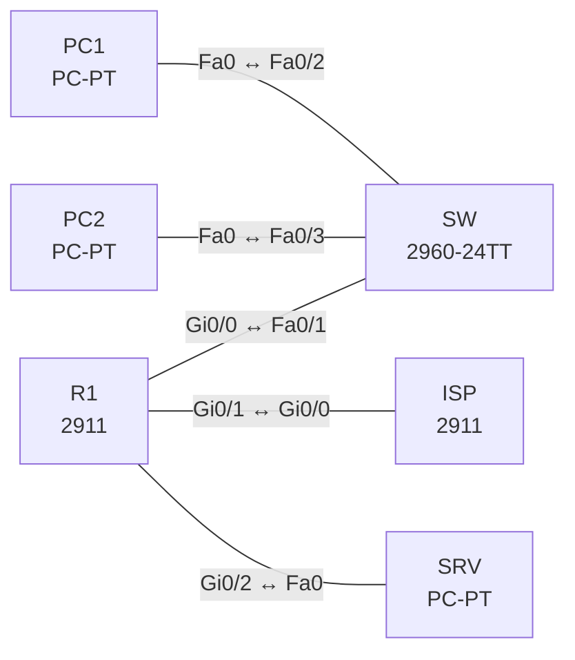

# Lab 09 – NAT und PAT

**Dauer:** 75 min · **Niveau:** mittel

Edge-Router mit LAN, DMZ und ISP: PAT (Overload), dynamisches NAT mit Pool, statisches NAT und Port-Forwarding. Du lernst die vier NAT-Adressbegriffe, die Reihenfolge der Operationen und die typischen Fehler.

**Lernziele:** Nach diesem Lab kannst du …

- Statisches NAT, dynamisches NAT und PAT unterscheiden und konfigurieren.
- Inside, Outside und die NAT-ACL korrekt zuordnen.
- Mit `show ip nat translations` und `statistics` Übersetzungsprobleme eingrenzen.

| ENCOR-Ziel (`Ziel::…`) | Thema |
|---|---|
| 3.3.b | NAT und PAT |

**So arbeitest du:** Teil A = Bauen, Teil B = Reparieren, Teil C = Üben. Die Konfigurationsdateien liegen in `build/` (Ausgangszustand zum Einfügen in die CLI), `repair/` (fertig gebaut, mit Fehlern) und `solutions/` (Musterlösung und Fehlerliste, erst nach eigenem Versuch öffnen). Anleitung zum Einfügen: siehe [Arbeiten mit den Dateien](../README.md#arbeiten-mit-den-dateien).

## Topologie



**Entwurfsskizze (aus dem CML-Lab; Portnamen der Switches siehe Verkabelungstabelle):**

```
 PC1 ─┐                          ┌─ SRV (DMZ 172.16.0.10, HTTP)
      ├─ SW ── R1 ──────────── ISP ── Lo0 8.8.8.8
 PC2 ─┘  LAN   Gi0/0 Gi0/1 .2   (203.0.113.0/30)
 192.168.10.0/24  R1 Gi0/2 = DMZ 172.16.0.0/24
```

### Geräte

| Gerät | Modell in Packet Tracer | Rolle |
|---|---|---|
| SW | 2960-24TT | Switch (im CML-Lab unmanaged; ohne Konfiguration) |
| PC1 | PC-PT | Host |
| PC2 | PC-PT | Host |
| R1 | 2911 | Router |
| ISP | 2911 | Router |
| SRV | PC-PT | Host |

### Verkabelung

| Von | Port | Nach | Port | Kabel |
|---|---|---|---|---|
| R1 | Gi0/0 | SW | Fa0/1 | Copper Straight-Through |
| PC1 | Fa0 | SW | Fa0/2 | Copper Straight-Through |
| PC2 | Fa0 | SW | Fa0/3 | Copper Straight-Through |
| R1 | Gi0/1 | ISP | Gi0/0 | Copper Cross-Over |
| R1 | Gi0/2 | SRV | Fa0 | Copper Cross-Over |

### Adressplan (Ausgangszustand)

| Gerät | Interface | Adresse | Maske | Gateway | DNS |
|---|---|---|---|---|---|
| PC1 | Fa0 (GUI) | 192.168.10.11 | 255.255.255.0 | 192.168.10.1 |  |
| PC2 | Fa0 (GUI) | 192.168.10.12 | 255.255.255.0 | 192.168.10.1 |  |
| R1 | Gi0/0 | 192.168.10.1 | 255.255.255.0 | | |
| R1 | Gi0/1 | 203.0.113.1 | 255.255.255.252 | | |
| R1 | Gi0/2 | 172.16.0.1 | 255.255.255.0 | | |
| ISP | Loopback0 | 8.8.8.8 | 255.255.255.255 | | |
| ISP | Gi0/0 | 203.0.113.2 | 255.255.255.252 | | |
| SRV | Fa0 (GUI) | 172.16.0.10 | 255.255.255.0 | 172.16.0.1 |  |

| Gerät | Interface | Adresse | NAT-Rolle |
|---|---|---|---|
| R1 | Gi0/0 | 192.168.10.1/24 | inside |
| R1 | Gi0/1 | 203.0.113.1/30 | outside |
| R1 | Gi0/2 | 172.16.0.1/24 | inside (DMZ) |
| ISP | Gi0/0 / Lo0 | 203.0.113.2/30 / 8.8.8.8/32 | – |
| PC1/PC2 | Gi0/0 | 192.168.10.11 / .12 | – |
| SRV | Gi0/0 | 172.16.0.10/24 (HTTP-Server an) | – |

Der ISP kennt das Supernetz 203.0.113.0/24 (via R1), daher sind alle Adressen des /24 für NAT nutzbar. R1 hat Default zum ISP.

### Portzuordnung der Switches (CML → Packet Tracer)

Aufgaben, Verkabelung, Konfigurationen und Fehlerlisten verwenden die Packet-Tracer-Ports. Die Tabelle zeigt, welcher Port der CML-Vorlage dazu gehört. Nur die Skizze nennt noch die CML-Ports. Umrechnung: `GiX/Y` → `Fa0/(X·4+Y+1)`.

| Switch | CML-Port | PT-Port |
|---|---|---|
| SW | Gi0/0 | Fa0/1 |
| SW | Gi0/1 | Fa0/2 |
| SW | Gi0/2 | Fa0/3 |

> **Packet-Tracer-Hinweis:** **Eignung: geeignet.** Alle verwendeten Funktionen gibt es in Packet Tracer; Ausgabeformate einzelner `show`-Befehle weichen leicht ab. Die CML-Switches (Gi-Ports) sind hier 3560-24PS bzw. 2960 mit FastEthernet-Ports: Die Portzuordnung steht unter dem Adressplan.

## Teil A – Bauen
Arbeite die Schritte der Reihe nach ab. Jeder Schritt sagt dir, was du tust, woran du den Erfolg erkennst (**Prüfen**) und worüber du nachdenken sollst (**Denkfrage**). Die Antworten auf die Denkfragen stehen am Ende von Teil A.

1. **Problem erkennen.** PC1 pingt 8.8.8.8, ohne Erfolg. Schalte auf dem ISP kurz `debug ip icmp` ein.
   - **Prüfen:** Der ISP sieht die Anfrage von 192.168.10.11.
   - **Denkfrage:** Warum kommt trotzdem keine Antwort zurück?
2. **PAT einrichten.** Setze `ip nat inside` an Gi0/0 und `ip nat outside` an Gi0/1. Lege eine Standard-ACL 1 für 192.168.10.0/24 an und aktiviere `ip nat inside source list 1 interface Gi0/1 overload`.
   - **Prüfen:** PC1 und PC2 erreichen 8.8.8.8. `show ip nat translations` zeigt beide als 203.0.113.1 mit verschiedenen Ports.
   - **Denkfrage:** Wozu braucht PAT die Ports?
3. **Die vier Adressbegriffe.** Nimm eine Zeile aus `show ip nat translations` für PC1 → 8.8.8.8.
   - **Denkfrage:** Welche Adresse ist Inside Local, Inside Global, Outside Local und Outside Global? Welche davon ändert NAT hier?
4. **Dynamisches NAT mit Pool.** Lege einen Pool `POOL` mit 203.0.113.16 bis 203.0.113.19 an und binde PC2 per ACL 2 daran, diesmal ohne `overload`.
   - **Prüfen:** PC2 erscheint mit einer Adresse aus dem Pool. Gibt es mehr Hosts als Pool-Adressen, steigen in `show ip nat statistics` die Misses.
5. **Statisches NAT.** SRV soll aus dem Internet erreichbar sein: `ip nat inside source static 172.16.0.10 203.0.113.10`. Setze an Gi0/2 `ip nat inside`.
   - **Prüfen:** `telnet 203.0.113.10 80` vom ISP baut eine Verbindung auf.
   - **Denkfrage:** Warum klappt das hier ohne Weiteres, und was müsste R1 tun, wenn 203.0.113.10 direkt im Transfernetz /30 läge?
6. **Port-Forwarding.** Leite TCP 8080 der Interface-Adresse 203.0.113.1 auf SRV Port 80 weiter: `ip nat inside source static tcp 172.16.0.10 80 interface Gi0/1 8080`.
   - **Prüfen:** `telnet 203.0.113.1 8080` vom ISP erreicht den Webserver.
7. **Reihenfolge verstehen.**
   - **Denkfrage:** Was passiert zuerst, Routing oder NAT, wenn ein Paket von innen nach außen geht? Und von außen nach innen? Welche Adressen muss deshalb eine ACL am Outside-Interface in Eingangsrichtung enthalten?
8. **Debug und Aufräumen.** Nutze kurz `debug ip nat detailed`, danach `undebug all` und `clear ip nat translation *`.
   - **Denkfrage:** Warum ist `clear ip nat translation *` im Betrieb heikel?

<details><summary>Antworten zu den Denkfragen</summary>

- **Zu 1:** Die Quelle ist eine private Adresse. Der ISP hat dafür keine Route zurück, also verwirft er die Antwort.
- **Zu 2:** Alle Hosts teilen sich eine öffentliche Adresse. Erst der Quellport macht jede Verbindung eindeutig, und R1 weiß, an wen die Antwort gehört.
- **Zu 3:** Inside Local = 192.168.10.11 (PC1, wie innen bekannt). Inside Global = 203.0.113.1 (PC1, wie außen sichtbar). Outside Local und Outside Global sind beide 8.8.8.8, weil das Ziel nicht übersetzt wird. NAT ändert hier nur die Quelladresse von Inside Local auf Inside Global.
- **Zu 5:** Der ISP kennt das ganze 203.0.113.0/24 über R1 und schickt die Pakete für .10 dorthin. Läge die Adresse direkt im Transfernetz, würde der ISP per ARP nach ihr fragen. R1 müsste dann für diese Adresse antworten. IOS legt dafür bei statischem NAT automatisch einen Alias an.
- **Zu 7:** Von innen nach außen: erst Routing, dann NAT. Von außen nach innen: erst NAT, dann Routing. Eine Eingangs-ACL am Outside-Interface sieht das Paket noch vor der Übersetzung, also mit der globalen Adresse. Sie muss 203.0.113.10 enthalten, nicht 172.16.0.10.
- **Zu 8:** Der Befehl löscht auch aktive Übersetzungen. Laufende Verbindungen brechen dann ab.

</details>

## Teil B – Reparieren

Baue die Topologie wie oben (oder behalte deine aus Teil A), setze alle Geräte zurück (`erase startup-config`, `reload` bzw. neues Gerät) und füge dann die Dateien aus `repair/` ein. Es stecken **4 Fehler** drin. Behandle jede Meldung als Ticket: erst Symptom nachstellen, dann Layer für Layer eingrenzen, beheben und beweisen. Ändere nur, was kaputt ist.

**Ticket 1:** Weder PC1 noch PC2 erreichen den ISP, `show ip nat translations` ist leer (Quelladresse bleibt privat).

**Ticket 2:** Dasselbe Bild trotz korrektem Interface-Setup: keine Übersetzung, der ISP sieht nichts.

**Ticket 3:** PC1 kommt raus, PC2 danach nicht mehr; `show ip nat statistics` zeigt Misses.

**Ticket 4:** Der ISP erreicht 203.0.113.10 (Server) nicht, `show ip nat translations` zeigt die Zuordnung zu .11.

## Verifikation
```
show ip nat translations [verbose]
show ip nat statistics
show access-lists
debug ip nat
```

| Befehl | Das solltest du sehen |
|---|---|
| `show ip nat translations` | PC1 und PC2 als 203.0.113.1:Port (PAT) |
| | SRV statisch als 203.0.113.10 |
| | 203.0.113.1:8080 → 172.16.0.10:80 |

## Teil C – Üben

Beantworte zuerst selbst, dann klappe die Antwort auf.

1. PC1 kann den ISP erreichen, PC2 nicht. Welche drei Dinge prüfst du?
<details><summary>Antwort</summary>

**Die NAT-ACL, die Inside/Outside-Zuordnung und ob `overload` gesetzt ist.** Passt die ACL auf das Subnetz von PC2? Sind die Interfaces richtig markiert? Steigen in `show ip nat statistics` die Misses, ist der Pool erschöpft oder `overload` fehlt.

</details>

2. Warum sieht man in `show ip nat translations` bei PAT mehrere Zeilen pro Host?
<details><summary>Antwort</summary>

**Weil PAT jede Verbindung einzeln übersetzt.** Jede Kombination aus Protokoll, Quell- und Zielport bekommt eine eigene Zeile. Ein Host mit mehreren offenen Verbindungen erscheint daher mehrfach.

</details>

3. Wozu braucht man `ip nat inside source static tcp … interface`?
<details><summary>Antwort</summary>

**Für Port-Forwarding.** Ein Dienst im inneren Netz wird über einen Port der äußeren Interface-Adresse erreichbar. Dafür braucht man keine eigene öffentliche Adresse.

</details>

## Prüfungsbezug
- Inside Local = Adresse des Hosts innen. Inside Global = wie der Host außen erscheint.
- NAT ohne `overload` braucht so viele Pool-Adressen wie gleichzeitige Hosts.
- Statisches NAT gilt in beide Richtungen, dynamisches nur für Verbindungen von innen.
- Von innen: Routing vor NAT. Von außen: NAT vor Routing.
- Ohne `ip nat inside` und `ip nat outside` an den Interfaces wird nichts übersetzt.

## Lösungen

- `solutions/<Gerät>.cfg`: Konfiguration zu Teil A (ohne Basis-Adressen)
- `solutions/FAULTS.md`: Fehlerliste zu Teil B (Spoiler!)
