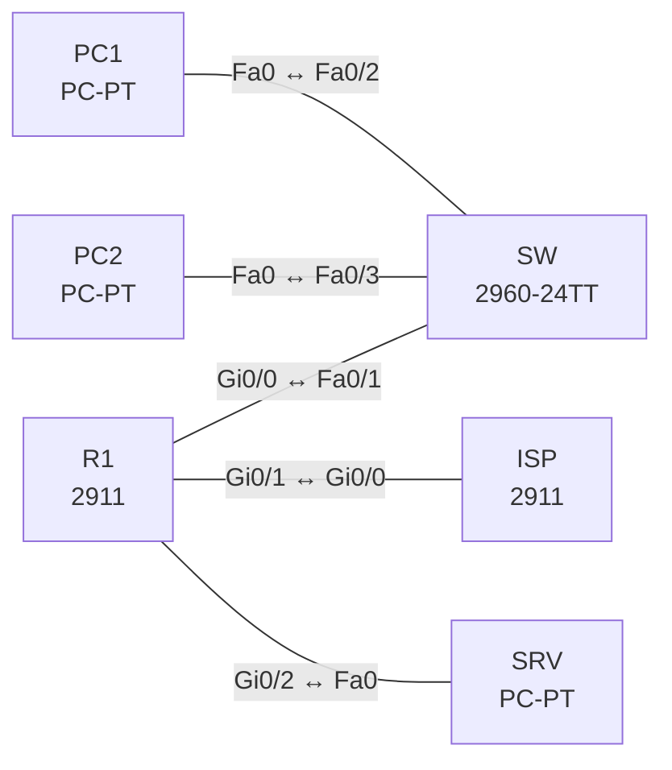

# Lab 10 – ACLs und Control-Plane Policing

**Dauer:** 90 min · **Niveau:** mittel

Layer-3/4-Filter mit Standard-, Extended- und benannten ACLs, `established`, Logging und vty-Schutz, dazu CoPP (MQC auf der Control-Plane) zur Begrenzung von ICMP und Management-Verkehr.

**Lernziele:** Nach diesem Lab kannst du …

- Standard- und Extended-ACLs richtig aufbauen und platzieren.
- Die Richtung (in/out) einer ACL am Interface begründen.
- Control-Plane Policing einrichten und an den Zählern prüfen.

| ENCOR-Ziel (`Ziel::…`) | Thema |
|---|---|
| 5.2.a | ACLs |
| 5.2.b | CoPP |

**So arbeitest du:** Teil A = Bauen, Teil B = Reparieren, Teil C = Üben. Die Konfigurationsdateien liegen in `build/` (Ausgangszustand zum Einfügen in die CLI), `repair/` (fertig gebaut, mit Fehlern) und `solutions/` (Musterlösung und Fehlerliste, erst nach eigenem Versuch öffnen). Anleitung zum Einfügen: siehe [Arbeiten mit den Dateien](../README.md#arbeiten-mit-den-dateien).

## Topologie



**Entwurfsskizze (aus dem CML-Lab; Portnamen der Switches siehe Verkabelungstabelle):**

```
 PC1 ─┐
      ├─ SW ── R1 (Gi0/0 inside) ──Gi0/1── ISP (Lo0 8.8.8.8)
 PC2 ─┘        └ Gi0/2 ─ SRV (DMZ)
```

### Geräte

| Gerät | Modell in Packet Tracer | Rolle |
|---|---|---|
| SW | 2960-24TT | Switch (im CML-Lab unmanaged; ohne Konfiguration) |
| PC1 | PC-PT | Host |
| PC2 | PC-PT | Host |
| R1 | 2911 | Router |
| ISP | 2911 | Router |
| SRV | PC-PT | Host |

### Verkabelung

| Von | Port | Nach | Port | Kabel |
|---|---|---|---|---|
| R1 | Gi0/0 | SW | Fa0/1 | Copper Straight-Through |
| PC1 | Fa0 | SW | Fa0/2 | Copper Straight-Through |
| PC2 | Fa0 | SW | Fa0/3 | Copper Straight-Through |
| R1 | Gi0/1 | ISP | Gi0/0 | Copper Cross-Over |
| R1 | Gi0/2 | SRV | Fa0 | Copper Cross-Over |

### Adressplan (Ausgangszustand)

| Gerät | Interface | Adresse | Maske | Gateway | DNS |
|---|---|---|---|---|---|
| PC1 | Fa0 (GUI) | 192.168.10.11 | 255.255.255.0 | 192.168.10.1 |  |
| PC2 | Fa0 (GUI) | 192.168.10.12 | 255.255.255.0 | 192.168.10.1 |  |
| R1 | Gi0/0 | 192.168.10.1 | 255.255.255.0 | | |
| R1 | Gi0/1 | 203.0.113.1 | 255.255.255.252 | | |
| R1 | Gi0/2 | 172.16.0.1 | 255.255.255.0 | | |
| ISP | Loopback0 | 8.8.8.8 | 255.255.255.255 | | |
| ISP | Gi0/0 | 203.0.113.2 | 255.255.255.252 | | |
| SRV | Fa0 (GUI) | 172.16.0.10 | 255.255.255.0 | 172.16.0.1 |  |

| Gerät | Interface | Adresse |
|---|---|---|
| R1 | Gi0/0 / Gi0/1 / Gi0/2 | 192.168.10.1/24 / 203.0.113.1/30 / 172.16.0.1/24 |
| ISP | Gi0/0 / Lo0 | 203.0.113.2/30 / 8.8.8.8/32 |
| PC1/PC2 | – | 192.168.10.11/.12 |
| SRV | – | 172.16.0.10 (HTTP an) |

Alle Netze sind ohne NAT erreichbar (der ISP routet das Kundennetz statisch zurück). Die vty-Lines von R1 erlauben Telnet nur für dieses Lab, in Produktion immer SSH.

### Portzuordnung der Switches (CML → Packet Tracer)

Aufgaben, Verkabelung, Konfigurationen und Fehlerlisten verwenden die Packet-Tracer-Ports. Die Tabelle zeigt, welcher Port der CML-Vorlage dazu gehört. Nur die Skizze nennt noch die CML-Ports. Umrechnung: `GiX/Y` → `Fa0/(X·4+Y+1)`.

| Switch | CML-Port | PT-Port |
|---|---|---|
| SW | Gi0/0 | Fa0/1 |
| SW | Gi0/1 | Fa0/2 |
| SW | Gi0/2 | Fa0/3 |

> **Packet-Tracer-Hinweis:** **Eignung: teilweise.** Stand Packet Tracer 8.x: CoPP: nicht vorhanden. `control-plane` und `service-policy` darunter fehlen. QoS (MQC): eingeschränkt. Klassen und Richtlinien lassen sich anlegen, `police`/`shape`/`priority` je nach Gerät nur teilweise; Messwerte nicht aussagekräftig. Akzeptiert PT einen Befehl nicht, ist das ein PT-Limit und kein Fehler von dir; solche Schritte machst du in CML oder EVE-NG. Die CML-Switches (Gi-Ports) sind hier 3560-24PS bzw. 2960 mit FastEthernet-Ports: Die Portzuordnung steht unter dem Adressplan.

## Teil A – Bauen
Arbeite die Schritte der Reihe nach ab. Jeder Schritt sagt dir, was du tust, woran du den Erfolg erkennst (**Prüfen**) und worüber du nachdenken sollst (**Denkfrage**). Die Antworten auf die Denkfragen stehen am Ende von Teil A.

1. **Ausgangslage prüfen.** Teste ohne ACLs: PC1 öffnet die Webseite von SRV, PC1 pingt 8.8.8.8, der ISP pingt PC1.
   - **Prüfen:** Alles funktioniert. Das ist dein Vergleichspunkt.
2. **Zugang zum Router beschränken.** Lege `ip access-list standard MGMT` an, die nur 192.168.10.0/24 erlaubt. Binde sie mit `access-class MGMT in` unter `line vty 0 4`.
   - **Prüfen:** Telnet von PC1 auf R1 klappt, vom ISP nicht. `show access-lists MGMT` zählt die Treffer.
   - **Denkfrage:** Warum gehört die ACL an die Line und nicht an ein Interface?
3. **Eingangs-ACL am Internet-Übergang.** Erlaube eingehend an Gi0/1 nur: ICMP echo-reply, TCP-Antworten (`established`), TCP 80 zu SRV und DNS-Antworten (UDP mit Quellport 53). Schließe mit `deny ip any any log` ab.
   - **Prüfen:** PC1 erreicht weiter 8.8.8.8 und Webseiten. Der ISP kann PC1 nicht mehr anpingen, die letzte Zeile zählt mit und schreibt ins Log.
   - **Denkfrage:** Am Ende jeder ACL steht ohnehin ein unsichtbares `deny any`. Wozu dann eine eigene Deny-Zeile?
4. **Richtung und Ort.** Überlege, bevor du es ausprobierst:
   - **Denkfrage:** Was würde dieselbe ACL bewirken, wenn sie `out` an Gi0/1 hinge? Und wohin setzt man Standard- bzw. Extended-ACLs?
5. **DMZ-Regeln.** SRV darf keine Verbindungen ins LAN aufbauen, aber auf Anfragen aus dem LAN antworten. ACL `DMZ-IN` eingehend an Gi0/2:
   - `5 permit tcp 172.16.0.0 0.0.0.255 eq www 192.168.10.0 0.0.0.255 established` (Antworten des Webservers)
   - `6 permit icmp 172.16.0.0 0.0.0.255 192.168.10.0 0.0.0.255 echo-reply` (Antworten auf Pings)
   - `10 deny ip 172.16.0.0 0.0.0.255 192.168.10.0 0.0.0.255`, dann `20 permit ip any any`

   Aus dem LAN in die DMZ sind nur TCP 80 und ICMP erlaubt. ACL `LAN-IN` eingehend an Gi0/0: diese beiden erlauben, den Rest Richtung DMZ verbieten, alles andere erlauben, damit das Internet erreichbar bleibt.
   - **Prüfen:** Ein Ping von SRV ins LAN scheitert. PC1 erreicht die Webseite auf SRV und kann SRV anpingen.
   - **Denkfrage:** Was würde passieren, wenn in `DMZ-IN` nur die Deny-Zeile stünde?
6. **Reihenfolge und Zähler.** Füge in eine benannte ACL mit einer Sequenznummer eine Zeile zwischen zwei bestehende ein (`15 permit …`).
   - **Prüfen:** `show access-lists` zeigt die neue Zeile an Position 15 und die Treffer pro Zeile.
   - **Denkfrage:** Wie erkennst du an den Zählern eine Zeile, die nie greifen kann?
7. **Control-Plane Policing.** Lege Class-Maps an für ICMP, für Management (Telnet und SSH aus dem LAN) und für Routing-Protokolle. Begrenze in `policy-map COPP` ICMP mit `police rate 64000 bps conform-action transmit exceed-action drop`. Binde die Policy mit `control-plane` und `service-policy input COPP`.
   - **Prüfen:** Ping vom ISP mit `repeat 500 size 1500` auf R1: `show policy-map control-plane` zeigt Pakete in conformed und exceeded.
8. **Grenzen von CoPP.**
   - **Denkfrage:** Warum schützt CoPP nicht vor Verkehr, der nur durch den Router hindurchgeht? Was ist Control Plane Protection (CPPr)?

<details><summary>Antworten zu den Denkfragen</summary>

- **Zu 2:** `access-class` prüft nur Verbindungen auf die Lines, also zum Router selbst, egal über welches Interface sie kommen. Eine Interface-ACL müsste auf jedem Interface stehen und würde auch Durchgangsverkehr prüfen.
- **Zu 3:** Das unsichtbare Deny zählt nicht mit und loggt nichts. Eine eigene Zeile mit `log` zeigt dir, was verworfen wird und wie oft. Das hilft bei der Fehlersuche und bei Angriffen.
- **Zu 4:** `out` an Gi0/1 würde den Verkehr ins Internet prüfen. Dort sind aber nur Antworten erlaubt, also käme aus dem LAN nichts mehr hinaus. Faustregel: Standard-ACLs nah ans Ziel, weil sie nur die Quelle kennen. Extended-ACLs nah an die Quelle, damit unerwünschter Verkehr gar nicht erst durchs Netz läuft.
- **Zu 5:** Dann würden auch die Antworten von SRV an das LAN verworfen. PC1 könnte die Webseite nicht mehr laden, obwohl die Anfrage erlaubt ist. Eine ACL ohne Zustand muss den Rückweg ausdrücklich erlauben.
- **Zu 6:** Eine Zeile bleibt bei 0, obwohl passender Verkehr läuft. Dann fängt eine weiter oben stehende, breitere Zeile denselben Verkehr vorher ab.
- **Zu 8:** CoPP sitzt vor der CPU und sieht nur Pakete an den Router selbst. Durchgangsverkehr wird in der Data Plane weitergeleitet und erreicht die CPU nie. CPPr teilt die Control Plane feiner auf (Host, Transit, CEF-Exception) und kann zum Beispiel Pakete an geschlossene Ports früh verwerfen.

</details>

## Teil B – Reparieren

Baue die Topologie wie oben (oder behalte deine aus Teil A), setze alle Geräte zurück (`erase startup-config`, `reload` bzw. neues Gerät) und füge dann die Dateien aus `repair/` ein. Es stecken **4 Fehler** drin. Behandle jede Meldung als Ticket: erst Symptom nachstellen, dann Layer für Layer eingrenzen, beheben und beweisen. Ändere nur, was kaputt ist.

**Ticket 1:** Seit der ACL am Edge funktioniert aus dem LAN nichts mehr (kein Ping nach 8.8.8.8, kein HTTP von außen), Zähler der ersten Zeile steigt.

**Ticket 2:** SRV kann trotz `deny` ins LAN pingen.

**Ticket 3:** `show policy-map control-plane` zeigt bei `CM-ICMP` null Treffer, Ping-Flut wird nicht begrenzt.

**Ticket 4:** Telnet von PC1 auf R1 wird sofort getrennt, obwohl PC1 im Management-Netz liegen soll.

## Verifikation
```
show access-lists
show ip interface Gi0/1 | include access list
show policy-map control-plane
show class-map
telnet 192.168.10.1                 ! von PC1 und vom ISP
```

| Test | Das solltest du sehen |
|---|---|
| Telnet von PC1 / vom ISP auf R1 | PC1 kommt durch, der ISP nicht |
| `show access-lists` | steigende Zähler bei den Zeilen, die du getestet hast |
| `show policy-map control-plane` | Pakete in conformed und exceeded bei der ICMP-Klasse |

## Teil C – Üben

Beantworte zuerst selbst, dann klappe die Antwort auf.

1. Eine ACL hat als letzte Zeile `permit ip any any`, ganz oben aber `deny ip any any`. Was passiert?
<details><summary>Antwort</summary>

**Alles wird verworfen.** Eine ACL hört beim ersten Treffer auf. `deny ip any any` passt auf jedes Paket, die Zeilen darunter werden nie erreicht.

</details>

2. Wie unterscheidet sich `established` von einer zustandsbehafteten Firewall?
<details><summary>Antwort</summary>

**`established` prüft nur Flags im Paket, eine Firewall kennt die Verbindung.** Die ACL lässt jedes TCP-Paket mit gesetztem ACK oder RST durch, auch ein gefälschtes. Eine zustandsbehaftete Firewall merkt sich jede Verbindung und lässt nur echte Antworten zurück.

</details>

3. Warum verwirft CoPP den Transit-Ping nicht?
<details><summary>Antwort</summary>

**Weil CoPP nur Verkehr an den Router selbst prüft.** Ein Transit-Ping geht durch die Data Plane und erreicht die Control Plane nie.

</details>

## Prüfungsbezug
- ACLs werden von oben nach unten geprüft, der erste Treffer gilt, am Ende steht ein unsichtbares `deny any`.
- Standard-ACLs prüfen nur die Quelle, Extended-ACLs auch Ziel, Protokoll und Ports.
- `established` prüft nur die Flags ACK und RST, ohne Verbindungstabelle.
- `access-class` an Lines, `ip access-group` an Interfaces.
- CoPP schützt nur die Control Plane, nicht den Durchgangsverkehr.

## Lösungen

- `solutions/<Gerät>.cfg`: Konfiguration zu Teil A (ohne Basis-Adressen)
- `solutions/FAULTS.md`: Fehlerliste zu Teil B (Spoiler!)
