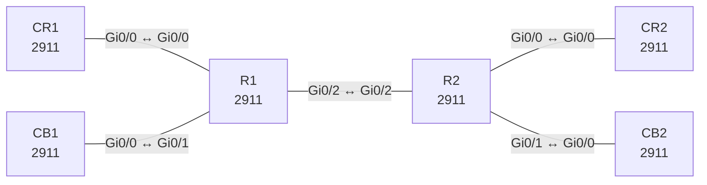

# Lab 13 – VRF-Lite mit überlappenden Adressen

**Dauer:** 75 min · **Niveau:** mittel

Zwei Kunden (RED, BLUE) teilen sich zwei Router und einen Link, nutzen aber dieselben IP-Bereiche. Mit VRF-Lite trennst du Routing-Tabellen, nutzt Subinterfaces als Trunk und OSPF pro VRF.

**Lernziele:** Nach diesem Lab kannst du …

- VRF-Lite mit überlappenden Adressen aufbauen.
- Pro VRF ein eigenes OSPF betreiben und die Tabellen getrennt prüfen.
- Erklären, wofür Route Distinguisher in MPLS-VPNs nötig sind und warum VRF-Lite ohne sie auskommt.

| ENCOR-Ziel (`Ziel::…`) | Thema |
|---|---|
| 2.2.a | VRF |

**So arbeitest du:** Teil A = Bauen, Teil B = Reparieren, Teil C = Üben. Die Konfigurationsdateien liegen in `build/` (Ausgangszustand zum Einfügen in die CLI), `repair/` (fertig gebaut, mit Fehlern) und `solutions/` (Musterlösung und Fehlerliste, erst nach eigenem Versuch öffnen). Anleitung zum Einfügen: siehe [Arbeiten mit den Dateien](../README.md#arbeiten-mit-den-dateien).

## Topologie



**Entwurfsskizze (aus dem CML-Lab; Portnamen der Switches siehe Verkabelungstabelle):**

```
 CR1 ─┐                              ┌─ CR2
      ├─ R1 ════ (Gi0/2.100 RED / .200 BLUE) ════ R2 ─┤
 CB1 ─┘                              └─ CB2
```
RED = CR1 ↔ CR2, BLUE = CB1 ↔ CB2.

### Geräte

| Gerät | Modell in Packet Tracer | Rolle |
|---|---|---|
| R1 | 2911 | Router |
| R2 | 2911 | Router |
| CR1 | 2911 | Router |
| CB1 | 2911 | Router |
| CR2 | 2911 | Router |
| CB2 | 2911 | Router |

### Verkabelung

| Von | Port | Nach | Port | Kabel |
|---|---|---|---|---|
| CR1 | Gi0/0 | R1 | Gi0/0 | Copper Cross-Over |
| CB1 | Gi0/0 | R1 | Gi0/1 | Copper Cross-Over |
| R1 | Gi0/2 | R2 | Gi0/2 | Copper Cross-Over |
| R2 | Gi0/0 | CR2 | Gi0/0 | Copper Cross-Over |
| R2 | Gi0/1 | CB2 | Gi0/0 | Copper Cross-Over |

### Adressplan (Ausgangszustand)

| Gerät | Interface | Adresse | Maske | Gateway | DNS |
|---|---|---|---|---|---|
| R1 | Gi0/0 | 10.1.1.1 | 255.255.255.252 | | |
| R1 | Gi0/1 | 10.1.1.1 | 255.255.255.252 | | |
| R1 | Gi0/2.100 | 10.0.12.1 | 255.255.255.252 | | |
| R1 | Gi0/2.200 | 10.0.12.1 | 255.255.255.252 | | |
| R2 | Gi0/0 | 10.2.2.1 | 255.255.255.252 | | |
| R2 | Gi0/1 | 10.2.2.1 | 255.255.255.252 | | |
| R2 | Gi0/2.100 | 10.0.12.2 | 255.255.255.252 | | |
| R2 | Gi0/2.200 | 10.0.12.2 | 255.255.255.252 | | |
| CR1 | Gi0/0 | 10.1.1.2 | 255.255.255.252 | | |
| CR1 | Loopback100 | 192.168.1.1 | 255.255.255.0 | | |
| CB1 | Gi0/0 | 10.1.1.2 | 255.255.255.252 | | |
| CB1 | Loopback100 | 192.168.1.1 | 255.255.255.0 | | |
| CR2 | Gi0/0 | 10.2.2.2 | 255.255.255.252 | | |
| CR2 | Loopback100 | 192.168.2.1 | 255.255.255.0 | | |
| CB2 | Gi0/0 | 10.2.2.2 | 255.255.255.252 | | |
| CB2 | Loopback100 | 192.168.2.1 | 255.255.255.0 | | |

| Link | Netz (in beiden VRFs identisch!) |
|---|---|
| R1 Gi0/0 – CR1 Gi0/0 (RED) | 10.1.1.0/30 (R1 .1, CR1 .2) |
| R1 Gi0/1 – CB1 Gi0/0 (BLUE) | 10.1.1.0/30 (R1 .1, CB1 .2) |
| R1 Gi0/2.100 / .200 – R2 Gi0/2.100 / .200 | 10.0.12.0/30 (R1 .1, R2 .2) je VRF |
| R2 Gi0/0 – CR2 Gi0/0 (RED) | 10.2.2.0/30 (R2 .1, CR2 .2) |
| R2 Gi0/1 – CB2 Gi0/0 (BLUE) | 10.2.2.0/30 (R2 .1, CB2 .2) |

Kunden-LANs: Site 1 = 192.168.1.0/24 (Lo100 auf CR1/CB1), Site 2 = 192.168.2.0/24 (Lo100 auf CR2/CB2), in RED und BLUE identisch.
> **Packet-Tracer-Hinweis:** **Eignung: teilweise.** Stand Packet Tracer 8.x: VRF-Lite: eingeschränkt. Je nach PT-Version nur teilweise oder gar nicht vorhanden. Wenn `ip vrf` nicht akzeptiert wird: Lab in CML/EVE-NG. Akzeptiert PT einen Befehl nicht, ist das ein PT-Limit und kein Fehler von dir; solche Schritte machst du in CML oder EVE-NG.

## Teil A – Bauen
Arbeite die Schritte der Reihe nach ab. Jeder Schritt sagt dir, was du tust, woran du den Erfolg erkennst (**Prüfen**) und worüber du nachdenken sollst (**Denkfrage**). Die Antworten auf die Denkfragen stehen am Ende von Teil A.

1. **VRFs anlegen.** Lege auf R1 und R2 `vrf definition RED` und `vrf definition BLUE` an, jeweils mit `address-family ipv4`. Weise die Kunden-Interfaces mit `vrf forwarding` zu und setze danach die IP-Adressen neu.
   - **Prüfen:** `show ip vrf interfaces` listet jedes Kunden-Interface in seiner VRF.
   - **Denkfrage:** Warum musst du die IP-Adresse neu setzen? Welche Tabelle zeigt `show ip route` ohne Angabe einer VRF?
2. **Subinterfaces auf dem Link R1–R2.** Lege auf beiden Routern `Gi0/2.100` (RED) und `Gi0/2.200` (BLUE) an, jeweils mit `encapsulation dot1Q`, `vrf forwarding` und der Adresse 10.0.12.1 bzw. .2.
   - **Prüfen:** `ping vrf RED 10.0.12.2` und `ping vrf BLUE 10.0.12.2` auf R1 klappen beide.
   - **Denkfrage:** Warum dürfen beide Subinterfaces dieselbe IP-Adresse haben?
3. **OSPF pro VRF.** Starte auf R1 und R2 `router ospf 1 vrf RED` und `router ospf 2 vrf BLUE`. Auf den Kunden-Routern läuft OSPF-Prozess 1 in Area 0.
   - **Prüfen:** `show ip route vrf RED ospf` auf R1 zeigt 192.168.2.0/24. `show ip ospf 1` und `show ip ospf 2` zeigen eigene Router-IDs.
4. **Ende zu Ende testen.** Pinge auf CR1 `ping 192.168.2.1 source Loopback100` und auf CB1 dasselbe.
   - **Prüfen:** Beide Pings klappen, obwohl RED und BLUE dieselben Adressen verwenden.
5. **Trennung beweisen.** Pinge aus VRF RED eine Adresse, die es nur in BLUE gibt.
   - **Prüfen:** Der Ping scheitert.
   - **Denkfrage:** Warum?
6. **Route-Leaking verstehen.** Manchmal soll eine VRF einen gemeinsamen Dienst erreichen, etwa einen DNS-Server in der globalen Tabelle. Mit einer statischen Route in der VRF und dem Schlüsselwort `global` am Next-Hop (`ip route vrf RED <Netz> <Maske> <Next-Hop> global`) zeigt die Route in die globale Tabelle. Für den Rückweg braucht die globale Tabelle eine Route in die VRF.
   - **Denkfrage:** Welche Gefahr bringt Route-Leaking mit sich, und wie macht man es sauberer?
7. **Einordnen.**
   - **Denkfrage:** Was unterscheidet VRF-Lite von VRFs in einem MPLS-VPN? Wann reicht VRF-Lite?

<details><summary>Antworten zu den Denkfragen</summary>

- **Zu 1:** Beim Wechsel der VRF entfernt IOS alle IP-Einstellungen, weil die Adresse jetzt in eine andere Tabelle gehört. `show ip route` ohne VRF zeigt die globale Tabelle.
- **Zu 2:** Jedes Subinterface gehört zu einer anderen VRF, also zu einer anderen Routing-Tabelle. Adressen dürfen sich nur innerhalb einer VRF nicht überschneiden.
- **Zu 5:** RED und BLUE haben getrennte Tabellen. In RED gibt es keine Route zu einem Netz, das nur in BLUE existiert.
- **Zu 6:** Leaking öffnet ein Loch in der Trennung. Wird zu viel geleakt, können sich Kunden gegenseitig erreichen. Sauberer ist es, nur einzelne Präfixe gezielt freizugeben, in MPLS-VPNs per Route-Target-Import und -Export. Oder man führt die VRFs über eine Firewall zusammen, die den Verkehr prüft.
- **Zu 7:** VRF-Lite trennt Tabellen nur lokal. Jede VRF braucht ein eigenes Interface oder Subinterface bis zum nächsten Router und ein eigenes Routing. Ein MPLS-VPN transportiert alle VRFs über ein gemeinsames Netz: Route Distinguisher machen gleiche Präfixe in MP-BGP eindeutig, Route Targets steuern Import und Export, Labels trennen die Daten. VRF-Lite reicht bei wenigen VRFs und wenigen Hops.

</details>

## Teil B – Reparieren

Baue die Topologie wie oben (oder behalte deine aus Teil A), setze alle Geräte zurück (`erase startup-config`, `reload` bzw. neues Gerät) und füge dann die Dateien aus `repair/` ein. Es stecken **4 Fehler** drin. Behandle jede Meldung als Ticket: erst Symptom nachstellen, dann Layer für Layer eingrenzen, beheben und beweisen. Ändere nur, was kaputt ist.

**Ticket 1:** Im Log steht `Address 10.1.1.1 overlaps with GigabitEthernet0/0`, BLUE-Site 1 (CB1) ist nicht erreichbar.

**Ticket 2:** RED läuft Ende zu Ende, BLUE hat zwischen R1 und R2 keine OSPF-Nachbarschaft.

**Ticket 3:** CB2 bildet keinen Nachbarn zu R2, die BLUE-Site 2 (192.168.2.0/24) fehlt in der Routing-Tabelle von R1.

**Ticket 4:** RED-Site 2 ist nicht erreichbar (192.168.2.0/24 fehlt in VRF RED auf R1), BLUE funktioniert.

## Verifikation
```
show vrf
show ip route vrf RED
show ip ospf 1 neighbor          ! ein Prozess pro VRF
show ip vrf interfaces
ping vrf RED 192.168.2.1         ! auf R1
ping 192.168.2.1 source Loopback100   ! auf CR1 und CB1
```

| Befehl | Das solltest du sehen |
|---|---|
| `show ip route vrf RED` und `vrf BLUE` auf R1 | in beiden eine OSPF-Route nach 192.168.2.0/24 |
| Ping von CR1 und CB1 | Ende zu Ende erfolgreich in beiden VRFs |

## Teil C – Üben

Beantworte zuerst selbst, dann klappe die Antwort auf.

1. Zwei VRFs haben dasselbe Präfix 192.168.1.0/24. Warum entsteht kein Konflikt?
<details><summary>Antwort</summary>

**Weil jede VRF ihre eigene Routing-Tabelle hat.** Die beiden Präfixe liegen in getrennten Tabellen und getrennten FIBs. Sie begegnen sich nie.

</details>

2. Wozu dient der Route Distinguisher, wenn VRF-Lite ohne ihn auskommt?
<details><summary>Antwort</summary>

**Für MP-BGP in MPLS-VPNs.** Dort transportiert ein einziger BGP-Prozess die Routen aller Kunden. Gleiche Präfixe müssen unterscheidbar sein: RD (64 Bit) plus Präfix ergibt eine eindeutige VPNv4-Adresse. VRF-Lite braucht das nicht, weil die Tabellen getrennt bleiben.

</details>

3. Ping aus VRF RED zeigt `Success rate 0`, aber `show ip route vrf RED` hat die Route. Warum?
<details><summary>Antwort</summary>

**Meist fehlt der Rückweg oder die Quelle liegt in der falschen VRF.** Prüfe, ob der Ping mit einer Quelle aus der VRF gesendet wird (`ping vrf RED … source …`), ob die Gegenseite eine Route zurück hat und ob ihr Interface in derselben VRF liegt.

</details>

## Prüfungsbezug
- VRF-Lite wirkt nur lokal und braucht keine Labels.
- Der Route Distinguisher macht Präfixe in MP-BGP eindeutig, das Route Target steuert Import und Export.
- `vrf forwarding` löscht die IP-Adresse am Interface.
- OSPF läuft pro VRF in einem eigenen Prozess. Ein Interface gehört genau zu einer VRF.

## Lösungen

- `solutions/<Gerät>.cfg`: Konfiguration zu Teil A (ohne Basis-Adressen)
- `solutions/FAULTS.md`: Fehlerliste zu Teil B (Spoiler!)
