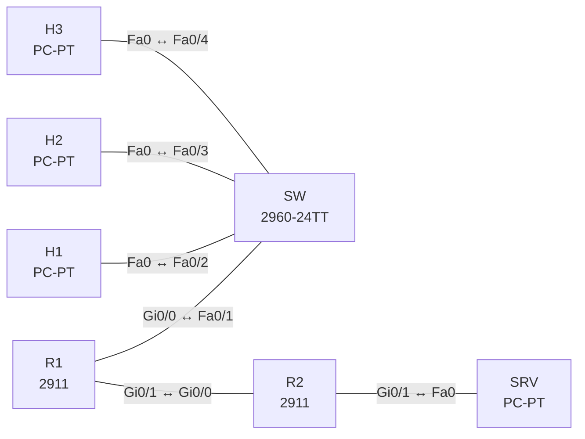

# Lab 17 – QoS mit MQC: Markieren, Policing, Shaping, LLQ

**Dauer:** 90 min · **Niveau:** mittel bis schwer

Branch-Router mit schmaler WAN-Strecke (2 Mbit/s): Klassifizieren und Markieren am Rand, Hierarchical Shaping mit Child-Queueing (LLQ/CBWFQ) am WAN-Ausgang, Policing auf dem Gast-Netz und WRED. Verkehr erzeugst du mit Pings und DSCP-Werten (`tos`).

**Lernziele:** Nach diesem Lab kannst du …

- Verkehr mit MQC klassifizieren und markieren.
- LLQ, Policing und Shaping konfigurieren und ihre Wirkung an den Zählern ablesen.
- Die Trust Boundary begründen und Fehler in Klassen und Bindungen finden.

| ENCOR-Ziel (`Ziel::…`) | Thema |
|---|---|
| 1.4 | QoS-Konfigurationen |

**So arbeitest du:** Teil A = Bauen, Teil B = Reparieren, Teil C = Üben. Die Konfigurationsdateien liegen in `build/` (Ausgangszustand zum Einfügen in die CLI), `repair/` (fertig gebaut, mit Fehlern) und `solutions/` (Musterlösung und Fehlerliste, erst nach eigenem Versuch öffnen). Anleitung zum Einfügen: siehe [Arbeiten mit den Dateien](../README.md#arbeiten-mit-den-dateien).

## Topologie



**Entwurfsskizze (aus dem CML-Lab; Portnamen der Switches siehe Verkabelungstabelle):**

```
 H1 (Voice) ─┐
 H2 (Video) ─┼─ SW ── R1 ═══ WAN (shaped 2 Mbit/s) ═══ R2 ── SRV
 H3 (Gast)  ─┘      Gi0/0    Gi0/1                       Gi0/0
```

### Geräte

| Gerät | Modell in Packet Tracer | Rolle |
|---|---|---|
| SW | 2960-24TT | Switch (im CML-Lab unmanaged; ohne Konfiguration) |
| H1 | PC-PT | Host |
| H2 | PC-PT | Host |
| H3 | PC-PT | Host |
| R1 | 2911 | Router |
| R2 | 2911 | Router |
| SRV | PC-PT | Host |

### Verkabelung

| Von | Port | Nach | Port | Kabel |
|---|---|---|---|---|
| R1 | Gi0/0 | SW | Fa0/1 | Copper Straight-Through |
| H1 | Fa0 | SW | Fa0/2 | Copper Straight-Through |
| H2 | Fa0 | SW | Fa0/3 | Copper Straight-Through |
| H3 | Fa0 | SW | Fa0/4 | Copper Straight-Through |
| R1 | Gi0/1 | R2 | Gi0/0 | Copper Cross-Over |
| R2 | Gi0/1 | SRV | Fa0 | Copper Cross-Over |

### Adressplan (Ausgangszustand)

| Gerät | Interface | Adresse | Maske | Gateway | DNS |
|---|---|---|---|---|---|
| H1 | Fa0 (GUI) | 192.168.10.11 | 255.255.255.0 | 192.168.10.1 |  |
| H2 | Fa0 (GUI) | 192.168.10.12 | 255.255.255.0 | 192.168.10.1 |  |
| H3 | Fa0 (GUI) | 192.168.10.13 | 255.255.255.0 | 192.168.10.1 |  |
| R1 | Gi0/0 | 192.168.10.1 | 255.255.255.0 | | |
| R1 | Gi0/1 | 10.0.12.1 | 255.255.255.252 | | |
| R2 | Gi0/0 | 10.0.12.2 | 255.255.255.252 | | |
| R2 | Gi0/1 | 10.0.20.1 | 255.255.255.0 | | |
| SRV | Fa0 (GUI) | 10.0.20.10 | 255.255.255.0 | 10.0.20.1 |  |

| Link | Netz |
|---|---|
| LAN | 192.168.10.0/24 (R1 .1, H1 .11, H2 .12, H3 .13) |
| R1 Gi0/1 – R2 Gi0/0 | 10.0.12.0/30 (R1 .1, R2 .2) |
| R2 Gi0/1 – SRV | 10.0.20.0/24 (R2 .1, SRV .10) |

Statische Routen sind vorhanden. Ping-Quellen: H1 Ping mit `tos 184` (EF, DSCP 46), H2 mit `tos 136` (AF41), H3 ohne Markierung.

### Portzuordnung der Switches (CML → Packet Tracer)

Aufgaben, Verkabelung, Konfigurationen und Fehlerlisten verwenden die Packet-Tracer-Ports. Die Tabelle zeigt, welcher Port der CML-Vorlage dazu gehört. Nur die Skizze nennt noch die CML-Ports. Umrechnung: `GiX/Y` → `Fa0/(X·4+Y+1)`.

| Switch | CML-Port | PT-Port |
|---|---|---|
| SW | Gi0/0 | Fa0/1 |
| SW | Gi0/1 | Fa0/2 |
| SW | Gi0/2 | Fa0/3 |
| SW | Gi0/3 | Fa0/4 |

> **Packet-Tracer-Hinweis:** **Eignung: teilweise.** Stand Packet Tracer 8.x: QoS (MQC): eingeschränkt. Klassen und Richtlinien lassen sich anlegen, `police`/`shape`/`priority` je nach Gerät nur teilweise; Messwerte nicht aussagekräftig. Akzeptiert PT einen Befehl nicht, ist das ein PT-Limit und kein Fehler von dir; solche Schritte machst du in CML oder EVE-NG. Die CML-Switches (Gi-Ports) sind hier 3560-24PS bzw. 2960 mit FastEthernet-Ports: Die Portzuordnung steht unter dem Adressplan.

## Teil A – Bauen
Arbeite die Schritte der Reihe nach ab. Jeder Schritt sagt dir, was du tust, woran du den Erfolg erkennst (**Prüfen**) und worüber du nachdenken sollst (**Denkfrage**). Die Antworten auf die Denkfragen stehen am Ende von Teil A.

1. **Trust Boundary festlegen.** H1 und H2 sind vertrauenswürdig, ihre Markierung bleibt. H3 (Gast) wird auf DSCP 0 zurückgesetzt. Baue dafür eine ACL für H3, eine `class-map` darauf und eine `policy-map MARK` mit `set dscp default`. Binde sie mit `service-policy input MARK` an Gi0/0.
   - **Prüfen:** `show policy-map interface Gi0/0` zählt Pakete in der Gast-Klasse, sobald H3 sendet.
   - **Denkfrage:** Warum darf man nicht jedem Endgerät seine Markierung glauben?
2. **Klassen anlegen.** Lege an: `class-map match-any VOICE` mit `match dscp ef`, `VIDEO` mit `match dscp af41` und `CRIT` mit `match dscp af31`.
   - **Denkfrage:** Wann ist `match-any` nötig, und was passiert bei `match-all` mit zwei verschiedenen DSCP-Werten?
3. **Warteschlangen (Child-Policy).** Baue `policy-map QUEUE`: VOICE mit `priority percent 20`, VIDEO mit `bandwidth percent 30`, CRIT mit `bandwidth percent 25`, `class class-default` mit `fair-queue` und `random-detect dscp-based`.
   - **Denkfrage:** Was unterscheidet die Priority-Queue (LLQ) von `bandwidth` (CBWFQ)?
4. **Shaper als Parent.** Baue `policy-map WAN` mit `class class-default`, darin `shape average 2000000` und `service-policy QUEUE`. Binde sie mit `service-policy output WAN` an Gi0/1.
   - **Prüfen:** `show policy-map interface Gi0/1` zeigt den Shaper mit 2 Mbit/s und darunter die vier Klassen.
   - **Denkfrage:** Warum braucht man den Shaper, obwohl Gi0/1 viel schneller ist?
5. **Gast begrenzen.** Ergänze in der Gast-Klasse von `MARK` einen Policer: `police rate 256000 bps conform-action transmit exceed-action drop`.
   - **Denkfrage:** Was ist der Unterschied zwischen Policing und Shaping?
6. **Unter Last testen.** Pinge gleichzeitig von H1 (`tos 184`), H2 (`tos 136`) und H3 mit `repeat 1000 size 1200` zu SRV.
   - **Prüfen:** `show policy-map interface Gi0/1` zeigt Pakete pro Klasse und Drops. Die meisten Drops entstehen in `class-default`.
   - **Denkfrage:** Warum verliert `class-default` zuerst Pakete und nicht VIDEO?
7. **Begriffe ordnen.**
   - **Denkfrage:** Was bedeuten EF, AF, CS und BE? Was ist der Unterschied zwischen Tail Drop und WRED und zwischen Congestion Management und Congestion Avoidance?

<details><summary>Antworten zu den Denkfragen</summary>

- **Zu 1:** Jedes Endgerät kann seine Pakete selbst als EF markieren. Ein Gast würde damit der echten Sprache die Priority-Queue wegnehmen. Deshalb vertraut man Markierungen nur ab einer festgelegten Grenze, meist am Access-Port, und nur bei bekannten Geräten wie IP-Telefonen.
- **Zu 2:** `match-any` trifft, sobald eine der Bedingungen passt. Bei nur einer Bedingung ist es gleich, ob any oder all. `match-all` mit zwei verschiedenen DSCP-Werten trifft nie, weil ein Paket nur einen DSCP-Wert hat.
- **Zu 3:** Die Priority-Queue wird immer zuerst bedient, das hält Verzögerung und Jitter klein. Damit sie die anderen nicht aushungert, begrenzt ein eingebauter Policer sie bei Stau auf die konfigurierte Rate. `bandwidth` garantiert nur einen Mindestanteil, ohne Vorrang.
- **Zu 4:** Warteschlangen greifen nur, wenn das Interface selbst überlastet ist. Gi0/1 schafft weit mehr als 2 Mbit/s, also staut sich beim Router nichts. Der Provider würde stattdessen wahllos verwerfen. Der Shaper erzeugt den Engpass von 2 Mbit/s im Router selbst, und erst damit wirken die Warteschlangen.
- **Zu 5:** Policing verwirft oder markiert um, was über der Rate liegt, sofort und ohne Puffer. Es geht in beide Richtungen. Shaping puffert den Überschuss und sendet ihn später. Das glättet den Verkehr, kostet aber Verzögerung, und geht nur ausgehend.
- **Zu 6:** VIDEO hat 30 % fest zugesagt. `class-default` hat keine Zusage und bekommt nur, was übrig bleibt. WRED verwirft dort außerdem schon früh.
- **Zu 7:** EF (Expedited Forwarding) für Sprache, AF (Assured Forwarding) in vier Klassen mit je drei Drop-Stufen, CS (Class Selector) kompatibel zu IP Precedence, BE (Best Effort) = DSCP 0. Tail Drop verwirft erst, wenn die Warteschlange voll ist, und trifft dann alle Verbindungen gleichzeitig. WRED verwirft vorher zufällig und nach Markierung gewichtet. Congestion Management heißt einreihen und bedienen (CBWFQ, LLQ). Congestion Avoidance heißt Stau vermeiden, bevor er entsteht (WRED).

</details>

## Teil B – Reparieren

Baue die Topologie wie oben (oder behalte deine aus Teil A), setze alle Geräte zurück (`erase startup-config`, `reload` bzw. neues Gerät) und füge dann die Dateien aus `repair/` ein. Es stecken **4 Fehler** drin. Behandle jede Meldung als Ticket: erst Symptom nachstellen, dann Layer für Layer eingrenzen, beheben und beweisen. Ändere nur, was kaputt ist.

**Ticket 1:** Die Klasse VOICE bleibt in `show policy-map interface` bei null Paketen, obwohl H1 mit DSCP 46 sendet.

**Ticket 2:** Der WAN-Link wird überfüllt, Voice leidet, `show policy-map interface Gi0/1` zeigt keine Policy.

**Ticket 3:** Der Durchsatz Richtung SRV bricht auf einen winzigen Bruchteil ein, Pings dauern extrem lang.

**Ticket 4:** Der Gast (H3) wird als Voice klassifiziert und nimmt der echten Sprache die Priority-Queue weg.

## Verifikation
```
show policy-map interface GigabitEthernet0/1
show policy-map interface GigabitEthernet0/0
show class-map
show ip interface Gi0/1 | include service
```

| Befehl | Das solltest du sehen |
|---|---|
| `show policy-map interface Gi0/1` | VOICE zählt Pakete mit DSCP 46, ohne Drops, solange H1 unter 20 % bleibt |
| | `class-default` verwirft bei Überlast |
| `show policy-map interface Gi0/0` | Gast-Verkehr im Policer als exceeded |

## Teil C – Üben

Beantworte zuerst selbst, dann klappe die Antwort auf.

1. Warum sind EF-Pakete in der LLQ trotzdem nicht unbegrenzt?
<details><summary>Antwort</summary>

**Weil ein eingebauter Policer die Priority-Queue begrenzt.** Sie darf nur die konfigurierte Rate nutzen, wenn es eng wird. Sonst könnte Sprache alle anderen Klassen aushungern.

</details>

2. `show policy-map interface` zeigt in der Klasse VIDEO null Pakete, obwohl Video läuft. Was prüfst du?
<details><summary>Antwort</summary>

**Die Match-Bedingung, die Bindung und ob vorher umgeschrieben wird.** Passt der DSCP-Wert? Steht da `match-all` mit mehreren Werten? Wird DSCP auf dem Weg überschrieben? Hängt die Policy am richtigen Interface in der richtigen Richtung?

</details>

3. Wann `police` statt `shape` für das Gästenetz?
<details><summary>Antwort</summary>

**Wenn Überschuss sofort verworfen werden soll.** Policing setzt eine harte Obergrenze ohne Puffer. Shaping würde Gast-Pakete zwischenspeichern und dadurch Verzögerung erzeugen.

</details>

## Prüfungsbezug
- DSCP: EF = 46, AF41 = 34, AF31 = 26, CS3 = 24, BE = 0.
- Policing wirkt ein- und ausgehend, Shaping nur ausgehend.
- `priority` (LLQ) hat immer einen eingebauten Policer.
- Mit `bandwidth` lassen sich standardmäßig höchstens 75 % der Interface-Bandbreite vergeben.
- Warteschlangen greifen nur bei Überlast. Auf schnellen Ethernet-Interfaces braucht es dafür oft einen Shaper als Parent.

## Lösungen

- `solutions/<Gerät>.cfg`: Konfiguration zu Teil A (ohne Basis-Adressen)
- `solutions/FAULTS.md`: Fehlerliste zu Teil B (Spoiler!)
