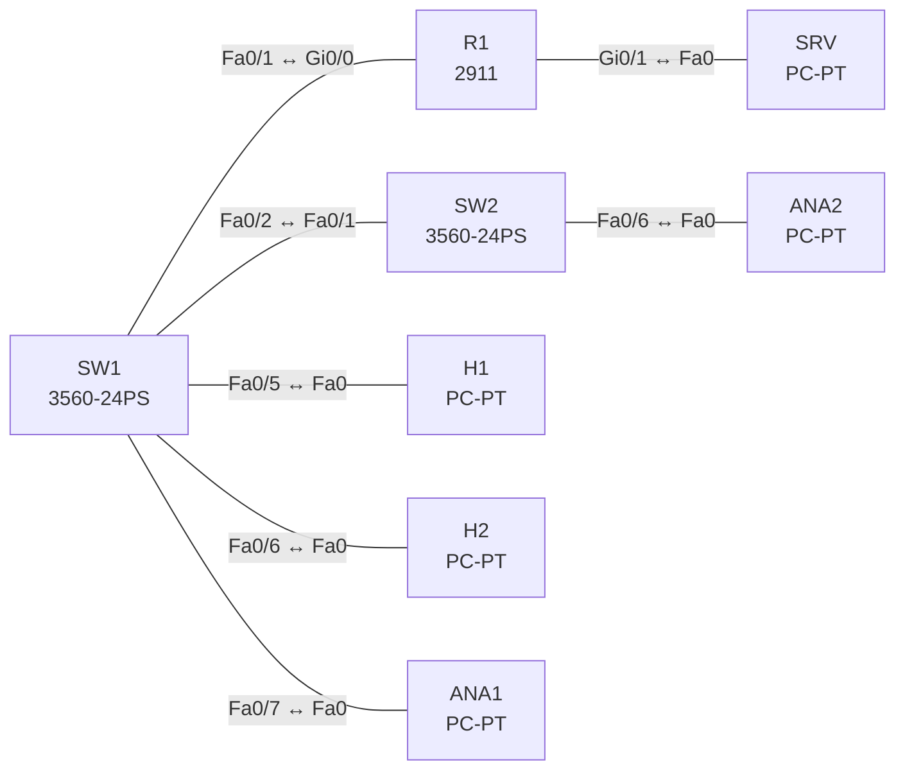

# Lab 18 – Flexible NetFlow, SPAN und RSPAN

**Dauer:** 75 min · **Niveau:** mittel

Verkehr sichtbar machen: Flexible NetFlow auf einem Router (Record, Exporter, Monitor), lokales SPAN und RSPAN über einen Trunk zwischen zwei Switches. ERSPAN wird als Konfigurationsübung ohne CML-Test behandelt.

**Lernziele:** Nach diesem Lab kannst du …

- Flexible NetFlow mit Record, Exporter und Monitor einrichten.
- Lokales SPAN und RSPAN aufbauen.
- Erklären, was NetFlow und SPAN zeigen und wo ihre Grenzen liegen.

| ENCOR-Ziel (`Ziel::…`) | Thema |
|---|---|
| 4.2 | Flexible NetFlow |
| 4.3 | SPAN, RSPAN und ERSPAN |

**So arbeitest du:** Teil A = Bauen, Teil B = Reparieren, Teil C = Üben. Die Konfigurationsdateien liegen in `build/` (Ausgangszustand zum Einfügen in die CLI), `repair/` (fertig gebaut, mit Fehlern) und `solutions/` (Musterlösung und Fehlerliste, erst nach eigenem Versuch öffnen). Anleitung zum Einfügen: siehe [Arbeiten mit den Dateien](../README.md#arbeiten-mit-den-dateien).

## Topologie



**Entwurfsskizze (aus dem CML-Lab; Portnamen der Switches siehe Verkabelungstabelle):**

```
 H1 ─┐                                        ┌─ ANA2 (RSPAN-Ziel)
     SW1 ── Gi0/0 ── R1 ── Gi0/1 ── SRV        SW2
 H2 ─┘      │ Gi0/1 ────────────────────────── Gi0/0
            └ Gi1/2 ── ANA1 (lokales SPAN-Ziel)
```

### Geräte

| Gerät | Modell in Packet Tracer | Rolle |
|---|---|---|
| SW1 | 3560-24PS | Switch |
| SW2 | 3560-24PS | Switch |
| R1 | 2911 | Router |
| H1 | PC-PT | Host |
| H2 | PC-PT | Host |
| SRV | PC-PT | Host |
| ANA1 | PC-PT | Host |
| ANA2 | PC-PT | Host |

### Verkabelung

| Von | Port | Nach | Port | Kabel |
|---|---|---|---|---|
| SW1 | Fa0/1 | R1 | Gi0/0 | Copper Straight-Through |
| R1 | Gi0/1 | SRV | Fa0 | Copper Cross-Over |
| SW1 | Fa0/2 | SW2 | Fa0/1 | Copper Cross-Over |
| SW1 | Fa0/5 | H1 | Fa0 | Copper Straight-Through |
| SW1 | Fa0/6 | H2 | Fa0 | Copper Straight-Through |
| SW1 | Fa0/7 | ANA1 | Fa0 | Copper Straight-Through |
| SW2 | Fa0/6 | ANA2 | Fa0 | Copper Straight-Through |

### Adressplan (Ausgangszustand)

| Gerät | Interface | Adresse | Maske | Gateway | DNS |
|---|---|---|---|---|---|
| R1 | Gi0/0 | 10.10.10.1 | 255.255.255.0 | | |
| R1 | Gi0/1 | 10.20.20.1 | 255.255.255.0 | | |
| H1 | Fa0 (GUI) | 10.10.10.11 | 255.255.255.0 | 10.10.10.1 |  |
| H2 | Fa0 (GUI) | 10.10.10.12 | 255.255.255.0 | 10.10.10.1 |  |
| SRV | Fa0 (GUI) | 10.20.20.10 | 255.255.255.0 | 10.20.20.1 |  |
| ANA1 | Fa0 (GUI) | 10.10.10.21 | 255.255.255.0 | 10.10.10.1 |  |
| ANA2 | Fa0 (GUI) | 10.10.10.22 | 255.255.255.0 | 10.10.10.1 |  |

| Gerät | Interface | Adresse |
|---|---|---|
| R1 | Gi0/0 / Gi0/1 | 10.10.10.1/24 / 10.20.20.1/24 |
| H1 / H2 | Gi0/0 | 10.10.10.11 / 10.10.10.12 |
| SRV | Gi0/0 | 10.20.20.10 |
| ANA1 / ANA2 | Gi0/0 | Sniffer-Hosts (passiv) |

SW1 Port-Belegung: Fa0/1 → R1 (Access VLAN 10), Fa0/2 → SW2 (Trunk), Fa0/5 → H1, Fa0/6 → H2, Fa0/7 → ANA1. SW2: Fa0/1 → SW1 (Trunk), Fa0/6 → ANA2.

### Portzuordnung der Switches (CML → Packet Tracer)

Aufgaben, Verkabelung, Konfigurationen und Fehlerlisten verwenden die Packet-Tracer-Ports. Die Tabelle zeigt, welcher Port der CML-Vorlage dazu gehört. Nur die Skizze nennt noch die CML-Ports. Umrechnung: `GiX/Y` → `Fa0/(X·4+Y+1)`.

| Switch | CML-Port | PT-Port |
|---|---|---|
| SW1 | Gi0/0 | Fa0/1 |
| SW1 | Gi0/1 | Fa0/2 |
| SW1 | Gi1/0 | Fa0/5 |
| SW1 | Gi1/1 | Fa0/6 |
| SW1 | Gi1/2 | Fa0/7 |
| SW2 | Gi0/0 | Fa0/1 |
| SW2 | Gi1/1 | Fa0/6 |

> **Packet-Tracer-Hinweis:** **Eignung: teilweise.** Stand Packet Tracer 8.x: Flexible NetFlow: nicht vorhanden. Nicht vorhanden. SPAN (lokal): eingeschränkt. Lokales SPAN auf Switches, Ausgabe weicht ab. RSPAN/ERSPAN: nicht vorhanden. Nicht vorhanden. Akzeptiert PT einen Befehl nicht, ist das ein PT-Limit und kein Fehler von dir; solche Schritte machst du in CML oder EVE-NG. Die CML-Switches (Gi-Ports) sind hier 3560-24PS bzw. 2960 mit FastEthernet-Ports: Die Portzuordnung steht unter dem Adressplan.

## Teil A – Bauen
Arbeite die Schritte der Reihe nach ab. Jeder Schritt sagt dir, was du tust, woran du den Erfolg erkennst (**Prüfen**) und worüber du nachdenken sollst (**Denkfrage**). Die Antworten auf die Denkfragen stehen am Ende von Teil A.

**Teil 1: Flexible NetFlow auf R1**

1. **Record anlegen.** Lege `flow record REC` an mit den Key-Feldern `match ipv4 source address`, `match ipv4 destination address`, `match ipv4 protocol`, `match transport source-port` und `match transport destination-port`. Dazu die Zähler `collect counter bytes` und `collect counter packets`.
   - **Denkfrage:** Was ist ein Flow, und was bewirken die `match`-Zeilen?
2. **Exporter anlegen.** Lege `flow exporter EXP` an mit `destination 10.20.20.10`, `transport udp 2055`, `source Gi0/1` und `export-protocol netflow-v9`.
   - **Denkfrage:** Wozu braucht NetFlow v9 Templates?
3. **Monitor anlegen und binden.** Verbinde Record und Exporter in `flow monitor MON`. Binde ihn an Gi0/0 mit `ip flow monitor MON input` (und `output`). Erzeuge Verkehr: Ping von H1 zu SRV, dazu einen Telnet-Versuch.
   - **Prüfen:** `show flow monitor MON cache` zeigt eigene Zeilen für ICMP und für TCP mit Zielport 23.
4. **Einordnen.**
   - **Denkfrage:** Was unterscheidet klassisches NetFlow, Flexible NetFlow, sFlow und IPFIX?

**Teil 2: Lokales SPAN**

5. **Port spiegeln.** Konfiguriere auf SW1 `monitor session 1 source interface Fa0/5 both` und `monitor session 1 destination interface Fa0/7`.
   - **Prüfen:** `show monitor session 1` zeigt Quelle und Ziel. ANA1 sieht den Verkehr von H1.
   - **Denkfrage:** Was passiert mit dem Zielport?

**Teil 3: RSPAN**

6. **Über zwei Switches spiegeln.** Lege VLAN 999 auf beiden Switches an und setze darunter `remote-span`. Erlaube es auf dem Trunk. SW1: `monitor session 2 source interface Fa0/6 both` und `monitor session 2 destination remote vlan 999`. SW2: `monitor session 2 source remote vlan 999` und `monitor session 2 destination interface Fa0/6`.
   - **Prüfen:** ANA2 sieht den Verkehr von H2. `show vlan remote-span` listet VLAN 999.
7. **ERSPAN verstehen.** So sähe eine ERSPAN-Quelle auf IOS XE aus:

   ```
   monitor session 3 type erspan-source
    source interface Gi1 both
    destination
     erspan-id 10
     ip address 10.1.1.1
     origin ip address 10.1.1.2
   ```
   - **Denkfrage:** Was unterscheidet SPAN, RSPAN und ERSPAN?

<details><summary>Antworten zu den Denkfragen</summary>

- **Zu 1:** Ein Flow ist eine Folge von Paketen mit gleichen Key-Feldern. Die `match`-Zeilen legen diese Key-Felder fest, hier also Quell- und Ziel-IP, Protokoll und Ports. Die `collect`-Zeilen zählen nur mit und machen keinen neuen Flow auf. Klassisches NetFlow nutzte fest sieben Key-Felder: dazu noch ToS und Eingangs-Interface.
- **Zu 2:** Ein Template beschreibt, welche Felder in welcher Reihenfolge in den Datensätzen stehen. So kann der Collector auch frei definierte Records lesen. v5 hatte ein festes Format.
- **Zu 4:** Klassisches NetFlow hat feste Felder. Flexible NetFlow lässt dich Record, Exporter und Monitor selbst zusammenstellen. sFlow nimmt nur Stichproben aus dem Verkehr. IPFIX ist der IETF-Standard auf Basis von NetFlow v9 und wird auch NetFlow v10 genannt.
- **Zu 5:** Der Zielport gibt nur noch die Kopien aus. Er nimmt keinen normalen Verkehr mehr an und nimmt nicht an STP teil.
- **Zu 7:** SPAN spiegelt lokal auf einem Switch. RSPAN transportiert die Kopien in einem eigenen VLAN über Trunks zu einem anderen Switch, also nur auf Layer 2. ERSPAN verpackt die Kopien in GRE und schickt sie per IP an ein beliebiges Ziel, auch über Router hinweg.

</details>

## Teil B – Reparieren

Baue die Topologie wie oben (oder behalte deine aus Teil A), setze alle Geräte zurück (`erase startup-config`, `reload` bzw. neues Gerät) und füge dann die Dateien aus `repair/` ein. Es stecken **4 Fehler** drin. Behandle jede Meldung als Ticket: erst Symptom nachstellen, dann Layer für Layer eingrenzen, beheben und beweisen. Ändere nur, was kaputt ist.

**Ticket 1:** **[in PT nicht prüfbar: Flexible NetFlow]** `show flow monitor MON cache` ist leer, obwohl Verkehr läuft; der Exporter zählt keine Pakete.

**Ticket 2:** Im Flow-Cache stehen nur noch Einträge je Host-Paar und Protokoll, Anwendungen (Ports) lassen sich nicht unterscheiden.

**Ticket 3:** ANA2 sieht nichts vom RSPAN-Verkehr von H2, lokales SPAN auf SW1 funktioniert.

**Ticket 4:** ANA1 sieht H1-Verkehr nicht, `show monitor session 1` zeigt ein anderes Ziel.

## Verifikation
```
show flow monitor MON cache
show flow exporter EXP statistics
show monitor session all
show vlan remote-span
```

| Befehl | Das solltest du sehen |
|---|---|
| `show flow monitor MON cache` | Flows von H1 zu SRV, getrennt nach Protokoll und Port |
| `show flow exporter EXP statistics` | steigende Zahl exportierter Records |
| Mitschnitt auf ANA1 / ANA2 | ANA1 sieht H1 (SPAN), ANA2 sieht H2 (RSPAN) |

## Teil C – Üben

Beantworte zuerst selbst, dann klappe die Antwort auf.

1. Was sind Key-Felder und Non-Key-Felder in einem NetFlow-Record?
<details><summary>Antwort</summary>

**Key-Felder bestimmen, was ein Flow ist, Non-Key-Felder werden nur mitgezählt.** Key (`match`): z. B. Quell- und Ziel-IP, Protokoll, Ports. Pakete mit gleichen Key-Werten gehören zum selben Flow. Non-Key (`collect`): Bytes, Pakete, Zeitstempel, TCP-Flags.

</details>

2. RSPAN-Session steht, aber ANA2 sieht nichts. Typische Ursachen?
<details><summary>Antwort</summary>

**Das Remote-VLAN fehlt, ist nicht erlaubt oder die Sessions sind falsch.** Ist das VLAN als `remote-span` angelegt? Ist es auf allen Trunks dazwischen erlaubt? Hat der Ziel-Switch eine Session mit `source remote vlan`?

</details>

3. Warum kann man das Gerät bei hoher Last im SPAN-Betrieb falsch interpretieren?
<details><summary>Antwort</summary>

**Weil SPAN bei Überlast Pakete verliert und NetFlow nur Statistik liefert.** SPAN-Kopien haben niedrige Priorität. Wird es eng, verwirft der Switch sie. NetFlow zählt Flows, zeigt aber keine Paketinhalte. Merke: Fehlt etwas im Mitschnitt, fehlt es nicht unbedingt im echten Verkehr.

</details>

## Prüfungsbezug
- Ein Flow ist eine Paketfolge mit gleichen Key-Feldern.
- Flexible NetFlow besteht aus Record, Exporter und Monitor.
- NetFlow v9 und IPFIX arbeiten mit Templates.
- SPAN spiegelt lokal, RSPAN über ein Remote-VLAN, ERSPAN per GRE zu einer IP-Adresse.
- Ein SPAN-Zielport nimmt keinen normalen Verkehr an.

## Lösungen

- `solutions/<Gerät>.cfg`: Konfiguration zu Teil A (ohne Basis-Adressen)
- `solutions/FAULTS.md`: Fehlerliste zu Teil B (Spoiler!)
