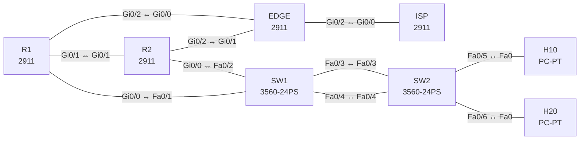

# Lab 23 – Capstone: Campus und Edge, Fehlersuche im Gesamtnetz

**Dauer:** 150 min · **Niveau:** schwer

Ein komplettes kleines Campus-Netz mit Internet-Edge: Access-Switch mit EtherChannel, Distribution-Router mit HSRP, OSPF, NAT, ACL, NTP und SSH. Der Schwerpunkt liegt auf der Reparatur: Zehn Fehler aus allen Schichten, teils voneinander verdeckt, wie in einem echten Troubleshooting-Ticket der Prüfung.

**Lernziele:** Nach diesem Lab kannst du …

- Ein Campus-Netz mit Layer 2, HSRP, OSPF, NAT und ACLs als Ganzes lesen.
- Fehler systematisch von unten nach oben eingrenzen: erst Layer 2, dann Gateway, dann Routing, dann Dienste.
- Mehrere Fehler lösen, bei denen einer den nächsten verdeckt.

| ENCOR-Ziel (`Ziel::…`) | Thema |
|---|---|
| 3.1.a | 802.1Q und Trunks |
| 3.1.b | EtherChannel |
| 3.1.c | RSTP, MST und Schutzfunktionen |
| 3.2.b | OSPFv2 und OSPFv3 |
| 3.3.a | NTP und PTP |
| 3.3.b | NAT und PAT |
| 3.3.c | HSRP und VRRP |
| 5.1.a | Lines und lokale Anmeldung |
| 5.2.a | ACLs |

**So arbeitest du:** Teil A = Bauen, Teil B = Reparieren, Teil C = Üben. Die Konfigurationsdateien liegen in `build/` (Ausgangszustand zum Einfügen in die CLI), `repair/` (fertig gebaut, mit Fehlern) und `solutions/` (Musterlösung und Fehlerliste, erst nach eigenem Versuch öffnen). Anleitung zum Einfügen: siehe [Arbeiten mit den Dateien](../README.md#arbeiten-mit-den-dateien).

## Topologie



**Entwurfsskizze (aus dem CML-Lab; Portnamen der Switches siehe Verkabelungstabelle):**

```
                          ISP (8.8.8.8)
                             │ 203.0.113.0/30
                           EDGE (NAT, NTP-Master, Lo0 10.255.0.3)
                     Gi0/0 /          \ Gi0/1
                10.0.13.0/30          10.0.23.0/30
                     R1 ──────────── R2        R1/R2 Gi0/1 ↔ Gi0/1 (10.0.12.0/30)
                  Gi0/0 \            / Gi0/0    HSRP v2, V10 + V20
                          SW1 (Root)
                       Gi0/2-3 ║ Po1 (LACP)
                          SW2 (Access)
                      Gi1/0 │      │ Gi1/1
                       H10 (V10)  H20 (V20)
```

### Geräte

| Gerät | Modell in Packet Tracer | Rolle |
|---|---|---|
| R1 | 2911 | Router |
| R2 | 2911 | Router |
| EDGE | 2911 | Router |
| ISP | 2911 | Router |
| SW1 | 3560-24PS | Switch |
| SW2 | 3560-24PS | Switch |
| H10 | PC-PT | Host |
| H20 | PC-PT | Host |

### Verkabelung

| Von | Port | Nach | Port | Kabel |
|---|---|---|---|---|
| EDGE | Gi0/2 | ISP | Gi0/0 | Copper Cross-Over |
| R1 | Gi0/2 | EDGE | Gi0/0 | Copper Cross-Over |
| R2 | Gi0/2 | EDGE | Gi0/1 | Copper Cross-Over |
| R1 | Gi0/1 | R2 | Gi0/1 | Copper Cross-Over |
| R1 | Gi0/0 | SW1 | Fa0/1 | Copper Straight-Through |
| R2 | Gi0/0 | SW1 | Fa0/2 | Copper Straight-Through |
| SW1 | Fa0/3 | SW2 | Fa0/3 | Copper Cross-Over |
| SW1 | Fa0/4 | SW2 | Fa0/4 | Copper Cross-Over |
| SW2 | Fa0/5 | H10 | Fa0 | Copper Straight-Through |
| SW2 | Fa0/6 | H20 | Fa0 | Copper Straight-Through |

### Adressplan (Ausgangszustand)

| Gerät | Interface | Adresse | Maske | Gateway | DNS |
|---|---|---|---|---|---|
| R1 | Loopback0 | 10.255.0.1 | 255.255.255.255 | | |
| R1 | Gi0/1 | 10.0.12.1 | 255.255.255.252 | | |
| R1 | Gi0/2 | 10.0.13.1 | 255.255.255.252 | | |
| R1 | Gi0/0.10 | 10.10.10.2 | 255.255.255.0 | | |
| R1 | Gi0/0.20 | 10.10.20.2 | 255.255.255.0 | | |
| R2 | Loopback0 | 10.255.0.2 | 255.255.255.255 | | |
| R2 | Gi0/1 | 10.0.12.2 | 255.255.255.252 | | |
| R2 | Gi0/2 | 10.0.23.1 | 255.255.255.252 | | |
| R2 | Gi0/0.10 | 10.10.10.3 | 255.255.255.0 | | |
| R2 | Gi0/0.20 | 10.10.20.3 | 255.255.255.0 | | |
| EDGE | Loopback0 | 10.255.0.3 | 255.255.255.255 | | |
| EDGE | Gi0/0 | 10.0.13.2 | 255.255.255.252 | | |
| EDGE | Gi0/1 | 10.0.23.2 | 255.255.255.252 | | |
| EDGE | Gi0/2 | 203.0.113.2 | 255.255.255.252 | | |
| ISP | Loopback0 | 8.8.8.8 | 255.255.255.255 | | |
| ISP | Gi0/0 | 203.0.113.1 | 255.255.255.252 | | |
| H10 | Fa0 (GUI) | 10.10.10.11 | 255.255.255.0 | 10.10.10.1 |  |
| H20 | Fa0 (GUI) | 10.10.20.12 | 255.255.255.0 | 10.10.20.1 |  |

| Netz | Verwendung |
|---|---|
| 10.10.10.0/24 | VLAN 10, VIP .1, R1 .2, R2 .3, H10 .11 |
| 10.10.20.0/24 | VLAN 20, VIP .1, R1 .2, R2 .3, H20 .12 |
| 10.0.12.0/30 | R1 .1 – R2 .2 |
| 10.0.13.0/30 | R1 .1 – EDGE .2 |
| 10.0.23.0/30 | R2 .1 – EDGE .2 |
| 203.0.113.0/30 | ISP .1 – EDGE .2 |
| Loopbacks | R1 10.255.0.1, R2 10.255.0.2, EDGE 10.255.0.3 (NTP-Server), ISP 8.8.8.8 |

**Design-Vorgaben:** SW1 ist STP-Root für VLAN 10 und 20 (Priorität 4096), SW2 hat 61440. Po1 ist ein LACP-Trunk (nur VLAN 10, 20). R1 ist HSRP-Active (Priorität 110, preempt) für beide VLANs, R2 Standby. OSPF 1 Area 0 mit `passive-interface default`. EDGE originiert die Default-Route per OSPF und macht PAT (Quell-Netz 10.10.0.0/16) auf Gi0/2. VLAN 20 darf VLAN 10 nicht erreichen (ACL auf R1/R2, eingehend am VLAN-20-Subinterface). NTP-Quelle ist EDGE. Verwaltung nur per SSH (Benutzer `admin`, Passwort `Lab-Passw0rd!`).

### Portzuordnung der Switches (CML → Packet Tracer)

Aufgaben, Verkabelung, Konfigurationen und Fehlerlisten verwenden die Packet-Tracer-Ports. Die Tabelle zeigt, welcher Port der CML-Vorlage dazu gehört. Nur die Skizze nennt noch die CML-Ports. Umrechnung: `GiX/Y` → `Fa0/(X·4+Y+1)`.

| Switch | CML-Port | PT-Port |
|---|---|---|
| SW1 | Gi0/0 | Fa0/1 |
| SW1 | Gi0/1 | Fa0/2 |
| SW1 | Gi0/2 | Fa0/3 |
| SW1 | Gi0/3 | Fa0/4 |
| SW2 | Gi0/2 | Fa0/3 |
| SW2 | Gi0/3 | Fa0/4 |
| SW2 | Gi1/0 | Fa0/5 |
| SW2 | Gi1/1 | Fa0/6 |

> **Packet-Tracer-Hinweis:** **Eignung: geeignet.** Alle verwendeten Funktionen gibt es in Packet Tracer; Ausgabeformate einzelner `show`-Befehle weichen leicht ab. Die CML-Switches (Gi-Ports) sind hier 3560-24PS bzw. 2960 mit FastEthernet-Ports: Die Portzuordnung steht unter dem Adressplan.

## Teil A – Bauen
Arbeite die Schritte der Reihe nach ab. Jeder Schritt sagt dir, was du tust, woran du den Erfolg erkennst (**Prüfen**) und worüber du nachdenken sollst (**Denkfrage**). Die Antworten auf die Denkfragen stehen am Ende von Teil A.

Dieses Lab ist vor allem zum Reparieren gedacht (Teil B). Wenn du es selbst bauen willst, gehe Schicht für Schicht vor und prüfe nach jeder Stufe, bevor du weitermachst.

1. **Layer 2.** Lege VLAN 10 und 20 auf SW1 und SW2 an. Bündle die Links zu Po1 mit LACP (SW1 `active`, SW2 `passive`). Die Ports zu R1 und R2 werden feste Trunks (`switchport mode trunk`, `nonegotiate`, erlaubt 10 und 20). Die Ports von H10 und H20 sind Access-Ports mit PortFast. SW1 bekommt `spanning-tree vlan 10,20 priority 4096`, SW2 61440.
   - **Prüfen:** `show etherchannel summary` zeigt `Po1(SU)`. `show spanning-tree root` zeigt SW1 als Root für beide VLANs.
   - **Denkfrage:** Warum bekommt SW2 bewusst die schlechteste Priorität 61440?
2. **Gateway-Redundanz.** Lege auf R1 und R2 die Subinterfaces `Gi0/0.10` und `.20` an. Konfiguriere HSRP Version 2 mit den Gruppen 10 und 20. R1 bekommt Priorität 110 und `preempt`.
   - **Prüfen:** `show standby brief` zeigt R1 Active in beiden Gruppen. H10 und H20 pingen ihr Gateway.
3. **Routing.** Starte OSPF 1 mit `passive-interface default` und `network 10.0.0.0 0.255.255.255 area 0`. Nimm die Uplinks mit `no passive-interface` heraus: auf R1 und R2 Gi0/1 und Gi0/2, auf EDGE Gi0/0 und Gi0/1. EDGE bekommt eine Default-Route zum ISP und `default-information originate`.
   - **Prüfen:** `show ip ospf neighbor` auf EDGE zeigt R1 und R2. R1 und R2 haben eine Route `O*E2 0.0.0.0/0`.
4. **NAT.** Auf EDGE: `access-list 1 permit 10.10.0.0 0.0.255.255`, `ip nat inside` an Gi0/0 und Gi0/1, `ip nat outside` an Gi0/2 und `ip nat inside source list 1 interface GigabitEthernet0/2 overload`.
   - **Prüfen:** H10 und H20 pingen 8.8.8.8. `show ip nat translations` zeigt Einträge aus beiden VLANs.
5. **Segmente trennen.** Lege `ip access-list extended V20-IN` an: zuerst `deny ip 10.10.20.0 0.0.0.255 10.10.10.0 0.0.0.255`, dann `permit ip any any`. Binde sie eingehend an `.20` auf R1 und R2.
   - **Prüfen:** H20 erreicht H10 nicht mehr, das Internet schon. `show access-lists` zählt Treffer auf der Deny-Zeile.
   - **Denkfrage:** Warum muss die ACL auf beiden Routern stehen?
6. **Zeit und Verwaltung.** EDGE bekommt `ntp master 3`, R1 und R2 `ntp server 10.255.0.3`. Auf allen Routern: `ip domain-name lab.local`, ein lokaler Benutzer, `crypto key generate rsa modulus 2048` (von Hand, steht nicht in der Startkonfiguration), `ip ssh version 2` und an den vty-Lines `login local` und `transport input ssh`.
   - **Prüfen:** `show ntp status` auf R1 und R2 meldet synchronisiert. SSH von R1 auf R2 klappt.
7. **Abnahme.** Prüfe alles zusammen: H10 und H20 pingen 8.8.8.8, H20 pingt H10 nicht. Schalte R1 ab: H10 und H20 kommen über R2 weiter ins Internet.

<details><summary>Antworten zu den Denkfragen</summary>

- **Zu 1:** SW2 soll nie Root werden, solange SW1 lebt. Mit 61440 hat er die schlechteste mögliche Priorität. Jeder andere Switch mit Standardwert 32768 würde vor ihm gewinnen, und das Design bleibt vorhersehbar.
- **Zu 5:** Je nachdem, welcher Router gerade HSRP Active ist, läuft der Verkehr aus VLAN 20 über R1 oder R2. Stünde die ACL nur auf R1, wäre die Trennung nach einem Wechsel auf R2 weg.

</details>

## Teil B – Reparieren

Baue die Topologie wie oben (oder behalte deine aus Teil A), setze alle Geräte zurück (`erase startup-config`, `reload` bzw. neues Gerät) und füge dann die Dateien aus `repair/` ein. Es stecken **10 Fehler** drin. Behandle jede Meldung als Ticket: erst Symptom nachstellen, dann Layer für Layer eingrenzen, beheben und beweisen. Ändere nur, was kaputt ist.

**Ticket 1:** H20 erreicht seinen Gateway nicht, H10 schon. Von R1 aus ist 10.10.20.12 nicht erreichbar.

**Ticket 2:** Nach dem Reparieren des Trunks melden in VLAN 10 beide Router `Active`. `show standby brief` auf R1 und R2 zeigt jeweils `Active` und keinen Standby-Partner; Hosts erhalten ARP-Antworten verschiedener Router.

**Ticket 3:** Alles funktioniert, aber beim Test (Abschalten von R1) verlieren alle Hosts das Internet, obwohl R2 HSRP Active wird. `show ip ospf neighbor` auf EDGE zeigt nur R1.

**Ticket 4:** H10 erreicht 8.8.8.8, H20 nicht, obwohl das Routing stimmt. `show ip nat translations` enthält nur Einträge aus 10.10.10.x.

**Ticket 5:** H20 kann H10 anpingen, obwohl die Segmente getrennt sein sollen. `show access-lists` zeigt keine Treffer auf der deny-Zeile.

**Ticket 6:** `show spanning-tree root` zeigt für VLAN 10 und 20 SW2 als Root, Design verlangt SW1. Der Verkehr der Hosts nimmt einen Umweg, SW1 hat `Root port Po1`.

**Ticket 7:** Po1 bündelt nicht: `show etherchannel summary` zeigt auf SW1 `(s)`/`(I)`-Ports, die Verbindung zu H10 und H20 ist unzuverlässig oder fällt ganz aus.

**Ticket 8:** `show ntp status` auf R2: `Clock is unsynchronized`, R1 ist synchron. `show ntp associations` zeigt Reach 0.

**Ticket 9:** SSH von R1 auf R2 wird abgewiesen (`Connection refused by remote host`), Telnet dagegen geht.

**Ticket 10:** H10/H20 erreichen 8.8.8.8 nicht. EDGE erreicht den ISP, R1 und R2 haben aber keine Default-Route (`show ip route 0.0.0.0` → `Network not in table`).

## Verifikation
```
show etherchannel summary          show spanning-tree root
show standby brief                 show ip ospf neighbor
show ip route ospf | include O\*   show ip nat translations
show access-lists                  show ntp status
show ip ssh                        ping 8.8.8.8 source 10.10.10.2
```

| Befehl | Das solltest du sehen |
|---|---|
| `show etherchannel summary` | Po1 `SU` mit `Fa0/3(P) Fa0/4(P)` |
| `show spanning-tree root` / `show standby brief` | SW1 Root, R1 Active für beide VLANs |
| `show ip ospf neighbor` auf EDGE | zwei Nachbarn (R1, R2) |
| `show ip route` auf R1 und R2 | `O*E2 0.0.0.0/0` |
| `show ip nat translations` | Einträge für 10.10.x.x |

## Teil C – Üben

Beantworte zuerst selbst, dann klappe die Antwort auf.

1. H20 erreicht sein Gateway nicht, H10 schon. Welche Kommandos in welcher Reihenfolge?
<details><summary>Antwort</summary>

**Von unten nach oben: erst Layer 2, dann der Router.** `show vlan brief` und `show interfaces trunk` auf SW2 und SW1 (ist VLAN 20 vorhanden und auf dem Trunk erlaubt?), dann `show spanning-tree vlan 20` (blockiert ein Port?), dann `show standby brief` auf R1. Erst wenn Layer 2 stimmt, lohnt der Blick auf die Router.

</details>

2. Wozu `passive-interface default` im Campus-Design, und was ist die Nebenwirkung eines vergessenen `no passive-interface`?
<details><summary>Antwort</summary>

**Damit sich nur dort Nachbarn bilden, wo sie gewollt sind.** Passive Interfaces senden keine Hellos. Das schützt LAN- und Edge-Ports und spart CPU. Vergisst man auf einem Uplink `no passive-interface`, fehlt die Nachbarschaft ohne Fehlermeldung. Auffallen tut das erst, wenn der Ersatzweg gebraucht wird.

</details>

3. Warum zeigt `show ip nat translations` nichts, obwohl `ip nat inside source` konfiguriert ist?
<details><summary>Antwort</summary>

**Weil das Paket gar nicht übersetzt wird.** Typisch: Inside oder Outside fehlt an einem Interface, die ACL passt nicht auf das Quellnetz, oder es fehlt die Default-Route, sodass das Paket das Outside-Interface nie erreicht.

</details>

## Prüfungsbezug
- Eine Troubleshooting-Frage nennt dir selten den Fehler, sondern ein Symptom.
- Vorgehen: erst Layer 1 und 2 (Interface, VLAN, Trunk, Channel, STP), dann Layer 3 (Adressen, Gateway, Routing), dann Dienste (NAT, ACL, NTP, SSH).
- Prüfe immer beide Seiten einer Verbindung.
- Ein Fehler weiter unten kann einen Fehler weiter oben verdecken. Nach jeder Reparatur neu testen.

## Lösungen

- `solutions/<Gerät>.cfg`: Konfiguration zu Teil A (ohne Basis-Adressen)
- `solutions/FAULTS.md`: Fehlerliste zu Teil B (Spoiler!)
