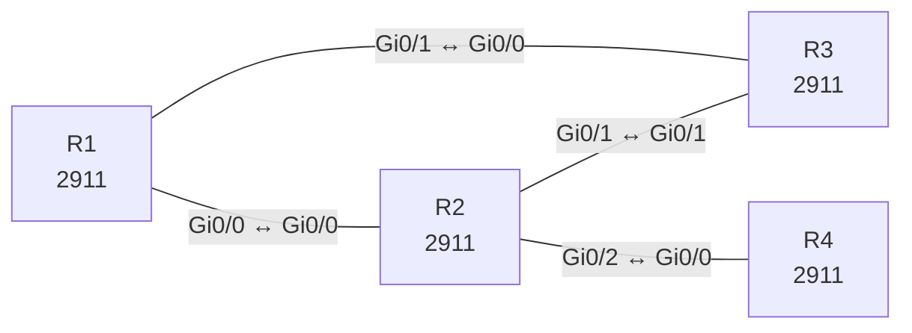

# Lab 25 – EIGRP klassisch: Nachbarschaft, Authentifizierung, Summary und Stub

**Dauer:** 90 min · **Niveau:** mittel

EIGRP im klassischen Modus über vier Router: Nachbarschaftsbedingungen (AS, K-Werte, Authentifizierung), Summarisierung, Stub-Router und das Lesen der Topology Table (Feasible Successor, FD/RD). Dazu die Abgrenzung zu OSPF.

**Lernziele:** Nach diesem Lab kannst du …

- Klassisches EIGRP mit Authentisierung aufbauen.
- Mit Summary und Stub die Query-Reichweite begrenzen.
- Nachbarschaftsfehler (AS, K-Werte, Key, passive) an ihren Meldungen unterscheiden.

| ENCOR-Ziel (`Ziel::…`) | Thema |
|---|---|
| 3.2.a | EIGRP und OSPF vergleichen |

**So arbeitest du:** Teil A = Bauen, Teil B = Reparieren, Teil C = Üben. Die Konfigurationsdateien liegen in `build/` (Ausgangszustand zum Einfügen in die CLI), `repair/` (fertig gebaut, mit Fehlern) und `solutions/` (Musterlösung und Fehlerliste, erst nach eigenem Versuch öffnen). Anleitung zum Einfügen: siehe [Arbeiten mit den Dateien](../README.md#arbeiten-mit-den-dateien).

## Topologie



**Entwurfsskizze (aus dem CML-Lab; Portnamen der Switches siehe Verkabelungstabelle):**

```
              172.16.0.0/22 (Lo10-13)
                    R1
          Gi0/0 /       \ Gi0/1
        10.0.12.0/30    10.0.13.0/30
              R2 ─────── R3        R2 Gi0/1 ↔ R3 Gi0/1 (10.0.23.0/30)
       Gi0/2 │
        10.0.24.0/30
              R4 (Stub, Lo1 192.168.4.0/24)
```

### Geräte

| Gerät | Modell in Packet Tracer | Rolle |
|---|---|---|
| R1 | 2911 | Router |
| R2 | 2911 | Router |
| R3 | 2911 | Router |
| R4 | 2911 | Router |

### Verkabelung

| Von | Port | Nach | Port | Kabel |
|---|---|---|---|---|
| R1 | Gi0/0 | R2 | Gi0/0 | Copper Cross-Over |
| R1 | Gi0/1 | R3 | Gi0/0 | Copper Cross-Over |
| R2 | Gi0/1 | R3 | Gi0/1 | Copper Cross-Over |
| R2 | Gi0/2 | R4 | Gi0/0 | Copper Cross-Over |

### Adressplan (Ausgangszustand)

| Gerät | Interface | Adresse | Maske | Gateway | DNS |
|---|---|---|---|---|---|
| R1 | Loopback0 | 10.255.0.1 | 255.255.255.255 | | |
| R1 | Loopback10 | 172.16.0.1 | 255.255.255.0 | | |
| R1 | Loopback11 | 172.16.1.1 | 255.255.255.0 | | |
| R1 | Loopback12 | 172.16.2.1 | 255.255.255.0 | | |
| R1 | Loopback13 | 172.16.3.1 | 255.255.255.0 | | |
| R1 | Gi0/0 | 10.0.12.1 | 255.255.255.252 | | |
| R1 | Gi0/1 | 10.0.13.1 | 255.255.255.252 | | |
| R2 | Loopback0 | 10.255.0.2 | 255.255.255.255 | | |
| R2 | Gi0/0 | 10.0.12.2 | 255.255.255.252 | | |
| R2 | Gi0/1 | 10.0.23.1 | 255.255.255.252 | | |
| R2 | Gi0/2 | 10.0.24.1 | 255.255.255.252 | | |
| R3 | Loopback0 | 10.255.0.3 | 255.255.255.255 | | |
| R3 | Gi0/0 | 10.0.13.2 | 255.255.255.252 | | |
| R3 | Gi0/1 | 10.0.23.2 | 255.255.255.252 | | |
| R4 | Loopback0 | 10.255.0.4 | 255.255.255.255 | | |
| R4 | Loopback1 | 192.168.4.1 | 255.255.255.0 | | |
| R4 | Gi0/0 | 10.0.24.2 | 255.255.255.252 | | |

| Link | Netz |
|---|---|
| R1 Gi0/0 – R2 Gi0/0 | 10.0.12.0/30 (.1/.2) |
| R1 Gi0/1 – R3 Gi0/0 | 10.0.13.0/30 (.1/.2) |
| R2 Gi0/1 – R3 Gi0/1 | 10.0.23.0/30 (.1/.2) |
| R2 Gi0/2 – R4 Gi0/0 | 10.0.24.0/30 (.1/.2) |

Loopback0: R1 10.255.0.1, R2 .2, R3 .3, R4 .4 (jeweils /32). R1 hat zusätzlich Lo10 bis Lo13 mit 172.16.0.1 bis 172.16.3.1 (je /24), R4 hat Lo1 192.168.4.1/24. AS-Nummer: **100**.
> **Packet-Tracer-Hinweis:** **Eignung: geeignet.** Alle verwendeten Funktionen gibt es in Packet Tracer; Ausgabeformate einzelner `show`-Befehle weichen leicht ab.

## Teil A – Bauen
Arbeite die Schritte der Reihe nach ab. Jeder Schritt sagt dir, was du tust, woran du den Erfolg erkennst (**Prüfen**) und worüber du nachdenken sollst (**Denkfrage**). Die Antworten auf die Denkfragen stehen am Ende von Teil A.

1. **Grundkonfiguration.** Starte auf allen Routern `router eigrp 100` mit `eigrp router-id` (= Loopback0), je einem `network` pro Link mit Wildcard-Maske und `no auto-summary`. Setze `passive-interface default` und nimm die Router-Links mit `no passive-interface` heraus.
   - **Prüfen:** `show ip eigrp neighbors` zeigt Hold Time, SRTT und Q Cnt pro Nachbar. `show ip protocols` zeigt AS, K-Werte und passive Interfaces.
2. **Topologie-Tabelle lesen.** Sieh dir auf R3 `show ip eigrp topology 172.16.0.0/24` an. Schalte danach den Link zum Successor ab.
   - **Prüfen:** Benenne FD, RD, Successor und Feasible Successor. Nach dem Abschalten übernimmt der Feasible Successor sofort, ohne Query.
   - **Denkfrage:** Warum darf der Feasible Successor ohne Rückfrage übernehmen?
3. **Metrik berechnen.** Berechne die klassische Metrik mit K1 und K3: 256 × (10⁷ ÷ kleinste Bandbreite in kbit/s + Summe der Delays in µs ÷ 10). Ändere an einem Link `bandwidth` oder `delay` und vergleiche mit `show interfaces`.
   - **Prüfen:** `show ip eigrp topology` zeigt nach der Änderung die neue Metrik.
   - **Denkfrage:** Warum steuert man Pfade lieber mit `delay` als mit `bandwidth`?
4. **Ungleiche Lastverteilung.** Setze auf R3 `variance 2` unter `router eigrp 100`.
   - **Prüfen:** `show ip route 172.16.0.0` zeigt zwei Pfade, wenn die Bedingung erfüllt ist.
   - **Denkfrage:** Welche zwei Bedingungen muss der zweite Pfad erfüllen?
5. **Zusammenfassen.** Setze auf R1 an Gi0/0 und Gi0/1 `ip summary-address eigrp 100 172.16.0.0 255.255.252.0`.
   - **Prüfen:** R2 und R3 sehen nur noch 172.16.0.0/22. R1 hat eine Route 172.16.0.0/22 nach Null0 mit Administrativer Distanz 5.
   - **Denkfrage:** Wozu dient die Route nach Null0?
6. **Stub.** Setze auf R4 `eigrp stub connected`.
   - **Prüfen:** `show ip eigrp neighbors detail` auf R2 meldet „Stub Peer Advertising (CONNECTED) Routes“.
   - **Denkfrage:** Warum schickt R2 dem Stub bei einem Ausfall keine Query mehr?
7. **Authentisierung.** Lege die Key-Chain `KC` mit Key 1 und dem String `EigrpKey` an. Setze auf dem Link R1–R2 `ip authentication mode eigrp 100 md5` und `ip authentication key-chain eigrp 100 KC`. Teste danach einen falschen Schlüssel.
   - **Prüfen:** Mit falschem Schlüssel fällt die Nachbarschaft, `debug eigrp packets` meldet „authentication mismatch“.
8. **Mit OSPF vergleichen.**
   - **Denkfrage:** Wie unterscheiden sich EIGRP und OSPF in Verfahren, Algorithmus, Administrativer Distanz, Multicast-Adressen und Metrik? Wann nimmst du welches?

<details><summary>Antworten zu den Denkfragen</summary>

- **Zu 2:** Seine RD ist kleiner als die FD des Successors. Der Nachbar ist also näher am Ziel als R3 über seinen besten Weg und kann nicht über R3 zurückrouten. Damit ist der Weg garantiert schleifenfrei.
- **Zu 3:** `bandwidth` wirkt sich auch auf andere Dinge aus, etwa auf QoS-Prozentwerte und OSPF-Kosten. Und weil EIGRP nur die kleinste Bandbreite auf dem Weg zählt, ändert sich oft nichts. `delay` wird über den Weg aufsummiert und ändert gezielt nur die Pfade über diesen Link.
- **Zu 4:** Erstens muss er ein Feasible Successor sein. Zweitens muss seine Metrik kleiner sein als `variance` × FD des Successors.
- **Zu 5:** Sie verhindert Schleifen. Kommt ein Paket für ein Teilnetz der Summary, das es nicht gibt, verwirft R1 es, statt es per Default-Route zurückzuschicken.
- **Zu 6:** Ein Stub sagt seinen Nachbarn: Hinter mir gibt es keinen anderen Weg. R2 muss ihn also nicht fragen. Die Suche nach einem Ersatzweg bleibt klein, und Stuck in Active wird unwahrscheinlicher.
- **Zu 8:** EIGRP ist ein erweitertes Distanzvektorverfahren mit DUAL, OSPF ein Link-State-Verfahren mit SPF. Administrative Distanz: EIGRP intern 90, extern 170, OSPF 110. Multicast: EIGRP 224.0.0.10, OSPF 224.0.0.5 und 224.0.0.6. EIGRP rechnet mit Bandbreite und Delay, OSPF mit Kosten aus der Bandbreite. EIGRP ist einfach und kann ungleiche Lastverteilung. OSPF ist ein offener Standard, läuft also auch mit anderen Herstellern, und gliedert große Netze in Areas.

</details>

## Teil B – Reparieren

Baue die Topologie wie oben (oder behalte deine aus Teil A), setze alle Geräte zurück (`erase startup-config`, `reload` bzw. neues Gerät) und füge dann die Dateien aus `repair/` ein. Es stecken **6 Fehler** drin. Behandle jede Meldung als Ticket: erst Symptom nachstellen, dann Layer für Layer eingrenzen, beheben und beweisen. Ändere nur, was kaputt ist.

**Ticket 1:** R1 und R2 bilden keine Nachbarschaft (`show ip eigrp neighbors` leer am Link); `debug eigrp packets` meldet einen Authentifizierungsfehler.

**Ticket 2:** R3 hat keine Nachbarn: `show ip eigrp neighbors` ist leer, auf R1 und R2 steht `K-value mismatch`.

**Ticket 3:** R4 hat keinen Nachbarn zu R2, 192.168.4.0/24 fehlt überall.

**Ticket 4:** R3 zeigt für das 172.16er-Netz zwei verschiedene Routen: `172.16.0.0/22` (über R2) und `172.16.0.0/23` (direkt von R1). Verkehr in 172.16.2.0/24 nimmt den Umweg.

**Ticket 5:** Nach Behebung der Nachbarschaft: R1 erreicht 192.168.4.1 nicht, obwohl R4 Nachbar von R2 ist.

**Ticket 6:** R2 und R3 sind direkt verbunden, aber `show ip eigrp neighbors` auf R2 zeigt R3 nicht (Nachbarschaft nur über R1).

## Verifikation
```
show ip eigrp neighbors
show ip eigrp topology [all-links]
show ip route eigrp
show ip protocols
show ip eigrp interfaces detail
```

| Befehl | Das solltest du sehen |
|---|---|
| `show ip eigrp neighbors` | R1 zwei Nachbarn (R2, R3), R2 drei (R1, R3, R4) |
| `show ip route eigrp` auf R3 | 172.16.0.0/22 über beide Wege (nach Schritt 4 und 5) |
| `show ip eigrp neighbors detail` auf R2 | R4 als Stub |

## Teil C – Üben

Beantworte zuerst selbst, dann klappe die Antwort auf.

1. Zwei EIGRP-Router bilden keine Nachbarschaft, obwohl alle Interfaces oben sind. Die ersten Prüfungen?
<details><summary>Antwort</summary>

**AS-Nummer, K-Werte, Authentisierung, passive Interfaces und das `network`-Statement.** `show ip protocols` zeigt AS und K-Werte, `show ip eigrp interfaces` zeigt, ob das Interface im Prozess ist. Außerdem müssen beide im selben Subnetz liegen. Die Hello-Timer dürfen dagegen verschieden sein.

</details>

2. Wann wird ein Pfad Feasible Successor?
<details><summary>Antwort</summary>

**Wenn seine Reported Distance kleiner ist als die Feasible Distance des Successors.** Der Nachbar ist dann näher am Ziel als man selbst über den besten Weg. Das schließt eine Schleife aus. Fällt der Successor aus, schaltet EIGRP ohne Query sofort um.

</details>

3. Was bewirkt `eigrp stub connected` und warum hilft es bei Stuck-in-Active?
<details><summary>Antwort</summary>

**Der Router kündigt nur seine direkt verbundenen Netze an und bekommt keine Queries mehr.** Die Nachbarn wissen, dass hinter einem Stub kein anderer Weg liegt. Die Suche nach einem Ersatzweg bleibt dadurch klein, und Stuck-in-Active wird unwahrscheinlicher.

</details>

## Prüfungsbezug
- EIGRP-Nachbarn brauchen gleiche AS-Nummer, gleiche K-Werte, passende Authentisierung und Adressen im selben Subnetz. Die Hello- und Hold-Timer dürfen verschieden sein.
- Successor = bester Pfad. Feasible Successor = Pfad mit RD < FD des Successors.
- Stub und Summary begrenzen die Ausbreitung von Queries und damit das Risiko für Stuck in Active.
- `variance` gilt nur für Feasible Successors.
- Administrative Distanz: intern 90, extern 170, Summary 5.

## Lösungen

- `solutions/<Gerät>.cfg`: Konfiguration zu Teil A (ohne Basis-Adressen)
- `solutions/FAULTS.md`: Fehlerliste zu Teil B (Spoiler!)
