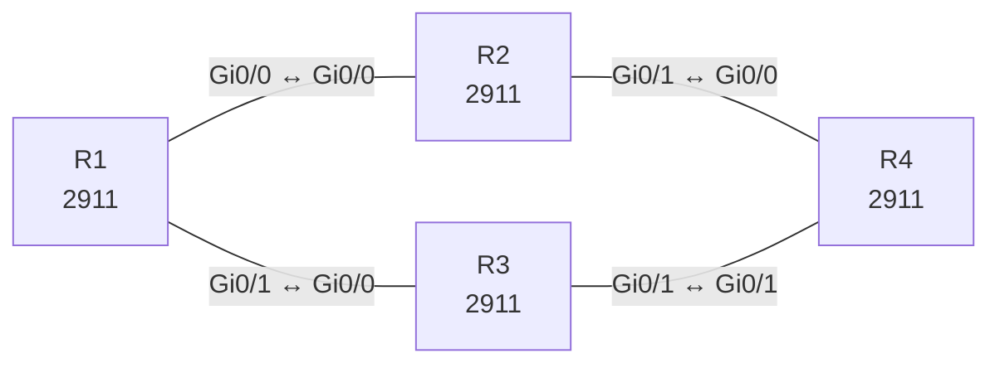

# Lab 27 – Redistribution zwischen OSPF und EIGRP mit Tags und Filtern

**Dauer:** 100 min · **Niveau:** schwer

Zwei Routing-Domänen (OSPF und EIGRP) werden an **zwei** Punkten gegenseitig verbunden. Ohne Schutz entstehen Routing-Schleifen und Rückkopplungen. Du lernst Metrik-Zuweisung, Route-Tags, Route-Maps und Prefix-Listen als Filter.

**Lernziele:** Nach diesem Lab kannst du …

- Routen zwischen OSPF und EIGRP gegenseitig redistribuieren.
- Seed-Metrik und `subnets` richtig setzen.
- Rückkopplungen an zwei Redistributionspunkten mit Route-Tags verhindern.

| ENCOR-Ziel (`Ziel::…`) | Thema |
|---|---|
| 3.2.a | EIGRP und OSPF vergleichen |
| 3.2.b | OSPFv2 und OSPFv3 |

**So arbeitest du:** Teil A = Bauen, Teil B = Reparieren, Teil C = Üben. Die Konfigurationsdateien liegen in `build/` (Ausgangszustand zum Einfügen in die CLI), `repair/` (fertig gebaut, mit Fehlern) und `solutions/` (Musterlösung und Fehlerliste, erst nach eigenem Versuch öffnen). Anleitung zum Einfügen: siehe [Arbeiten mit den Dateien](../README.md#arbeiten-mit-den-dateien).

## Topologie



**Entwurfsskizze (aus dem CML-Lab; Portnamen der Switches siehe Verkabelungstabelle):**

```
        R1 (Lo10 10.1.0.0/24)           OSPF 1 (Area 0)
      Gi0/0 /        \ Gi0/1
        R2              R3            R2/R3 = ASBR (OSPF <-> EIGRP)
      Gi0/1 \        / Gi0/1
            R4 (Lo10 10.4.0.0/24, Lo11 10.4.1.0/24)   EIGRP 100
```

### Geräte

| Gerät | Modell in Packet Tracer | Rolle |
|---|---|---|
| R1 | 2911 | Router |
| R2 | 2911 | Router |
| R3 | 2911 | Router |
| R4 | 2911 | Router |

### Verkabelung

| Von | Port | Nach | Port | Kabel |
|---|---|---|---|---|
| R1 | Gi0/0 | R2 | Gi0/0 | Copper Cross-Over |
| R1 | Gi0/1 | R3 | Gi0/0 | Copper Cross-Over |
| R2 | Gi0/1 | R4 | Gi0/0 | Copper Cross-Over |
| R3 | Gi0/1 | R4 | Gi0/1 | Copper Cross-Over |

### Adressplan (Ausgangszustand)

| Gerät | Interface | Adresse | Maske | Gateway | DNS |
|---|---|---|---|---|---|
| R1 | Loopback0 | 10.255.0.1 | 255.255.255.255 | | |
| R1 | Loopback10 | 10.1.0.1 | 255.255.255.0 | | |
| R1 | Gi0/0 | 10.0.12.1 | 255.255.255.252 | | |
| R1 | Gi0/1 | 10.0.13.1 | 255.255.255.252 | | |
| R2 | Loopback0 | 10.255.0.2 | 255.255.255.255 | | |
| R2 | Gi0/0 | 10.0.12.2 | 255.255.255.252 | | |
| R2 | Gi0/1 | 10.0.24.1 | 255.255.255.252 | | |
| R3 | Loopback0 | 10.255.0.3 | 255.255.255.255 | | |
| R3 | Gi0/0 | 10.0.13.2 | 255.255.255.252 | | |
| R3 | Gi0/1 | 10.0.34.1 | 255.255.255.252 | | |
| R4 | Loopback0 | 10.255.0.4 | 255.255.255.255 | | |
| R4 | Loopback10 | 10.4.0.1 | 255.255.255.0 | | |
| R4 | Loopback11 | 10.4.1.1 | 255.255.255.0 | | |
| R4 | Gi0/0 | 10.0.24.2 | 255.255.255.252 | | |
| R4 | Gi0/1 | 10.0.34.2 | 255.255.255.252 | | |

| Link | Netz |
|---|---|
| R1 Gi0/0 – R2 Gi0/0 | 10.0.12.0/30 (.1/.2), OSPF |
| R1 Gi0/1 – R3 Gi0/0 | 10.0.13.0/30 (.1/.2), OSPF |
| R2 Gi0/1 – R4 Gi0/0 | 10.0.24.0/30 (.1/.2), EIGRP |
| R3 Gi0/1 – R4 Gi0/1 | 10.0.34.0/30 (.1/.2), EIGRP |

Loopback0: R1 10.255.0.1, R2 .2, R3 .3, R4 .4. R1 Lo10 10.1.0.1/24 (OSPF-LAN), R4 Lo10 10.4.0.1/24 und Lo11 10.4.1.1/24 (EIGRP-LANs). **Vorgabe:** 10.4.1.0/24 ist lokal und darf nicht nach OSPF gelangen. Der Weg über R2 soll bevorzugt werden (R2 Metrik 20, R3 Metrik 100).
> **Packet-Tracer-Hinweis:** **Eignung: geeignet.** Alle verwendeten Funktionen gibt es in Packet Tracer; Ausgabeformate einzelner `show`-Befehle weichen leicht ab.

## Teil A – Bauen
Arbeite die Schritte der Reihe nach ab. Jeder Schritt sagt dir, was du tust, woran du den Erfolg erkennst (**Prüfen**) und worüber du nachdenken sollst (**Denkfrage**). Die Antworten auf die Denkfragen stehen am Ende von Teil A.

1. **Zwei Domänen aufbauen.** OSPF 1 in Area 0 auf R1 (alle Links, Loopbacks, Lo10 mit `ip ospf network point-to-point`, damit /24 statt /32 angekündigt wird) sowie auf R2 und R3 Richtung R1. EIGRP 100 auf R2, R3 und R4 Richtung R4, inklusive Lo10 und Lo11 von R4, mit `no auto-summary`.
   - **Prüfen:** R1 kennt noch keine Netze von R4, R4 keine von R1.
2. **Redistribution an einem Punkt.** Nur auf R2: `redistribute eigrp 100 subnets` unter OSPF und `redistribute ospf 1 metric 10000 100 255 1 1500` unter EIGRP.
   - **Prüfen:** R1 zeigt die EIGRP-Netze als `O E2`. R4 zeigt die OSPF-Netze als `D EX` mit Administrativer Distanz 170.
   - **Denkfrage:** Warum braucht EIGRP eine Startmetrik, OSPF aber nicht?
3. **Zweiter Redistributionspunkt.** Konfiguriere dasselbe auf R3.
   - **Prüfen:** In `show ip route` auf R2, R3 und R4 tauchen Routen auf, die über den anderen Punkt zurücklaufen.
   - **Denkfrage:** Wie entsteht diese Rückkopplung?
4. **Tags gegen Rückkopplung.** Baue auf R2 und R3 zwei Route-Maps:
   - `E2O` (EIGRP nach OSPF): Routen mit Tag 1 verwerfen (`deny`, die stammen aus OSPF), alle anderen mit `set tag 2` übernehmen.
   - `O2E` (OSPF nach EIGRP): Routen mit Tag 2 verwerfen, alle anderen mit `set tag 1` übernehmen.

   Hänge die Route-Maps an die `redistribute`-Befehle.
   - **Prüfen:** `show ip route 10.1.0.0` auf R4 zeigt Tag 1. Es laufen keine Routen mehr im Kreis.
5. **Metrik steuern.** Setze in `E2O` auf R2 `set metric 20`, auf R3 `set metric 100`.
   - **Prüfen:** R1 wählt für 10.4.0.0/24 den Weg über R2.
   - **Denkfrage:** Wie würdest du E1 statt E2 setzen, und wann ist das sinnvoll?
6. **Filtern.** Lege die Prefix-List `LOCAL-ONLY` mit `permit 10.4.1.0/24` an. Setze in `E2O` als erste Sequenz ein `deny` mit `match ip address prefix-list LOCAL-ONLY`.
   - **Prüfen:** Auf R1 fehlt 10.4.1.0/24, 10.4.0.0/24 ist da.
7. **Einordnen.**
   - **Denkfrage:** Wann ist es besser, nur in eine Richtung zu redistribuieren und in die andere eine Default-Route zu schicken?

<details><summary>Antworten zu den Denkfragen</summary>

- **Zu 2:** EIGRP setzt für fremde Routen ohne Angabe eine unendliche Metrik und übernimmt sie dann nicht. Es braucht fünf Werte: Bandbreite, Delay, Zuverlässigkeit, Last und MTU. OSPF setzt von selbst Metrik 20 und Typ E2.
- **Zu 3:** R2 gibt OSPF-Routen nach EIGRP. R3 lernt sie dort als EIGRP-Routen und gibt sie zurück nach OSPF, jetzt als externe Route. Je nach Administrativer Distanz und Metrik bevorzugt ein Router plötzlich den Umweg, oder Routen laufen im Kreis.
- **Zu 5:** Mit `set metric-type type-1` in der Route-Map oder `metric-type 1` am `redistribute`. E1 addiert die internen Kosten bis zum ASBR. Das lohnt sich, wenn es mehrere ASBRs gibt und jeder Router den für ihn nächsten nehmen soll.
- **Zu 7:** Wenn die eine Domäne nur einen Weg hinaus hat, etwa ein Standort am Rand. Dann genügt dort eine Default-Route, und es gibt keine Rückkopplung, die man mit Tags abfangen muss.

</details>

## Teil B – Reparieren

Baue die Topologie wie oben (oder behalte deine aus Teil A), setze alle Geräte zurück (`erase startup-config`, `reload` bzw. neues Gerät) und füge dann die Dateien aus `repair/` ein. Es stecken **6 Fehler** drin. Behandle jede Meldung als Ticket: erst Symptom nachstellen, dann Layer für Layer eingrenzen, beheben und beweisen. Ändere nur, was kaputt ist.

**Ticket 1:** R4 lernt über R2 keine OSPF-Routen; `show ip route` auf R4 zeigt 10.1.0.0/24 nur (falls überhaupt) über R3.

**Ticket 2:** Über R3 erscheinen keine EIGRP-Netze in OSPF; R1 sieht 10.4.0.0/24 nur über R2 mit Metrik 20.

**Ticket 3:** Auf R4 und R3 pendelt 10.1.0.0/24 zwischen den Domänen, R1 sieht die eigene Route als `O E2` mit Tag 2 zurück (Rückkopplung).

**Ticket 4:** R1 lernt 10.4.1.0/24, obwohl das Netz lokal bleiben sollte.

**Ticket 5:** R3 und R4 haben keine EIGRP-Nachbarschaft; R4 erreicht OSPF-Netze nur über R2.

**Ticket 6:** R1 und R3 bilden keine OSPF-Nachbarschaft; im Log `Mismatched Area ID`/hängt in `INIT`.

## Verifikation
```
show ip route ospf / eigrp
show ip route 10.4.0.0           ! Tag, Typ, Metrik
show ip ospf database external
show ip eigrp topology
show route-map
show ip prefix-list
```

| Befehl | Das solltest du sehen |
|---|---|
| `show ip route 10.4.0.0` auf R1 | `O E2` mit Tag 2 über R2, Metrik 20 |
| `show ip route 10.4.1.0` auf R1 | nicht vorhanden |
| `show ip route 10.1.0.0` auf R4 | `D EX` mit Tag 1, keine Routen mit Tag 2 zurück |

## Teil C – Üben

Beantworte zuerst selbst, dann klappe die Antwort auf.

1. R2 redistribuiert EIGRP nach OSPF, aber in OSPF erscheint nur das klassische Netz 10.0.0.0/8, nicht die /24. Ursache?
<details><summary>Antwort</summary>

**`subnets` fehlt.** Ohne dieses Schlüsselwort übernimmt OSPF nur klassenbehaftete Netze. Mit `redistribute eigrp 100 subnets` kommen alle Subnetze.

</details>

2. Wozu setzt man beim Redistribuieren Route-Tags?
<details><summary>Antwort</summary>

**Um zu markieren, woher eine Route stammt.** Ein zweiter Redistributionspunkt erkennt am Tag eine Route aus der anderen Domäne und gibt sie nicht zurück. So verhindert man Rückkopplungen, ohne Prefix-Lists pflegen zu müssen.

</details>

3. Warum ist gegenseitige Redistribution an zwei Punkten riskanter als an einem?
<details><summary>Antwort</summary>

**Weil Routen über den zweiten Punkt zurück in ihre Ursprungsdomäne fließen können.** Dort kommen sie mit schlechterer Metrik oder anderer AD an. Die Folge: Umwege oder Schleifen. Mit nur einem Punkt gibt es das nicht, dafür aber auch keine Redundanz.

</details>

## Prüfungsbezug
- Redistribution braucht eine Metrik im Zielprotokoll. EIGRP: fünf Werte. OSPF: Standard 20.
- Ohne `subnets` übernimmt OSPF nur klassenbehaftete Netze.
- Bei mehreren Redistributionspunkten verhindern Tags und Route-Maps Rückkopplungen. Die Administrative Distanz schützt nur teilweise.
- E2: Metrik bleibt gleich. E1: interne Kosten kommen dazu.

## Lösungen

- `solutions/<Gerät>.cfg`: Konfiguration zu Teil A (ohne Basis-Adressen)
- `solutions/FAULTS.md`: Fehlerliste zu Teil B (Spoiler!)
