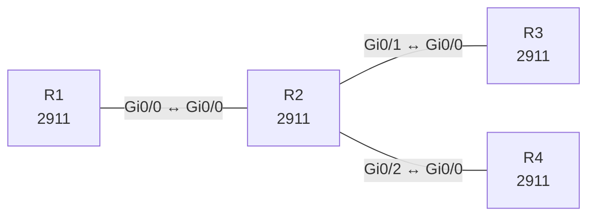

# Lab 28 – OSPF vertieft: Area-Typen, Summarisierung und Authentifizierung

**Dauer:** 100 min · **Niveau:** schwer

Ein ABR verbindet Area 0 mit einer Totally-Stubby-Area und einer NSSA. Dazu Zusammenfassung am ABR, Redistribution im NSSA und MD5-Authentifizierung. Du liest LSA-Typen und verstehst, warum Area-Typen auf beiden Seiten übereinstimmen müssen.

**Lernziele:** Nach diesem Lab kannst du …

- Stub, Totally Stubby und NSSA unterscheiden und konfigurieren.
- Inter-Area-Routen am ABR zusammenfassen.
- OSPF-Authentisierung einrichten und Fehler daran erkennen.

| ENCOR-Ziel (`Ziel::…`) | Thema |
|---|---|
| 3.2.b | OSPFv2 und OSPFv3 |

**So arbeitest du:** Teil A = Bauen, Teil B = Reparieren, Teil C = Üben. Die Konfigurationsdateien liegen in `build/` (Ausgangszustand zum Einfügen in die CLI), `repair/` (fertig gebaut, mit Fehlern) und `solutions/` (Musterlösung und Fehlerliste, erst nach eigenem Versuch öffnen). Anleitung zum Einfügen: siehe [Arbeiten mit den Dateien](../README.md#arbeiten-mit-den-dateien).

## Topologie



**Entwurfsskizze (aus dem CML-Lab; Portnamen der Switches siehe Verkabelungstabelle):**

```
   R1 (Area 0, Lo10 10.1.0.0/24)
      │ Gi0/0 ↔ R2 Gi0/0 (10.0.12.0/30, MD5)
     R2 (ABR)
   Gi0/1 /      \ Gi0/2
 10.0.23.0/30   10.0.24.0/30
   R3 (Area 1, stub)   R4 (Area 2, NSSA, ASBR 172.31.0.0/24)
   Lo10-13 192.168.0-3.0/24
```

### Geräte

| Gerät | Modell in Packet Tracer | Rolle |
|---|---|---|
| R1 | 2911 | Router |
| R2 | 2911 | Router |
| R3 | 2911 | Router |
| R4 | 2911 | Router |

### Verkabelung

| Von | Port | Nach | Port | Kabel |
|---|---|---|---|---|
| R1 | Gi0/0 | R2 | Gi0/0 | Copper Cross-Over |
| R2 | Gi0/1 | R3 | Gi0/0 | Copper Cross-Over |
| R2 | Gi0/2 | R4 | Gi0/0 | Copper Cross-Over |

### Adressplan (Ausgangszustand)

| Gerät | Interface | Adresse | Maske | Gateway | DNS |
|---|---|---|---|---|---|
| R1 | Loopback0 | 10.255.0.1 | 255.255.255.255 | | |
| R1 | Loopback10 | 10.1.0.1 | 255.255.255.0 | | |
| R1 | Gi0/0 | 10.0.12.1 | 255.255.255.252 | | |
| R2 | Loopback0 | 10.255.0.2 | 255.255.255.255 | | |
| R2 | Gi0/0 | 10.0.12.2 | 255.255.255.252 | | |
| R2 | Gi0/1 | 10.0.23.1 | 255.255.255.252 | | |
| R2 | Gi0/2 | 10.0.24.1 | 255.255.255.252 | | |
| R3 | Loopback0 | 10.255.0.3 | 255.255.255.255 | | |
| R3 | Loopback10 | 192.168.0.1 | 255.255.255.0 | | |
| R3 | Loopback11 | 192.168.1.1 | 255.255.255.0 | | |
| R3 | Loopback12 | 192.168.2.1 | 255.255.255.0 | | |
| R3 | Loopback13 | 192.168.3.1 | 255.255.255.0 | | |
| R3 | Gi0/0 | 10.0.23.2 | 255.255.255.252 | | |
| R4 | Loopback0 | 10.255.0.4 | 255.255.255.255 | | |
| R4 | Gi0/0 | 10.0.24.2 | 255.255.255.252 | | |

| Link | Netz | Area |
|---|---|---|
| R1 Gi0/0 – R2 Gi0/0 | 10.0.12.0/30 (.1/.2) | 0 |
| R2 Gi0/1 – R3 Gi0/0 | 10.0.23.0/30 (.1/.2) | 1 |
| R2 Gi0/2 – R4 Gi0/0 | 10.0.24.0/30 (.1/.2) | 2 |

Loopback0: R1 10.255.0.1, R2 10.255.0.2 (Area 0), R3 10.255.0.3 (Area 1), R4 10.255.0.4 (Area 2). R1 Lo10 10.1.0.1/24, R3 Lo10–13 192.168.0.1 bis 192.168.3.1 (je /24), R4 hat eine statische Route 172.31.0.0/24 nach Null0 (wird als extern eingespeist). OSPF-Passwort: `OspfKey` (Key 1).
> **Packet-Tracer-Hinweis:** **Eignung: geeignet.** Alle verwendeten Funktionen gibt es in Packet Tracer; Ausgabeformate einzelner `show`-Befehle weichen leicht ab.

## Teil A – Bauen
Arbeite die Schritte der Reihe nach ab. Jeder Schritt sagt dir, was du tust, woran du den Erfolg erkennst (**Prüfen**) und worüber du nachdenken sollst (**Denkfrage**). Die Antworten auf die Denkfragen stehen am Ende von Teil A.

1. **Grundkonfiguration.** Starte auf allen Routern OSPF 1 mit `passive-interface default` und nimm die Links mit `no passive-interface` heraus. Ordne die Interfaces laut Tabelle den Areas zu. Setze an den Loopbacks `ip ospf network point-to-point`, damit sie als /24 statt /32 erscheinen.
   - **Prüfen:** `show ip ospf neighbor` auf R2 zeigt drei Nachbarn im Zustand FULL. `show ip route ospf` auf R1 enthält alle Netze.
2. **Authentisierung.** Setze auf dem Link R1–R2 auf beiden Seiten `ip ospf authentication message-digest` und `ip ospf message-digest-key 1 md5 OspfKey`.
   - **Prüfen:** `show ip ospf interface Gi0/0` meldet „Message digest authentication enabled“.
   - **Denkfrage:** Was ist der Unterschied zu `area 0 authentication message-digest`?
3. **Area 1 als Totally Stubby.** Setze auf R2 `area 1 stub no-summary`, auf R3 `area 1 stub`. Vergleiche `show ip route` auf R3 vorher und nachher.
   - **Prüfen:** Vorher stehen dort viele `O IA`-Routen, danach nur noch eine Default-Route `O*IA`.
   - **Denkfrage:** Welche LSA-Typen hält der ABR jetzt aus Area 1 heraus?
4. **Area 2 als NSSA.** Setze auf R2 und R4 `area 2 nssa`. R4 speist mit `redistribute static subnets` seine statische Route ein.
   - **Prüfen:** `show ip ospf database nssa-external` auf R4 zeigt ein Typ-7-LSA. `show ip ospf database external` auf R1 zeigt dasselbe Netz als Typ 5.
   - **Denkfrage:** Wer wandelt Typ 7 in Typ 5 um?
5. **Zusammenfassen am ABR.** Setze auf R2 `area 1 range 192.168.0.0 255.255.252.0`.
   - **Prüfen:** R1 sieht nur noch eine Route `O IA 192.168.0.0/22`. R2 hat eine Route 192.168.0.0/22 nach Null0.
6. **LSA-Typen zuordnen.**
   - **Denkfrage:** Welcher Router erzeugt hier welches LSA (Typ 1, 2, 3, 4, 5, 7)? Warum prüft OSPF im Hello das Stub-Flag?

<details><summary>Antworten zu den Denkfragen</summary>

- **Zu 2:** `area 0 authentication message-digest` schaltet die Authentisierung für alle Interfaces der Area auf einmal ein. Den Schlüssel setzt man trotzdem pro Interface. Die Interface-Variante wirkt nur auf diesen einen Link.
- **Zu 3:** Typ 3 (außer der Default-Route, die der ABR selbst erzeugt), Typ 4 und Typ 5.
- **Zu 4:** Der ABR, hier R2. Gibt es mehrere ABRs an einer NSSA, übernimmt das der mit der höchsten Router-ID.
- **Zu 6:** Jeder Router erzeugt ein Typ-1-LSA für seine Area. Typ 2 erzeugt der DR auf Broadcast-Netzen. Ethernet ist standardmäßig ein Broadcast-Netz, also wählt OSPF auch auf den /30-Links einen DR, und es gibt Typ 2. Typ 3 und Typ 4 erzeugt der ABR R2. Typ 7 erzeugt R4 in der NSSA, R2 macht daraus Typ 5. Das Stub-Flag zeigt, ob eine Area externe Routen erlaubt. Sind sich zwei Router darin uneinig, würden sie verschiedene LSAs erwarten. Deshalb verwirft OSPF das Hello, und es entsteht keine Nachbarschaft.

</details>

## Teil B – Reparieren

Baue die Topologie wie oben (oder behalte deine aus Teil A), setze alle Geräte zurück (`erase startup-config`, `reload` bzw. neues Gerät) und füge dann die Dateien aus `repair/` ein. Es stecken **6 Fehler** drin. Behandle jede Meldung als Ticket: erst Symptom nachstellen, dann Layer für Layer eingrenzen, beheben und beweisen. Ändere nur, was kaputt ist.

**Ticket 1:** R2 und R3 bilden keine Nachbarschaft; `debug ip ospf adj` zeigt `Hello from … with mismatched Stub/Transit area option bit`.

**Ticket 2:** R1 sieht drei einzelne Routen 192.168.1.0/24, 192.168.2.0/24, 192.168.3.0/24 und nur 192.168.0.0/24 als Summary.

**Ticket 3:** R1 und R2 sind in `INIT`/ohne Nachbarschaft, Log: `Mismatched Authentication key`.

**Ticket 4:** 172.31.0.0/24 fehlt in Area 0, R1 sieht keine externe Route.

**Ticket 5:** R4 hat keinen OSPF-Nachbarn zu R2, obwohl der Link steht.

**Ticket 6:** R3 trägt trotz Stub-Area alle Inter-Area-Routen (O IA) statt nur der Default-Route.

## Verifikation
```
show ip ospf neighbor
show ip route ospf
show ip ospf database summary / external / nssa-external
show ip ospf interface Gi0/0       ! Authentisierung
show ip protocols
```

| Befehl | Das solltest du sehen |
|---|---|
| `show ip route` auf R3 | nur die Default-Route `O*IA` und eigene Netze |
| `show ip route ospf` auf R1 | `O IA 192.168.0.0/22` und `O E2 172.31.0.0/24` |
| `show ip route ospf` auf R2 | `O N2 172.31.0.0/24` |

## Teil C – Üben

Beantworte zuerst selbst, dann klappe die Antwort auf.

1. R3 bildet keine Nachbarschaft zum ABR, beide Hello-Timer sind gleich. Was könnte falsch sein?
<details><summary>Antwort</summary>

**Der Area-Typ passt nicht.** Steht `area 1 stub` nur auf einer Seite, ist das E-Bit im Hello verschieden, und die Router ignorieren sich. Weitere Kandidaten: Authentisierung, Subnetz und Maske, Area-ID, passives Interface.

</details>

2. Warum kann eine Stub-Area keinen ASBR enthalten, die NSSA aber schon?
<details><summary>Antwort</summary>

**Weil Stub keine externen Routen erlaubt, NSSA aber schon.** Eine Stub-Area verbietet Typ-5-LSAs. Die NSSA transportiert externe Routen als Typ 7. Der ABR wandelt sie an der Grenze in Typ 5 um.

</details>

3. Was ändert `no-summary` bei einer Stub-Area?
<details><summary>Antwort</summary>

**Der ABR sendet keine Inter-Area-Routen mehr, nur noch eine Default-Route.** Ohne Typ-3-LSAs wird die Area zur Totally Stubby Area mit der kleinsten Tabelle.

</details>

## Prüfungsbezug
- Stub: kein Typ 5. Totally Stubby: kein Typ 3, 4, 5, nur eine Default-Route. NSSA: Typ 7 statt Typ 5, ein ASBR ist erlaubt.
- Der Area-Typ muss auf allen Routern der Area gleich sein.
- Zusammenfassen: Inter-Area am ABR (`area range`), extern am ASBR (`summary-address`).
- Der ABR wandelt Typ 7 in Typ 5 um.
- MD5-Authentisierung mit Key-ID und Passwort, pro Interface oder für die ganze Area.

## Lösungen

- `solutions/<Gerät>.cfg`: Konfiguration zu Teil A (ohne Basis-Adressen)
- `solutions/FAULTS.md`: Fehlerliste zu Teil B (Spoiler!)
