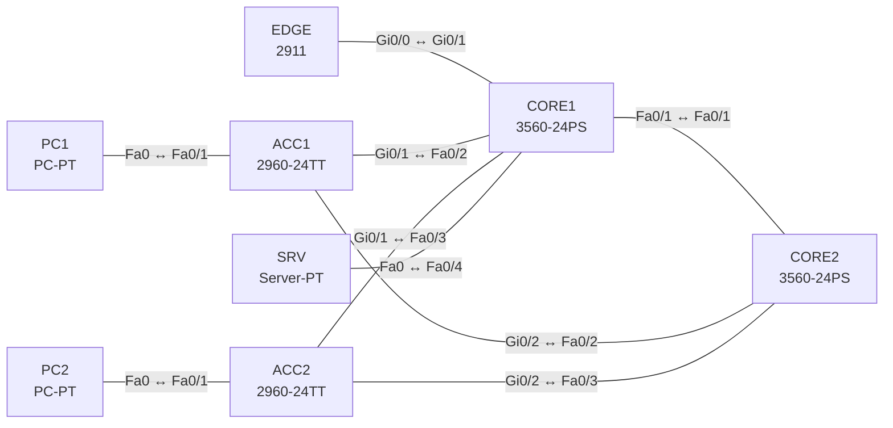

# Lab 01 – Netzwerkkomponenten, Topologien und Verkabelung

**Dauer:** 60 min · **Niveau:** leicht

Du baust ein SOHO-Netz und ein Campus-Netz in 2-Tier-Architektur, wählst jedes Kabel selbst (ohne die Auto-Verbindung von Packet Tracer) und ordnest jedem Gerät seine Rolle zu. Das Lab braucht fast keine Konfiguration; der Lerneffekt liegt in Entwurf, Kabelwahl und den Fragen.

| CCNA-Ziel | Thema |
|---|---|
| 1.1 | Rollen von Netzwerkkomponenten (Router, Switches, Firewall/IPS, AP, WLC, Endgeräte, Server, PoE) |
| 1.2 | Topologie-Architekturen (2-/3-Tier, Spine-Leaf, WAN, SOHO, On-Prem/Cloud) |
| 1.3 | Schnittstellen und Verkabelung (Kupfer, Glasfaser, shared media vs. P2P) |

**So arbeitest du:** Teil A = Bauen, Teil C = Üben (kein Reparatur-Teil: Das Lab besteht aus Aufbau und Fragen). Die Konfigurationsdateien liegen in `build/` (Ausgangszustand zum Einfügen in die CLI), `repair/` (fertig gebaut, mit Fehlern) und `solutions/` (Musterlösung und Fehlerliste, erst nach eigenem Versuch öffnen). Anleitung zum Einfügen: siehe [Arbeiten mit den Dateien](../README.md#arbeiten-mit-den-dateien).

## Topologie

Oben das Campus-Netz (2-Tier, Collapsed Core), das SOHO-Netz mit WRT300N baust du daneben als zweites, unabhängiges Netz.

### Geräte

| Gerät | Modell in Packet Tracer | Rolle |
|---|---|---|
| EDGE | 2911 | Edge-Router zum Provider |
| CORE1 | 3560-24PS | Collapsed Core / Distribution (L3) |
| CORE2 | 3560-24PS | Collapsed Core / Distribution (L3), Redundanz |
| ACC1 | 2960-24TT | Access-Switch Gebäude A (L2) |
| ACC2 | 2960-24TT | Access-Switch Gebäude B (L2) |
| PC1 | PC-PT | Endgerät |
| PC2 | PC-PT | Endgerät |
| SRV | Server-PT | Server |

### Verkabelung

| Von | Port | Nach | Port | Kabel |
|---|---|---|---|---|
| EDGE | Gi0/0 | CORE1 | Gi0/1 | Copper Straight-Through |
| CORE1 | Fa0/1 | CORE2 | Fa0/1 | Copper Cross-Over |
| ACC1 | Gi0/1 | CORE1 | Fa0/2 | Copper Cross-Over |
| ACC1 | Gi0/2 | CORE2 | Fa0/2 | Copper Cross-Over |
| ACC2 | Gi0/1 | CORE1 | Fa0/3 | Copper Cross-Over |
| ACC2 | Gi0/2 | CORE2 | Fa0/3 | Copper Cross-Over |
| PC1 | Fa0 | ACC1 | Fa0/1 | Copper Straight-Through |
| PC2 | Fa0 | ACC2 | Fa0/1 | Copper Straight-Through |
| SRV | Fa0 | CORE1 | Fa0/4 | Copper Straight-Through |

### Adressplan (Ausgangszustand)

| Gerät | Interface | Adresse | Maske | Gateway | DNS |
|---|---|---|---|---|---|
| PC1 | Fa0 (GUI) | 10.1.1.11 | 255.255.255.0 | 10.1.1.1 |  |
| PC2 | Fa0 (GUI) | 10.1.1.12 | 255.255.255.0 | 10.1.1.1 |  |
| SRV | Fa0 (GUI) | 10.1.1.100 | 255.255.255.0 | 10.1.1.1 |  |

> **Packet-Tracer-Hinweis:** PoE wird in Packet Tracer nur begrenzt simuliert. Die Konzepte (802.3af/at/bt) übst du in Teil C. Kabel im Menü „Connections“ manuell wählen, nicht den Blitz (Auto) verwenden.

## Teil A – Bauen

1. **Campus bauen.** Platziere die Geräte aus der Tabelle und verbinde sie **von Hand** mit dem passenden Kabel gemäss Verkabelungstabelle (Straight-Through bei ungleichen Geräteklassen, Cross-Over bei gleichen). Prüfe, dass alle Link-LEDs grün werden. Welche Kabel wären bei Auto-MDIX egal, und warum benutzt Cisco trotzdem die klassische Regel in Prüfungsfragen?
2. **Rollen zuordnen.** Beschrifte jedes Gerät (Notiz-Funktion): Access-Layer, Distribution/Core, Edge-Router, Endgerät, Server. Welche Geräte arbeiten auf Layer 2, welche auf Layer 3?
3. **SOHO bauen.** Zweites Netz: ein WRT300N (Wireless Router), zwei PCs per Kabel (Ports Eth1/Eth2), ein Laptop per WLAN. Wo steckt das Internet-Kabel (Port „Internet“)? Welche Funktionen bündelt das Gerät (Router, Switch, AP, DHCP, NAT)?
4. **Topologie bewerten.** Zeichne auf Papier dasselbe Campus-Netz als 3-Tier und als Spine-Leaf. Wann lohnt sich die dritte Ebene, wann Spine-Leaf?
5. **Glasfaser.** Tausche in Gedanken den Uplink ACC1–CORE1 gegen Glasfaser: Welche Module/Fasern brauchst du bei 300 m, welche bei 10 km?
6. **Collapsed Core.** Warum sind CORE1 und CORE2 untereinander verbunden, und was geht verloren, wenn der Link fehlt?

## Verifikation

- Alle Links grün, jeder Port gemäss Tabelle belegt (Mouse-over zeigt Portnamen).
- Zwei PCs im Campus erhalten manuell passende IPs (10.1.1.0/24) und pingen sich über CORE1/CORE2 (L2-Verbindung; Switches ohne VLAN-Konfiguration reichen).
- WRT300N: Laptop verbindet per WLAN (SSID „SOHO“), PCs holen per DHCP eine Adresse (`192.168.0.x`).

## Teil C – Üben

Beantworte zuerst selbst, dann klappe die Antwort auf.

1. Welches Kabel verbindet (a) PC↔Switch, (b) Switch↔Switch, (c) Router↔Router, (d) PC↔Router, (e) Router↔Konsolenport des PCs?

Antwort

(a) Straight-Through, (b) Cross-Over, (c) Cross-Over, (d) Cross-Over, (e) Console/Rollover. Mit Auto-MDIX gehen (b)–(d) auch mit Straight.

2. Nenne drei Unterschiede zwischen Singlemode- und Multimode-Faser.

Antwort

SMF: kleiner Kern (~9 µm), Laser, Kilometer-Strecken, teurere Optik; MMF: grösserer Kern (50/62,5 µm), LED/VCSEL, Strecken bis einige hundert Meter, günstiger.

3. Was ist ‚Shared Media‘ und was ‚Point-to-Point‘ bei Ethernet?

Antwort

Shared Media: mehrere Stationen am selben Medium (Hub, Koax), Halbduplex mit CSMA/CD und Kollisionen. Point-to-Point: Switch-Port zu Endgerät oder Switch zu Switch, Vollduplex, keine Kollisionen.

4. Wofür steht PoE und welche Standards kennst du?

Antwort

Power over Ethernet versorgt Geräte über das Datenkabel. 802.3af (PoE, bis 15,4 W am PSE), 802.3at (PoE+, 30 W), 802.3bt (PoE++, 60/90 W). Typisch für IP-Phones, APs, Kameras.

5. Was unterscheidet eine NGFW von einer klassischen Firewall, und wo steht ein IPS?

Antwort

NGFW prüft zusätzlich Anwendungen, Benutzer, Inhalte und enthält IPS/Malware-Schutz; ein IPS inspiziert Verkehr auf Angriffssignaturen/Anomalien und blockiert aktiv, wenn inline. Platzierung am Netzübergang oder vor schützenswerten Zonen.

6. Wann nimmst du 2-Tier, 3-Tier und Spine-Leaf?

Antwort

2-Tier (Access + Collapsed Core) für kleine bis mittlere Standorte. 3-Tier (Access, Distribution, Core) bei vielen Gebäuden/Räumen, wenn Skalierung und Fehlerdomänen zählen. Spine-Leaf im Rechenzentrum: gleichmässige Latenz, viel Ost-West-Verkehr.

7. Was ist der Unterschied zwischen On-Premises- und Cloud-Betrieb, und was bedeutet das für die WAN-Anbindung?

Antwort

On-Prem: Hardware und Betrieb liegen im eigenen Haus. Cloud: Dienste liegen beim Anbieter; das WAN (Internet, VPN, Direktanbindung) wird zum kritischen Pfad, Bandbreite und Redundanz am Internet-Zugang zählen mehr.

## Prüfungsbezug

Router trennen Broadcast-Domänen und routen zwischen Netzen, L2-Switches schalten Frames per MAC-Tabelle, L3-Switches routen zusätzlich per SVI, Firewalls/IPS filtern und inspizieren, WLC steuert Lightweight-APs zentral, PoE versorgt Endgeräte über das Datenkabel. 2-Tier (Collapsed Core) für kleine/mittlere Campus, 3-Tier für grosse, Spine-Leaf im Rechenzentrum (jeder Leaf mit jedem Spine, Ost-West-Verkehr). Straight-Through: ungleiche Klassen (PC–Switch, Router–Switch); Cross-Over: gleiche Klassen (Switch–Switch, Router–Router, PC–Router). Multimode für kurze Strecken (Hunderte Meter), Singlemode für lange (km).

## Lösungen

- `solutions/<Gerät>.cfg`: Konfiguration zu Teil A (ohne Basis-Adressen)
