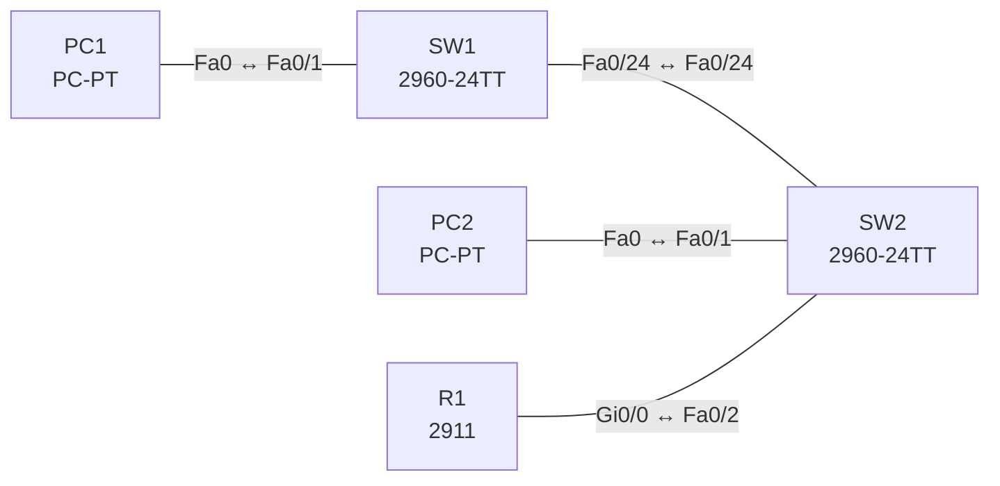

# Lab 02 – Schnittstellen- und Kabelprobleme (Duplex, Speed, Fehler)

**Dauer:** 60 min · **Niveau:** leicht

Typische Layer-1/2-Störungen finden: administrativ down, Speed- und Duplex-Mismatch, falsche Maske am Endgerät. Du liest `show interfaces`, `show interfaces status` und die Zähler (Kollisionen, CRC, Runts, Giants).

| CCNA-Ziel | Thema |
|---|---|
| 1.4 | Schnittstellen- und Kabelprobleme (Kollisionen, Fehler, Duplex, Speed) |
| 1.3 | Schnittstellen und Verkabelung (Kupfer, Glasfaser, shared media vs. P2P) |

**So arbeitest du:** Teil A = Bauen, Teil B = Reparieren, Teil C = Üben. Die Konfigurationsdateien liegen in `build/` (Ausgangszustand zum Einfügen in die CLI), `repair/` (fertig gebaut, mit Fehlern) und `solutions/` (Musterlösung und Fehlerliste, erst nach eigenem Versuch öffnen). Anleitung zum Einfügen: siehe [Arbeiten mit den Dateien](../README.md#arbeiten-mit-den-dateien).

## Topologie




### Geräte

| Gerät | Modell in Packet Tracer | Rolle |
|---|---|---|
| R1 | 2911 | Gateway |
| SW2 | 2960-24TT | Access-Switch |
| SW1 | 2960-24TT | Access-Switch |
| PC1 | PC-PT | Endgerät |
| PC2 | PC-PT | Endgerät |

### Verkabelung

| Von | Port | Nach | Port | Kabel |
|---|---|---|---|---|
| PC1 | Fa0 | SW1 | Fa0/1 | Copper Straight-Through |
| SW1 | Fa0/24 | SW2 | Fa0/24 | Copper Cross-Over |
| PC2 | Fa0 | SW2 | Fa0/1 | Copper Straight-Through |
| R1 | Gi0/0 | SW2 | Fa0/2 | Copper Straight-Through |

### Adressplan (Ausgangszustand)

| Gerät | Interface | Adresse | Maske | Gateway | DNS |
|---|---|---|---|---|---|
| R1 | Gi0/0 | 192.168.2.1 | 255.255.255.0 | | |
| PC1 | Fa0 (GUI) | 192.168.2.11 | 255.255.255.0 | 192.168.2.1 |  |
| PC2 | Fa0 (GUI) | 192.168.2.12 | 255.255.255.0 | 192.168.2.1 |  |


> **Packet-Tracer-Hinweis:** Packet Tracer simuliert Fehlerzähler (CRC, Runts, Kollisionen) nur eingeschränkt. Speed-Mismatch führt zu „down“, Duplex-Mismatch zeigt sich vor allem in `show interfaces` (Duplex-Zeile). Die Zählerbedeutung übst du in Teil C.

## Teil A – Bauen

1. **Basis aufbauen.** Verkabeln, Config aus `build/` einfügen, Hosts laut Tabelle einstellen. Alle Interfaces mit `no shutdown` und Auto-Negotiation. Ping PC1 → PC2 und PC1 → R1.
2. **Statuszeile lesen.** `show interfaces fa0/24` auf SW1: Was bedeuten `up/up`, `up/down`, `down/down`, `administratively down`?
3. **Mismatch erzeugen.** Setze auf SW1 Fa0/24 `speed 10` und `duplex half`, SW2 bleibt auto. Wie reagiert der Link? Welche Zeilen in `show interfaces` verraten es?
4. **Mismatch beheben.** Beide Seiten auf `speed auto`/`duplex auto` oder identisch fest einstellen. Warum ist Auto/Auto besser als einseitig fest?
5. **Zähler.** Welche Fehlerzähler gibt es (input errors, CRC, runts, giants, collisions, late collisions) und was zeigt jeder an?
6. **Layer-1-Checkliste** schreiben: Kabeltyp/-länge, LED, Port-Status, Speed/Duplex, Fehlerzähler, Port-Security-Shutdown (err-disabled).

## Teil B – Reparieren

Baue die Topologie wie oben (oder behalte deine aus Teil A), setze alle Geräte zurück (`erase startup-config`, `reload` bzw. neues Gerät) und füge dann die Dateien aus `repair/` ein und stelle die Endgeräte laut Tabelle unten ein. Es stecken **4 Fehler** drin. Behandle jede Meldung als Ticket: erst Symptom nachstellen, dann Layer für Layer eingrenzen, beheben und beweisen. Ändere nur, was kaputt ist.

**Endgeräte im Repair-Zustand:**

| Gerät | IP | Maske | Gateway | DNS |
|---|---|---|---|---|
| PC1 | 192.168.2.11 | 255.255.255.0 | 192.168.2.1 |  |
| PC2 | 192.168.2.12 | 255.255.255.128 | 192.168.2.1 |  |

**Ticket 1:** PC1 erreicht nichts hinter dem Trunk-Uplink; `show interfaces status` auf SW1 zeigt Fa0/24 mit `10`/`half` und Link down oder Probleme.

**Ticket 2:** Das Gateway R1 ist von PC2 aus nicht erreichbar, der Switch-Port zu R1 meldet `administratively down`.

**Ticket 3:** Zwischen PC und R1 stockt es nach einiger Last; `show interfaces gi0/0` zeigt Halbduplex gegen Vollduplex auf dem Switch.

**Ticket 4:** PC2 erreicht PC1 nicht (ping `Destination host unreachable`), obwohl alles verbunden ist.

## Verifikation

```
show interfaces status
show interfaces fa0/24
show interfaces counters errors
show ip interface brief
```
Erwartet im Sollzustand: alle genutzten Ports `connected`, `a-full`/`a-100` (Auto-ausgehandelt), keine wachsenden Fehlerzähler.

## Teil C – Üben

Beantworte zuerst selbst, dann klappe die Antwort auf.

1. Auf einem Port steigen late collisions. Was vermutest du?
<details><summary>Antwort</summary>

Duplex-Mismatch (Gegenstelle Vollduplex, dieser Port Halbduplex) oder zu lange/falsche Verkabelung. Late collisions gibt es bei korrektem Vollduplex nicht.

</details>

2. Wofür stehen CRC-Fehler, Runts, Giants?
<details><summary>Antwort</summary>

CRC: Prüfsumme falsch (Kabel, EMV, Duplex). Runts: Frames < 64 Byte (Kollisionsfragmente). Giants: Frames > 1518 Byte (bzw. MTU-Überschreitung).

</details>

3. `show interfaces` zeigt `GigabitEthernet0/1 is up, line protocol is down`. Wo suchst du?
<details><summary>Antwort</summary>

Layer 2: Encapsulation, Keepalives, fehlende Gegenstelle/andere Encapsulation, bei Ethernet z. B. Err-Disable oder Mismatch von Speed/Duplex-Parametern.

</details>

4. Warum ist ein Port `err-disabled`, und wie bringst du ihn zurück?
<details><summary>Antwort</summary>

Ein Schutzmechanismus (Port Security, BPDU Guard …) hat den Port abgeschaltet. Ursache beheben, dann `shutdown` / `no shutdown` oder `errdisable recovery`.

</details>

## Prüfungsbezug

Duplex-Mismatch: eine Seite Halb-, die andere Vollduplex: Verbindung steht, aber schlechte Leistung, späte Kollisionen auf der Halbduplex-Seite, CRC/Runts auf der Vollduplex-Seite. Speed-Mismatch: Link bleibt down (Elektrik/Optik). `up/down` bedeutet Layer 1 ok, Layer 2 nicht (z. B. Encapsulation, Keepalive); `administratively down` = `shutdown`.

## Lösungen

- `solutions/<Gerät>.cfg`: Konfiguration zu Teil A (ohne Basis-Adressen)
- `solutions/FAULTS.md`: Fehlerliste zu Teil B (Spoiler!)
