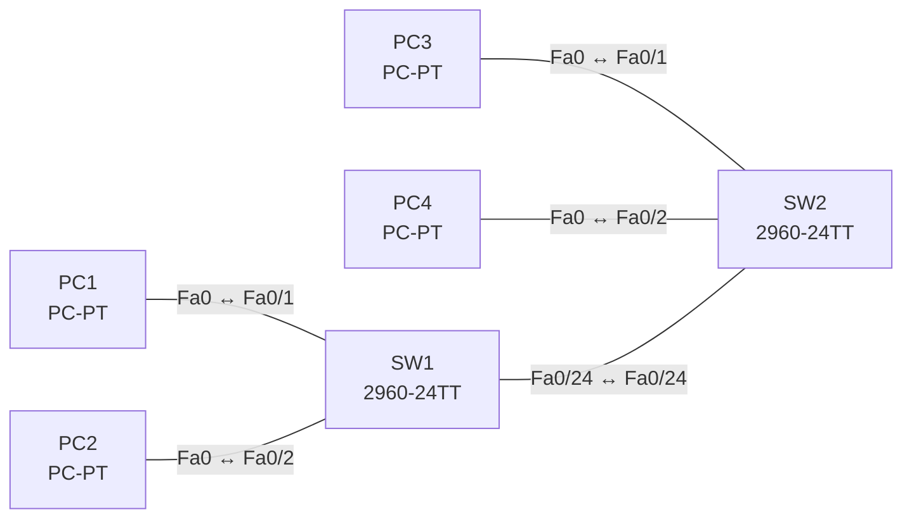

# Lab 03 – Switching-Konzepte: MAC-Lernen, Aging, Flooding

**Dauer:** 60 min · **Niveau:** leicht

Du beobachtest im Simulationsmodus, wie Switches Quell-MAC-Adressen lernen, unbekannte Ziele fluten, Einträge altern lassen und wie sich statische MAC-Einträge auswirken.

| CCNA-Ziel | Thema |
|---|---|
| 1.13 | Switching-Konzepte (MAC-Lernen, Aging, Flooding, MAC-Tabelle) |
| 1.1 | Rollen von Netzwerkkomponenten (Router, Switches, Firewall/IPS, AP, WLC, Endgeräte, Server, PoE) |

**So arbeitest du:** Teil A = Bauen, Teil B = Reparieren, Teil C = Üben. Die Konfigurationsdateien liegen in `build/` (Ausgangszustand zum Einfügen in die CLI), `repair/` (fertig gebaut, mit Fehlern) und `solutions/` (Musterlösung und Fehlerliste, erst nach eigenem Versuch öffnen). Anleitung zum Einfügen: siehe [Arbeiten mit den Dateien](../README.md#arbeiten-mit-den-dateien).

## Topologie




### Geräte

| Gerät | Modell in Packet Tracer | Rolle |
|---|---|---|
| SW1 | 2960-24TT | Access-Switch links |
| SW2 | 2960-24TT | Access-Switch rechts |
| PC1 | PC-PT | Endgerät |
| PC2 | PC-PT | Endgerät |
| PC3 | PC-PT | Endgerät |
| PC4 | PC-PT | Endgerät |

### Verkabelung

| Von | Port | Nach | Port | Kabel |
|---|---|---|---|---|
| PC1 | Fa0 | SW1 | Fa0/1 | Copper Straight-Through |
| PC2 | Fa0 | SW1 | Fa0/2 | Copper Straight-Through |
| PC3 | Fa0 | SW2 | Fa0/1 | Copper Straight-Through |
| PC4 | Fa0 | SW2 | Fa0/2 | Copper Straight-Through |
| SW1 | Fa0/24 | SW2 | Fa0/24 | Copper Cross-Over |

### Adressplan (Ausgangszustand)

| Gerät | Interface | Adresse | Maske | Gateway | DNS |
|---|---|---|---|---|---|
| PC1 | Fa0 (GUI) | 192.168.3.11 | 255.255.255.0 |  |  |
| PC2 | Fa0 (GUI) | 192.168.3.12 | 255.255.255.0 |  |  |
| PC3 | Fa0 (GUI) | 192.168.3.13 | 255.255.255.0 |  |  |
| PC4 | Fa0 (GUI) | 192.168.3.14 | 255.255.255.0 |  |  |


> **Packet-Tracer-Hinweis:** Simulationsmodus (Simulation-Schalter rechts unten), Filter auf ARP und ICMP setzen. Mit `show mac address-table` auf jedem Switch vergleichen.

## Teil A – Bauen

1. **Basis.** Verkabeln, Configs aus `build/` einfügen, PCs laut Tabelle. `show mac address-table` auf allen Switches: leer? (Nur dynamische Einträge, die gelernt werden.)
2. **Lernen beobachten.** PC1 pingt PC3 im Simulationsmodus. Verfolge das ARP-Broadcast Schritt für Schritt: Welcher Switch lernt wann welche Quell-MAC auf welchem Port?
3. **Flooding.** Welche Frames werden geflutet (unbekannte Ziel-MAC, Broadcast)? Wann wird gefiltert/weitergeleitet (bekannte Ziel-MAC)?
4. **Aging.** `mac address-table aging-time 60` auf SW2 setzen. Warte, bis ein Eintrag verschwindet (`show mac address-table aging-time`). Standard: 300 s.
5. **Statischer Eintrag.** Trage die MAC von PC3 statisch auf dem korrekten Port ein: `mac address-table static <MAC> vlan 1 interface fa0/3`. Welche Vor- und Nachteile hat das (Sicherheit vs. Pflegeaufwand)?
6. **Kollisions-/Broadcast-Domänen.** Zähle für die Topologie die Kollisionsdomänen (pro Switch-Port) und Broadcast-Domänen (hier 1). Wie würde ein Hub die Zählung verändern?

## Teil B – Reparieren

Baue die Topologie wie oben (oder behalte deine aus Teil A), setze alle Geräte zurück (`erase startup-config`, `reload` bzw. neues Gerät) und füge dann die Dateien aus `repair/` ein und stelle die Endgeräte laut Tabelle unten ein. Es stecken **3 Fehler** drin. Behandle jede Meldung als Ticket: erst Symptom nachstellen, dann Layer für Layer eingrenzen, beheben und beweisen. Ändere nur, was kaputt ist.

**Endgeräte im Repair-Zustand:**

| Gerät | IP | Maske | Gateway | DNS |
|---|---|---|---|---|
| PC1 | 192.168.3.11 | 255.255.255.0 |  |  |
| PC2 | 192.168.3.12 | 255.255.255.0 |  |  |
| PC3 | 192.168.3.13 | 255.255.255.252 |  |  |
| PC4 | 192.168.3.14 | 255.255.255.0 |  |  |

**Ticket 1:** Zwischen den Switches wird auffällig viel geflutet: `show mac address-table` auf SW2 ist nach kurzer Zeit fast leer, Pakete erscheinen im Simulationsmodus wiederholt an allen Ports.

**Ticket 2:** Die Hosts an SW1 und SW2 sehen einander nicht, jede Seite erreicht nur die eigenen Nachbarn.

**Ticket 3:** PC3 erreicht nur PC4, aber weder PC1 noch PC2.

## Verifikation

```
show mac address-table
show mac address-table dynamic
show mac address-table address <MAC>
show mac address-table aging-time
clear mac address-table dynamic
```
Erwartet: Nach dem Ping stehen die MACs auf den Ports Richtung Quelle; über den Uplink (`Fa0/24`) sieht SW1 die MACs der Hosts hinter SW2.

## Teil C – Üben

Beantworte zuerst selbst, dann klappe die Antwort auf.

1. Was passiert, wenn der Switch die Ziel-MAC nicht kennt?
<details><summary>Antwort</summary>

Er flutet den Frame auf alle Ports im VLAN ausser dem Eingangsport (Unknown Unicast Flooding).

</details>

2. Wann lernt ein Switch eine MAC-Adresse und warum nie aus der Zieladresse?
<details><summary>Antwort</summary>

Er lernt aus der Quelladresse jedes eingehenden Frames, weil nur die Quelle verrät, über welchen Port das Gerät erreichbar ist.

</details>

3. Ein PC wird an einen anderen Port umgesteckt. Was geschieht mit dem alten Eintrag?
<details><summary>Antwort</summary>

Sobald ein Frame der MAC am neuen Port eintrifft, wird der Eintrag auf den neuen Port aktualisiert; sonst läuft er nach Aging-Time ab.

</details>

4. Wie viele Kollisions- und Broadcast-Domänen hat ein Switch mit 10 Hosts in einem VLAN?
<details><summary>Antwort</summary>

10 Kollisionsdomänen (pro Port), 1 Broadcast-Domäne.

</details>

5. Wie unterscheiden sich Store-and-Forward und Cut-Through?
<details><summary>Antwort</summary>

Store-and-Forward empfängt den ganzen Frame, prüft die FCS und leitet erst dann weiter (Fehlerfilterung, höhere Latenz). Cut-Through beginnt nach der Ziel-MAC (niedrige Latenz, keine Fehlerfilterung).

</details>

## Prüfungsbezug

Switch lernt anhand der Quell-MAC, leitet anhand der Ziel-MAC weiter. Unbekannt-Unicast, Broadcast und (ohne Snooping) Multicast werden auf allen Ports ausser dem Eingangsport geflutet. Einträge altern standardmässig nach 300 Sekunden. Jeder Switch-Port ist eine eigene Kollisionsdomäne, alle Ports im selben VLAN bilden eine Broadcast-Domäne.

## Lösungen

- `solutions/<Gerät>.cfg`: Konfiguration zu Teil A (ohne Basis-Adressen)
- `solutions/FAULTS.md`: Fehlerliste zu Teil B (Spoiler!)
