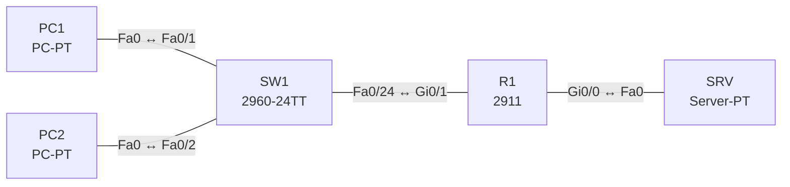

# Lab 04 – TCP und UDP: Verbindungsaufbau, Ports, Dienste

**Dauer:** 75 min · **Niveau:** leicht

Mit einem Server-PT (HTTP, DNS, TFTP) und einem Router beobachtest du im Simulationsmodus TCP-Handshake, UDP-Anfragen und Portnummern. Ein kaputter ACL-Eintrag zeigt, dass die Namensauflösung (UDP/53) ausfallen kann, während Web (TCP/80) per IP weiter funktioniert.

| CCNA-Ziel | Thema |
|---|---|
| 1.5 | TCP und UDP im Vergleich |
| 5.6 | Access Control Lists |

**So arbeitest du:** Teil A = Bauen, Teil B = Reparieren, Teil C = Üben. Die Konfigurationsdateien liegen in `build/` (Ausgangszustand zum Einfügen in die CLI), `repair/` (fertig gebaut, mit Fehlern) und `solutions/` (Musterlösung und Fehlerliste, erst nach eigenem Versuch öffnen). Anleitung zum Einfügen: siehe [Arbeiten mit den Dateien](../README.md#arbeiten-mit-den-dateien).

## Topologie




### Geräte

| Gerät | Modell in Packet Tracer | Rolle |
|---|---|---|
| R1 | 2911 | Router zwischen Client- und Server-LAN |
| SW1 | 2960-24TT | Client-Switch |
| PC1 | PC-PT | Client |
| PC2 | PC-PT | Client |
| SRV | Server-PT | HTTP, DNS, TFTP |

### Verkabelung

| Von | Port | Nach | Port | Kabel |
|---|---|---|---|---|
| PC1 | Fa0 | SW1 | Fa0/1 | Copper Straight-Through |
| PC2 | Fa0 | SW1 | Fa0/2 | Copper Straight-Through |
| SW1 | Fa0/24 | R1 | Gi0/1 | Copper Straight-Through |
| R1 | Gi0/0 | SRV | Fa0 | Copper Cross-Over |

### Adressplan (Ausgangszustand)

| Gerät | Interface | Adresse | Maske | Gateway | DNS |
|---|---|---|---|---|---|
| R1 | Gi0/0 | 10.4.2.1 | 255.255.255.0 | | |
| R1 | Gi0/1 | 10.4.1.1 | 255.255.255.0 | | |
| PC1 | Fa0 (GUI) | 10.4.1.11 | 255.255.255.0 | 10.4.1.1 | 10.4.2.10 |
| PC2 | Fa0 (GUI) | 10.4.1.12 | 255.255.255.0 | 10.4.1.1 | 10.4.2.10 |
| SRV | Fa0 (GUI) | 10.4.2.10 | 255.255.255.0 | 10.4.2.1 | 10.4.2.10 |


> **Packet-Tracer-Hinweis:** Im Simulationsmodus unter „Edit Filters“ nur HTTP, DNS, TCP, UDP, TFTP anhaken. Auf dem Server unter Services die Dienste HTTP, DNS (A-Record `www.lab.local` → 10.4.2.10) und TFTP einschalten.

## Teil A – Bauen

1. **Basis.** Verkabeln, Configs aus `build/` einfügen, Hosts laut Tabelle. Ping PC1 → SRV.
2. **DNS (UDP).** DNS-Dienst auf SRV aktivieren, Eintrag `www.lab.local` → 10.4.2.10. PC1 öffnet im Browser `www.lab.local`. Beobachte im Simulationsmodus die DNS-Anfrage: Protokoll, Quellport (dynamisch), Zielport 53. Gibt es einen Verbindungsaufbau?
3. **HTTP (TCP).** Danach der TCP-Handshake (SYN, SYN/ACK, ACK) zu Port 80, dann HTTP GET und die Antwort. Zähle die Segmente bis zur Anzeige der Webseite.
4. **TFTP (UDP).** Kopiere von R1 die Konfiguration per `copy running-config tftp:` auf den Server. Welche Ports? Warum braucht TFTP keinen Handshake, aber eigene Fehlerbehandlung (Lock-Step per ACK-Block)?
5. **Vergleich.** Erstelle eine Tabelle TCP vs. UDP: Verbindung, Zuverlässigkeit, Reihenfolge, Flusskontrolle, Header-Grösse, typische Dienste.
6. **Well-known Ports.** Ordne zu: 20/21 FTP, 22 SSH, 23 Telnet, 25 SMTP, 53 DNS, 67/68 DHCP, 69 TFTP, 80 HTTP, 110 POP3, 123 NTP, 143 IMAP, 161/162 SNMP, 443 HTTPS, 514 Syslog. Welche nutzen UDP, welche TCP?

## Teil B – Reparieren

Baue die Topologie wie oben (oder behalte deine aus Teil A), setze alle Geräte zurück (`erase startup-config`, `reload` bzw. neues Gerät) und füge dann die Dateien aus `repair/` ein und stelle die Endgeräte laut Tabelle unten ein. Es stecken **3 Fehler** drin. Behandle jede Meldung als Ticket: erst Symptom nachstellen, dann Layer für Layer eingrenzen, beheben und beweisen. Ändere nur, was kaputt ist.

**Endgeräte im Repair-Zustand:**

| Gerät | IP | Maske | Gateway | DNS |
|---|---|---|---|---|
| PC1 | 10.4.1.11 | 255.255.255.0 | 10.4.1.1 | 10.4.2.10 |
| PC2 | 10.4.1.12 | 255.255.255.0 | 10.4.1.1 | 10.4.2.11 |
| SRV | 10.4.2.10 | 255.255.255.0 | 10.4.2.1 | 10.4.2.10 |

**Ticket 1:** Webseite per IP (`http://10.4.2.10`) lädt, per Name (`www.lab.local`) nicht; `nslookup` läuft in ein Timeout.

**Ticket 2:** Ping und DNS gehen, die Webseite lädt nicht (Browser: Timeout).

**Ticket 3:** Auf PC2 funktioniert `www.lab.local` nicht, auf PC1 schon.

## Verifikation

```
show access-lists
show ip interface gi0/0 | include access list
ping 10.4.2.10
```
Am PC: `nslookup www.lab.local`, `ping www.lab.local`. Erwartet: Name wird aufgelöst, Webseite lädt.

## Teil C – Üben

Beantworte zuerst selbst, dann klappe die Antwort auf.

1. Warum nutzt DNS normalerweise UDP, schaltet aber bei grossen Antworten auf TCP?
<details><summary>Antwort</summary>

Eine einzelne kleine Anfrage/Antwort braucht keinen Handshake. Wird die Antwort zu gross (Truncation, Zonentransfer), wiederholt der Client per TCP/53.

</details>

2. Was ist die Aufgabe der Sequenz- und Bestätigungsnummern?
<details><summary>Antwort</summary>

Reihenfolge herstellen, Verluste erkennen und erneut übertragen (TCP).

</details>

3. Wofür braucht man Quell- und Zielport?
<details><summary>Antwort</summary>

Sie adressieren die Anwendung auf dem Host; der Quellport (dynamisch) trennt parallele Sitzungen.

</details>

4. Ein Webserver ist per IP erreichbar, per Name nicht. Welcher Layer-4-Dienst ist verdächtig?
<details><summary>Antwort</summary>

DNS (UDP/53): Server, Pfad oder ACL prüfen.

</details>

5. Was bedeutet das TCP-Fenster (Window)?
<details><summary>Antwort</summary>

Menge an Daten, die der Sender ohne Bestätigung senden darf; steuert die Flusskontrolle.

</details>

## Prüfungsbezug

TCP: verbindungsorientiert (3-Wege-Handshake SYN/SYN-ACK/ACK), zuverlässig, geordnet, Flusskontrolle per Fenster, 20 Byte Header. UDP: verbindungslos, ohne Zustellgarantie, 8 Byte Header, geringe Latenz (DNS, DHCP, TFTP, VoIP, SNMP, Syslog, NTP). Die Anwendung entscheidet, ob Zuverlässigkeit nötig ist.

## Lösungen

- `solutions/<Gerät>.cfg`: Konfiguration zu Teil A (ohne Basis-Adressen)
- `solutions/FAULTS.md`: Fehlerliste zu Teil B (Spoiler!)
