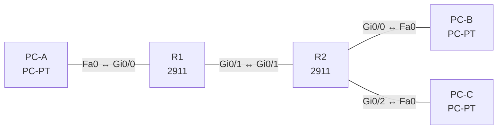

# Lab 05 – IPv4-Adressierung, VLSM und private Bereiche

**Dauer:** 90 min · **Niveau:** mittel

Aus dem Block 192.168.50.0/24 planst du Subnetze nach Hostbedarf (VLSM), konfigurierst Router und Hosts und findest typische Adressierungsfehler. Dazu gehört das Prüfen der IP-Parameter auf Windows, macOS und Linux.

| CCNA-Ziel | Thema |
|---|---|
| 1.6 | IPv4-Adressierung und Subnetting |
| 1.7 | Private IPv4-Adressen |
| 1.10 | IP-Parameter auf Windows, macOS und Linux prüfen |
| 3.3 | Statisches Routing IPv4/IPv6 (Default, Netz, Host, Floating) |

**So arbeitest du:** Teil A = Bauen, Teil B = Reparieren, Teil C = Üben. Die Konfigurationsdateien liegen in `build/` (Ausgangszustand zum Einfügen in die CLI), `repair/` (fertig gebaut, mit Fehlern) und `solutions/` (Musterlösung und Fehlerliste, erst nach eigenem Versuch öffnen). Anleitung zum Einfügen: siehe [Arbeiten mit den Dateien](../README.md#arbeiten-mit-den-dateien).

## Topologie




### Geräte

| Gerät | Modell in Packet Tracer | Rolle |
|---|---|---|
| R1 | 2911 | Router Standort A |
| R2 | 2911 | Router Standort B |
| PC-A | PC-PT | LAN-A |
| PC-B | PC-PT | LAN-B |
| PC-C | PC-PT | LAN-C |

### Verkabelung

| Von | Port | Nach | Port | Kabel |
|---|---|---|---|---|
| PC-A | Fa0 | R1 | Gi0/0 | Copper Cross-Over |
| R1 | Gi0/1 | R2 | Gi0/1 | Copper Cross-Over |
| R2 | Gi0/0 | PC-B | Fa0 | Copper Cross-Over |
| R2 | Gi0/2 | PC-C | Fa0 | Copper Cross-Over |

### Adressplan (Ausgangszustand)

| Gerät | Interface | Adresse | Maske | Gateway | DNS |
|---|---|---|---|---|---|
| R1 | Gi0/0 | 192.168.50.1 | 255.255.255.192 | | |
| R1 | Gi0/1 | 192.168.50.253 | 255.255.255.252 | | |
| R2 | Gi0/1 | 192.168.50.254 | 255.255.255.252 | | |
| R2 | Gi0/0 | 192.168.50.65 | 255.255.255.224 | | |
| R2 | Gi0/2 | 192.168.50.97 | 255.255.255.240 | | |
| PC-A | Fa0 (GUI) | 192.168.50.10 | 255.255.255.192 | 192.168.50.1 |  |
| PC-B | Fa0 (GUI) | 192.168.50.70 | 255.255.255.224 | 192.168.50.65 |  |
| PC-C | Fa0 (GUI) | 192.168.50.100 | 255.255.255.240 | 192.168.50.97 |  |


> **Packet-Tracer-Hinweis:** PCs haben unter Desktop → Command Prompt `ipconfig /all`. Für macOS/Linux gibt es in Packet Tracer keine eigenen Hosts; die Befehle lernst du in Teil C.

## Teil A – Bauen

1. **VLSM-Plan auf Papier (vor dem Konfigurieren).** Block 192.168.50.0/24. Bedarf: LAN-A 60 Hosts, LAN-B 28 Hosts, LAN-C 12 Hosts, ein Router-Router-Link. Vergib die Subnetze von gross nach klein, ohne Überlappung. Trage je Subnetz Netz-ID, Maske, erster/letzter Host, Broadcast ein. Vergleiche mit dem Adressplan.
2. **Konfigurieren.** Configs aus `build/` einfügen (Interfaces sind vorbereitet), PCs laut Tabelle einstellen. Ergänze statische Routen: R1 → LAN-B/LAN-C über R2, R2 → LAN-A über R1.
3. **Prüfen.** Ping PC-A → PC-B und PC-C. `show ip route` auf R1: Welche Codes (C, L, S) siehst du?
4. **Private Bereiche.** Welche Netze sind nach RFC 1918 privat? Welche Adressen sind APIPA (169.254.0.0/16), Loopback (127.0.0.0/8), Multicast (224.0.0.0/4)?
5. **Subnetting-Drill.** Berechne für 172.16.37.200/21: Netz-ID, Broadcast, Hostbereich, Anzahl Hosts. Danach 10.1.77.9/19 und 192.168.5.77/27.
6. **IP-Parameter prüfen.** Wie lautet der Befehl auf Windows, macOS und Linux? Wofür steht das Gateway, was zeigt `arp -a`?

## Teil B – Reparieren

Baue die Topologie wie oben (oder behalte deine aus Teil A), setze alle Geräte zurück (`erase startup-config`, `reload` bzw. neues Gerät) und füge dann die Dateien aus `repair/` ein und stelle die Endgeräte laut Tabelle unten ein. Es stecken **4 Fehler** drin. Behandle jede Meldung als Ticket: erst Symptom nachstellen, dann Layer für Layer eingrenzen, beheben und beweisen. Ändere nur, was kaputt ist.

**Endgeräte im Repair-Zustand:**

| Gerät | IP | Maske | Gateway | DNS |
|---|---|---|---|---|
| PC-A | 192.168.50.10 | 255.255.255.192 | 192.168.50.1 |  |
| PC-B | 192.168.50.95 | 255.255.255.224 | 192.168.50.65 |  |
| PC-C | 192.168.50.100 | 255.255.255.240 | 192.168.50.98 |  |

**Ticket 1:** R1 und R2 sehen sich nicht, kein Ping über den Router-Link; die LANs erreichen sich nicht.

**Ticket 2:** PC-A erreicht LAN-B, aber nicht LAN-C; `show ip route` zeigt die Route zu .96/28 mit dem eigenen Link-Interface als Next Hop.

**Ticket 3:** PC-B hat keine Verbindung ausser lokal; `ipconfig` zeigt eine Adresse, die auf .95 endet.

**Ticket 4:** PC-C erreicht nur das eigene Subnetz, aber keine anderen LANs.

## Verifikation

```
show ip interface brief
show ip route
ping 192.168.50.65
```
PC: `ipconfig /all`. Erwartet: vollständige Erreichbarkeit zwischen allen drei LANs.

## Teil C – Üben

Beantworte zuerst selbst, dann klappe die Antwort auf.

1. Wie viele Hosts passen in ein /26, /27, /28, /29, /30?
<details><summary>Antwort</summary>

62, 30, 14, 6, 2.

</details>

2. 172.16.37.200/21: Netz-ID, Broadcast, Hostbereich?
<details><summary>Antwort</summary>

Blockgrösse im 3. Oktett = 8: Netz 172.16.32.0, Broadcast 172.16.39.255, Hosts 172.16.32.1 bis 172.16.39.254 (2046 Hosts).

</details>

3. Wie sind die Windows-, macOS- und Linux-Befehle zur IP-Anzeige?
<details><summary>Antwort</summary>

Windows: `ipconfig /all`. macOS: `ifconfig` bzw. `networksetup -getinfo Wi-Fi`. Linux: `ip a` (alt: `ifconfig`), Routen `ip route`, DNS `resolvectl status`/`cat /etc/resolv.conf`. ARP: `arp -a` bzw. `ip neigh`.

</details>

4. Ein PC hat 169.254.12.7. Was bedeutet das?
<details><summary>Antwort</summary>

APIPA/Link-Local: Der Host fand keinen DHCP-Server und hat sich selbst eine Adresse gegeben; nur lokale Kommunikation.

</details>

5. Welche Adresse darf ein Host im Netz 192.168.50.64/27 nicht verwenden?
<details><summary>Antwort</summary>

Netz-ID 192.168.50.64 und Broadcast 192.168.50.95.

</details>

## Prüfungsbezug

Subnetting-Methode: Blockgrösse = 256 − letztes Oktett der Maske, Netz-ID = Vielfaches der Blockgrösse, Broadcast = nächstes Netz − 1, Hosts = 2^n − 2. VLSM: grosse Subnetze zuerst. Private Bereiche: 10.0.0.0/8, 172.16.0.0/12, 192.168.0.0/16. Die Gateway-Adresse muss im selben Subnetz liegen wie der Host.

## Lösungen

- `solutions/<Gerät>.cfg`: Konfiguration zu Teil A (ohne Basis-Adressen)
- `solutions/FAULTS.md`: Fehlerliste zu Teil B (Spoiler!)
