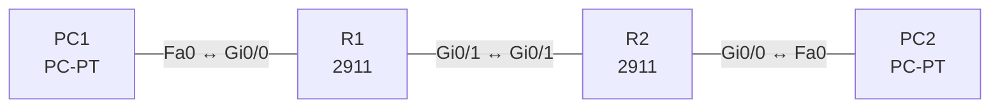

# Lab 06 – IPv6: Adressen, Adresstypen und EUI-64

**Dauer:** 90 min · **Niveau:** mittel

Zwei Router verbinden zwei IPv6-LANs. Du vergibst globale Unicast-, Link-Local- und EUI-64-Adressen, lässt PCs per SLAAC eine Adresse bilden und routest statisch (IPv6-Default und -Netzroute).

| CCNA-Ziel | Thema |
|---|---|
| 1.8 | IPv6-Adressierung und Präfix |
| 1.9 | IPv6-Adresstypen (GUA, ULA, Link-Local, Anycast, Multicast, EUI-64) |
| 3.3 | Statisches Routing IPv4/IPv6 (Default, Netz, Host, Floating) |

**So arbeitest du:** Teil A = Bauen, Teil B = Reparieren, Teil C = Üben. Die Konfigurationsdateien liegen in `build/` (Ausgangszustand zum Einfügen in die CLI), `repair/` (fertig gebaut, mit Fehlern) und `solutions/` (Musterlösung und Fehlerliste, erst nach eigenem Versuch öffnen). Anleitung zum Einfügen: siehe [Arbeiten mit den Dateien](../README.md#arbeiten-mit-den-dateien).

## Topologie



Adressen stammen aus dem Dokumentationsbereich 2001:db8::/32 und aus fd00::/8 (Unique Local).

### Geräte

| Gerät | Modell in Packet Tracer | Rolle |
|---|---|---|
| R1 | 2911 | Router 1 |
| R2 | 2911 | Router 2 |
| PC1 | PC-PT | LAN1 |
| PC2 | PC-PT | LAN2 |

### Verkabelung

| Von | Port | Nach | Port | Kabel |
|---|---|---|---|---|
| PC1 | Fa0 | R1 | Gi0/0 | Copper Cross-Over |
| R1 | Gi0/1 | R2 | Gi0/1 | Copper Cross-Over |
| R2 | Gi0/0 | PC2 | Fa0 | Copper Cross-Over |

### Adressplan (Ausgangszustand)

| Gerät | Interface | Adresse | Maske | Gateway | DNS |
|---|---|---|---|---|---|
| PC1 | Fa0 (GUI) | Auto Config (SLAAC) |  |  |  |
| PC2 | Fa0 (GUI) | Auto Config (SLAAC) |  |  |  |

| Gerät | Interface | IPv6 |
|---|---|---|
| R1 | Gi0/0 (LAN1) | 2001:db8:acad:10::1/64, Link-Local FE80::1 |
| R1 | Gi0/1 (Link) | 2001:db8:acad:12::1/64, Link-Local FE80::1 |
| R2 | Gi0/1 (Link) | 2001:db8:acad:12::2/64, Link-Local FE80::2 |
| R2 | Gi0/0 (LAN2) | 2001:db8:acad:20::/64 EUI-64, Link-Local FE80::2 |

> **Packet-Tracer-Hinweis:** Die PCs stellst du in der IP-Konfiguration auf „Auto Config“ (IPv6 SLAAC). Ob Packet Tracer den EUI-64-Teil der PC-Adresse aus der MAC bildet, siehst du unter Desktop → Command Prompt → `ipconfig /all`.

## Teil A – Bauen

1. **Basis.** Verkabeln, Configs aus `build/` einfügen (IPv4 gibt es hier nicht). `ipv6 unicast-routing` aktivieren: Warum ist das auf einem Router zwingend für Weiterleitung und RA?
2. **Adressen setzen.** Interface-Adressen laut Tabelle, Link-Local jeweils manuell (`ipv6 address FE80::1 link-local`). `show ipv6 interface brief`: Welche Adressen siehst du pro Interface?
3. **EUI-64.** R2 Gi0/0 bildet die Host-ID aus der MAC. Berechne selbst: MAC 0060.5C2B.7A01 → EUI-64 (FFFE einfügen, 7. Bit der ersten Byte invertieren). Vergleiche mit `show ipv6 interface gi0/0`.
4. **SLAAC.** PCs auf „Auto Config“: Welche Adresse und welchen Default-Gateway erhalten sie (RA des Routers)? Welche Rolle spielt das Präfix aus dem Router Advertisement?
5. **Statisch routen.** R1: `ipv6 route 2001:db8:acad:20::/64 2001:db8:acad:12::2`. R2: Default `ipv6 route ::/0 2001:db8:acad:12::1`. Teste Ping PC1 → PC2. Warum geht das auch mit Link-Local als Next Hop nur zusammen mit Ausgangsinterface?
6. **Adresstypen zuordnen.** Ordne zu: 2001:db8::1 (GUA), fd00::1 (ULA), FE80::1 (Link-Local), ::1 (Loopback), FF02::1 (All Nodes), FF02::2 (All Routers), FF02::5 (OSPF), 2001:db8::/32 (Dokumentation). Was ist Anycast?

## Teil B – Reparieren

Baue die Topologie wie oben (oder behalte deine aus Teil A), setze alle Geräte zurück (`erase startup-config`, `reload` bzw. neues Gerät) und füge dann die Dateien aus `repair/` ein. Es stecken **4 Fehler** drin. Behandle jede Meldung als Ticket: erst Symptom nachstellen, dann Layer für Layer eingrenzen, beheben und beweisen. Ändere nur, was kaputt ist.

**Ticket 1:** PC1 erhält keine Adresse per SLAAC und erreicht nichts; `show ipv6 interface gi0/0` zeigt keine Router Advertisements.

**Ticket 2:** PC1 erreicht R2 (Link), aber nicht LAN2; `show ipv6 route` zeigt die Route mit einem nicht erreichbaren Next Hop.

**Ticket 3:** PC2 bekommt eine Adresse aus einem unerwarteten Präfix (…:21::), Antworten an PC1 laufen ins Leere, da R1 …:20::/64 routet.

**Ticket 4:** LAN2 erreicht nichts jenseits von R2 (auch nicht LAN1).

## Verifikation

```
show ipv6 interface brief
show ipv6 route
show ipv6 neighbors
ping 2001:db8:acad:20::...   (Adresse von PC2 per ipconfig)
```
Erwartet: PC1 und PC2 pingen sich per IPv6 über beide Router.

## Teil C – Üben

Beantworte zuerst selbst, dann klappe die Antwort auf.

1. Verkürze 2001:0db8:0000:0000:00ab:0000:0000:0001.
<details><summary>Antwort</summary>

2001:db8::ab:0:0:1 (das `::` nur einmal, hier für das längste Nullfeld am Anfang) oder 2001:db8:0:0:ab::1; beide sind gültig.

</details>

2. MAC 0060.5C2B.7A01: wie lautet die EUI-64-Interface-ID?
<details><summary>Antwort</summary>

0260:5CFF:FE2B:7A01 (FFFE eingefügt, 0x00 → 0x02 durch Invertieren des U/L-Bits).

</details>

3. Wozu dienen NDP, NS/NA und RS/RA?
<details><summary>Antwort</summary>

Neighbor Discovery ersetzt ARP (NS/NA: MAC-Auflösung und DAD) und liefert Präfix/Gateway per RS/RA für SLAAC.

</details>

4. Was ist der Unterschied zwischen SLAAC und DHCPv6?
<details><summary>Antwort</summary>

SLAAC bildet die Adresse selbst aus Präfix+Interface-ID (zustandslos). DHCPv6 stateful vergibt Adressen zentral, stateless liefert nur Zusatzinfos wie DNS.

</details>

5. Warum braucht es keine NAT-Pflicht mehr in IPv6?
<details><summary>Antwort</summary>

Der Adressraum reicht für globale Adressen aller Geräte; Filterung geschieht per ACL/Firewall. NAT66/NPTv6 gibt es nur in Sonderfällen.

</details>

## Prüfungsbezug

IPv6: 128 Bit, Hex, Verkürzung (führende Nullen weglassen, einmal `::`). Global Unicast 2000::/3, Unique Local FC00::/7 (praktisch FD00::/8), Link-Local FE80::/10, Multicast FF00::/8 (kein Broadcast). EUI-64: MAC halbieren, FFFE einfügen, U/L-Bit (Bit 7) invertieren. `ipv6 unicast-routing` aktiviert Routing und RAs. Anycast: dieselbe Adresse auf mehreren Geräten, Zustellung an das nächste.

## Lösungen

- `solutions/<Gerät>.cfg`: Konfiguration zu Teil A (ohne Basis-Adressen)
- `solutions/FAULTS.md`: Fehlerliste zu Teil B (Spoiler!)
