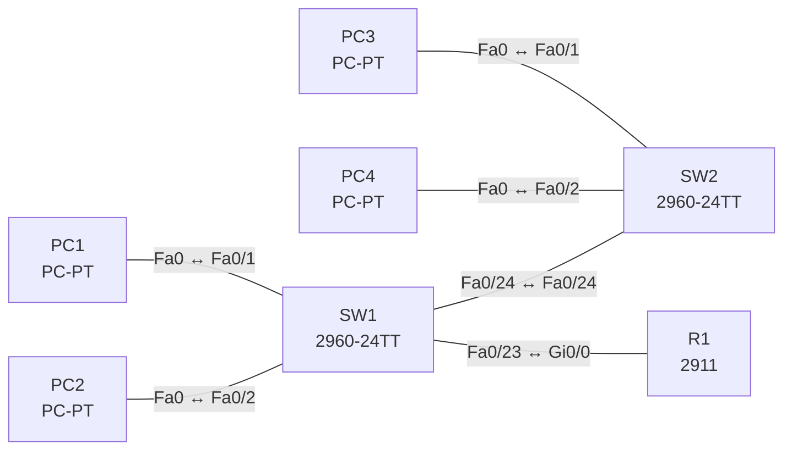

# Lab 07 – VLANs, Trunks und Inter-VLAN-Routing

**Dauer:** 90 min · **Niveau:** mittel

Zwei Access-Switches, zwei VLANs und ein Router-on-a-Stick: Du legst VLANs an, ordnest Ports zu, trunkst zwischen den Switches und routest zwischen den VLANs über Subinterfaces.

| CCNA-Ziel | Thema |
|---|---|
| 2.1 | VLANs über mehrere Switches inkl. Inter-VLAN-Routing |
| 2.2 | Interswitch-Verbindungen (Trunk, 802.1Q, Native VLAN) |

**So arbeitest du:** Teil A = Bauen, Teil B = Reparieren, Teil C = Üben. Die Konfigurationsdateien liegen in `build/` (Ausgangszustand zum Einfügen in die CLI), `repair/` (fertig gebaut, mit Fehlern) und `solutions/` (Musterlösung und Fehlerliste, erst nach eigenem Versuch öffnen). Anleitung zum Einfügen: siehe [Arbeiten mit den Dateien](../README.md#arbeiten-mit-den-dateien).

## Topologie



Zusatz (Teil A, Schritt 6): Ersetze den Router durch einen 3560 mit SVIs (`ip routing`, `interface vlan 10/20`).

### Geräte

| Gerät | Modell in Packet Tracer | Rolle |
|---|---|---|
| R1 | 2911 | Router-on-a-Stick |
| SW1 | 2960-24TT | Access-Switch 1 |
| SW2 | 2960-24TT | Access-Switch 2 |
| PC1 | PC-PT | VLAN 10 |
| PC2 | PC-PT | VLAN 20 |
| PC3 | PC-PT | VLAN 10 |
| PC4 | PC-PT | VLAN 20 |

### Verkabelung

| Von | Port | Nach | Port | Kabel |
|---|---|---|---|---|
| PC1 | Fa0 | SW1 | Fa0/1 | Copper Straight-Through |
| PC2 | Fa0 | SW1 | Fa0/2 | Copper Straight-Through |
| PC3 | Fa0 | SW2 | Fa0/1 | Copper Straight-Through |
| PC4 | Fa0 | SW2 | Fa0/2 | Copper Straight-Through |
| SW1 | Fa0/24 | SW2 | Fa0/24 | Copper Cross-Over |
| SW1 | Fa0/23 | R1 | Gi0/0 | Copper Straight-Through |

### Adressplan (Ausgangszustand)

| Gerät | Interface | Adresse | Maske | Gateway | DNS |
|---|---|---|---|---|---|
| R1 | Gi0/0.10 | 192.168.10.1 | 255.255.255.0 | | |
| R1 | Gi0/0.20 | 192.168.20.1 | 255.255.255.0 | | |
| PC1 | Fa0 (GUI) | 192.168.10.11 | 255.255.255.0 | 192.168.10.1 |  |
| PC2 | Fa0 (GUI) | 192.168.20.11 | 255.255.255.0 | 192.168.20.1 |  |
| PC3 | Fa0 (GUI) | 192.168.10.12 | 255.255.255.0 | 192.168.10.1 |  |
| PC4 | Fa0 (GUI) | 192.168.20.12 | 255.255.255.0 | 192.168.20.1 |  |


## Teil A – Bauen

1. **Basis.** Verkabeln, `build/`-Configs einfügen, Hosts laut Tabelle einstellen. Vor der VLAN-Konfiguration: Pingen PC1 und PC2? (Beide im selben Broadcast-Domäne VLAN 1, aber mit verschiedenen IP-Netzen.)
2. **VLANs anlegen.** Auf beiden Switches `vlan 10` (USERS) und `vlan 20` (SERVER); `show vlan brief`.
3. **Access-Ports.** Fa0/1 → VLAN 10, Fa0/2 → VLAN 20 (jeweils `switchport mode access` + `switchport access vlan`). Warum `mode access` explizit?
4. **Trunks.** Zwischen SW1 und SW2 (Fa0/24) sowie zu R1 (SW1 Fa0/23): `switchport mode trunk`, erlaubte VLANs auf 10 und 20 einschränken. `show interfaces trunk`.
5. **Router-on-a-Stick.** R1 Gi0/0.10 und Gi0/0.20 mit `encapsulation dot1Q <VLAN>` und IP-Adresse des Gateways. Ping PC1 → PC4 (anderes VLAN, anderer Switch). Wie viele Router-Interfaces brauchst du physisch?
6. **Alternative SVI.** Baue dieselbe Funktion mit einem Layer-3-Switch (3560): `ip routing`, `interface vlan 10`, Gateway-IP. Vor- und Nachteile gegenüber Router-on-a-Stick?

## Teil B – Reparieren

Baue die Topologie wie oben (oder behalte deine aus Teil A), setze alle Geräte zurück (`erase startup-config`, `reload` bzw. neues Gerät) und füge dann die Dateien aus `repair/` ein und stelle die Endgeräte laut Tabelle unten ein. Es stecken **5 Fehler** drin. Behandle jede Meldung als Ticket: erst Symptom nachstellen, dann Layer für Layer eingrenzen, beheben und beweisen. Ändere nur, was kaputt ist.

**Endgeräte im Repair-Zustand:**

| Gerät | IP | Maske | Gateway | DNS |
|---|---|---|---|---|
| PC1 | 192.168.10.11 | 255.255.255.0 | 192.168.10.1 |  |
| PC2 | 192.168.20.11 | 255.255.255.0 | 192.168.20.254 |  |
| PC3 | 192.168.10.12 | 255.255.255.0 | 192.168.10.1 |  |
| PC4 | 192.168.20.12 | 255.255.255.0 | 192.168.20.1 |  |

**Ticket 1:** PC3 (192.168.10.12) erreicht weder PC1 noch sein Gateway.

**Ticket 2:** VLAN 10 läuft über beide Switches, VLAN 20 nicht: PC4 erreicht weder PC2 noch sein Gateway.

**Ticket 3:** Hosts in VLAN 20 erreichen ihr Gateway 192.168.20.1 nicht, VLAN 10 funktioniert.

**Ticket 4:** Kein VLAN läuft zwischen SW1 und SW2; `show interfaces trunk` auf SW2 bleibt leer.

**Ticket 5:** PC2 erreicht PC4 (gleiches VLAN), aber nichts in anderen Netzen.

## Verifikation

```
show vlan brief
show interfaces trunk
show interfaces fa0/24 switchport
show ip interface brief   (R1)
show ip route             (R1)
```
Erwartet: PC1↔PC3 (VLAN 10) und PC2↔PC4 (VLAN 20) direkt, VLAN-übergreifend über R1.

## Teil C – Üben

Beantworte zuerst selbst, dann klappe die Antwort auf.

1. Wieso braucht jedes VLAN ein eigenes IP-Subnetz?
<details><summary>Antwort</summary>

Jedes VLAN ist eine eigene Broadcast-Domäne; IP-Kommunikation zwischen Domänen läuft über Routing, deshalb pro VLAN ein Subnetz mit Gateway.

</details>

2. Wie fügt 802.1Q das VLAN in den Frame ein?
<details><summary>Antwort</summary>

Ein 4-Byte-Tag (TPID 0x8100, PCP, DEI, 12-Bit-VLAN-ID) zwischen Quell-MAC und EtherType; das native VLAN bleibt ungetaggt.

</details>

3. Der PC in VLAN 20 erreicht sein Gateway nicht. Welche vier Dinge prüfst du?
<details><summary>Antwort</summary>

Access-VLAN des Ports, VLAN auf dem Switch vorhanden/aktiv, VLAN im Trunk erlaubt, Subinterface-Encapsulation und IP am Router.

</details>

4. Router-on-a-Stick vs. SVI?
<details><summary>Antwort</summary>

ROAS: ein physischer Trunk, Engpass durch einen Link und Router-CPU. SVI: Switch routet in Hardware, skaliert besser, braucht Layer-3-Switch.

</details>

5. Wie viele VLANs deckt der Normalbereich ab?
<details><summary>Antwort</summary>

1–1005 (davon 1002–1005 reserviert für FDDI/Token Ring); erweitert 1006–4094.

</details>

## Prüfungsbezug

VLAN trennt Broadcast-Domänen; ein Access-Port gehört zu genau einem Daten-VLAN, ein Trunk trägt mehrere VLANs per 802.1Q-Tag (4 Byte, native VLAN ungetaggt). Inter-VLAN: Router-on-a-Stick (Subinterfaces) oder Layer-3-Switch (SVI, `ip routing`). Normal-range-VLANs 1–1005 (Konfiguration in `vlan.dat`), extended 1006–4094. VLAN 1 ist Default und nicht löschbar.

## Lösungen

- `solutions/<Gerät>.cfg`: Konfiguration zu Teil A (ohne Basis-Adressen)
- `solutions/FAULTS.md`: Fehlerliste zu Teil B (Spoiler!)
