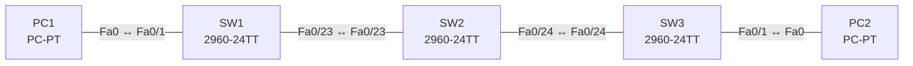

# Lab 08 – Trunks, Native VLAN, DTP und CDP/LLDP

**Dauer:** 75 min · **Niveau:** mittel

Drei Switches in einer Kette mit 802.1Q-Trunks, Native VLAN 99, ausgeschaltetem DTP und aktivem CDP/LLDP. Du findest Native-VLAN-Mismatch, DTP-Fehlaushandlung, fehlende erlaubte VLANs und verschwundene Nachbarn.

| CCNA-Ziel | Thema |
|---|---|
| 2.2 | Interswitch-Verbindungen (Trunk, 802.1Q, Native VLAN) |
| 2.3 | Layer-2-Discovery (CDP, LLDP) |
| 2.1 | VLANs über mehrere Switches inkl. Inter-VLAN-Routing |

**So arbeitest du:** Teil A = Bauen, Teil B = Reparieren, Teil C = Üben. Die Konfigurationsdateien liegen in `build/` (Ausgangszustand zum Einfügen in die CLI), `repair/` (fertig gebaut, mit Fehlern) und `solutions/` (Musterlösung und Fehlerliste, erst nach eigenem Versuch öffnen). Anleitung zum Einfügen: siehe [Arbeiten mit den Dateien](../README.md#arbeiten-mit-den-dateien).

## Topologie




### Geräte

| Gerät | Modell in Packet Tracer | Rolle |
|---|---|---|
| SW1 | 2960-24TT | Switch links |
| SW2 | 2960-24TT | Switch Mitte |
| SW3 | 2960-24TT | Switch rechts |
| PC1 | PC-PT | VLAN 10 |
| PC2 | PC-PT | VLAN 10 |

### Verkabelung

| Von | Port | Nach | Port | Kabel |
|---|---|---|---|---|
| PC1 | Fa0 | SW1 | Fa0/1 | Copper Straight-Through |
| SW1 | Fa0/23 | SW2 | Fa0/23 | Copper Cross-Over |
| SW2 | Fa0/24 | SW3 | Fa0/24 | Copper Cross-Over |
| SW3 | Fa0/1 | PC2 | Fa0 | Copper Straight-Through |

### Adressplan (Ausgangszustand)

| Gerät | Interface | Adresse | Maske | Gateway | DNS |
|---|---|---|---|---|---|
| PC1 | Fa0 (GUI) | 192.168.8.11 | 255.255.255.0 |  |  |
| PC2 | Fa0 (GUI) | 192.168.8.12 | 255.255.255.0 |  |  |


> **Packet-Tracer-Hinweis:** Falls `lldp run` in deiner Packet-Tracer-Version nicht akzeptiert wird, beschränke dich auf CDP und beantworte die LLDP-Fragen in Teil C theoretisch.

## Teil A – Bauen

1. **Basis.** Verkabeln, `build/` einfügen, PCs setzen. Standardverhalten prüfen: `show cdp neighbors` auf SW2: Wen siehst du, welche Port-IDs?
2. **VLANs.** VLAN 10 (USERS) und 99 (NATIVE) auf allen drei Switches. PCs in VLAN 10.
3. **Trunks.** Beide Inter-Switch-Links: `switchport mode trunk`, `switchport trunk native vlan 99`, `switchport trunk allowed vlan 10,99`, `switchport nonegotiate`. Prüfe `show interfaces trunk`. Warum das native VLAN nicht auf VLAN 1 lassen?
4. **DTP.** Probiere (testweise) `dynamic auto`/`dynamic desirable` auf beiden Seiten durch und notiere die Kombinationen, die einen Trunk bilden. Welche Einstellung schaltet DTP-Frames ab?
5. **CDP.** `show cdp neighbors detail`: Welche Infos liefert CDP (Plattform, IP, Capabilities, Native VLAN, Duplex)? An Access-Ports mit `no cdp enable` abschalten. Warum?
6. **LLDP.** `lldp run` aktivieren, `show lldp neighbors`. Unterschiede CDP (Cisco-proprietär, Layer 2, Multicast 01:00:0C:CC:CC:CC) und LLDP (IEEE 802.1AB, herstellerneutral).

## Teil B – Reparieren

Baue die Topologie wie oben (oder behalte deine aus Teil A), setze alle Geräte zurück (`erase startup-config`, `reload` bzw. neues Gerät) und füge dann die Dateien aus `repair/` ein. Es stecken **4 Fehler** drin. Behandle jede Meldung als Ticket: erst Symptom nachstellen, dann Layer für Layer eingrenzen, beheben und beweisen. Ändere nur, was kaputt ist.

**Ticket 1:** Auf SW2/SW3 erscheinen Meldungen zu `native vlan mismatch`; `show cdp neighbors detail` zeigt unterschiedliche Native VLANs, Verkehr im VLAN 99 stimmt nicht.

**Ticket 2:** PC1 erreicht PC2 nicht; auf SW2 zeigt `show interfaces trunk` für Fa0/23 nur VLAN 99 als erlaubt.

**Ticket 3:** `show cdp neighbors` auf SW1 und SW3 zeigt SW2 nicht mehr, obwohl der Link up ist.

**Ticket 4:** Der Link SW1–SW2 wird nicht zum Trunk (Access-Betrieb); PC1 erreicht PC2 nicht.

## Verifikation

```
show interfaces trunk
show interfaces fa0/23 switchport
show cdp neighbors [detail]
show lldp neighbors
show vlan brief
```
Erwartet: PC1 ↔ PC2 im VLAN 10 pingen sich über zwei Trunks; Native VLAN 99 stimmt an beiden Enden.

## Teil C – Üben

Beantworte zuerst selbst, dann klappe die Antwort auf.

1. Welche DTP-Kombinationen bilden einen Trunk?
<details><summary>Antwort</summary>

trunk↔trunk, trunk↔desirable, trunk↔auto, desirable↔desirable, desirable↔auto. Nicht: auto↔auto (beide passiv), access↔irgendwas (kein Trunk).

</details>

2. Wozu dient das Native VLAN und was geht bei Mismatch schief?
<details><summary>Antwort</summary>

Es trägt ungetaggte Frames. Unterschiedliche Native VLANs verbinden zwei VLANs, STP/CDP melden Fehler, Verkehr landet im falschen VLAN.

</details>

3. Wie erkennt man, welches Gerät an Gi0/1 hängt, ohne Dokumentation?
<details><summary>Antwort</summary>

`show cdp neighbors`/`show lldp neighbors` zeigen Gerät, Port, Modell, ggf. Management-IP.

</details>

4. Warum CDP/LLDP an Access-Ports abschalten?
<details><summary>Antwort</summary>

Sie geben Plattform, Version und Adressen preis (Information Disclosure) und sind dort nutzlos, sofern kein IP-Phone/AP angeschlossen ist, das LLDP-MED/CDP nutzt.

</details>

5. Wie lange sendet CDP, wie lange gilt ein Eintrag?
<details><summary>Antwort</summary>

Update alle 60 s, Hold-Time 180 s (Default).

</details>

## Prüfungsbezug

Trunk: 802.1Q (Tag 4 Byte), Native VLAN ungetaggt, Mismatch erzeugt Fehlermeldungen/Fehlverhalten und ein Sicherheitsrisiko (VLAN Hopping). DTP-Modi: trunk, dynamic desirable, dynamic auto, access; `nonegotiate` unterdrückt DTP. CDP ist Cisco-proprietär (Standard an), LLDP IEEE-Standard (Standard aus; `lldp run`, `lldp transmit`/`receive` je Port).

## Lösungen

- `solutions/<Gerät>.cfg`: Konfiguration zu Teil A (ohne Basis-Adressen)
- `solutions/FAULTS.md`: Fehlerliste zu Teil B (Spoiler!)
