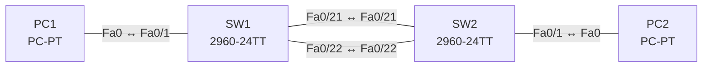

# Lab 09 – EtherChannel mit LACP

**Dauer:** 75 min · **Niveau:** mittel

Zwei Switches verbinden sich mit zwei parallelen Links, die du zu einem logischen Port-Channel bündelst (LACP). Du erkennst, welche Parameter auf beiden Seiten und an allen Mitgliedern übereinstimmen müssen.

| CCNA-Ziel | Thema |
|---|---|
| 2.4 | EtherChannel (LACP) |
| 2.2 | Interswitch-Verbindungen (Trunk, 802.1Q, Native VLAN) |

**So arbeitest du:** Teil A = Bauen, Teil B = Reparieren, Teil C = Üben. Die Konfigurationsdateien liegen in `build/` (Ausgangszustand zum Einfügen in die CLI), `repair/` (fertig gebaut, mit Fehlern) und `solutions/` (Musterlösung und Fehlerliste, erst nach eigenem Versuch öffnen). Anleitung zum Einfügen: siehe [Arbeiten mit den Dateien](../README.md#arbeiten-mit-den-dateien).

## Topologie




### Geräte

| Gerät | Modell in Packet Tracer | Rolle |
|---|---|---|
| SW1 | 2960-24TT | Switch 1 |
| SW2 | 2960-24TT | Switch 2 |
| PC1 | PC-PT | VLAN 10 |
| PC2 | PC-PT | VLAN 10 |

### Verkabelung

| Von | Port | Nach | Port | Kabel |
|---|---|---|---|---|
| PC1 | Fa0 | SW1 | Fa0/1 | Copper Straight-Through |
| SW1 | Fa0/21 | SW2 | Fa0/21 | Copper Cross-Over |
| SW1 | Fa0/22 | SW2 | Fa0/22 | Copper Cross-Over |
| SW2 | Fa0/1 | PC2 | Fa0 | Copper Straight-Through |

### Adressplan (Ausgangszustand)

| Gerät | Interface | Adresse | Maske | Gateway | DNS |
|---|---|---|---|---|---|
| PC1 | Fa0 (GUI) | 192.168.9.11 | 255.255.255.0 |  |  |
| PC2 | Fa0 (GUI) | 192.168.9.12 | 255.255.255.0 |  |  |


> **Packet-Tracer-Hinweis:** Packet Tracer unterstützt LACP (`channel-group 1 mode active|passive`) und PAgP (`desirable|auto`) auf den 2960; teilweise fehlen Details in `show etherchannel`.

## Teil A – Bauen

1. **Basis.** Verkabeln (zwei Links Fa0/21 und Fa0/22), `build/` einfügen, PCs setzen. Ohne Bündelung: Was passiert mit dem zweiten Link (STP blockiert)?
2. **VLAN und Access.** VLAN 10 auf beiden Switches, PCs in VLAN 10.
3. **Bündeln.** `interface range Fa0/21 - 22` → `channel-group 1 mode active`. Danach `interface Port-channel1`: Trunk, erlaubtes VLAN 10. Warum konfigurierst du den Trunk am Port-Channel, nicht an den Mitgliedern?
4. **Prüfen.** `show etherchannel summary`: Flags `SU`/`P`. `show interfaces port-channel 1`: Bandbreite = Summe? Ping-Test, dann Link Fa0/21 ziehen (Cable-Tool): Ausfallzeit?
5. **Modi.** Teste Kombinationen: active/active, active/passive, passive/passive, on/on, on/active. Welche bilden einen Channel?
6. **Load Balancing.** `show etherchannel load-balance`: Welche Hash-Eingabe (src-mac, dst-ip …)? Warum nutzt ein einzelner Flow nur einen Link?

## Teil B – Reparieren

Baue die Topologie wie oben (oder behalte deine aus Teil A), setze alle Geräte zurück (`erase startup-config`, `reload` bzw. neues Gerät) und füge dann die Dateien aus `repair/` ein. Es stecken **4 Fehler** drin. Behandle jede Meldung als Ticket: erst Symptom nachstellen, dann Layer für Layer eingrenzen, beheben und beweisen. Ändere nur, was kaputt ist.

**Ticket 1:** `show etherchannel summary` zeigt kein `Po1(SU)`, die Links bleiben stand-alone (`I`) oder suspendiert; STP blockiert einen Link, ggf. Err-Disable.

**Ticket 2:** Der Channel steht (`Po1(SU)`), aber PC1 und PC2 erreichen sich nicht.

**Ticket 3:** Nur ein Member (Fa0/21) ist gebündelt, Fa0/22 meldet `s` oder `I`; die Bandbreite des Channels ist nur 100 Mbit/s.

**Ticket 4:** PC1 erreicht PC2 nicht, obwohl der Channel steht.

## Verifikation

```
show etherchannel summary
show etherchannel port-channel
show interfaces trunk
show spanning-tree summary
```
Erwartet: `Po1(SU)` mit `Fa0/21(P) Fa0/22(P)`, Protokoll LACP.

## Teil C – Üben

Beantworte zuerst selbst, dann klappe die Antwort auf.

1. Welche Modus-Kombinationen bilden einen LACP-Channel?
<details><summary>Antwort</summary>

active/active und active/passive. passive/passive nicht (niemand initiiert). `on` bildet nur mit `on`.

</details>

2. Ein Member zeigt `(s)` suspended. Was prüfst du?
<details><summary>Antwort</summary>

Parametervergleich zum Channel: Speed/Duplex, Switchport-Modus, Allowed VLANs, Native VLAN, Gegenstellenmodus (LACP vs. PAgP).

</details>

3. Warum erhöht ein EtherChannel nicht die Geschwindigkeit einer einzelnen TCP-Verbindung?
<details><summary>Antwort</summary>

Der Hash weist einen Flow immer demselben Link zu; nur viele verschiedene Flows verteilen sich.

</details>

4. Wozu dient die STP-Sicht auf den Port-Channel?
<details><summary>Antwort</summary>

STP sieht ein logisches Interface, es blockiert keine einzelnen Mitglieder; damit entfallen redundante Links als blockierte Ports.

</details>

5. Was ist ein Layer-3-EtherChannel?
<details><summary>Antwort</summary>

Routed Port-Channel: `no switchport` am Port-Channel, IP-Adresse darauf; Mitglieder ebenfalls `no switchport`.

</details>

## Prüfungsbezug

LACP (IEEE 802.3ad): `active` (verhandelt aktiv), `passive` (antwortet nur). PAgP (Cisco): `desirable`/`auto`. `on` = statisch ohne Protokoll. Mitglieder müssen übereinstimmen: Speed, Duplex, Switchport-Modus, VLANs/Trunk-Parameter, Native VLAN. Max. 8 aktive Links. Lastverteilung per Hash, nicht pro Paket. `show etherchannel summary`: S = Layer 2, U = in use, P = bundled, I = stand-alone, D = down, s = suspended.

## Lösungen

- `solutions/<Gerät>.cfg`: Konfiguration zu Teil A (ohne Basis-Adressen)
- `solutions/FAULTS.md`: Fehlerliste zu Teil B (Spoiler!)
