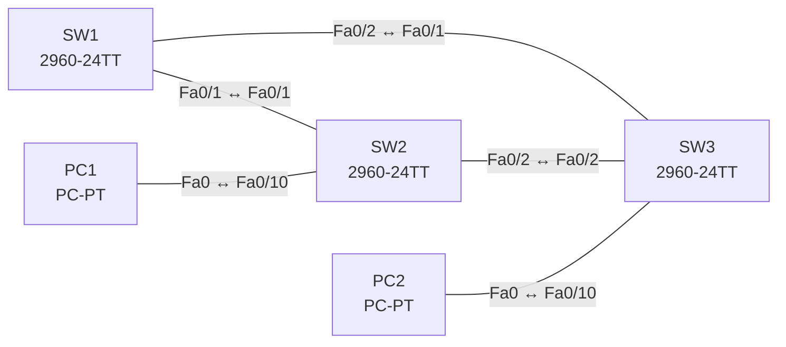

# Lab 10 – Rapid PVST+: Root Bridge, Port-Rollen und Schutzfunktionen

**Dauer:** 90 min · **Niveau:** mittel

Drei Switches im Dreieck. Du steuerst die Root Bridge per Priorität, liest Port-Rollen und -Zustände, aktivierst PortFast, BPDU Guard und Root Guard und reparierst typische STP-Fehler.

| CCNA-Ziel | Thema |
|---|---|
| 2.5 | Rapid PVST+ (Root Bridge, Port-Rollen und -Zustände, PortFast, Guards) |

**So arbeitest du:** Teil A = Bauen, Teil B = Reparieren, Teil C = Üben. Die Konfigurationsdateien liegen in `build/` (Ausgangszustand zum Einfügen in die CLI), `repair/` (fertig gebaut, mit Fehlern) und `solutions/` (Musterlösung und Fehlerliste, erst nach eigenem Versuch öffnen). Anleitung zum Einfügen: siehe [Arbeiten mit den Dateien](../README.md#arbeiten-mit-den-dateien).

## Topologie




### Geräte

| Gerät | Modell in Packet Tracer | Rolle |
|---|---|---|
| SW1 | 2960-24TT | Root Bridge |
| SW2 | 2960-24TT | Backup-Root |
| SW3 | 2960-24TT | Access-Switch |
| PC1 | PC-PT | VLAN 10 |
| PC2 | PC-PT | VLAN 10 |

### Verkabelung

| Von | Port | Nach | Port | Kabel |
|---|---|---|---|---|
| SW1 | Fa0/1 | SW2 | Fa0/1 | Copper Cross-Over |
| SW1 | Fa0/2 | SW3 | Fa0/1 | Copper Cross-Over |
| SW2 | Fa0/2 | SW3 | Fa0/2 | Copper Cross-Over |
| PC1 | Fa0 | SW2 | Fa0/10 | Copper Straight-Through |
| PC2 | Fa0 | SW3 | Fa0/10 | Copper Straight-Through |

### Adressplan (Ausgangszustand)

| Gerät | Interface | Adresse | Maske | Gateway | DNS |
|---|---|---|---|---|---|
| PC1 | Fa0 (GUI) | 192.168.10.11 | 255.255.255.0 |  |  |
| PC2 | Fa0 (GUI) | 192.168.10.12 | 255.255.255.0 |  |  |


## Teil A – Bauen

1. **Basis.** Verkabeln (Dreieck), `build/` einfügen, PCs setzen. Standard-STP: `show spanning-tree` auf allen Switches. Wer ist Root (kleinste Bridge-ID = Priorität + MAC)?
2. **Rapid PVST+.** Auf allen drei Switches `spanning-tree mode rapid-pvst`. Unterschiede zu PVST+ (Konvergenz in Sekunden, Proposal/Agreement)?
3. **Root festlegen.** SW1: `spanning-tree vlan 1,10 priority 4096` (oder `root primary`), SW2: `8192` als Backup. Bestimme vor dem Prüfen mit `show spanning-tree vlan 10`, welche Ports Root/Designated/Alternate sind. Kostenwerte (Fa = 19, Gi = 4).
4. **Edge-Ports.** PC-Ports: `spanning-tree portfast` und `spanning-tree bpduguard enable`. Teste, was passiert, wenn du einen Switch an einen solchen Port steckst (err-disabled).
5. **Root Guard.** Auf SW2 Fa0/2 (Richtung SW3): `spanning-tree guard root`. Wann erscheint `root-inconsistent`?
6. **Weitere Schutzfunktionen.** Loop Guard (`spanning-tree guard loop`), BPDU Filter (Gefahr: Loops), `spanning-tree portfast default`. Wo passt welche?

## Teil B – Reparieren

Baue die Topologie wie oben (oder behalte deine aus Teil A), setze alle Geräte zurück (`erase startup-config`, `reload` bzw. neues Gerät) und füge dann die Dateien aus `repair/` ein. Es stecken **4 Fehler** drin. Behandle jede Meldung als Ticket: erst Symptom nachstellen, dann Layer für Layer eingrenzen, beheben und beweisen. Ändere nur, was kaputt ist.

**Ticket 1:** Die Root Bridge ist nicht mehr SW1; SW2 meldet `ROOTGUARD_BLOCK` auf Fa0/2 und `show spanning-tree` zeigt Fa0/2 als `*ROOT_INCONS`.

**Ticket 2:** Nach einem Linkausfall dauert die Umschaltung 30–50 Sekunden; `show spanning-tree` auf SW2 zeigt `Spanning tree enabled protocol ieee`.

**Ticket 3:** PC2 hat nach dem Einstecken eine längere Wartezeit bis zum Link-Status Forwarding als PC1; `show spanning-tree interface fa0/10 detail` zeigt Edge `no`.

**Ticket 4:** Der Verkehr von PC2 in VLAN 10 nimmt den Umweg über SW2 statt des direkten Links zu SW1; der Root Port von SW3 für VLAN 10 ist Fa0/2.

## Verifikation

```
show spanning-tree
show spanning-tree vlan 10
show spanning-tree summary
show spanning-tree interface fa0/10 detail
show errdisable recovery
```
Erwartet: SW1 ist Root für VLAN 1 und 10 (alle Ports Designated), SW2 hat Root Port Fa0/1, SW3 Root Port Fa0/1 und Fa0/2 als Alternate (Discarding).

## Teil C – Üben

Beantworte zuerst selbst, dann klappe die Antwort auf.

1. Wie wird der Root Port bestimmt?
<details><summary>Antwort</summary>

Niedrigste Gesamtkosten zur Root Bridge; bei Gleichstand kleinste Bridge-ID des Nachbarn, dann kleinste Port-ID des Nachbarn.

</details>

2. Welche Port-Rollen kennt RSTP und welche Zustände?
<details><summary>Antwort</summary>

Rollen: Root, Designated, Alternate, Backup, Disabled. Zustände: Discarding, Learning, Forwarding.

</details>

3. BPDU Guard vs. Root Guard?
<details><summary>Antwort</summary>

BPDU Guard sperrt einen Edge-Port, sobald irgendeine BPDU eintrifft. Root Guard erlaubt BPDUs, verweigert aber überlegene (würde den Port zum Root Port machen) und setzt den Port root-inconsistent.

</details>

4. Warum ist `spanning-tree bpdufilter enable` gefährlich?
<details><summary>Antwort</summary>

Der Port sendet/verarbeitet keine BPDUs mehr; STP erkennt Schleifen nicht, ein versehentlich angeschlossener Switch erzeugt einen Loop.

</details>

5. Was bewirkt PortFast an einem Trunk-Port?
<details><summary>Antwort</summary>

Der Trunk geht sofort in Forwarding und kann bei Loops Schaden anrichten; PortFast gehört an Edge-Ports (Hosts).

</details>

## Prüfungsbezug

Root Bridge = niedrigste Bridge-ID (Priorität in 4096er-Schritten + VLAN-ID als Extended System ID + MAC). Rollen: Root, Designated, Alternate, Backup, Disabled. RSTP-Zustände: Discarding, Learning, Forwarding. Wahl des Root Ports: niedrigste Root-Path-Cost, dann niedrigste Sender-Bridge-ID, dann niedrigste Sender-Port-ID. PortFast überspringt Wartezeiten für Edge-Ports; BPDU Guard schaltet den Port bei BPDU ab (err-disable); Root Guard verhindert, dass ein Port Root-Port wird; Loop Guard schützt vor unidirektionalen Links; BPDU Filter unterdrückt BPDUs.

## Lösungen

- `solutions/<Gerät>.cfg`: Konfiguration zu Teil A (ohne Basis-Adressen)
- `solutions/FAULTS.md`: Fehlerliste zu Teil B (Spoiler!)
