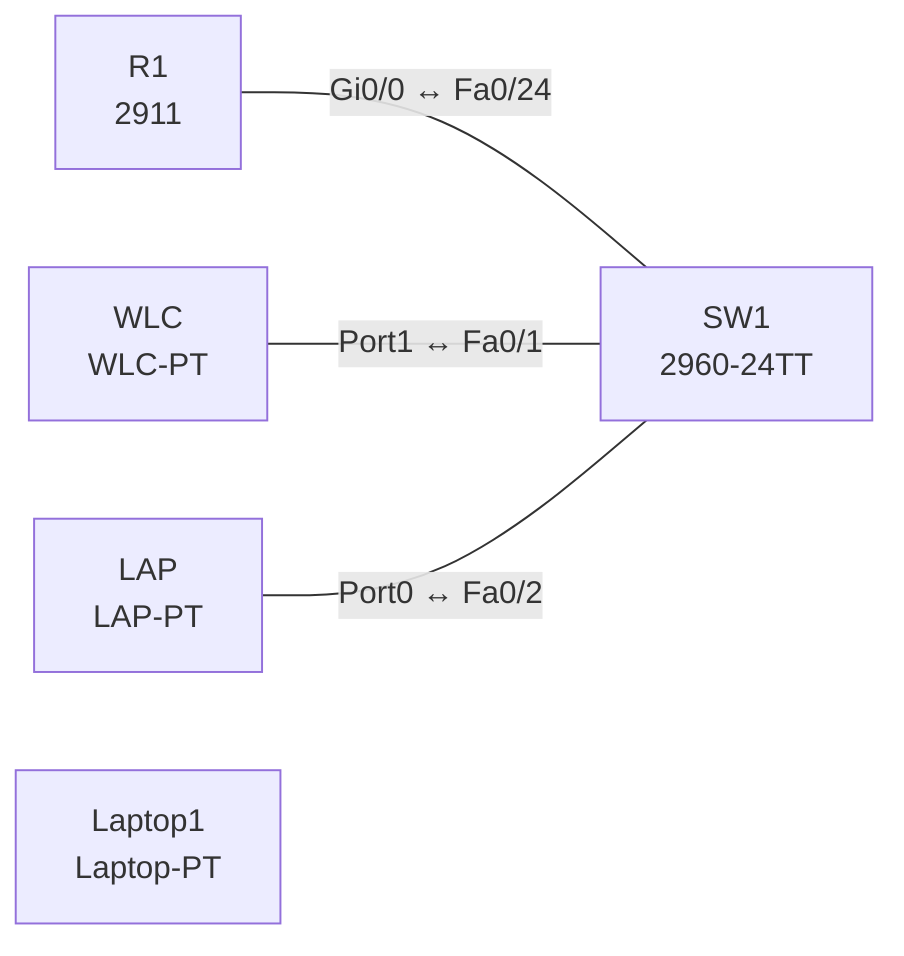

# Lab 11 – Wireless-Architekturen: WLC, Lightweight-AP und DHCP

**Dauer:** 75 min · **Niveau:** mittel

Ein Lightweight-AP bekommt per DHCP eine Adresse samt Option 43 und findet so den WLC. Du lernst Architekturen (Autonomous, Lightweight/Split-MAC, Cloud-managed), AP-Modi und die Switch-Anbindung von AP und Controller.

| CCNA-Ziel | Thema |
|---|---|
| 2.6 | Wireless-Architekturen und AP-Modi |
| 2.7 | WLAN-Komponenten: Verbindungen von AP und WLC |
| 1.11 | Wireless-Grundlagen (Kanäle, SSID, RF, Verschlüsselung) |

**So arbeitest du:** Teil A = Bauen, Teil B = Reparieren, Teil C = Üben. Die Konfigurationsdateien liegen in `build/` (Ausgangszustand zum Einfügen in die CLI), `repair/` (fertig gebaut, mit Fehlern) und `solutions/` (Musterlösung und Fehlerliste, erst nach eigenem Versuch öffnen). Anleitung zum Einfügen: siehe [Arbeiten mit den Dateien](../README.md#arbeiten-mit-den-dateien).

## Topologie




### Geräte

| Gerät | Modell in Packet Tracer | Rolle |
|---|---|---|
| R1 | 2911 | Gateway und DHCP-Server |
| SW1 | 2960-24TT | Access-Switch |
| WLC | WLC-PT | Controller (Management-IP) |
| LAP | LAP-PT | Lightweight-AP |
| Laptop1 | Laptop-PT | Funk-Client (WLAN-Modul WPC300N) |

### Verkabelung

| Von | Port | Nach | Port | Kabel |
|---|---|---|---|---|
| R1 | Gi0/0 | SW1 | Fa0/24 | Copper Straight-Through |
| WLC | Port1 | SW1 | Fa0/1 | Copper Straight-Through |
| LAP | Port0 | SW1 | Fa0/2 | Copper Straight-Through |

### Adressplan (Ausgangszustand)

| Gerät | Interface | Adresse | Maske | Gateway | DNS |
|---|---|---|---|---|---|
| R1 | Gi0/0 | 10.11.1.1 | 255.255.255.0 | | |
| WLC | Fa0 (GUI) | 10.11.1.5 | 255.255.255.0 | 10.11.1.1 |  |
| LAP | Fa0 (GUI) | DHCP |  |  |  |
| Laptop1 | Fa0 (GUI) | DHCP |  |  |  |


> **Packet-Tracer-Hinweis:** Portnamen und Dialoge von WLC und LAP unterscheiden sich je nach Packet-Tracer-Version. Wenn der LAP sich nicht anmeldet: auf dem LAP unter Config die WLC-Adresse prüfen und `option 43` im DHCP-Pool vergleichen. WLC über den Browser (Server-PC) aufrufen: `https://10.11.1.5`.

## Teil A – Bauen

1. **Basis.** Verkabeln, `build/` einfügen. WLC-Management-IP 10.11.1.5/24 (Gateway 10.11.1.1) setzen. Warum braucht der LAP vor dem Anmelden einen DHCP-Lease und die Controller-Adresse?
2. **DHCP für den AP.** Auf R1 `ip dhcp pool WLAN` mit `option 43 hex f104.0a0b.0105` (Typ f1, Länge 04, Controller 10.11.1.5). Lies den Hexwert: `0a0b0105` = 10.11.1.5.
3. **Anmeldung.** Der LAP wird in der WLC-Oberfläche unter *Wireless* sichtbar. Welche Protokolle laufen (CAPWAP UDP 5246 Control, 5247 Data)? Welche Rolle spielt Split-MAC?
4. **Architekturen vergleichen.** Autonomous AP (jeder AP einzeln), Lightweight (zentral per WLC), Cloud-based (Meraki, Verwaltung aus der Cloud), Embedded Wireless (EWC im AP/Switch). Was sprechen für/gegen jede Variante?
5. **AP-Modi.** Local, FlexConnect, Monitor, Sniffer, Rogue Detector, Bridge/Mesh, SE-Connect: Ordne je Modus ein Einsatzszenario zu.
6. **Anbindung.** Welche Switch-Port-Modi gehören an (a) einen Lightweight-AP im Local-Mode, (b) einen FlexConnect-AP mit lokalem Switching mehrerer VLANs, (c) den WLC (mehrere Ports als LAG)?

## Teil B – Reparieren

Baue die Topologie wie oben (oder behalte deine aus Teil A), setze alle Geräte zurück (`erase startup-config`, `reload` bzw. neues Gerät) und füge dann die Dateien aus `repair/` ein. Es stecken **3 Fehler** drin. Behandle jede Meldung als Ticket: erst Symptom nachstellen, dann Layer für Layer eingrenzen, beheben und beweisen. Ändere nur, was kaputt ist.

**Ticket 1:** Der LAP bekommt eine Adresse, erscheint aber nicht im WLC.

**Ticket 2:** Der LAP ist offline (keine Link-LED), `show interfaces status` auf SW1 zeigt Fa0/2 als disabled.

**Ticket 3:** LAP und Laptop erhalten keine Adresse (APIPA oder keine Anmeldung); `show ip dhcp pool` zeigt 0 freie Adressen.

## Verifikation

```
show ip dhcp binding        (R1)
show ip dhcp pool
show interfaces status      (SW1)
```
Im WLC-GUI: *Monitor → Access Points* zeigt den LAP; ein Laptop findet die SSID und holt per DHCP 10.11.1.x.

## Teil C – Üben

Beantworte zuerst selbst, dann klappe die Antwort auf.

1. Wozu dient Option 43 im DHCP?
<details><summary>Antwort</summary>

Sie liefert dem Lightweight-AP die Adresse(n) des WLC, damit er sich per CAPWAP anmelden kann (Hersteller-spezifische Option).

</details>

2. Was bedeutet Split-MAC?
<details><summary>Antwort</summary>

Die MAC-Funktionen sind geteilt: Zeitkritische Aufgaben (Beacons, Verschlüsselung, Frame-Handling) am AP, Management/Authentisierung/Roaming am WLC.

</details>

3. FlexConnect: wofür und welcher Port-Typ?
<details><summary>Antwort</summary>

Lokales Switching am Standort bei Ausfall/WAN-Verzögerung zum WLC; Trunk-Port, da mehrere VLANs lokal gesetzt werden.

</details>

4. Welche Vorteile bringt ein Controller gegenüber Autonomous APs?
<details><summary>Antwort</summary>

Zentrale Konfiguration/Updates, Roaming, RRM (Kanal/Leistung), einheitliche Sicherheit, Monitoring.

</details>

5. Was macht ein AP im Monitor-/Sniffer-Modus?
<details><summary>Antwort</summary>

Monitor: scannt Kanäle (Rogue-/Angriffserkennung, Standort); Sniffer: leitet Funkpakete an einen Analyzer weiter; beide bedienen keine Clients.

</details>

## Prüfungsbezug

Lightweight-AP + WLC: CAPWAP-Tunnel (Control UDP 5246, Data 5247), Split-MAC (Echtzeitfunktionen am AP, Management am WLC). AP-Port im Local-Modus: Access-Port, bei FlexConnect Trunk. WLC-Anbindung: Trunk, mehrere Ports als LAG (EtherChannel in WLC-Terminologie). Management-Zugriff: Console, SSH, HTTPS, SNMP; HTTP/Telnet sind unsicher. Cloud-managed: Verwaltung aus der Cloud (Meraki), Datenverkehr bleibt lokal.

## Lösungen

- `solutions/<Gerät>.cfg`: Konfiguration zu Teil A (ohne Basis-Adressen)
- `solutions/FAULTS.md`: Fehlerliste zu Teil B (Spoiler!)
