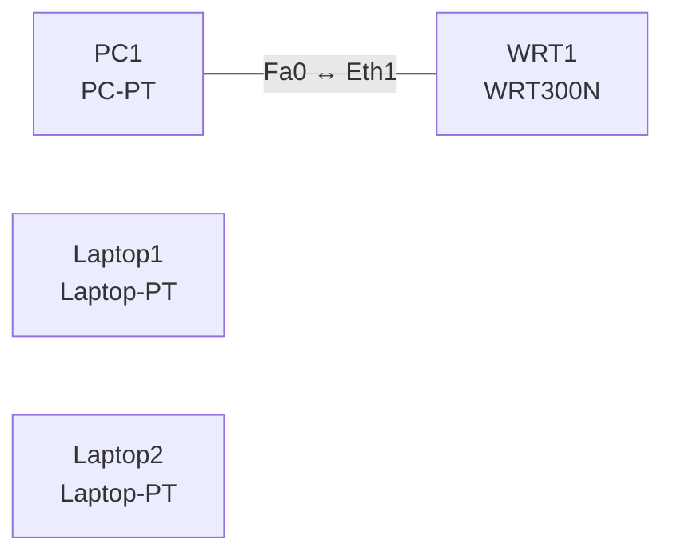

# Lab 12 – WLAN per GUI: SSID, Kanäle, WPA2-PSK und Fehleranalyse

**Dauer:** 75 min · **Niveau:** leicht

Am Wireless-Router (WRT300N) und im WLC-Webinterface konfigurierst du SSID, Kanal, Sicherheitsmodus und Passphrase. In den Analyseaufgaben liest du Einstellungen und findest, warum Clients sich nicht verbinden.

| CCNA-Ziel | Thema |
|---|---|
| 1.11 | Wireless-Grundlagen (Kanäle, SSID, RF, Verschlüsselung) |
| 2.9 | WLAN-GUI-Konfiguration interpretieren |
| 5.9 | Wireless-Sicherheit (WPA, WPA2, WPA3) |
| 5.10 | WLAN mit WPA2-PSK per GUI konfigurieren |

**So arbeitest du:** Teil A = Bauen, Teil B2 = Konfiguration interpretieren, Teil C = Üben. Die Konfigurationsdateien liegen in `build/` (Ausgangszustand zum Einfügen in die CLI), `repair/` (fertig gebaut, mit Fehlern) und `solutions/` (Musterlösung und Fehlerliste, erst nach eigenem Versuch öffnen). Anleitung zum Einfügen: siehe [Arbeiten mit den Dateien](../README.md#arbeiten-mit-den-dateien).

## Topologie

### Geräte

| Gerät | Modell in Packet Tracer | Rolle |
|---|---|---|
| WRT1 | WRT300N | Wireless Router (Kanal 1) |
| PC1 | PC-PT | kabelgebunden |
| Laptop1 | Laptop-PT | WLAN-Client |
| Laptop2 | Laptop-PT | WLAN-Client |

### Verkabelung

| Von | Port | Nach | Port | Kabel |
|---|---|---|---|---|
| PC1 | Fa0 | WRT1 | Eth1 | Copper Straight-Through |

### Adressplan (Ausgangszustand)

| Gerät | Interface | Adresse | Maske | Gateway | DNS |
|---|---|---|---|---|---|
| PC1 | Fa0 (GUI) | DHCP |  |  |  |
| Laptop1 | Fa0 (GUI) | DHCP |  |  |  |
| Laptop2 | Fa0 (GUI) | DHCP |  |  |  |

> **Packet-Tracer-Hinweis:** Laptops brauchen das WLAN-Modul (WPC300N): Gerät ausschalten, Ethernet-Modul ziehen, WPC300N einsetzen, einschalten. WRT300N öffnest du per Klick → GUI → Wireless.

## Teil A – Bauen

1. **Basis.** Verkabeln (PC1 an Eth1), Laptops platzieren. WRT300N: Setup → Basic (IP 192.168.0.1, DHCP aktiv).
2. **WLAN anlegen.** GUI → Wireless → Basic: SSID `LAB-WLAN`, Standard `Mixed`, Kanal 1. Verbinde Laptop1 per Wireless-Dialog. Welche Kanäle überlappen nicht (1/6/11 im 2,4-GHz-Band)?
3. **WPA2-PSK.** Wireless Security: `WPA2 Personal`, Encryption `AES`, Passphrase `Lab#2026wlan`. Laptop neu verbinden. Warum ist AES (CCMP) besser als TKIP, und warum WPA2/WPA3 statt WEP?
4. **SSID-Broadcast** ausschalten: Laptop findet das Netz nicht mehr in der Liste; was bringt das wirklich (kein Schutz, nur Verstecken)?
5. **Zweites Netz.** Zweiter Router (Kanal 3): Welche Störung entsteht (Überlappung), und wie behebst du sie (Kanal 6 oder 11)?
6. **WLC-GUI.** Im WLC (aus Lab 11) *WLANs → Create New*: Profile `Staff`, SSID `LAB-WLAN`, Security Layer 2 `WPA2+AES`, Auth Key Mgmt `PSK`, Interface/VLAN, Status Enabled. Wo stellst du QoS (Platinum/Gold/Silver/Bronze) ein?

## Teil B2 – Konfiguration interpretieren

Diese Aufgaben brauchen keine Geräte: Lies die Einstellungen und beantworte die Frage, klappe dann die Antwort auf.

**1. Laptop findet das WLAN nicht**

| Einstellung | Wert |
|---|---|
| Router | WRT300N |
| SSID | LAB-WLAN |
| SSID-Broadcast | Disabled |
| Standard | Mixed |
| Kanal | 6 |
| Security | WPA2 Personal, AES |

Der Laptop zeigt in der Netzliste `LAB-WLAN` nicht an. Was ist die wahrscheinlichste Ursache, wie verbindest du dich trotzdem?

Antwort

SSID-Broadcast ist aus. Das Netz ist vorhanden, aber nicht in der Liste: SSID manuell eintragen (verstecktes Netz) oder Broadcast aktivieren. Sicherheit gewinnt man dadurch nicht.

**2. Verbindung scheitert nach Passphrase**

| Einstellung | Router | Laptop-Profil |
|---|---|---|
| SSID | LAB-WLAN | LAB-WLAN |
| Security | WPA2-Personal, AES | WPA2-Personal, AES |
| Passphrase | `Lab#2026wlan` | `lab#2026wlan` |

Warum schlägt die Authentifizierung fehl?

Antwort

Die Passphrase unterscheidet sich in Gross-/Kleinschreibung (`L` vs. `l`). PSK ist case-sensitive; aus ihr wird der Schlüssel abgeleitet, der Vier-Wege-Handshake scheitert.

**3. Schlechte Leistung im Büro**

| AP | Kanal | Band | Weite |
|---|---|---|---|
| AP-Eingang | 1 | 2,4 GHz | 20 MHz |
| AP-Mitte | 3 | 2,4 GHz | 20 MHz |
| AP-Hinten | 6 | 2,4 GHz | 20 MHz |

Wo liegt das Problem und wie lautet die Lösung?

Antwort

Kanal 3 überlappt mit 1 und 6 (Co-Channel/Adjacent-Channel-Interferenz). Lösung: nur 1, 6, 11 verwenden, z. B. 1/11/6, oder auf 5 GHz mit mehr nichtüberlappenden Kanälen ausweichen.

**4. WLC-GUI: Clients erhalten keine Adresse im VLAN der Mitarbeiter**

| WLAN-Einstellung | Wert |
|---|---|
| Profile / SSID | Staff / LAB-STAFF |
| Status | Enabled |
| Layer-2-Security | WPA2 + AES |
| Auth Key Mgmt | PSK |
| QoS | Silver |
| Interface/Interface Group | management |

Die Clients landen im Management-Subnetz. Was ist falsch?

Antwort

Dem WLAN ist das Interface `management` zugeordnet statt der dynamischen Schnittstelle des Mitarbeiter-VLANs. Neues Interface (VLAN) anlegen, WLAN darauf abbilden, und der Switch-Trunk zum WLC muss das VLAN führen.

**5. WLC-GUI: Enterprise gewünscht, aber nur eine Passphrase**

| WLAN-Einstellung | Wert |
|---|---|
| Layer-2-Security | WPA2 + AES |
| Auth Key Mgmt | PSK |
| RADIUS-Server | – |

Die Firma will individuelle Zugänge pro Benutzer. Was ändert sich?

Antwort

Auth Key Mgmt von `PSK` auf `802.1X` stellen und einen RADIUS-Server (z. B. ISE) hinterlegen; Clients melden sich mit Benutzernamen/Zertifikat an (WPA2-/WPA3-Enterprise).

## Verifikation

- Laptop1 zeigt `LAB-WLAN`, verbindet mit WPA2-PSK und erhält `192.168.0.x`.
- Falsche Passphrase: Verbindung scheitert (Test).
- Ping Laptop1 → PC1 funktioniert.

## Teil C – Üben

Beantworte zuerst selbst, dann klappe die Antwort auf.

1. Warum 1/6/11 im 2,4-GHz-Band?

Antwort

Kanäle sind 5 MHz breit, ein WLAN belegt 20 MHz (≈ 4–5 Kanäle). 1, 6, 11 überlappen sich nicht.

2. WPA2-Personal vs. Enterprise?

Antwort

Personal: gemeinsamer Pre-Shared Key. Enterprise: individuelle Anmeldung per 802.1X gegen RADIUS.

3. Wofür steht SAE bei WPA3?

Antwort

Simultaneous Authentication of Equals ersetzt den PSK-Handshake, schützt gegen Offline-Wörterbuchangriffe und bietet Forward Secrecy.

4. Was ist ein Rogue AP?

Antwort

Ein nicht autorisierter AP im eigenen Netz oder in der Nähe; WLC/Monitor-Modus kann ihn erkennen.

5. Was bewirkt das QoS-Profil Platinum?

Antwort

Höchste Priorität im Funkbereich, gedacht für Sprache (Voice).

## Prüfungsbezug

2,4 GHz: Kanäle 1, 6, 11 sind nicht überlappend (je 20 MHz), 5 GHz hat mehr Kanäle ohne Überlappung. SSID = Netzname, BSSID = MAC des AP-Radios. WPA2: AES-CCMP; WPA3: SAE statt PSK, PMF Pflicht, 192-Bit-Suite bei Enterprise. Personal = PSK, Enterprise = 802.1X/RADIUS. WLC-WLAN: Layer-2-Security, Auth-Key-Mgmt (PSK/802.1X), Interface-Zuordnung, QoS-Profil, Status.

## Lösungen

- `solutions/<Gerät>.cfg`: Konfiguration zu Teil A (ohne Basis-Adressen)
