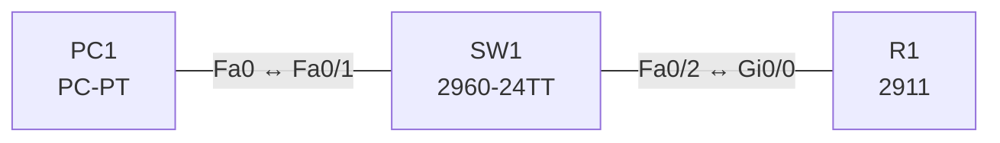

# Lab 13 – Gerätezugriff: lokale Passwörter, Passwortrichtlinie und SSH

**Dauer:** 75 min · **Niveau:** leicht

Router und Switch werden für sicheren Fernzugriff gehärtet: verschlüsselte Passwörter, lokale Benutzer mit `secret`, SSH Version 2 statt Telnet, Mindestlänge, Login-Block und Timeouts. Dazu gehört die Einordnung der Management-Zugänge (Console, Telnet, SSH, HTTP/HTTPS, RADIUS/TACACS+).

| CCNA-Ziel | Thema |
|---|---|
| 5.3 | Gerätezugriff mit lokalen Passwörtern |
| 5.4 | Passwort-Richtlinien (Komplexität, MFA, Zertifikate, Biometrie) |
| 4.8 | SSH für Fernzugriff |
| 2.8 | Verwaltungszugriff (Console, Telnet, SSH, HTTP/HTTPS, TACACS+/RADIUS, Cloud) |

**So arbeitest du:** Teil A = Bauen, Teil B = Reparieren, Teil C = Üben. Die Konfigurationsdateien liegen in `build/` (Ausgangszustand zum Einfügen in die CLI), `repair/` (fertig gebaut, mit Fehlern) und `solutions/` (Musterlösung und Fehlerliste, erst nach eigenem Versuch öffnen). Anleitung zum Einfügen: siehe [Arbeiten mit den Dateien](../README.md#arbeiten-mit-den-dateien).

## Topologie




### Geräte

| Gerät | Modell in Packet Tracer | Rolle |
|---|---|---|
| R1 | 2911 | Router (Zugriff über SSH) |
| SW1 | 2960-24TT | Access-Switch (Management 10.13.1.2) |
| PC1 | PC-PT | Admin-PC |

### Verkabelung

| Von | Port | Nach | Port | Kabel |
|---|---|---|---|---|
| PC1 | Fa0 | SW1 | Fa0/1 | Copper Straight-Through |
| SW1 | Fa0/2 | R1 | Gi0/0 | Copper Straight-Through |

### Adressplan (Ausgangszustand)

| Gerät | Interface | Adresse | Maske | Gateway | DNS |
|---|---|---|---|---|---|
| R1 | Gi0/0 | 10.13.1.1 | 255.255.255.0 | | |
| SW1 | Vlan1 | 10.13.1.2 | 255.255.255.0 | | |
| PC1 | Fa0 (GUI) | 10.13.1.11 | 255.255.255.0 | 10.13.1.1 |  |


> **Packet-Tracer-Hinweis:** Schlüsselerzeugung: `crypto key generate rsa modulus 2048` (Packet Tracer verlangt zuvor `ip domain-name`). SSH-Client am PC: Desktop → Command Prompt → `ssh -l admin 10.13.1.1`.

## Teil A – Bauen

1. **Basis.** Verkabeln, `build/` einfügen. PC1 erhält 10.13.1.11/24. Ping zu R1 und SW1. Testen: `telnet 10.13.1.1` gelingt nicht, weil noch nichts konfiguriert ist (kein vty-Login).
2. **Lokale Passwörter.** `enable secret`, Console-Passwort, `service password-encryption`. Welche Typen (0, 5, 7, 8/9) zeigt `show running-config`? Warum ist `secret` besser als `password`?
3. **Passwortrichtlinie.** `security passwords min-length 10`, `login block-for 60 attempts 3 within 30`, `exec-timeout 5 0` auf vty/console. Welche Elemente einer Passwortrichtlinie fehlen auf dem Gerät (Komplexität, Ablauf, MFA)?
4. **Lokaler Benutzer und SSH.** `username admin privilege 15 secret …`, `ip domain-name lab.local`, `crypto key generate rsa modulus 2048`, `ip ssh version 2`, vty: `login local`, `transport input ssh`. Verbinde PC1 per SSH.
5. **Warum nicht Telnet?** Beobachte im Simulationsmodus den Klartext bei Telnet gegenüber verschlüsseltem SSH.
6. **Banner und Härtung.** `banner motd`, ungenutzte Ports `shutdown`, Management nur aus einem Subnetz (Vorschau auf ACLs). Wo gehören Zertifikate, Biometrie, MFA in das Bild (zentrale Authentisierung, Lab 26)?

## Teil B – Reparieren

Baue die Topologie wie oben (oder behalte deine aus Teil A), setze alle Geräte zurück (`erase startup-config`, `reload` bzw. neues Gerät) und füge dann die Dateien aus `repair/` ein. Es stecken **4 Fehler** drin. Behandle jede Meldung als Ticket: erst Symptom nachstellen, dann Layer für Layer eingrenzen, beheben und beweisen. Ändere nur, was kaputt ist.

**Ticket 1:** `ssh -l admin 10.13.1.1` wird abgelehnt (`Connection refused`), Telnet geht stattdessen.

**Ticket 2:** Die Schlüsselerzeugung scheitert (`Please define a domain-name first`), `show ip ssh` meldet SSH disabled; SSH ist nicht möglich.

**Ticket 3:** SSH baut die Verbindung auf, aber die Anmeldung wird immer abgelehnt (`Access denied`).

**Ticket 4:** Telnet/SSH zeigen `Password required, but none set` und trennen die Verbindung.

## Verifikation

```
show running-config | section line
show ip ssh
show ssh
show users
show login
```
Erwartet: SSH-Verbindung als `admin` gelingt, Telnet wird abgelehnt (`Connection refused`).

## Teil C – Üben

Beantworte zuerst selbst, dann klappe die Antwort auf.

1. Welche Schritte brauchst du für SSH auf einem frischen Router?
<details><summary>Antwort</summary>

Hostname setzen, `ip domain-name`, RSA-Schlüssel erzeugen, `ip ssh version 2`, Benutzer anlegen, `line vty 0 4` → `login local` → `transport input ssh`.

</details>

2. Was ist der Unterschied zwischen `enable password` und `enable secret`?
<details><summary>Antwort</summary>

`secret` speichert einen Hash (Typ 5/8/9), `password` im Klartext bzw. mit schwacher Typ-7-Verschleierung. Hat ein Gerät beides, gilt `secret`.

</details>

3. Wozu `login block-for 60 attempts 3 within 30`?
<details><summary>Antwort</summary>

Nach 3 Fehlversuchen innerhalb 30 s sperrt der Login 60 s; schützt gegen Brute-Force.

</details>

4. Wie gut schützt Typ 7 (service password-encryption)?
<details><summary>Antwort</summary>

Praktisch nicht: Typ 7 ist ein umkehrbares Verschleiern; es hindert nur zufälliges Mitlesen auf dem Bildschirm.

</details>

5. Welche Vorteile bringt MFA, was Zertifikate und Biometrie?
<details><summary>Antwort</summary>

MFA kombiniert mehrere Faktoren (Wissen, Besitz, Merkmal) und erschwert gestohlene Passwörter; Zertifikate beweisen Identität kryptografisch (kein Passwort im Netz); Biometrie nutzt körperliche Merkmale, ist aber nicht widerrufbar.

</details>

## Prüfungsbezug

`enable secret` (Hash Typ 5/8/9) ist stärker als `enable password`; `service password-encryption` verschleiert nur Typ-0-Passwörter (Typ 7, reversibel). SSH braucht Hostname, Domänenname, RSA-Schlüssel, lokale Benutzer/AAA, `transport input ssh`. `login local` nutzt die lokale Benutzerdatenbank. Passwortrichtlinie: Länge, Komplexität, Ablauf, Wiederverwendung, MFA, Zertifikate, Biometrie. Management-Zugänge: Console (lokal), Telnet (Klartext, vermeiden), SSH (verschlüsselt), HTTP/HTTPS, SNMP; zentral: RADIUS/TACACS+.

## Lösungen

- `solutions/<Gerät>.cfg`: Konfiguration zu Teil A (ohne Basis-Adressen)
- `solutions/FAULTS.md`: Fehlerliste zu Teil B (Spoiler!)
