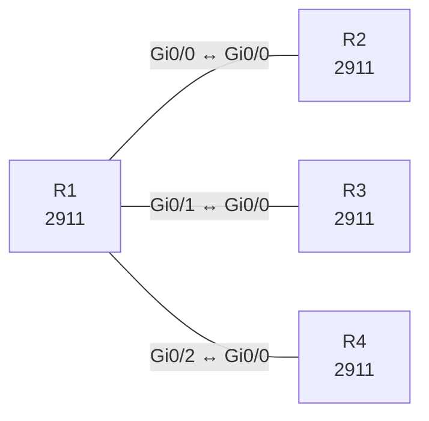

# Lab 14 – Routing-Tabelle lesen und die Weiterleitungsentscheidung vorhersagen

**Dauer:** 75 min · **Niveau:** mittel

R1 hat überlappende Routen (/8, /16, /24, Default) zu drei Nachbarn. Du sagst voraus, welchen Next Hop ein Paket nimmt, prüfst mit `show ip route <Ziel>` und liest Codes, Administrative Distance, Metrik und das Gateway of Last Resort.

| CCNA-Ziel | Thema |
|---|---|
| 3.1 | Routing-Tabelle lesen |
| 3.2 | Weiterleitungsentscheidung (Longest Match, AD, Metrik) |
| 3.3 | Statisches Routing IPv4/IPv6 (Default, Netz, Host, Floating) |

**So arbeitest du:** Teil A = Bauen, Teil B = Reparieren, Teil C = Üben. Die Konfigurationsdateien liegen in `build/` (Ausgangszustand zum Einfügen in die CLI), `repair/` (fertig gebaut, mit Fehlern) und `solutions/` (Musterlösung und Fehlerliste, erst nach eigenem Versuch öffnen). Anleitung zum Einfügen: siehe [Arbeiten mit den Dateien](../README.md#arbeiten-mit-den-dateien).

## Topologie




### Geräte

| Gerät | Modell in Packet Tracer | Rolle |
|---|---|---|
| R1 | 2911 | Zentraler Router |
| R2 | 2911 | Ziel für 10/8 und Default |
| R3 | 2911 | Ziel für 10.1/16 |
| R4 | 2911 | Ziel für 10.1.1/24 |

### Verkabelung

| Von | Port | Nach | Port | Kabel |
|---|---|---|---|---|
| R1 | Gi0/0 | R2 | Gi0/0 | Copper Cross-Over |
| R1 | Gi0/1 | R3 | Gi0/0 | Copper Cross-Over |
| R1 | Gi0/2 | R4 | Gi0/0 | Copper Cross-Over |

### Adressplan (Ausgangszustand)

| Gerät | Interface | Adresse | Maske | Gateway | DNS |
|---|---|---|---|---|---|
| R1 | Gi0/0 | 192.168.14.1 | 255.255.255.252 | | |
| R1 | Gi0/1 | 192.168.14.5 | 255.255.255.252 | | |
| R1 | Gi0/2 | 192.168.14.9 | 255.255.255.252 | | |
| R2 | Gi0/0 | 192.168.14.2 | 255.255.255.252 | | |
| R2 | Loopback0 | 10.9.9.9 | 255.255.255.255 | | |
| R2 | Loopback1 | 8.8.8.8 | 255.255.255.255 | | |
| R3 | Gi0/0 | 192.168.14.6 | 255.255.255.252 | | |
| R3 | Loopback0 | 10.1.5.5 | 255.255.255.255 | | |
| R4 | Gi0/0 | 192.168.14.10 | 255.255.255.252 | | |
| R4 | Loopback0 | 10.1.1.1 | 255.255.255.255 | | |


## Teil A – Bauen

1. **Basis.** Verkabeln, `build/` einfügen. Die Nachbarn R2–R4 haben je eine Loopback und einen Default zurück zu R1. Auf R1: `show ip route`. Was sind die Codes `C` und `L`?
2. **Statische Routen auf R1.** `ip route 10.0.0.0 255.0.0.0 192.168.14.2`, `10.1.0.0/16 → 192.168.14.6`, `10.1.1.0/24 → 192.168.14.10`, `0.0.0.0/0 → 192.168.14.2`. Lies die Einträge: `S [1/0] via …`, was bedeuten `1` und `0` (AD/Metrik)?
3. **Vorhersage.** Für jede Zieladresse notierst du den Next Hop, bevor du pingst: 10.1.1.1 – 10.1.5.5 – 10.9.9.9 – 8.8.8.8 – 172.16.0.1 (Default). Prüfe mit `show ip route 10.1.1.1` und per `traceroute`.
4. **Regel.** Formuliere die Regeln: erst längster Präfix (Longest Match), bei gleicher Länge niedrigste AD, dann niedrigste Metrik. Was passiert bei zwei Routen gleicher Länge, AD und Metrik (ECMP)?
5. **AD-Tabelle.** Ordne: Connected 0, Static 1, EIGRP 90, OSPF 110, RIP 120, External EIGRP 170, iBGP 200.
6. **Gateway of Last Resort.** Wann zeigt die Tabelle `Gateway of last resort is … to network 0.0.0.0`? Entferne den Default und prüfe das Verhalten für 172.16.0.1 (`Destination net unreachable`).

## Teil B – Reparieren

Baue die Topologie wie oben (oder behalte deine aus Teil A), setze alle Geräte zurück (`erase startup-config`, `reload` bzw. neues Gerät) und füge dann die Dateien aus `repair/` ein. Es stecken **4 Fehler** drin. Behandle jede Meldung als Ticket: erst Symptom nachstellen, dann Layer für Layer eingrenzen, beheben und beweisen. Ändere nur, was kaputt ist.

**Ticket 1:** Ping 10.1.1.1 scheitert; `traceroute` endet an R3, das die Adresse nicht kennt (oder zurückgibt).

**Ticket 2:** 10.1.5.5 landet nicht bei R3 sondern über /8 bei R2; `show ip route 10.1.5.5` zeigt 10.0.0.0/8.

**Ticket 3:** R1 kann 10.1.5.5 anpingen, bekommt aber keine Antwort (R3 kennt den Rückweg nicht).

**Ticket 4:** 8.8.8.8 und 172.16.0.1 erreichen R2 nicht; `show ip route` zeigt den Default via R4.

## Verifikation

```
show ip route
show ip route 10.1.1.1
show ip route static
traceroute 10.1.5.5
```
Erwartet: 10.1.1.1 über R4 (/24), 10.1.5.5 über R3 (/16), 10.9.9.9 über R2 (/8), 8.8.8.8 über Default (R2).

## Teil C – Üben

Beantworte zuerst selbst, dann klappe die Antwort auf.

1. Routen: 10.0.0.0/8 (S), 10.1.0.0/16 (OSPF), 10.1.1.0/24 (RIP). Wohin geht ein Paket an 10.1.1.9?
<details><summary>Antwort</summary>

Zur /24-Route über RIP: Der längste Präfix gewinnt, AD ist irrelevant.

</details>

2. Wie unterscheiden sich AD und Metrik?
<details><summary>Antwort</summary>

AD bewertet die Vertrauenswürdigkeit der Quelle (zwischen Protokollen), die Metrik die Güte eines Pfads innerhalb eines Protokolls.

</details>

3. Was bedeuten `S*` und `0.0.0.0/0`?
<details><summary>Antwort</summary>

Eine statische Default-Route (Kandidat für das Gateway of Last Resort).

</details>

4. Was passiert ohne passende Route?
<details><summary>Antwort</summary>

Das Paket wird verworfen, der Router sendet ICMP `Destination Unreachable`.

</details>

5. Wie liest du `O 10.2.0.0/16 [110/20] via 10.0.0.2, 00:03:10, Gi0/1`?
<details><summary>Antwort</summary>

OSPF-Route zu 10.2.0.0/16, AD 110, Metrik (Kosten) 20, Next Hop 10.0.0.2, seit 3 min 10 s, Ausgang Gi0/1.

</details>

## Prüfungsbezug

Routingtabelle: Code (C, L, S, O, D, B), Präfix/Maske, `[AD/Metrik]`, Next Hop, Ausgangsinterface, Alter. Entscheidung: 1) längster passender Präfix, 2) niedrigste AD zwischen Protokollen, 3) niedrigste Metrik innerhalb eines Protokolls. Connected = 0, Static = 1, eBGP 20, EIGRP 90, OSPF 110, RIP 120, iBGP 200. Default-Route 0.0.0.0/0 (Gateway of Last Resort, Flag `*`).

## Lösungen

- `solutions/<Gerät>.cfg`: Konfiguration zu Teil A (ohne Basis-Adressen)
- `solutions/FAULTS.md`: Fehlerliste zu Teil B (Spoiler!)
