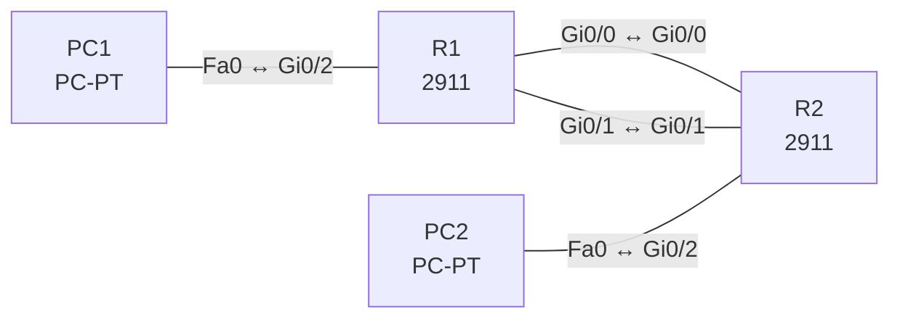

# Lab 15 – Statisches Routing: Default, Netz, Host, Floating (IPv4 und IPv6)

**Dauer:** 90 min · **Niveau:** mittel

Zwei Standorte sind über einen primären und einen Backup-Link verbunden. Du baust Netz-, Host- und Default-Routen, eine Floating Static Route mit höherer AD und das IPv6-Pendant, und testest den Failover.

**Lernziele:** Nach diesem Lab kannst du …

- Netz-, Host- und Default-Routen für IPv4 und IPv6 konfigurieren.
- Eine Floating Static Route als Backup einrichten und den Failover testen.
- Die Grenzen statischer Routen ohne Tracking erklären.

| CCNA-Ziel | Thema |
|---|---|
| 3.3 | Statisches Routing IPv4/IPv6 (Default, Netz, Host, Floating) |
| 3.1 | Routing-Tabelle lesen |

**So arbeitest du:** Teil A = Bauen, Teil B = Reparieren, Teil C = Üben. Die Konfigurationsdateien liegen in `build/` (Ausgangszustand zum Einfügen in die CLI), `repair/` (fertig gebaut, mit Fehlern) und `solutions/` (Musterlösung und Fehlerliste, erst nach eigenem Versuch öffnen). Anleitung zum Einfügen: siehe [Arbeiten mit den Dateien](../README.md#arbeiten-mit-den-dateien).

## Topologie



Primär: Gi0/0 (10.15.12.0/30), Backup: Gi0/1 (10.15.12.4/30). IPv6-Spiegel: 2001:db8:15:12::/64 (primär) und 2001:db8:15:13::/64 (Backup).

### Geräte

| Gerät | Modell in Packet Tracer | Rolle |
|---|---|---|
| R1 | 2911 | Standort A |
| R2 | 2911 | Standort B |
| PC1 | PC-PT | LAN A |
| PC2 | PC-PT | LAN B |

### Verkabelung

| Von | Port | Nach | Port | Kabel |
|---|---|---|---|---|
| R1 | Gi0/0 | R2 | Gi0/0 | Copper Cross-Over |
| R1 | Gi0/1 | R2 | Gi0/1 | Copper Cross-Over |
| PC1 | Fa0 | R1 | Gi0/2 | Copper Cross-Over |
| PC2 | Fa0 | R2 | Gi0/2 | Copper Cross-Over |

### Adressplan (Ausgangszustand)

| Gerät | Interface | Adresse | Maske | Gateway | DNS |
|---|---|---|---|---|---|
| R1 | Gi0/0 | 10.15.12.1 | 255.255.255.252 | | |
| R1 | Gi0/1 | 10.15.12.5 | 255.255.255.252 | | |
| R1 | Gi0/2 | 192.168.15.1 | 255.255.255.0 | | |
| R2 | Gi0/0 | 10.15.12.2 | 255.255.255.252 | | |
| R2 | Gi0/1 | 10.15.12.6 | 255.255.255.252 | | |
| R2 | Gi0/2 | 172.16.20.1 | 255.255.255.0 | | |
| PC1 | Fa0 (GUI) | 192.168.15.11 | 255.255.255.0 | 192.168.15.1 |  |
| PC2 | Fa0 (GUI) | 172.16.20.11 | 255.255.255.0 | 172.16.20.1 |  |

| Gerät | Interface | IPv6 |
|---|---|---|
| R1 | Gi0/0 / Gi0/1 / Gi0/2 | 2001:db8:15:12::1/64 · 2001:db8:15:13::1/64 · 2001:db8:15:1::1/64 |
| R2 | Gi0/0 / Gi0/1 / Gi0/2 | 2001:db8:15:12::2/64 · 2001:db8:15:13::2/64 · 2001:db8:15:2::1/64 |

## Teil A – Bauen

Arbeite die Schritte der Reihe nach ab. Jeder Schritt sagt dir, was du tust, woran du den Erfolg erkennst (**Prüfen**) und worüber du nachdenken sollst (**Denkfrage**). Die Antworten auf die Denkfragen stehen am Ende von Teil A.

1. **Basis.** Verkabeln, `build/` einfügen und die PCs einstellen.
   - **Prüfen:** PC1 pingt PC2 noch nicht.
   - **Denkfrage:** Warum nicht?
2. **Netzrouten.** R1: `ip route 172.16.20.0 255.255.255.0 10.15.12.2`. R2: `ip route 192.168.15.0 255.255.255.0 10.15.12.1`.
   - **Prüfen:** PC1 pingt PC2.
   - **Denkfrage:** Was ist bei Ethernet der Unterschied zwischen Next Hop und Ausgangsinterface in der Route?
3. **Floating Static.** Lege eine zweite Route über den Backup-Link mit AD 200 an: auf R1 `ip route 172.16.20.0 255.255.255.0 10.15.12.6 200`, auf R2 entsprechend über 10.15.12.5.
   - **Prüfen:** `show ip route` zeigt nur die Route mit AD 1. Schalte Gi0/0 auf R1 ab: Jetzt erscheint die Route mit `[200/0]`.
   - **Denkfrage:** Wie schnell schaltet das um, und wovon hängt es ab?
4. **Hostroute.** Leite einen einzelnen Server über den Backup-Link: `ip route 172.16.20.99 255.255.255.255 10.15.12.6`.
   - **Prüfen:** `show ip route 172.16.20.99` zeigt die /32-Route, alle anderen Ziele in 172.16.20.0/24 gehen weiter über den Hauptlink.
5. **Default.** Setze auf R1 `ip route 0.0.0.0 0.0.0.0 10.15.12.2`.
   - **Denkfrage:** Wann ist eine Default-Route am Standort sinnvoll?
6. **IPv6.** `ipv6 unicast-routing`, Adressen nach Tabelle, dann `ipv6 route 2001:db8:15:2::/64 2001:db8:15:12::2` und eine Floating Route mit AD 200 über den Backup-Link.
   - **Prüfen:** PC1 pingt PC2 per IPv6.
   - **Denkfrage:** Was ist in der Syntax anders als bei IPv4?

<details><summary>Antworten zu den Denkfragen</summary>

- **Zu 1:** Jeder Router kennt nur seine direkt verbundenen Netze. Das LAN des anderen Standorts fehlt in der Tabelle.
- **Zu 2:** Mit Next Hop löst der Router nur die MAC des Nachbarn per ARP auf. Mit reinem Ausgangsinterface hält er jedes Ziel für direkt erreichbar und fragt für jede Zieladresse per ARP, das klappt nur mit Proxy-ARP beim Nachbarn. Am besten gibst du den Next Hop an.
- **Zu 3:** Sobald das Interface down geht, verschwindet die Hauptroute, und die Floating Route rückt sofort nach. Bleibt das Interface aber up, während dahinter etwas ausfällt, merkt die statische Route nichts.
- **Zu 5:** An einem Standort mit nur einem Weg nach draußen (Stub). Dann braucht er keine einzelnen Routen für alle fremden Netze.
- **Zu 6:** Präfixlänge statt Maske (`/64`), und Next Hop ist eine IPv6-Adresse. `ipv6 unicast-routing` muss an sein.

</details>

## Teil B – Reparieren

Baue die Topologie wie oben (oder behalte deine aus Teil A), setze alle Geräte zurück (`erase startup-config`, `reload` bzw. neues Gerät) und füge dann die Dateien aus `repair/` ein. Es stecken **4 Fehler** drin. Behandle jede Meldung als Ticket: erst Symptom nachstellen, dann Layer für Layer eingrenzen, beheben und beweisen. Ändere nur, was kaputt ist.

**Ticket 1:** Der Backup-Link wird bereits im Normalbetrieb mitbenutzt (`show ip route` zeigt zwei Pfade, Last wird verteilt), obwohl er nur Reserve sein soll.

**Ticket 2:** PC1 pingt PC2, bekommt aber keine Antwort.

**Ticket 3:** IPv4 funktioniert, IPv6 nicht: PC1 und PC2 können sich per IPv6 nicht erreichen, `show ipv6 route` ist leer.

**Ticket 4:** IPv6-Ping von PC2 nach PC1 scheitert, IPv4 geht.

## Verifikation

```
show ip route static
show ip route 172.16.20.0
show ipv6 route static
ping 172.16.20.11
tracert 172.16.20.11     ! am PC
```

| Prüfung | Das solltest du sehen |
|---|---|
| `show ip route 172.16.20.0` im Normalbetrieb | genau eine Route mit `[1/0]` über den Hauptlink |
| dasselbe bei Ausfall des Hauptlinks | die Route mit `[200/0]` über den Backup-Link |
| `show ipv6 route static` | Route zu 2001:db8:15:2::/64 |

## Teil C – Üben

Beantworte zuerst selbst, dann klappe die Antwort auf.

1. Warum zeigt `show ip route` die Floating Route nicht an?
<details><summary>Antwort</summary>

**Weil es zum selben Ziel eine Route mit kleinerer AD gibt.** In die Tabelle kommt nur die beste. Die Floating Route rückt erst nach, wenn die bessere verschwindet.

</details>

2. Was spricht gegen nur ein Ausgangsinterface in einer statischen Route auf Ethernet?
<details><summary>Antwort</summary>

**Der Router muss dann jede Zieladresse per ARP auflösen.** Das klappt nur, wenn der Nachbar Proxy-ARP macht, und füllt die ARP-Tabelle. Besser den Next Hop angeben oder beides.

</details>

3. Wie lautet die IPv6-Default-Route?
<details><summary>Antwort</summary>

**`ipv6 route ::/0 <Next-Hop>`.**

</details>

4. Wann nutzt man eine Hostroute?
<details><summary>Antwort</summary>

**Wenn ein einzelnes System einen anderen Weg nehmen soll.** Zum Beispiel ein Management-Server, die Loopback eines Nachbarn oder eine Blackhole-Route für eine einzelne Adresse.

</details>

5. Warum greift der Failover nicht, wenn der Link nur Pakete verliert?
<details><summary>Antwort</summary>

**Weil eine statische Route nur auf den Interface-Status achtet.** Solange das Interface up ist, bleibt sie aktiv. Erst mit IP SLA und Tracking merkt der Router, dass der Next Hop nicht antwortet.

</details>

## Prüfungsbezug

- `ip route <Netz> <Maske> <Next-Hop oder Interface> [AD]`.
- Floating Static: höhere AD als die Hauptroute (z. B. 200 gegen OSPF 110), aktiv nur, wenn die bessere verschwindet.
- Hostroute /32, Default 0.0.0.0/0. IPv6: `ipv6 route <Präfix/Länge> <Next-Hop> [AD]`, `ipv6 unicast-routing` ist Pflicht.
- Nur Ausgangsinterface auf Ethernet → ARP für jedes Ziel.

## Lösungen

- `solutions/<Gerät>.cfg`: Konfiguration zu Teil A (ohne Basis-Adressen)
- `solutions/FAULTS.md`: Fehlerliste zu Teil B (Spoiler!)
