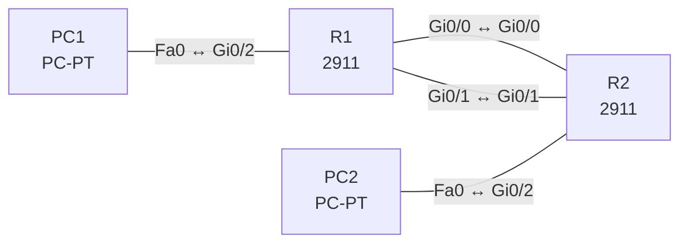

# Lab 15 – Statisches Routing: Default, Netz, Host, Floating (IPv4 und IPv6)

**Dauer:** 90 min · **Niveau:** mittel

Zwei Standorte sind über einen primären und einen Backup-Link verbunden. Du baust Netz-, Host- und Default-Routen, eine Floating Static Route mit höherer AD und das IPv6-Pendant, und testest den Failover.

| CCNA-Ziel | Thema |
|---|---|
| 3.3 | Statisches Routing IPv4/IPv6 (Default, Netz, Host, Floating) |
| 3.1 | Routing-Tabelle lesen |

**So arbeitest du:** Teil A = Bauen, Teil B = Reparieren, Teil C = Üben. Die Konfigurationsdateien liegen in `build/` (Ausgangszustand zum Einfügen in die CLI), `repair/` (fertig gebaut, mit Fehlern) und `solutions/` (Musterlösung und Fehlerliste, erst nach eigenem Versuch öffnen). Anleitung zum Einfügen: siehe [Arbeiten mit den Dateien](../README.md#arbeiten-mit-den-dateien).

## Topologie



Primär: Gi0/0 (10.15.12.0/30), Backup: Gi0/1 (10.15.12.4/30). IPv6-Spiegel: 2001:db8:15:12::/64 (primär) und 2001:db8:15:13::/64 (Backup).

### Geräte

| Gerät | Modell in Packet Tracer | Rolle |
|---|---|---|
| R1 | 2911 | Standort A |
| R2 | 2911 | Standort B |
| PC1 | PC-PT | LAN A |
| PC2 | PC-PT | LAN B |

### Verkabelung

| Von | Port | Nach | Port | Kabel |
|---|---|---|---|---|
| R1 | Gi0/0 | R2 | Gi0/0 | Copper Cross-Over |
| R1 | Gi0/1 | R2 | Gi0/1 | Copper Cross-Over |
| PC1 | Fa0 | R1 | Gi0/2 | Copper Cross-Over |
| PC2 | Fa0 | R2 | Gi0/2 | Copper Cross-Over |

### Adressplan (Ausgangszustand)

| Gerät | Interface | Adresse | Maske | Gateway | DNS |
|---|---|---|---|---|---|
| R1 | Gi0/0 | 10.15.12.1 | 255.255.255.252 | | |
| R1 | Gi0/1 | 10.15.12.5 | 255.255.255.252 | | |
| R1 | Gi0/2 | 192.168.15.1 | 255.255.255.0 | | |
| R2 | Gi0/0 | 10.15.12.2 | 255.255.255.252 | | |
| R2 | Gi0/1 | 10.15.12.6 | 255.255.255.252 | | |
| R2 | Gi0/2 | 172.16.20.1 | 255.255.255.0 | | |
| PC1 | Fa0 (GUI) | 192.168.15.11 | 255.255.255.0 | 192.168.15.1 |  |
| PC2 | Fa0 (GUI) | 172.16.20.11 | 255.255.255.0 | 172.16.20.1 |  |

| Gerät | Interface | IPv6 |
|---|---|---|
| R1 | Gi0/0 / Gi0/1 / Gi0/2 | 2001:db8:15:12::1/64 · 2001:db8:15:13::1/64 · 2001:db8:15:1::1/64 |
| R2 | Gi0/0 / Gi0/1 / Gi0/2 | 2001:db8:15:12::2/64 · 2001:db8:15:13::2/64 · 2001:db8:15:2::1/64 |

## Teil A – Bauen

1. **Basis.** Verkabeln, `build/` einfügen, PCs setzen. Pingen PC1 → PC2? Warum noch nicht (keine Routen)?
2. **Netzrouten.** R1: `ip route 172.16.20.0 255.255.255.0 10.15.12.2`, R2: `ip route 192.168.15.0 255.255.255.0 10.15.12.1`. Ping testen. Next Hop oder Ausgangsinterface: Welcher Unterschied bei Ethernet (ARP pro Ziel vs. Next-Hop)?
3. **Floating Static.** Zweite Route mit Backup-Next-Hop und AD 200: `ip route 172.16.20.0 255.255.255.0 10.15.12.6 200` (R1) bzw. `… 10.15.12.5 200` (R2). `show ip route` zeigt nur die AD-1-Route. Ziehe das primäre Kabel (oder `shutdown` Gi0/0): Die Backup-Route erscheint. Dauer der Umschaltung?
4. **Hostroute.** `ip route 172.16.20.99 255.255.255.255 10.15.12.6` auf R1 leitet einen einzelnen Server über den Backup-Link. Longest Match!
5. **Default.** R1: `ip route 0.0.0.0 0.0.0.0 10.15.12.2`. Wann ist ein Default am Stub-Standort sinnvoll?
6. **IPv6.** `ipv6 unicast-routing`, Adressen laut Tabelle, `ipv6 route 2001:db8:15:2::/64 2001:db8:15:12::2` und Floating mit AD 200 über …:13::2. Wie unterscheidet sich die Syntax (Präfixlänge statt Maske)?

## Teil B – Reparieren

Baue die Topologie wie oben (oder behalte deine aus Teil A), setze alle Geräte zurück (`erase startup-config`, `reload` bzw. neues Gerät) und füge dann die Dateien aus `repair/` ein. Es stecken **4 Fehler** drin. Behandle jede Meldung als Ticket: erst Symptom nachstellen, dann Layer für Layer eingrenzen, beheben und beweisen. Ändere nur, was kaputt ist.

**Ticket 1:** Der Backup-Link wird bereits im Normalbetrieb mitbenutzt (`show ip route` zeigt zwei Pfade, Last wird verteilt), obwohl er nur Reserve sein soll.

**Ticket 2:** PC1 pingt PC2, bekommt aber keine Antwort.

**Ticket 3:** IPv4 funktioniert, IPv6 nicht: PC1 und PC2 können sich per IPv6 nicht erreichen, `show ipv6 route` ist leer.

**Ticket 4:** IPv6-Ping von PC2 nach PC1 scheitert, IPv4 geht.

## Verifikation

```
show ip route static
show ip route 172.16.20.0
show ipv6 route static
ping 172.16.20.11
tracert 172.16.20.11     (am PC)
```
Erwartet: Route mit `[1/0]` aktiv, Backup `[200/0]` nur bei Link-Ausfall.

## Teil C – Üben

Beantworte zuerst selbst, dann klappe die Antwort auf.

1. Wieso zeigt `show ip route` die Floating Route nicht?
<details><summary>Antwort</summary>

Weil die bessere AD (1) bereits eine Route zum Ziel stellt; die Backup-Route (200) erscheint erst, wenn die bessere Route entfällt.

</details>

2. Was spricht gegen ein statisches Ausgangsinterface auf einem Ethernet-Link?
<details><summary>Antwort</summary>

Der Router muss jede Zieladresse per ARP auflösen (Proxy-ARP des Nachbarn nötig), das belastet. Besser Next-Hop oder beides.

</details>

3. Wie heisst die IPv6-Default-Route?
<details><summary>Antwort</summary>

`ipv6 route ::/0 <Next-Hop>`.

</details>

4. Wann nutzt man eine Hostroute?
<details><summary>Antwort</summary>

Für einzelne Systeme, die einen abweichenden Pfad brauchen (z. B. Verwaltungsserver, Blackhole, Loopback eines Nachbarn).

</details>

5. Warum fällt der Failover aus, wenn der Link nicht down geht, sondern nur Pakete verliert?
<details><summary>Antwort</summary>

Statische Routen kennen nur den Interface-Status. Ohne IP SLA/Tracking bleibt die Route aktiv, obwohl der Next Hop nicht antwortet.

</details>

## Prüfungsbezug

Statische Route: `ip route <Netz> <Maske> <Next-Hop | Interface> [AD]`. Floating: AD höher als die des Haupt-Protokolls (z. B. 200 gegen OSPF 110) tritt nur ein, wenn die bessere Route verschwindet. Hostroute: /32, Default: 0.0.0.0/0, IPv6: `ipv6 route <Präfix/Länge> <Next-Hop> [AD]`, `ipv6 unicast-routing` zwingend. Bei Ethernet-Ausgangsinterface ohne Next-Hop erfolgt ARP für jedes Ziel (unnötig).

## Lösungen

- `solutions/<Gerät>.cfg`: Konfiguration zu Teil A (ohne Basis-Adressen)
- `solutions/FAULTS.md`: Fehlerliste zu Teil B (Spoiler!)
